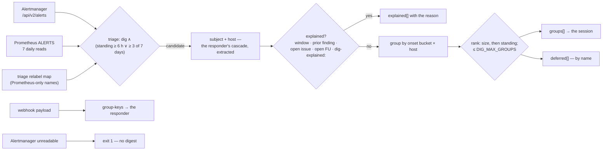

# deep-dig-select.sh select · group-keys — what the dig looks at, and one story per group

The deterministic half of the [deep dig](../../../../docs/glossary.md) (ADR-148 (3)): the model
never decides what it looks at. `select` reads Alertmanager and seven daily Prometheus reads,
keeps the `triage: dig` alerts that STOOD or RECURRED, records (and skips) what something already
explains, groups the rest by onset and host, and emits one `deep-dig-digest/v1` document the dig
session is briefed with. `group-keys` applies the SAME grouping to one Alertmanager webhook
payload for the responder, so the two lanes cannot drift. Script:
[`agents/deep-dig-select.sh`](../../../deep-dig-select.sh); run daily 03:30Z by
[`agents/coordinator/deep-dig-argo.yaml`](../../../coordinator/deep-dig-argo.yaml). Owning prose:
[`docs/agents/roles.md`](../../../../docs/agents/roles.md) §deep dig. Terms: [glossary.md](glossary.md).

```
bash agents/deep-dig-select.sh select [--out /tmp/dig.json]
bash agents/deep-dig-select.sh group-keys < payload.json
```

## Interface — the machine half

**[`dig-digest.schema.json`](dig-digest.schema.json)** holds the digest, its params, the
`group-keys` line and the exit codes. Seams: `DIG_AM_FILE`, `DIG_PROM_DAY_DIR`, `DIG_WINDOW_FILE`,
`DIG_PRIOR_FILE`, `DIG_NOW`, `DIG_REPO`, a `gh` on `PATH`.

| Requirement | Governs (schema) | Exit | Status |
|---|---|---|---|
| [INTAKE-DIG-CANDIDATE](#intake-dig-candidate) | `$defs/alert`, `params` | — | 🚧 WIP — no evidence pipeline yet (fixture: `deep-dig-test.sh` §candidates) |
| [INTAKE-DIG-EXPLAINED](#intake-dig-explained) | `explained[]`, `windows[]` | — | 🚧 WIP — no evidence pipeline yet (fixture: `deep-dig-test.sh` §explained) |
| [INTAKE-DIG-GROUP](#intake-dig-group) | `groups[]`, `deferred[]`, `$defs/group_keys_line` | — | 🚧 WIP — no evidence pipeline yet (fixture: `deep-dig-test.sh` §grouping; `responder-behaviour-test.sh` §ONE SESSION PER GROUP) |
| [INTAKE-DIG-PROBE](#intake-dig-probe) | `schema`, `exit` | 1 = no digest | 🚧 WIP — no evidence pipeline yet (fixture: `deep-dig-test.sh` §rule #6) |

## Flow overview



## Requirement index

| Requirement | Section | Status |
|---|---|---|
| [INTAKE-DIG-CANDIDATE](#intake-dig-candidate) | standing or recurring, and only `dig` | 🚧 WIP — no evidence pipeline yet (fixture: `deep-dig-test.sh` §candidates) |
| [INTAKE-DIG-EXPLAINED](#intake-dig-explained) | what already owns the condition | 🚧 WIP — no evidence pipeline yet (fixture: `deep-dig-test.sh` §explained) |
| [INTAKE-DIG-GROUP](#intake-dig-group) | onset × host, for both lanes | 🚧 WIP — no evidence pipeline yet (fixture: `deep-dig-test.sh` §grouping) |
| [INTAKE-DIG-PROBE](#intake-dig-probe) | unreadable reads fail safe | 🚧 WIP — no evidence pipeline yet (fixture: `deep-dig-test.sh` §rule #6) |

## INTAKE-DIG-CANDIDATE

A candidate is an alert whose [triage label](../../../../docs/glossary.md) is `dig` and that has
either STOOD — firing on Alertmanager for ≥ `DIG_STANDING_H` (6) hours — or RECURRED: present in
Prometheus's `ALERTS{alertstate="firing"}` on ≥ `DIG_RECUR_DAYS` (3) of the last `DIG_LOOKBACK_D`
(7) days, firing now or quiet. A quiet recurring name has no `triage` label in Prometheus (the
relabel map adds it at send time), so its triage is resolved from
`argocd/platform/values/kube-prometheus-stack-triage.yaml` exactly as Alertmanager would see it —
severity-specific lines first. `triage: now` is the responder's however long it stands; `none` and
an unlabelled stack rule are nobody's. `Watchdog` and `InfoInhibitor` never qualify. Each candidate
carries its subject and host (the responder's cascade), standing hours, days present, labels and
annotations — the rule author's runbook hints ride into the brief.

**World: [dig-clock](worlds/README.md#harness-worlds--a-pinned-clock-and-file-seams)**.

#### Which alerts are candidates

Legend: `triage` = the alert's label (or the map's answer — `map:dig`); `firing` = firing now;
`standing_h` = hours since `startsAt`; `days_present` = days of 7 in `ALERTS`; `candidate?`;
`host?` = the digest's host for it.

| description | world | triage | firing | standing_h | days_present | fixture | candidate? | host? |
|---|---|---|---|---|---|---|---|---|
| a dig alert standing 8 h | dig-clock | `dig` | yes | `8` | `0` | `deep-dig-test.sh` "a dig alert standing 8h" | `yes` | `cluster` (a kube-state-metrics alert — never the exporter's pod IP) |
| a dig alert standing 2 h is too early | dig-clock | `dig` | yes | `2` | `0` | `deep-dig-test.sh` "standing 2h" | `no` | — |
| `now` is the responder's however long it stands | dig-clock | `now` | yes | `8` | `0` | `deep-dig-test.sh` "triage:now" | `no` | — |
| recurrence counts while quiet ⚖ | dig-clock | `dig` | no | — | `3` | `deep-dig-test.sh` "3 of 7 days" | `yes` (onset `recurring`) | `192.168.2.51` (instance, port stripped) |
| two days is not recurring | dig-clock | `dig` | no | — | `2` | `deep-dig-test.sh` "2 of 7 days" | `no` | — |
| a stock name resolves through the relabel map | dig-clock | `map:dig` | no | — | `3` | `deep-dig-test.sh` "upstream name" | `yes` (`KubeNodeNotReady`) | `wk-03` (node label) |
| the map can say `none` | dig-clock | `map:none` | no | — | `3` | `deep-dig-test.sh` "classifies 'none'" | `no` | — |
| a stack rule with no triage anywhere is nobody's ⚖ | dig-clock | (none) | no | — | `3` | `deep-dig-test.sh` "no triage anywhere" | `no` | — |

<details markdown="1"><summary>Evidence — latest run</summary>

--8<-- "INTAKE-DIG-CANDIDATE.md"

</details>

## INTAKE-DIG-EXPLAINED

A candidate something already owns is dropped from the groups and RECORDED in `explained[]` with
the reason, so the session reads the record instead of re-deriving it. The ledger, cheapest first:
a [declared window](../../../../docs/glossary.md) naming the alert that is live for triage (its
`until`, or a closed window's `tail_until`); a prior dig finding for the same (alert, subject)
within `DIG_REDIG_DAYS` (7) — keyed on the finding's `members` stamped by the harvest, with the
pre-stamp `alerts` strings as the fallback; an OPEN issue anywhere in the org whose title names the
alert and whose title or body names its object (a per-class `alert:<name>` subject: the title
alone); an OPEN follow-up item naming the alert; an explicit `dig-explained: <Alert>[, …] — <reason>`
line in the seat's meta-state. A prior `cause-found` / `fix-proposed` explains only the EPISODE it
saw — an alert firing in an episode that started after the finding is news (a fix was expected and
the condition is back) ⚖; an `explained` or `unexplained` prior keeps the full window, so a known
nightly condition is not re-dug per night. A window that has lapsed explains nothing but rides
`windows[]` as onset history, bounded by the lookback. A bare meta-state mention explains nothing
(the seat lists every standing alert at wind-down — 2026-10-12: a standing alert hid itself by
being standing).

**World: [dig-clock](worlds/README.md#harness-worlds--a-pinned-clock-and-file-seams)**, one
`dig` candidate standing 8 h unless the row says otherwise.

#### What explains a candidate

Legend: `record` = the thing present in the world; `explained_by?` = the digest's `explained_by`
(`—` = the candidate stays unexplained).

| description | world | record | fixture | explained_by? |
|---|---|---|---|---|
| a live declared window naming it | dig-clock | window `wk-03-1`, live, names the alert | `deep-dig-test.sh` "a declared window naming the alert" | `window wk-03-1 (…)` |
| an expired window explains nothing, but rides as history | dig-clock | window `wk-03-old`, lapsed | `deep-dig-test.sh` "an EXPIRED window" | — (`windows[]` holds `wk-03-old`) |
| a closed window in its tail still owns what it named | dig-clock | window `wk-03-closed`, closed, inside `tail_until` | `deep-dig-test.sh` "a CLOSED window still in its tail" | `window wk-03-closed (…)` |
| an open issue whose title names the alert, org-wide | dig-clock | `homelab#2101` open, title names alert + object | `deep-dig-test.sh` "an OPEN issue whose title names the alert" | `issue teststuffstash/homelab#2101` |
| the same alert on another object is a different record | dig-clock | an open issue, same alert, other object | `deep-dig-test.sh` "SAME alert on ANOTHER object" | — |
| a per-class subject is explained by the title alone | dig-clock | `homelab#2060`, subject `alert:<name>` | `deep-dig-test.sh` "per-class subject" | `issue teststuffstash/homelab#2060` |
| an open follow-up naming the alert, by id | dig-clock | `FU-302` open, names it | `deep-dig-test.sh` "an OPEN follow-up item" | `follow-up FU-302` |
| a closed follow-up explains nothing | dig-clock | a `- [x]` item names it | `deep-dig-test.sh` "a CLOSED item" | — |
| an explicit `dig-explained:` marker, reason carried | dig-clock | `dig-explained: <Alert> — clears when PR#1963 merges.` | `deep-dig-test.sh` "an explicit dig-explained marker" | `meta-state: clears when PR#1963 merges.` |
| a bare meta-state mention explains nothing ⚖ | dig-clock | the alert named in a list line | `deep-dig-test.sh` "a bare meta-state mention" | — |
| a harvested finding 2 days ago — no daily re-dig | dig-clock | prior finding, same (alert, subject), `members` stamped | `deep-dig-test.sh` "a HARVESTED dig finding" | `dug <ts> (…)` |
| a cause-found prior does not explain a newer episode ⚖ | dig-clock | prior `cause-found`, the alert re-fired after it | `deep-dig-test.sh` "a cause-found prior does NOT explain" | — |
| an explained prior still does | dig-clock | prior `explained`, same re-fire | `deep-dig-test.sh` "an explained prior still does" | `dug <ts> (explained)` |
| a finding older than the re-dig window does not | dig-clock | prior finding, 8 d old | `deep-dig-test.sh` "older than the redig window" | — |
| a finding on another subject does not | dig-clock | prior finding, same alert, other subject | `deep-dig-test.sh` "another SUBJECT" | — |
| a legacy unstamped finding still explains by its alerts strings | dig-clock | prior finding with only `alerts: ["<alert> (<subject>)"]` | `deep-dig-test.sh` "a LEGACY (unstamped) finding" | `dug <ts> (…)` |

<details markdown="1"><summary>Evidence — latest run</summary>

--8<-- "INTAKE-DIG-EXPLAINED.md"

</details>

## INTAKE-DIG-GROUP

Alerts that started in the same `DIG_ONSET_BUCKET_MIN` (60) minute bucket on the same host are one
story — the two correlation keys the 2026-10-03 audit named. The [group key](glossary.md#group-key)
is `<onset>|<host>`; a quiet recurring candidate's onset is `recurring`. Groups rank largest first,
then longest-standing, then by key; at most `DIG_MAX_GROUPS` (4) go to the session and the rest are
listed in `deferred[]` by name — deferred, never dropped. `group-keys` keys one webhook payload the
same way for the responder (one session per group, the first member to reach the spawn is the
leader): `<fp>\t<key>\t<alertname>\t<subject>` per FIRING `now`-lane alert; `dig`/`none` alerts
and resolved ones are not members; an alert with no parseable `startsAt` keys to `solo:<fp>`. A
fractional `startsAt` keeps its real bucket.

**World: [dig-clock](worlds/README.md#harness-worlds--a-pinned-clock-and-file-seams)**.

#### How candidates group

Legend: `alerts` = the unexplained candidates as `name@host+onset` (`T0` = a bucket start);
`max_groups` = `DIG_MAX_GROUPS`; `groups?` / `deferred?` = the digest's.

| description | world | alerts | max_groups | fixture | groups? | deferred? |
|---|---|---|---|---|---|---|
| two alerts on one host in one bucket are one group | dig-clock | `A@.182+T0`, `B@.182+T0`, `A@.186+T0` | 4 | `deep-dig-test.sh` "two alerts on one host" | `T0\|.182` (2 alerts, first), `T0\|.186` | — |
| the same host a day apart is two stories | dig-clock | `A@h+T0`, `B@h+T0+1d` | 4 | `deep-dig-test.sh` "onsets a day apart" | 2 groups | — |
| a fractional startsAt keeps its real bucket | dig-clock | `A@h+T0+10m.123Z` | 4 | `deep-dig-test.sh` "a fractional startsAt" | the `T0` bucket, not the run's | — |
| the cap defers the rest by name ⚖ | dig-clock | 3 groups (`A1` longest-standing) | 2 | `deep-dig-test.sh` "with the cap at 2" | 2, `A1`'s first | 1, starting `A3` |

#### group-keys — the responder's grouping

Legend: `alert` = one payload member; `key?` = its `group-keys` key (`—` = not listed).

| description | world | alert | fixture | key? |
|---|---|---|---|---|
| two kube-state pod alerts in one hour share a key | dig-clock | `k1`, `k2`: kube-state-metrics, same onset hour | `deep-dig-test.sh` "group-keys same group" | one key, host `cluster` |
| a node-labelled alert keys to its node | dig-clock | `k3`: `node=hp-01`, 01:xx | `deep-dig-test.sh` "group-keys node host" | `2026-10-20T01:00:00Z\|hp-01` |
| no startsAt groups with nothing | dig-clock | `k4`: no `startsAt` | `deep-dig-test.sh` "group-keys solo" | `solo:k4` |
| a dig alert never forms a responder group | dig-clock | `k5`: `triage: dig` | `deep-dig-test.sh` "group-keys skips dig" | — |
| a resolved alert is not a member | dig-clock | `k6`: `status: resolved` | `deep-dig-test.sh` "group-keys skips resolved" | — |

<details markdown="1"><summary>Evidence — latest run</summary>

--8<-- "INTAKE-DIG-GROUP.md"

</details>

## INTAKE-DIG-PROBE

An unreadable Alertmanager is a loud non-zero exit and no digest — an empty candidate set from a
failed read would be "nothing to dig", the silent run. A missing Prometheus day degrades to zero
recurrence for that day (one note on stderr); a standing alert still qualifies. An unreadable
window record, issue search, follow-up file or prior-findings read degrades to "no explanation" —
the direction that costs one more look, never a dropped alert. The digest is checked for its own
schema before it is emitted: never an empty or foreign document on exit 0 (PR #2212: a jq that
compiled on 1.7 and not on the image's 1.6 wrote an empty digest the pod read as "nothing to dig").

**World: [dig-clock](worlds/README.md#harness-worlds--a-pinned-clock-and-file-seams)**.

#### When a read fails

Legend: `failing_read` = the read the world breaks; `exit?`; `digest?` = what is emitted.

| description | world | failing_read | fixture | exit? | digest? |
|---|---|---|---|---|---|
| an unreadable Alertmanager is no digest | dig-clock | Alertmanager | `deep-dig-test.sh` "AM unreadable → non-zero" | non-zero | none |
| missing Prometheus days under-count, the standing alert still qualifies | dig-clock | every Prometheus day | `deep-dig-test.sh` "missing Prometheus days" | `0` | 1 unexplained, `days_present: 0` |
| the digest carries its schema, ts and params | dig-clock | none | `deep-dig-test.sh` "the digest carries its schema" | `0` | `deep-dig-digest/v1`, `ts` = the pinned clock, `params.standing_h: 6` |

<details markdown="1"><summary>Evidence — latest run</summary>

--8<-- "INTAKE-DIG-PROBE.md"

</details>
