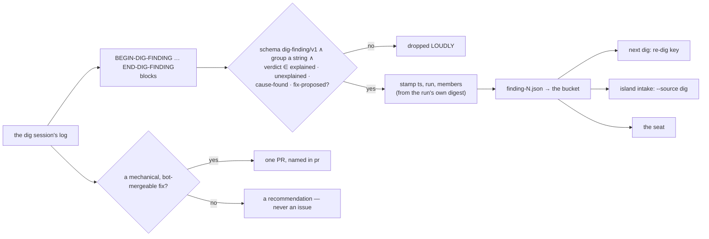

# dig-finding/v1 — the deep dig's one product, per group

The [deep dig](../../../../docs/glossary.md)'s output is a record per digest group in the
transcripts bucket — `homelab/dig-<date>/dig-r1-<ts>/finding-N.json`, beside the digest, the brief,
the transcript and a manifest — and nothing else in the tracker (FU-231's consumer leg: findings
to the bucket, issues only where the loop acts). Three readers depend on it: the NEXT dig's
explanation ledger (the `members` key — [INTAKE-DIG-EXPLAINED](dig-digest.md#intake-dig-explained)),
island intake's dig source (`cause-found` findings naming an island —
[INTAKE-SELECT-DIG](intake-select.md#intake-select-dig)), and the seat. The session writes the
blocks; the SHELL (`agents/deep-dig-select.sh harvest`) is what makes them records. Terms:
[glossary.md](glossary.md).

```
DIG_DIGEST=/tmp/dig.json DIG_TS=<iso> DIG_RUN=dig-<date>/dig-r1-<ts> bash agents/deep-dig-select.sh harvest <session-log> <outdir>
```

## Interface — the machine half

**[`dig-finding.schema.json`](dig-finding.schema.json)** holds the block the session prints and the
record the harvest writes.

| Requirement | Governs (schema) | Exit | Status |
|---|---|---|---|
| [INTAKE-DIG-FINDING](#intake-dig-finding) | the record | 0 ≥ 1 valid · non-zero none | 🚧 WIP — no evidence pipeline yet (fixture: `deep-dig-test.sh` §harvest) |
| [INTAKE-DIG-OUTPUT](#intake-dig-output) | `pr`, `verdict` | — | 🚧 WIP — no evidence pipeline yet (no fixture: the session's write discipline is the brief's) · `⚑ gap`: findings reach the board only through intake |

## Flow overview



## Requirement index

| Requirement | Section | Status |
|---|---|---|
| [INTAKE-DIG-FINDING](#intake-dig-finding) | blocks become records, or are dropped loudly | 🚧 WIP — no evidence pipeline yet (fixture: `deep-dig-test.sh` §harvest) |
| [INTAKE-DIG-OUTPUT](#intake-dig-output) | the bucket, never the tracker | 🚧 WIP — no evidence pipeline yet · `⚑ gap`: the board does not surface findings |

## INTAKE-DIG-FINDING

The session wraps each group's finding in a `BEGIN-DIG-FINDING` / `END-DIG-FINDING` pair with ONE
JSON object between. The harvest extracts every block and keeps it only when it parses with
`schema: dig-finding/v1`, a string `group` and a verdict in `explained | unexplained | cause-found
| fix-proposed`; anything else is dropped with one stderr line quoting its head — never uploaded as
a record. A kept block is stamped with `ts`, `run` and `members`: the `{alertname, subject}` pairs
of the run's OWN digest group its `group` key names — the shell's key, never the session's
free-text `alerts` (the 2026-10-06…09 daily re-dig keyed on a field no record carried). A block
whose group is not in the digest is kept, unstamped, and said so; an unreadable digest stamps
nothing, loudly. The harvest exits 0 when at least one block validated; with none, the workflow
says the transcript is the only record. The harvest and the capture run BEFORE anything else can
fail, and the session's failure does not skip them.

**World: [dig-clock](worlds/README.md#harness-worlds--a-pinned-clock-and-file-seams)**, a digest
with two groups and a session log carrying the row's blocks.

#### What the harvest keeps

Legend: `blocks` = the session's finding blocks (`ok(g1)` = valid, group g1 of the digest;
`ok(unknown)` = valid, a group the digest lacks; `bad-verdict` = an unknown verdict); `files?` =
`finding-N.json` written; `stderr?` / `exit?`.

| description | world | blocks | fixture | files? | members? | stderr? | exit? |
|---|---|---|---|---|---|---|---|
| valid blocks become records stamped from the digest | dig-clock | `ok(g1)`, `ok(unknown)`, `bad-verdict` | `deep-dig-test.sh` "finding count", "finding-1 members" | 2 | `finding-1`: every member of g1 | `2 finding(s) written … (1 dropped)` | `0` |
| a block for a group the digest lacks is kept, unstamped ⚖ | dig-clock | (as above) | `deep-dig-test.sh` "unknown group stamp" | `finding-2` | `[]` | `…is not a group of the run's digest — no members stamped` | `0` |
| an unknown verdict is dropped loudly | dig-clock | (as above) | `deep-dig-test.sh` "invalid block dropped loudly" | — | — | `a finding block did not validate … dropped` | `0` |
| no block at all is a non-zero harvest | dig-clock | none | `deep-dig-test.sh` "harvest none rc" | 0 | — | `0 finding(s) written` | non-zero |

<details markdown="1"><summary>Evidence — latest run</summary>

--8<-- "INTAKE-DIG-FINDING.md"

</details>

## INTAKE-DIG-OUTPUT

The dig files no issue and comments on no thread; its findings are the deliverable. A PR is allowed
only when the fix is mechanical and in-diff (a threshold, a `for:`, an annotation, a selector's
scope, a doc line), on a file the bot reviewer can merge (never `.github/`, `.agents/`, CODEOWNERS,
`devbox.json`/`.lock`, `mgmt/`, `agents/coordinator/*-argo.yaml` or a `pin-only-lint` GUARDED
file), and the group's evidence supports it without a human decision — branch `dig/<slug>`, one PR,
auto-merge armed, named in the finding's `pr`. Before any write the session searches open issues
and PRs for the alert name; a match is cited in `related`, never duplicated. A suspected automation
loop (its own earlier PRs piling up) stops it to report-only. Everything that needs a person is the
finding's `recommendation`, written to be acted on in one read — and a `cause-found` finding naming
an island reaches that island's intake sitting, which is the only path from a dig finding to a
queued issue.

The session's write discipline is its brief's (`deep-dig-argo.yaml` HARD RULES); no row drives a
session, so each rule here is unverified — expected to hold as the brief states.

`⚑ gap`: a finding that names no island (or an island whose sitting is not wired —
[INTAKE-SELECT-DIG](intake-select.md#intake-select-dig)) reaches the seat only if the seat lists the
bucket; [`docs/agents/roles.md`](../../../../docs/agents/roles.md) §deep dig: "surfacing them on the
board is the next step, not built here".

#### What a finding may lead to

Legend: `verdict` = the finding's; `fix` = the fix's shape; `writes?` = what the session may write.

| description | verdict | fix | writes? |
|---|---|---|---|
| a mechanical fix on a bot-mergeable file is one PR | `fix-proposed` | `for: 5m → 15m` in a PrometheusRule | one PR on `dig/<slug>`, auto-merge, `pr` set |
| a fix on a guarded path is a recommendation ⚖ | `cause-found` | an edit to `agents/coordinator/deep-dig-argo.yaml` | the finding only |
| a cause needing a person is a recommendation | `cause-found` | a hardware swap | the finding only (intake picks it up when it names an island) |
| an existing record is cited, never duplicated | `explained` | — | the finding, `related` naming the issue |

_Evidence: none yet — unverified._
