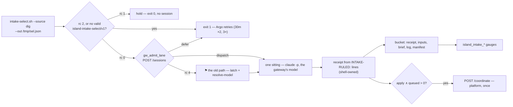

# island-intake — the wired run, its receipt, and how every lane is admitted

The `island-intake` CronWorkflow ([`agents/coordinator/island-intake-argo.yaml`](../../../coordinator/island-intake-argo.yaml),
daily 05:00Z, after the 03:30Z [deep dig](../../../../docs/glossary.md)) runs one sitting over the
dig source unattended: select ([INTAKE-SELECT-DIG](intake-select.md#intake-select-dig)) → admit
one session at the gateway → the sitting rules (its writes are [intake-ruling](intake-ruling.md)) →
the SHELL writes the [receipt](glossary.md#receipt) from the session's `INTAKE-RULED:` lines →
gauges → one `/coordinate` ring when something was queued. The receipt is the one record that an
input was ruled; the next selection reads it back. This page also holds the island's one
cross-cutting requirement, how all three lanes get an LLM session
([INTAKE-LANE-ADMISSION](#intake-lane-admission)). No use case walks this run yet: #3048
([UC-1](use-cases/uc-1-key-rows-to-fixtures.md)) was ruled by the seat-run pass. Terms:
[glossary.md](glossary.md).

```
argo -n agent-coordinator submit --from cronworkflow/island-intake [-p mode=dry-run] [-p island=gateway]
```

## Interface — the machine half

**[`intake-receipt.schema.json`](intake-receipt.schema.json)** holds the workflow parameters, the
`INTAKE-RULED:` line, the receipt, the gauges and the admission request each lane sends.

| Requirement | Governs (schema) | Status |
|---|---|---|
| [INTAKE-RUN-RECEIPT](#intake-run-receipt) | `$defs/ruled_line`, `$defs/receipt` | 🚧 WIP — no evidence pipeline yet (fixture: `island-intake-test.sh` §the script, run) |
| [INTAKE-RUN-HOLD](#intake-run-hold) | `parameters`, `exit` | 🚧 WIP — no evidence pipeline yet (fixture: `island-intake-test.sh` §the script, run) |
| [INTAKE-LANE-ADMISSION](#intake-lane-admission) | `$defs/admission` | 🚧 WIP — no evidence pipeline yet (fixtures: `island-intake-test.sh` §the gateway admits the sitting, `deep-dig-test.sh` §FU-270, `responder-behaviour-test.sh` §FU-270) · `⚑ gap`: the rc-4 fallback picks a rail and a model itself |
| [INTAKE-RUN-BELT](#intake-run-belt) | `$defs/gauges` | 🚧 WIP — no evidence pipeline yet (fixture: `island-intake-test.sh` §the script, run — the ring rows) · `⚑ gap`: no harm detector, no revert drill |

## Flow overview



## Requirement index

| Requirement | Section | Status |
|---|---|---|
| [INTAKE-RUN-RECEIPT](#intake-run-receipt) | the line protocol and the shell-owned receipt | 🚧 WIP — no evidence pipeline yet (fixture: `island-intake-test.sh`) |
| [INTAKE-RUN-HOLD](#intake-run-hold) | a hold is a selection that says so | 🚧 WIP — no evidence pipeline yet (fixture: `island-intake-test.sh`) |
| [INTAKE-LANE-ADMISSION](#intake-lane-admission) | every lane's session through `POST /sessions` | 🚧 WIP · `⚑ gap`: the rc-4 fallback self-routes |
| [INTAKE-RUN-BELT](#intake-run-belt) | gauges, staleness, the ring | 🚧 WIP · `⚑ gap`: no harm detector |

## INTAKE-RUN-RECEIPT

The session prints, for every input, one line outside any code fence:
`INTAKE-RULED: <input id> <outcome> <refs>` — `<outcome>` one of `queue goal seat fold close
standing file deferred`, `<refs>` the comma-separated `owner/repo#n` it wrote or relied on, or `-`.
The SHELL, not the model, builds the receipt from those lines: only ids of THIS run's inputs, only
known outcomes, the first line per id; everything else is dropped. The receipt
(`island-intake-receipt/v1`) carries the mode, the model and rail the session ran on, the inputs and
the ruled list, and is uploaded to `homelab/intake-<island>-<date>/intake-r1-<ts>/receipt.json`
beside the inputs, brief, log and manifest. An input with no line is not ruled and re-presents
tomorrow; a receipt that fails to upload is said loudly (tomorrow's sitting re-reads those inputs,
and its own "already owned?" step finds what this one filed).

**World: [intake-bucket](worlds/README.md#harness-worlds--a-pinned-clock-and-file-seams)** with
two inputs (10-25 finding-2, 10-26 finding-2); the workflow's script is extracted from the manifest
and run with stubs for `claude`, `s5cmd`, `git`, `curl`.

#### What the receipt keeps

Legend: `session_lines` = the session's `INTAKE-RULED:` lines in order (inputs abbreviated
`<day>/f<n>`); `ruled?` = the receipt's `ruled[]` as `[input, outcome]`.

| description | world | session_lines | fixture | ruled? |
|---|---|---|---|---|
| only this run's ids, only known outcomes, the first line per id ⚖ | intake-bucket | `10-26/f2 approve` · `10-26/f2 fold #9` · `10-25/f2 queue #9` · `2099-01-01/forged/f1 queue` · `10-25/f2 close` | `island-intake-test.sh` "receipt" | `[10-25/f2, queue]`, `[10-26/f2, fold]` |
| the receipt is what the selector's ledger reads | intake-bucket | as above, `mode=apply` | `island-intake-test.sh` "receipt shape" | `schema: island-intake-receipt/v1`, `mode: apply`, `session_ran: true` |
| the next selection reads it back: nothing left | intake-bucket | as above, receipt copied into the bucket | `island-intake-test.sh` "round trip" | the selector holds (exit 1) |
| a dry-run says so in brief and receipt | intake-bucket | as above, `mode=dry-run` | `island-intake-test.sh` "dry-run" | `mode: dry-run` (rules nothing — [INTAKE-SELECT-DIG](intake-select.md#intake-select-dig)) |

<details markdown="1"><summary>Evidence — latest run</summary>

--8<-- "INTAKE-RUN-RECEIPT.md"

</details>

## INTAKE-RUN-HOLD

The run reads the selector's exit AND its output: a hold is a hold only when the selector WROTE a
valid `island-intake-select/v1` selection saying so. rc 2, or a selection file that is missing or
not of that schema, is a failure — exit 1, and the retry wrapper re-runs it (30 min backoff, factor
2, limit 3). A selector that died under `set -e` also exits 1, and reading that as "nothing to do"
is the fail-open the first in-cluster dry-run hit (2026-10-28: inputs 0 while four findings
waited). A real hold exits 0 with no session. The CronWorkflow is `Forbid`-concurrent, the
semaphore sits on the `intake` LEAF and never on the retry wrapper (FU-198), and the leaf carries no
`retryStrategy`, so no backoff holds a subscription slot.

> **External:** Argo `retryStrategy` with `retryPolicy: OnFailure` retries the failed node and a
> `synchronization.semaphores` lock is held for the template that declares it — verify during
> implementation against the pinned Argo version's docs.

**World: [intake-bucket](worlds/README.md#harness-worlds--a-pinned-clock-and-file-seams)**.

#### Hold, fail, or sit

Legend: `selector` = what the selection step produced; `session?` = whether `claude` ran;
`exit?` = the workflow step's exit code.

| description | world | selector | fixture | session? | exit? |
|---|---|---|---|---|---|
| a selector that dies is a failure, never a hold ⚖ | intake-bucket | exit 1, no selection written (`INTAKE_NOW=garbage`) | `island-intake-test.sh` "fail-open hold" | no | `1` |
| a written hold sits nobody | intake-bucket | exit 1, a valid selection, 0 inputs | `island-intake-test.sh` "hold" | no | `0` |
| inputs to rule sit once | intake-bucket | exit 0, 2 inputs | `island-intake-test.sh` "apply run" | yes, once | `0` |
| the semaphore is on the leaf, the retry on the wrapper | — | (the manifest's shape) | `island-intake-test.sh` "FU-198" ×3 | — | — |

<details markdown="1"><summary>Evidence — latest run</summary>

--8<-- "INTAKE-RUN-HOLD.md"

</details>

## INTAKE-LANE-ADMISSION

Every LLM session this island starts is admitted by the gateway's
[`POST /sessions`](../../../../gateway/specs/endpoints/sessions.md) through `agents/gateway-admit.sh`
`gw_admit_lane` (the UNBOUND lane shape: the dispatch env rides `env` onto the `claude` call,
overriding the pod's old-proxy pair; an EXIT trap releases the session). The lane names who it is,
never a model: the intake sitting as `role: coordinator`, `tier: heavy`, `task:
intake-<island>-<day>`, stack `platform`; the dig as `role: responder`, `task: dig-<day>`, stack
`platform`; a responder triage as `role: responder`, `task: alert-<fp>`, stack = the alert's route
stack. A `dispatch` runs the session on the gateway's model (rail prefix stripped) and records the
gateway's rail and model in the lane's record; a `defer` exits 1 so the lane's retry wrapper waits
it out (the responder first re-marks the alert and its subject `deferred-<day>` so neither dedup
reads it as triaged, and the write-once spawn key stays — a deferring gateway spends budget and
cannot loop past the cap).

`⚑ gap (2026-11-07, spike #3147)`: the redrawn contract wants no caller choosing a model. Each
lane still carries the rc-4 path — the gateway knob off (`AGENT_GATEWAY` unset), another stack
(the responder; the helper admits platform only), or the FU-270 transition fallback on a gateway
503 — where it picks a rail with `agents/subscription-latch.sh --pick-rail` and a model with
`agents/resolve-model.sh` (intake: `--role coordinator --class goal-decompose --fallback opus`; dig
and responder: `--role responder --fallback sonnet`, or the Go rail id the latch returned). Those
three sites are the island's share of the self-routing sites
[context-and-autonomy.md §Interfaces](../../../../docs/spikes/context-and-autonomy.md#interfaces-are-redrawn-at-the-cut-operator-2026-10-05)
counts; they die when the fallback does.

**World:** [intake-bucket](worlds/README.md#harness-worlds--a-pinned-clock-and-file-seams) (intake),
[dig-clock](worlds/README.md#harness-worlds--a-pinned-clock-and-file-seams) (dig),
[responder-suite](worlds/README.md#harness-worlds--a-pinned-clock-and-file-seams) (responder) — each
with a stub gateway answering the row's `gateway` cell.

#### What each lane asks, and what it does with the answer

Legend: `lane` = intake / dig / responder; `gateway` = the stub's answer (`dispatch`, `defer`,
`503` = fail-closed, `knob-off` = `AGENT_GATEWAY` unset); `request?` = the `POST /sessions` fields
sent (`—` = no call); `session?` = what the `claude` call ran on; `exit?` = the step's exit.

| description | world | lane | gateway | fixture | request? | session? | exit? |
|---|---|---|---|---|---|---|---|
| the sitting is the platform coordinator, tier heavy | intake-bucket | intake | `dispatch` | `island-intake-test.sh` "gw admit body" | `stack platform, role coordinator, tier heavy, task intake-gateway-<day>` | the gateway's model, its env | `0` |
| a defer waits for the retry wrapper | intake-bucket | intake | `defer` | `island-intake-test.sh` "gw defer" | as above | none | `1` |
| ⚑ gap: a gateway outage falls back to self-routing | intake-bucket | intake | `503` | `island-intake-test.sh` "gw fallback path" | as above | `opus` via `resolve-model.sh`, old-proxy pair | `0` |
| ⚑ gap: the knob off is the old path byte for byte | intake-bucket | intake | `knob-off` | `island-intake-test.sh` "gw knob off" | — | `resolve-model.sh`'s answer | `0` |
| the dig is a responder-role session | dig-clock | dig | `dispatch` | `deep-dig-test.sh` "dig gw dispatch rc" | `stack platform, role responder, task dig-<day>` | the gateway's model | `0` |
| a dig defer waits for its retry wrapper | dig-clock | dig | `defer` | `deep-dig-test.sh` "dig gw defer rc" | as above | none | `1` |
| ⚑ gap: a gateway outage never fails the dig — it self-routes | dig-clock | dig | `503` | `deep-dig-test.sh` "dig fallback rc" | as above | `resolve-model.sh --role responder` | `0` |
| a platform-routed triage is admitted per alert | responder-suite | responder | `dispatch` | `responder-behaviour-test.sh` "gw dispatch rc" | `stack platform, role responder, task alert-<fp>` | the gateway's model | `0` |
| a triage defer re-marks fp and subject `deferred-` and retries | responder-suite | responder | `defer` | `responder-behaviour-test.sh` "gw defer subject" | as above | none | non-zero |

<details markdown="1"><summary>Evidence — latest run</summary>

--8<-- "INTAKE-LANE-ADMISSION.md"

</details>

## INTAKE-RUN-BELT

The run pushes `island_intake_{last_run_timestamp_seconds, probe_ok, inputs, session_ran, ruled,
queued}` to the pushgateway (job `island_intake`, label `island`) on EVERY exit path — hold, cap,
probe failure, defer, session done — so `IslandIntakeStale` (no run in > 2 days, `for: 6h`,
`triage: none`, `platform_machinery: "true"`) fires when the lane stops, whatever stopped it. The dig
does the same with `deep_dig_*` and `DeepDigStale`. After an APPLY sitting that queued anything
(`queue` or `goal` lines in the receipt) the run rings `/coordinate` for the platform stack ONCE, so
the queued work dispatches now rather than on the scan's cron; a dry-run never rings; a failed ring
is non-fatal (the cron catches it).

`⚑ gap`: the belts detect a lane that stopped, never a lane that did harm — a sitting that queued
a wrong issue, a dig PR that broke a rule. P4(c) of
[context-and-autonomy.md §The plan](../../../../docs/spikes/context-and-autonomy.md#the-plan-ordered-each-step-one-session--one-pr--a-settle-number)
wants a detector from the island's own evidence, a revert path (a revert PR — the pods clone
master) and a drill; none exists for this island.

**World: [intake-bucket](worlds/README.md#harness-worlds--a-pinned-clock-and-file-seams)**.

#### The ring

Legend: `mode` / `queued` = the run's mode and the receipt's queue+goal count; `ring?` = a
`POST /coordinate` was made.

| description | world | mode | queued | fixture | ring? |
|---|---|---|---|---|---|
| a queue outcome rings once | intake-bucket | `apply` | `1` | `island-intake-test.sh` "ring" | `yes` |
| a dry-run never rings | intake-bucket | `dry-run` | `1` | `island-intake-test.sh` "dry-run ring" | `no` |
| ⚑ gap: nothing queued, nothing rung | intake-bucket | `apply` | `0` | — | `no` (unverified) |

<details markdown="1"><summary>Evidence — latest run</summary>

--8<-- "INTAKE-RUN-BELT.md"

</details>
