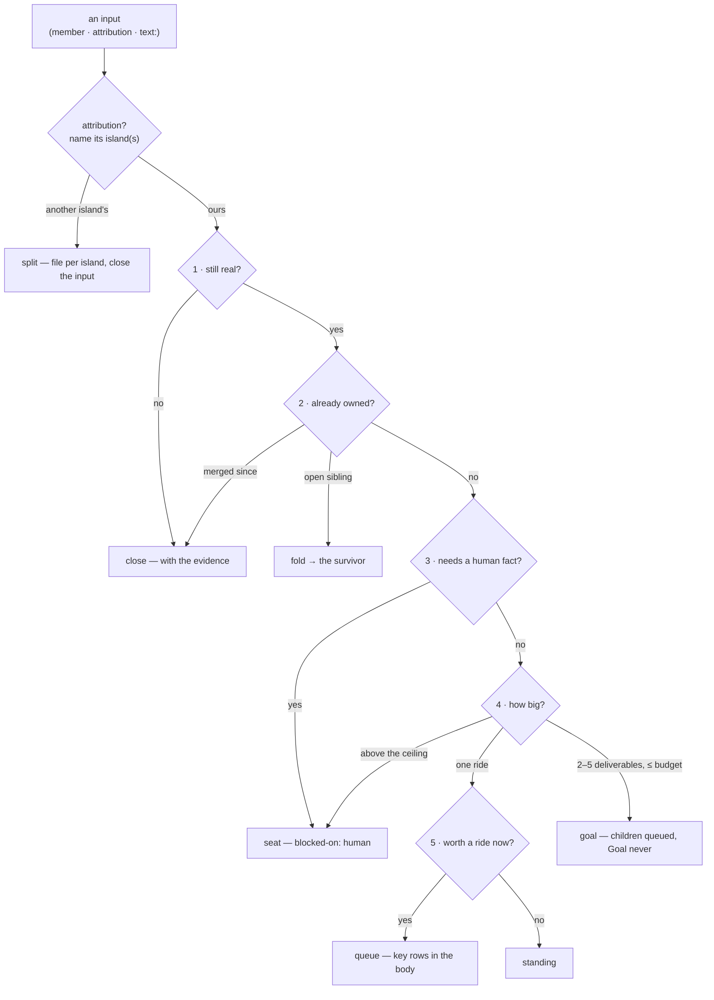

# The intake ruling — what a sitting writes to GitHub, and the state it leaves

What the scan, launch and the operator's board read after a sitting: for every input, ONE
[ruling](glossary.md#ruling) carried by a comment whose first line is `intake: <outcome> — <reason>`,
the labels that outcome puts on the issue, and — for `queue` — a body a single ride can finish.
The rules are [`gateway/intake.md`](../../../../gateway/intake.md) (runtime-read by every sitting,
in full — the spec cites its sections, never restates them), plus the island's facts file
([`docs/intake/agent-loop.md`](../../../../docs/intake/agent-loop.md) for this island's own items).
The outcome is an LLM sitting's judgment; this page pins what each judgment WRITES, which is
mechanical. Terms: [glossary.md](glossary.md), [island intake](../../../../docs/glossary.md).

## Interface — the machine half

**[`intake-ruling.schema.json`](intake-ruling.schema.json)** holds the outcome vocabulary, the
marker grammar, the labels per outcome and the queue-ready body's sections. The machine block of a
body is `agents/issue_body.py`'s (ADR-122 (3)) — this schema names its keys, the parser owns its
shape.

| Requirement | Governs (schema) | Status |
|---|---|---|
| [INTAKE-ADMIT-OUTCOME](#intake-admit-outcome) | `$defs/outcome`, `$defs/writes` | 🚧 WIP — no evidence pipeline yet (no fixture: an LLM sitting; the record is the sitting's report and, for the wired run, its receipt) · `⚑ gap`: `split` and `file` are outcomes the receipt cannot carry |
| [INTAKE-ADMIT-MARKER](#intake-admit-marker) | `$defs/marker` | 🚧 WIP — no evidence pipeline yet (no fixture) |
| [INTAKE-ADMIT-QUEUE-BODY](#intake-admit-queue-body) | `$defs/queue_body` | 🚧 WIP — no evidence pipeline yet (no fixture; the body gate `issue_body.py json` is the one mechanical check) |
| [INTAKE-ADMIT-LIMITS](#intake-admit-limits) | `$defs/limits` | 🚧 WIP — no evidence pipeline yet (no fixture) |

## Flow overview

## Requirement index

| Requirement | Section | Status |
|---|---|---|
| [INTAKE-ADMIT-OUTCOME](#intake-admit-outcome) | one outcome, one loop-readable state | 🚧 WIP — no evidence pipeline yet · `⚑ gap`: `split`/`file` absent from the receipt |
| [INTAKE-ADMIT-MARKER](#intake-admit-marker) | the `intake:` comment | 🚧 WIP — no evidence pipeline yet |
| [INTAKE-ADMIT-QUEUE-BODY](#intake-admit-queue-body) | the body one ride can finish | 🚧 WIP — no evidence pipeline yet |
| [INTAKE-ADMIT-LIMITS](#intake-admit-limits) | what a sitting never does | 🚧 WIP — no evidence pipeline yet |

## INTAKE-ADMIT-OUTCOME

Every input leaves the sitting with exactly one outcome, and every outcome maps to exactly one
[loop-readable state](glossary.md#loop-readable-state) a machine that already exists reads —
never a new label or grammar (`gateway/intake.md` §Outcomes). The procedure's order is fixed
(§The procedure: whose → still real → already owned → needs a human fact → how big → worth a ride),
so the first step that decides, decides. A `text:` input becomes an issue (`file`) only when its
ruling would be `queue`, `goal` or `seat`; `standing` or `close` on text is report-only, because the
source record (the FU line, the meta-state bullet) keeps it — one home per fact.

**World:** none runs — the rows below are the brief's table as cases, each with an issue that
was ruled that way where one is known (read 2026-11-07).

#### What each outcome writes

Legend: `outcome` = the ruling; `author` = who filed the input (`bot` / `human`); `labels?` = the
labels the ruling adds; `issue_state?` = open / closed after the sitting; `state?` = the
loop-readable state; `instance` = an issue ruled this way.

| description | outcome | author | instance | labels? | issue_state? | state? |
|---|---|---|---|---|---|---|
| one ride finishes it | `queue` | `bot` | `homelab#3048` | `agent-fix`, `task/fix\|task/build`, `agent/queued` | open | queued |
| real work no single ride finishes, within the ceiling ⚖ | `goal` | any | — | the children: `agent/queued`; the Goal: none | open | Goal tree |
| a human fact is missing | `seat` | any | `homelab#1939` | `agent-fix`, `agent/blocked` | open | blocked on a human |
| the body keeps it out of the loop ("the seat sequences it") ⚖ | `seat` | any | — | none (comment only — a human's lineage line outranks the label set) | open | blocked on a human |
| the claim no longer holds | `close` | `bot` | `homelab#2918` | none | closed | closed with evidence |
| an honest gap nobody should spend a ride on now ⚖ | `standing` | `bot` | `homelab#1572` | none | open | standing |
| two inputs are one change | `fold` | `bot` | — | none on the folded; the survivor takes its own outcome | the folded: closed | closed with evidence |
| one input, two islands' deliverables | `split` | `bot` | — | none on the input; each part filed under its island | the input: closed | closed with evidence |
| a `text:` input worth an issue | `file` | — | — | the filed issue is ruled in the same sitting | — | the filed issue's |

`⚑ gap`: the wired run's receipt accepts `queue goal seat fold close standing file deferred`
([INTAKE-RUN-RECEIPT](intake-receipt.md#intake-run-receipt)) — `split` is not among them, so a
split ruled by the CronWorkflow re-presents tomorrow.

_Evidence: none yet — unverified._

## INTAKE-ADMIT-MARKER

A ruling is ONE comment, its first line `intake: <outcome> — <reason, one line>` (`fold` and
`split` name their targets: `intake: fold → #<survivor>`, `intake: split → #a, #b`). A `seat`
ruling adds, on its own line, `blocked-on: human` — the scan's existing suppression grammar
(`agents/coordinator/README.md` §Blocked-on marker), so the board's SOLVE line and the scan's
predicate read it with no new code. Immediately before writing, the sitting re-reads the labels and
the last `intake:` comment: an item that has gained an `agent/*` label or a ruling since selection
is not its own this sitting. No second comment to clarify.

**World:** none runs.

#### The comment a ruling posts

Legend: `outcome` = the ruling; `first_line?` = the comment's first line (pattern);
`second_line?` = a required line after it.

| description | outcome | instance | first_line? | second_line? |
|---|---|---|---|---|
| a queue names its one-line reason | `queue` | `homelab#3048` | `intake: queue — <reason>` | — |
| a seat names the one missing fact and the suppression line | `seat` | `homelab#1939` | `intake: seat — <what is needed>` | `blocked-on: human` |
| a standing names why not now | `standing` | `homelab#1572` | `intake: standing — <why not now>` | — |
| a close names its evidence (the line, the PR, the date) | `close` | `homelab#2918` | `intake: close — <evidence>` | — |
| a fold names its survivor | `fold` | — | `intake: fold → #<survivor>` | — |
| an item labelled since selection is left alone | (none) | — | no comment | — |

_Evidence: none yet — unverified._

## INTAKE-ADMIT-QUEUE-BODY

A `queue` ruling rewrites the body so ONE ride finishes it, and writes the spec into it (rule 2:
an issue carries a handful of key rows — the happy path and the failure modes worth a
conversation). The machine block (`Touches`, `Origin`, `Class`) goes through `issue_body.py set`
and the gate `issue_body.py json` (exit 2 ⇒ fix, never post); the prose carries no hand-typed
machine line. Sections: `## Deliverable` (one sentence), `## Acceptance` (numbered, checkable,
each naming the rule and row), `## Spec changes` on an island with `specs/` or `## Key rows` on one
without, `## Out of scope`. On the agent loop a body that touches a clause file names the replay
fixture dir in `Touches` and gives it an acceptance line (ADR-103's ratchet — CI reds without it),
and a `codeowner-merge` path says it lands through the ADR-110 seat read so the park is not read as
a stall ([`docs/intake/agent-loop.md`](../../../../docs/intake/agent-loop.md)). Bounds: ≲ 5
`Touches` paths, key rows on ≤ 2 requirements, every path `machine-merge` or queue-able by the
facts file. A row not grounded in a page or merged PR says "verify during implementation", never
asserts.

**World:** none runs; [UC-1](use-cases/uc-1-key-rows-to-fixtures.md) is the walk.

#### What a queue-ready body carries

Legend: `island` = the input's island; `touches_clause` = whether `Touches` names a replay clause
file; `rows_heading?` = the section the key rows sit under; `touches_fixture?` = whether `Touches`
must name a fixture dir; `note?` = the line the body must carry.

| description | island | touches_clause | instance | rows_heading? | touches_fixture? | note? |
|---|---|---|---|---|---|---|
| a clause edit on the agent loop names its fixture | `agent-loop` | yes | `homelab#3048` | `## Key rows` | yes | "Lands through the ADR-110 seat read" |
| a gateway spec edit writes rows against a requirement | `gateway` | no | — | `## Spec changes` (`Requirement: GW-…`, world, index-row edit) | no (the test file carrying `rule("GW-…")`) | — |
| an agent-loop doc-only edit | `agent-loop` | no | — | `## Key rows` | no | — |
| ⚑ gap: the key rows are joined to nothing | `agent-loop` | yes | `homelab#3048` | `## Key rows` | yes | no reader checks the closing PR shipped one fixture per row (UC-1 Q4) |

_Evidence: none yet — unverified._

## INTAKE-ADMIT-LIMITS

The sitting authors issues, labels, comments, sub-issue and `blockedBy` edges and one branch ref per
Goal — never code, a PR, or an edit to an island file. It never closes or folds a HUMAN-filed issue
(author type `User` — the jail's identity is the operator's, so an operator filing is human-filed);
it rules it `seat` with the recommendation instead. At most 3 `queue` outcomes per sitting,
children included; an input past the cap whose ruling would be `queue` gets no write and
re-presents (`deferred (cap)`). A bot-authored Goal carries `Budget:` ≤ `INTAKE_GOAL_BUDGET_USD`
(10), `Base: goal/<n>-<slug>` (never `master`), `Verdict-authority: human`, passes `goal-lint`
before any label, and is never `agent/queued` — breaker #1 refuses a Goal queued by a loop
identity, and the assembly's codeowner read stays the gate. No credential in any body or comment.
On the agent loop, new or re-grouped loop machinery is `seat`, never `queue`/`goal`.

**World:** none runs.

#### What a sitting refuses to do

Legend: `case` = the input and the would-be ruling; `outcome?` = what the sitting does instead;
`writes?` = what reaches GitHub.

| description | case | outcome? | writes? |
|---|---|---|---|
| a human filing is never closed ⚖ | human-filed, claim no longer holds | `seat` with the close recommendation | `agent-fix` + `agent/blocked` + the seat comment |
| the fourth queue waits | 4th input ruled `queue` | `deferred (cap)` | nothing — the selector re-offers it |
| a Goal over the ceiling is the operator's ⚖ | Goal draft, `Budget: 25` | `seat` with the draft in the comment | the seat comment |
| a Goal is never queued | Goal + 3 children, `goal-lint` PASS | `goal` | `agent/queued` on the 3 children only |
| a loop component redesign is the seat's | agent-loop item proposing a new responder lane | `seat` | the seat comment |

_Evidence: none yet — unverified._
