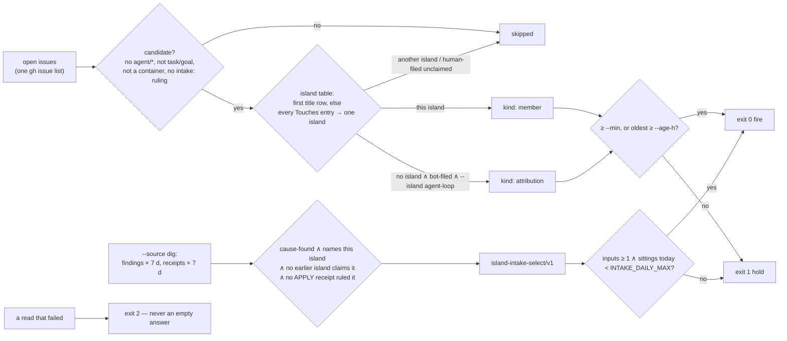

# intake-select.sh — which inputs an island's sitting rules, and whether it sits

The deterministic half of [island intake](../../../../docs/glossary.md): a sitting never picks its
own inputs ([`gateway/scripts/intake-select.sh`](../../../../gateway/scripts/intake-select.sh), the
scan's "the shell selects, the model judges" shape, ADR-094). Two sources. **Issues** (default): the
island's open issues nobody has ruled, one line each, and a verdict — fire or hold. **Dig**
(`--source dig`): the deep dig's `cause-found` findings that name the island and that no APPLY
receipt has ruled, as one `island-intake-select/v1` document. Every island's sitting — the seat's
`/intake` fan-out and the `island-intake` CronWorkflow — reads this and nothing else to know what
it rules. Terms: [glossary.md](glossary.md).

```
bash gateway/scripts/intake-select.sh [--island gateway] [--repo teststuffstash/homelab] [--min 3] [--age-h 24] [--json]
bash gateway/scripts/intake-select.sh --source dig [--island gateway] [--out sel.json]
```

## Interface — the machine half

**[`intake-select.schema.json`](intake-select.schema.json)** holds the candidate (issues mode,
`--json`), the selection document (dig mode) and the exit codes. Seams for a world:
`INTAKE_ISSUES_JSON` (a file served instead of `gh issue list`), `INTAKE_TS_DIR` (a directory laid
out like the bucket), `INTAKE_NOW` (the clock).

| Requirement | Governs (schema) | Exit codes | Status |
|---|---|---|---|
| [INTAKE-SELECT-MEMBERSHIP](#intake-select-membership) | `$defs/candidate.kind`, `$defs/island` | 2 (no row for `--island`) | 🚧 WIP — no evidence pipeline yet (fixture: `island-intake-test.sh` §selector issues) · `⚑ gap`: the table is a shell `case`, read by no other tool |
| [INTAKE-SELECT-CANDIDATE](#intake-select-candidate) | `$defs/candidate` | — | 🚧 WIP — no evidence pipeline yet (fixture: `island-intake-test.sh` §selector issues #17–#19, #26–#29) |
| [INTAKE-SELECT-ATTRIBUTION](#intake-select-attribution) | `$defs/candidate.kind`, `$defs/candidate_line` | — | 🚧 WIP — no evidence pipeline yet (fixture: `island-intake-test.sh` §selector issues #22–#30) |
| [INTAKE-SELECT-FIRE](#intake-select-fire) | `exit` | 0 fire · 1 hold · 2 probe failed | 🚧 WIP — exit 2 rows proven by `island-intake-test.sh`; the fire thresholds by no row |
| [INTAKE-SELECT-DIG](#intake-select-dig) | `$defs/selection` | 0 · 1 · 2 | 🚧 WIP — no evidence pipeline yet (fixture: `island-intake-test.sh` §selector --source dig, §island precedence) |

## Flow overview



## Requirement index

| Requirement | Section | Status |
|---|---|---|
| [INTAKE-SELECT-MEMBERSHIP](#intake-select-membership) | the island table — one island per issue | 🚧 WIP — no evidence pipeline yet (fixture: `island-intake-test.sh` §selector issues) · `⚑ gap`: the table is a shell `case` |
| [INTAKE-SELECT-CANDIDATE](#intake-select-candidate) | what is never a candidate | 🚧 WIP — no evidence pipeline yet (fixture: `island-intake-test.sh` §selector issues) |
| [INTAKE-SELECT-ATTRIBUTION](#intake-select-attribution) | the agent-loop sitting's bot-filed unclaimed inputs | 🚧 WIP — no evidence pipeline yet (fixture: `island-intake-test.sh` §selector issues) |
| [INTAKE-SELECT-FIRE](#intake-select-fire) | the verdict and the exit code | 🚧 WIP — the fire thresholds by no row |
| [INTAKE-SELECT-DIG](#intake-select-dig) | the dig source | 🚧 WIP — no evidence pipeline yet (fixture: `island-intake-test.sh` §selector --source dig) |

## INTAKE-SELECT-MEMBERSHIP

An issue belongs to at most one island. `ISLANDS` is the precedence order — `gateway router-pair
mgmt-box dependency-upgrades substrate agent-loop`, most specific first — and an issue goes to the
FIRST row whose title regex matches, or whose island owns every `Touches` entry. A path goes to
the island with the LONGEST matching prefix (equal length → the earlier row); a footprint that
spans two islands, or names a path no island owns, belongs to none by `Touches` (its title can
still claim it). `Touches` is read through the one body parser (`agents/issue_body.py get
Touches`), never a grep. `argocd/resources/agent-gateway/` and `.github/workflows/**` are nobody's
on purpose (workflows are operator-author, a `seat` surface on every island). An `--island` with no
row is refused with exit 2.

⚖ the table lives in two shell functions (`island_members`, `island_pattern`) and every new island
edits both plus a facts file; nothing else can read it — `⚑ gap`: the island list as data (one
file the selector, the skill and the board read) is not built.

**World: [issue-table](worlds/README.md#harness-worlds--a-pinned-clock-and-file-seams)**, every
issue bot-filed and unlabelled unless the row says otherwise.

#### Which island an issue belongs to

Legend: `title` and `touches` = the issue's title and its machine block's `Touches` (`—` = no
block); `fixture` = the issue number in the world's table; `island?` = the one `--island` whose
selection lists it as `kind: member` (`none` = no island's).

| description | world | title | touches | fixture | island? |
|---|---|---|---|---|---|
| a title row claims it | issue-table | `gateway: a title row` | — | `#1` | `gateway` |
| a requirement id in the title claims it | issue-table | `catalog drift on GW-CATALOG-GO` | — | `#2` | `gateway` |
| every Touches entry under one island's prefix | issue-table | `no title cue` | `gateway/specs/a.md, gateway/tests/b.py` | `#3` | `gateway` |
| the earlier row wins over a later row's title ⚖ | issue-table | `scan: title says agent-loop` | `gateway/src/x.py` | `#4` | `gateway` |
| a footprint spanning two islands is nobody's by Touches | issue-table | `no title cue` | `gateway/a.md, agents/b.sh` | `#5` | `none` |
| the longest prefix wins (`tofu/opnsense-router.tf` over `tofu/`) | issue-table | `no title cue` | `tofu/opnsense-router.tf` | `#8` | `router-pair` |
| two islands' paths under one shared parent stay nobody's | issue-table | `no title cue` | `tofu/opnsense-router.tf, tofu/garage.tf` | `#16` | `none` |
| a path no island owns is nobody's | issue-table | `no title cue` | `.github/workflows/ci.yaml` | `#15` | `none` |
| an earlier row's title beats a later row's Touches ⚖ | issue-table | `garage: title wins over Touches` | `agents/x.sh` | `#20` | `substrate` |
| the agent loop's own title rows | issue-table | `scan: a guard` | — | `#6` | `agent-loop` |

Every member is listed by exactly one `--island` (16 memberships over 30 issues in the world).

<details markdown="1"><summary>Evidence — latest run</summary>

--8<-- "INTAKE-SELECT-MEMBERSHIP.md"

</details>

## INTAKE-SELECT-CANDIDATE

A candidate carries no `agent/*` lifecycle label, is not `task/goal` (a Goal is admitted by a
human — breaker #1), is not a `post-launch:` / `stint:` container, and has no comment whose FIRST
line starts `intake:`. The last test is what makes a `standing` ruling stick: a ruled item is
labelled (`queue`, `seat`), closed (`close`, `fold`), or carries only the comment (`standing`), and
the selector skips all three alike. The candidate rides with its body in the same list call, so
membership needs no second read.

**World: [issue-table](worlds/README.md#harness-worlds--a-pinned-clock-and-file-seams)**.

#### What removes an issue from every selection

Legend: `labels` / `first_comment` / `title` = the issue's state (`—` = none); `selected?` = listed
by any `--island`.

| description | world | title | labels | first_comment | fixture | selected? |
|---|---|---|---|---|---|---|
| a lifecycle label means the loop owns it | issue-table | `scan: labelled` | `agent/queued` | — | `#17` | `no` |
| a standing ruling is a ruling | issue-table | `scan: ruled` | — | `intake: standing — not now` | `#18` | `no` |
| a container is never ruled | issue-table | `post-launch: scan bucket` | — | — | `#19` | `no` |
| a Goal is the human's to admit | issue-table | `no title cue, bot Goal` | `task/goal` | — | `#28` | `no` |
| a stint container, bot-filed | issue-table | `stint: bot container` | — | — | `#29` | `no` |
| the same title unlabelled and unruled is a candidate | issue-table | `scan: a guard` | — | — | `#6` | `yes` |

<details markdown="1"><summary>Evidence — latest run</summary>

--8<-- "INTAKE-SELECT-CANDIDATE.md"

</details>

## INTAKE-SELECT-ATTRIBUTION

The loop's own filers (janitor, scout, strike) leave component attribution to intake. So an issue
that passes [INTAKE-SELECT-CANDIDATE](#intake-select-candidate), that no island claims, and that a
BOT filed — not author type `User`: `is_bot`, an `app/<slug>` login or a `<login>[bot]` login — is
selected by `--island agent-loop` only (`ATTRIBUTION_ISLAND`), as `kind: attribution`, with a fifth
column `attribution` on its output line. The sitting names its island(s) first and `split`s what is
not its own ([INTAKE-ADMIT-OUTCOME](intake-ruling.md#intake-admit-outcome)). A HUMAN-filed
unclaimed issue is nobody's — the seat's `none` list. A claimed issue is a member whoever filed it.

**World: [issue-table](worlds/README.md#harness-worlds--a-pinned-clock-and-file-seams)**.

#### Who receives an unclaimed issue

Legend: `author` = `app` (`app/homelab-agents-1234`), `[bot]` (`homelab-agents-1234[bot]`, the REST
spelling) or `human` (`is_bot: false`); `island?` / `kind?` = the selection that lists it.

| description | world | title | touches | author | fixture | island? | kind? |
|---|---|---|---|---|---|---|---|
| a bot filing no island claims goes to the agent loop (#3094's shape) | issue-table | `worker OOMKilled at 4Gi on the opencode 1M-context cell` | — | `app` | `#22` | `agent-loop` | `attribution` |
| the `[bot]` login spelling is a bot too | issue-table | `no title cue, a [bot] login` | — | `[bot]` | `#25` | `agent-loop` | `attribution` |
| a bot filing spanning two islands is attributed, not split by the selector | issue-table | `no title cue` | `gateway/a.md, agents/b.sh` | `app` | `#5` | `agent-loop` | `attribution` |
| a human filing no island claims is nobody's ⚖ | issue-table | `no title cue, human-filed` | — | `human` | `#23` | `none` | — |
| a human filing spanning two islands is nobody's | issue-table | `no title cue, human, mixed` | `gateway/a.md, agents/b.sh` | `human` | `#24` | `none` | — |
| a claimed issue is a member whoever filed it | issue-table | `gateway: human-filed member` | — | `human` | `#30` | `gateway` | `member` |

No island but `agent-loop` ever receives an attribution input.

<details markdown="1"><summary>Evidence — latest run</summary>

--8<-- "INTAKE-SELECT-ATTRIBUTION.md"

</details>

## INTAKE-SELECT-FIRE

Issues mode fires (exit 0) when the island has ≥ `--min` candidates (default 3) or its oldest is ≥
`--age-h` hours (default 24): one sitting per trigger, never per issue. Otherwise it holds (exit 1)
with the count and the oldest age on stderr. A read that failed is exit 2 — an empty answer from a
failed `gh issue list`, an unreadable `INTAKE_ISSUES_JSON`, a missing parser — because an empty
answer read as "no candidates" is the fail-open the selector exists to avoid. The fire thresholds
are unverified — expected to behave as the header states; no row drives `--min` or `--age-h`.

**World: [issue-table](worlds/README.md#harness-worlds--a-pinned-clock-and-file-seams)**.

#### The exit code

Legend: `issue_list` = what the issue read answered; `island_arg` = `--island`; `exit?` = the
selector's exit code.

| description | world | issue_list | island_arg | fixture | exit? |
|---|---|---|---|---|---|
| an unreadable issue list is a probe failure | issue-table | the seam file is missing | `substrate` | `island-intake-test.sh` "issues rule #6" | `2` |
| an island with no membership row is refused | issue-table | the world | `nosuch` | `island-intake-test.sh` "issues island table" | `2` |
| ⚑ gap: three candidates fire | issue-table | 3 unruled members | `agent-loop` | — | `0` (unverified) |
| ⚑ gap: one candidate older than 24 h fires | issue-table | 1 member, 30 h old | `agent-loop` | — | `0` (unverified) |

_Evidence: none yet — unverified._ (the two exit-2 rows have a harness case; the thresholds have none)

## INTAKE-SELECT-DIG

The dig source turns the deep dig's findings into an island's `text:` inputs (`source: dig`), so
the dig files nothing and intake stays the island's one admission — dedup (`fold`) happens before
anything is filed. An input is a `dig-finding/v1` record from the last `INTAKE_DIG_LOOKBACK_D` (7)
days whose verdict is in `INTAKE_DIG_VERDICTS` (`cause-found`) and whose text — cause,
recommendation, evidence, related, pr — matches the island's pattern AND no earlier island's
pattern (precedence: one finding, one sitting). It is RULED, and never offered again, once an
APPLY receipt lists it with any outcome but `deferred`; a dry-run receipt rules nothing. The
selection fires when ≥ 1 input is unruled and fewer than `INTAKE_DAILY_MAX` (2) apply sittings ran
today (counted from the same receipts — the responder's daily-cap shape, a budget knob). A bucket
it cannot list, or no READER key, is exit 2: an unreadable bucket would also read as "nothing
ruled", which would feed the same findings every day.

> **External:** an s5cmd `ls` of a prefix with no objects answers ERROR + exit 1 (read in-cluster
> 2026-10-28, s5cmd v2.3 on Garage — `island-intake-argo.yaml` §1 note); the selector treats it as
> an empty prefix only after a positive-control listing of `homelab/` succeeded.

**World: [intake-bucket](worlds/README.md#harness-worlds--a-pinned-clock-and-file-seams)** —
findings on 2026-10-10 (out of the lookback), 10-25 (two name the gateway, one a snore-recorder
venv) and 10-26 (one `explained` naming `gateway/specs`, one `cause-found` naming `agent-gateway`).

#### Which findings are inputs

Legend: `receipts` = the receipts present for `--island gateway` (`apply: f1 queue, f2 deferred`
= an APPLY receipt ruling 10-25's finding-1 `queue` and finding-2 `deferred`); `inputs?` = the
selection's `inputs[].id`, abbreviated `<day>/f<n>`.

| description | world | receipts | fixture | inputs? |
|---|---|---|---|---|
| cause-found ∧ names the island (a path, `agent-gateway`, a `GW-` id) ∧ inside the lookback | intake-bucket | none | `island-intake-test.sh` "membership" | `10-26/f2 10-25/f1 10-25/f2` |
| a dry-run receipt rules nothing | intake-bucket | `dry-run: f1 queue` | `island-intake-test.sh` "dry-run consumes" | `10-26/f2 10-25/f1 10-25/f2` |
| an APPLY receipt rules its inputs — except `deferred`, which re-presents ⚖ | intake-bucket | `apply: f1 queue, f2 deferred` | `island-intake-test.sh` "receipt key" | `10-26/f2 10-25/f2` |
| the S3 branch reads the same receipts back | intake-bucket-s3 | `apply: 10-26/f2 standing` (+ the row above) | `island-intake-test.sh` "S3 branch" | `10-25/f2` |

#### When it holds or fails

Legend: `state` = the condition; `exit?` = the selector's exit code; `stderr?` = the verdict line's
start.

| description | world | state | fixture | exit? | stderr? |
|---|---|---|---|---|---|
| two apply sittings today hold on the cap | intake-bucket | 2 apply receipts on 10-27, `INTAKE_DAILY_MAX` 2 | `island-intake-test.sh` "daily cap" | `1` | `hold: daily cap` |
| the cap is a knob | intake-bucket | the same, `INTAKE_DAILY_MAX` 3 | `island-intake-test.sh` "cap knob" | `0` | `fire:` |
| an unreadable store is a probe failure | intake-bucket | `INTAKE_TS_DIR` has no `homelab/` | `island-intake-test.sh` "rule #6" | `2` | `intake-select: INTAKE_TS_DIR has no homelab/` |
| no READER key fails closed | intake-bucket | no seam, no `AGENT_TS_READER_ID` | `island-intake-test.sh` "reader key" | `2` | `intake-select: no bucket READER key` |
| an unlistable bucket fails its positive control | intake-bucket-s3 | the stub has no `homelab/` | `island-intake-test.sh` "S3 positive control" | `2` | `intake-select: bucket listing failed` |
| an island with no pattern row is refused | intake-bucket | `--island nosuch` | `island-intake-test.sh` "island table" | `2` | `intake-select: no dig pattern` |

#### One finding, one island

Legend: `island_arg` = `--island`; `inputs?` = the finding numbers it takes from the
[intake-precedence](worlds/README.md#harness-worlds--a-pinned-clock-and-file-seams) world (1 = a
router-pair drill alert, 2 = `agent-gateway` + `agents/agent-session.sh`, 3 = a mgmt-lease alert,
4 = Longhorn).

| description | world | island_arg | fixture | inputs? |
|---|---|---|---|---|
| the gateway takes the finding that also names `agents/` (it is first) ⚖ | intake-precedence | `gateway` | `island-intake-test.sh` "dig precedence gateway" | `2` |
| the router pair takes the drill alert | intake-precedence | `router-pair` | `island-intake-test.sh` "dig precedence router-pair" | `1` |
| the management box takes the lease alert | intake-precedence | `mgmt-box` | `island-intake-test.sh` "dig precedence mgmt-box" | `3` |
| the substrate takes Longhorn | intake-precedence | `substrate` | `island-intake-test.sh` "dig precedence substrate" | `4` |
| the agent loop re-rules nothing an earlier row took | intake-precedence | `agent-loop` | `island-intake-test.sh` "dig precedence agent-loop" | — |

⚑ gap: the CronWorkflow runs `--island gateway` only (its `island` parameter's default); the
other islands' dig findings are selected correctly and ruled by nobody until a run per island is
wired (an operator ruling — [`docs/spikes/island-intake.md`](../../../../docs/spikes/island-intake.md)
§Open questions).

<details markdown="1"><summary>Evidence — latest run</summary>

--8<-- "INTAKE-SELECT-DIG.md"

</details>
