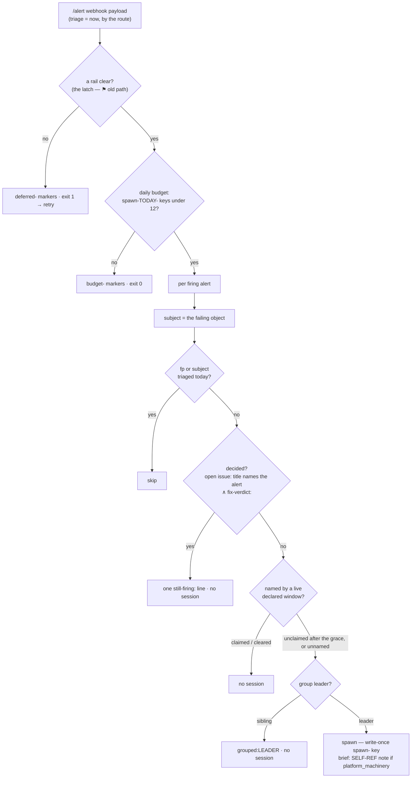

# The responder's gates — whether an acute alert gets a triage session at all

The responder ([`agents/coordinator/responder-argo.yaml`](../../../coordinator/responder-argo.yaml),
Sensor `responder` → WorkflowTemplate `respond`) takes the `triage: now` alerts Alertmanager's
route sends it — `dig` goes to the [deep dig](../../../../docs/glossary.md), `none` to nobody — and
for each firing alert decides, cheapest first, whether a session is worth spawning: the daily
budget, the per-day fingerprint and subject ledger, decided-once, the declared window, the group
leader. Only then does the session start, admitted by the gateway
([INTAKE-LANE-ADMISSION](intake-receipt.md#intake-lane-admission)). Every gate that skips writes a
ledger marker (FU-113(a)), so a deliberate stop is distinguishable from a drop. The consumer of this
page is the responder's own spawn step and `agents/meta-alert-crosscheck.sh`, which reads the same
markers to tell stuck machinery from a deliberate stop. Owning prose:
[`docs/agents/roles.md`](../../../../docs/agents/roles.md) §responder. Terms:
[glossary.md](glossary.md).

## Interface — the machine half

**[`responder-gates.schema.json`](responder-gates.schema.json)** holds the webhook payload the
Sensor receives, the `responder-seen` ledger's key and value grammar, the budget gauges, the
subject grammar and the declared-window record the gates read.

| Requirement | Governs (schema) | Status |
|---|---|---|
| [INTAKE-RESP-BUDGET](#intake-resp-budget) | `$defs/ledger`, `$defs/budget_gauges` | 🚧 WIP — no evidence pipeline yet (fixture: `responder-behaviour/responder-behaviour` §FU-149 budget) |
| [INTAKE-RESP-DECIDED-ONCE](#intake-resp-decided-once) | `$defs/still_firing_line` | 🚧 WIP — no evidence pipeline yet (fixture: `responder-decided-once/*`) |
| [INTAKE-RESP-SUBJECT](#intake-resp-subject) | `$defs/subject` | 🚧 WIP — no evidence pipeline yet (fixture: `responder-subject/*`) |
| [INTAKE-RESP-WINDOW](#intake-resp-window) | `$defs/declared_window` | 🚧 WIP — no evidence pipeline yet (fixture: `responder-seat-window/*`) |
| [INTAKE-RESP-SELFREF](#intake-resp-selfref) | `$defs/payload_alert.labels.platform_machinery` | 🚧 WIP — no evidence pipeline yet (fixture: `responder-selfref/*`) |

## Flow overview

## Requirement index

| Requirement | Section | Status |
|---|---|---|
| [INTAKE-RESP-BUDGET](#intake-resp-budget) | the daily cap | 🚧 WIP — no evidence pipeline yet (fixture: `responder-behaviour`) |
| [INTAKE-RESP-DECIDED-ONCE](#intake-resp-decided-once) | a standing condition is triaged once | 🚧 WIP — no evidence pipeline yet (fixture: `responder-decided-once/*`) |
| [INTAKE-RESP-SUBJECT](#intake-resp-subject) | the failing object | 🚧 WIP — no evidence pipeline yet (fixture: `responder-subject/*`) |
| [INTAKE-RESP-WINDOW](#intake-resp-window) | the declared window | 🚧 WIP — no evidence pipeline yet (fixture: `responder-seat-window/*`) |
| [INTAKE-RESP-SELFREF](#intake-resp-selfref) | platform machinery | 🚧 WIP — no evidence pipeline yet (fixture: `responder-selfref/*`) |

## INTAKE-RESP-BUDGET

The lane spawns at most `RESPONDER_DAILY_MAX` (12) triage sessions per UTC day, checked before any
per-alert work and again before each spawn, with no escape clause. The count is DERIVED: each spawn
writes a write-once key `spawn-<date>-<fp>` = `<date>|<incident>` into the `responder-seen`
ConfigMap, and nothing else writes that prefix — so no later branch can erase a spawn (until
2026-10-20 the count read `fp-` values every later run re-marks; one burst spawned 15 against a cap
of 12). An ABSENT ledger is a cold start (0 used, clear); a ledger that exists but cannot be read
or counted blocks fail-CLOSED — nothing else enforces this budget, so an unprovable "under" is
treated as over. Earlier days' `spawn-` keys are pruned after the count, best-effort.
`agents/responder-budget.sh` pushes `responder_triage_{sessions_today, budget_max,
budget_remaining, blocked, probe_ok, day_start}` on BOTH paths; `ResponderTriageBudgetExhausted`
(`warning`, `triage: none` — it can never consume the budget it reports) fires while
`blocked == 1` for the current day only, so it self-clears at midnight. Over budget, every firing
alert of the payload gets a `budget-<today>` marker and the workflow exits 0 (a day-long budget is
not something a retry can outwait; alerts re-fire ≤ 3 h).

**World: [responder-suite](worlds/README.md#harness-worlds--a-pinned-clock-and-file-seams)**.

#### Whether the day's budget allows a spawn

Legend: `ledger` = the `responder-seen` keys present (`TD` = today); `spawn?` = a `claude -p`
call; `writes?` = the ledger write observed.

| description | world | ledger | fixture | spawn? | writes? |
|---|---|---|---|---|---|
| twelve spawn keys today exhaust the budget, whatever the fp- values say ⚖ | responder-suite | 12 × `spawn-TD-*`, every `fp-` value re-marked | `responder-behaviour` "budget exhausted" | `no` | `budget-TD` markers |
| fp- values alone are not the count | responder-suite | 12 × `fp-*` = `TD\|…`, no `spawn-` | `responder-behaviour` "fp- values alone" | `yes` | `"spawn-TD-b2":"TD\|KubePodNotReady/garage"` |
| an earlier day's spawn key is pruned | responder-suite | `spawn-2026-01-01-old` | `responder-behaviour` "pruned" | `yes` | json remove `/data/spawn-2026-01-01-old` |
| ⚑ gap: an unreadable ledger blocks fail-closed | responder-suite | the ConfigMap exists, its JSON unreadable | — | `no` (unverified) | `responder_triage_probe_ok 0` |

Evidence — latest run

--8<-- "INTAKE-RESP-BUDGET.md"

## INTAKE-RESP-DECIDED-ONCE

A condition that already has an OPEN issue whose TITLE names this alert and whose body carries a
`fix-verdict:` line (`fix` or `report-only`) is decided: the re-fire rewrites ONE `still-firing:`
line in that body and spawns no session. Title-anchored, so a DIFFERENT alert class on the same
subject still triages. A thread a PERSON closed is a decision too, for
`RESPONDER_HUMAN_CLOSE_DAYS` (14): no session and nothing written; past that shelf life the close
no longer decides and the alert triages. Before this gate, the per-UTC-day ledger re-armed every
midnight, and ~40 % of the lane's sessions over 2026-09-11→16 re-confirmed standing conditions
while 32 other alerts were dropped at the cap.

**World:** each row's fixture dir (its recorded `world/gh/`).

#### Whether an existing record already decided it

Legend: `record` = the issue the gate finds; `session?`; `written?` = the body write.

| description | record | fixture | session? | written? |
|---|---|---|---|---|
| a standing condition is triaged once, not once a day | open `homelab#1598`, title names `BlockingCodeownerParkWaiting`, `fix-verdict:` present | `responder-decided-once/decided` | `no` | one `still-firing:` line |
| a person's close decides ⚖ | `homelab#1663` closed by a User 3 d ago, verdict present | `responder-decided-once/human-closed` | `no` | nothing |
| a person's close has a shelf life ⚖ | the same, closed past `RESPONDER_HUMAN_CLOSE_DAYS` | `responder-decided-once/human-closed-stale` | `yes` | — |
| a different alert class on one subject is a different problem | open issue on the subject, title names ANOTHER alert | `responder-decided-once/witness-different-alert` | `yes` | — |

Evidence — latest run

--8<-- "INTAKE-RESP-DECIDED-ONCE.md"

## INTAKE-RESP-SUBJECT

The [subject](glossary.md#subject) is the FAILING OBJECT, never the exporter that reported it. The
cascade, first match wins: `persistentvolumeclaim` → `pvc:<ns>/<pvc>`; `repo` + `workflow` →
`workflow:<repo>/<wf>`; `daemonset`, `statefulset`, `deployment`, `job_name` (run suffix stripped),
`cronjob` → `workload:<ns>/<name>`; `pod` only when the pod IS the object → `workload:<ns>/<pod,
suffix stripped>`; `node` → `node:<n>`; `repo` → `repo:<r>`; `instance` → `instance:<target>`
verbatim, unless it is a reporter's own address; a non-reporter `namespace` → `ns:<ns>`; else the
per-class `alert:<name>`. Object labels come BEFORE `pod` because kube-state-metrics and
node-exporter leave their own target labels on metrics with no matching dimension; a
kube-state-metrics POD-level alert keeps its pod (the `uid` tell, or a target set aggregated away);
the pushgateway and github-exporter are reporters, so their `instance` and `namespace` name nothing.
The cascade is ONE block (`>>>REPLAY:responder-subject>>>`) that the deep dig extracts at run time
([INTAKE-DIG-CANDIDATE](dig-digest.md#intake-dig-candidate)) — one home
for "what is this alert about". The per-day ledger keys on (alertname, subject).

**World:** each row's fixture dir.

#### What an alert is about

Legend: `labels` = the alert labels that decide (abridged); `subject?` = the cascade's answer.

| description | labels | fixture | subject? |
|---|---|---|---|
| an object label beats the reporter's pod label | `daemonset=runner-image-prepull-pve`, `pod=…kube-state-metrics…` | `responder-subject/daemonset-reporter-pod` | `workload:arc-runners/runner-image-prepull-pve` |
| the statefulset arm | `statefulset=loki` | `responder-subject/statefulset` | `workload:loki/loki` |
| `cronjob` is an object label | `cronjob=fstrim-guard-wk-04` | `responder-subject/cronjob` | `workload:node-maintenance/fstrim-guard-wk-04` |
| a kube-state-metrics pod alert keeps its pod (the `uid` tell) | `pod=cloudflared-…`, `uid` | `responder-subject/ksm-pod-uid` | `workload:cloudflared/cloudflared` |
| a pod that really is the object still wins | `pod=coordinator-sensor-kfmcv`, no reporter `job` | `responder-subject/witness-pod-owned` | `workload:agent-coordinator/coordinator-sensor-kfmcv` |
| a reporter's pod with no object label falls to the target | node-exporter `instance=192.168.2.182:9100` | `responder-subject/node-exporter-instance` | `instance:192.168.2.182:9100` |
| a reporter's own instance is never a subject | kube-state-metrics, no object | `responder-subject/ksm-object-no-pod` | `alert:GithubTokenMintStale` |
| the pushgateway is a reporter, told by its Service | pushed `job` | `responder-subject/pushgateway-pushed-job` | `alert:GarageWriteProbeFailing` |
| the github-exporter's bare `repo` names the subject | `repo=homelab` | `responder-subject/github-exporter-repo` | `repo:homelab` |
| an Agent alert whose project names a namespace keys to it ⚖ | `AgentDispatchCronWoken`, `project=oracle-fleet` | `responder-subject/oracle-fleet` | `ns:oracle-fleet` |
| an un-opted alert with a project label keeps the catch-all | `RouterRotationStale`, `project=…` | `responder-subject/witness-unopted` | `alert:RouterRotationStale` |

Fixtures not tabled above, same requirement: `responder-subject/homelab`,
`witness-opted-infra-death`, `witness-opted-negative-cost`, `witness-unopted-phase-slow`.

Evidence — latest run

--8<-- "INTAKE-RESP-SUBJECT.md"

## INTAKE-RESP-WINDOW

A [declared window](../../../../docs/glossary.md) (the seat's record in the `responder-window`
ConfigMap, written by `agents/seat-window.sh`) never suppresses by itself: a `now` alert a live
window NAMES waits one grace (the `window-grace` step, ~10 min, holding no subscription slot) for
the seat to claim it with an Alertmanager silence. After the grace the gate re-reads Alertmanager:
claimed (a silence covers its fingerprint) → no session; stopped firing → no session; still
unclaimed → triage, with the window's reason in the brief. "Live" includes a closed window's tail
(`tail_until`). Matching is by alert NAME only, never namespace. An alert no window names triages
at once. An unreadable Alertmanager claims nothing — the alert triages (rule #6: an unread claim
is not a claim). The window's reason is free text and reads back verbatim.

**World:** each row's fixture dir (window `wk-03-1789600000`, "node-maintenance window on wk-03").

#### What a declared window does to a named alert

Legend: `window` = the window's state for this alert's name; `am` = what Alertmanager says after
the grace; `outcome?` = the gate's.

| description | window | am | fixture | outcome? |
|---|---|---|---|---|
| a claimed alert spawns no session | live, names it | silenced (`s-123`) | `responder-seat-window/claimed` | `CLAIMED by silence` — no session |
| an alert that cleared during the grace spawns no session | live, names it | not firing | `responder-seat-window/cleared` | `cleared during the grace` — no session |
| an unclaimed named alert triages, window in the brief | live, names it | firing, no silence | `responder-seat-window/unclaimed` | triage |
| a closed window in its tail still owns what it named | closed, inside `tail_until` | silenced | `responder-seat-window/tail` | `closed …, tail until …` — no session |
| an alert outside the declared set triages at once | live, does not name it | — | `responder-seat-window/undeclared` | triage, no grace |
| an unreadable Alertmanager claims nothing ⚖ | live, names it | unreadable | `responder-seat-window/am-unreadable` | triage |
| the reason reads back verbatim, pipes included | live, reason `cordon \| drain \| shutdown` | silenced | `responder-seat-window/pipe-in-reason` | the reason verbatim in the line |

Evidence — latest run

--8<-- "INTAKE-RESP-WINDOW.md"

## INTAKE-RESP-SELFREF

A triage of the platform's own machinery may open a PR but never auto-merge it — a human merges
the fix. The key is the rule author's `platform_machinery: "true"` label (declared where the fact
is known), with the original namespace set and the `Agent*` name kept as belts; a
pushgateway-derived alert carries neither of the older keys, which is how `RetroReportOverdue`
once dispatched a ride and latched `agent/error` (homelab#237). A self-referential triage gets a
SELF-REF note in its brief that carries the never-auto-merge cap and asks for the marker the
debouncer reads; the log names which key matched. The same alert without the label is dispatchable
again.

**World:** each row's fixture dir.

#### Whether the triage is self-referential

Legend: `platform_machinery` = the alert's label; `self_note?` = what the brief gains.

| description | platform_machinery | fixture | self_note? |
|---|---|---|---|
| the rule author's label is the key, and the only one this alert has | `"true"` | `responder-selfref/platform-machinery` | the never-auto-merge cap + the debouncer's marker instruction |
| the same alert without the label is dispatchable again | absent | `responder-selfref/unlabelled` | empty — nothing appended |
| an `Agent*` name is a belt | absent, `alertname=AgentWorkerEgressDropped` | `responder-behaviour` "Agent* alert is self-referential" | `SELF-REFERENTIAL`, the log names `alertname='AgentWorkerEgressDropped'` |

Evidence — latest run

--8<-- "INTAKE-RESP-SELFREF.md"

