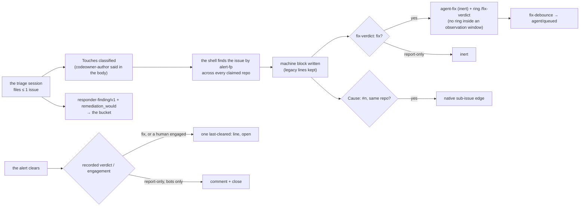

# The responder's issue, its verdict, and its record — what the loop reads after a triage

A triage session's cheapest sufficient outcome is report-only, a GitOps quick fix, or EXACTLY ONE
inert issue on the repo that owns the fix surface. What the rest of the platform reads is the
issue's grammar — `alert-fp:`, `subject:`, `Touches:`, `fix-verdict:`, `Cause:` — normalised by the
shell into the one machine block (ADR-122 (3)), and the typed `responder-finding/v1` record in the
bucket. The [fix verdict](glossary.md#fix-verdict) is a diagnosis, not a dispatch: `fix` earns the
inert `agent-fix` label and a ring on `/fix-verdict`, and `fix-debounce-argo.yaml` judges the whole
pending set before any issue is `agent/queued` — the self-heal half P4(c) names, from alert to a
queued fix with no human in the path. When the alert clears, the resolve leg acts on the recorded
verdict, never on the alert. Owning prose: [`docs/agents/roles.md`](../../../../docs/agents/roles.md)
§responder; the dial's evidence: [the scoreboard](../docs/remediation-would-scoreboard.md). Terms:
[glossary.md](glossary.md).

## Interface — the machine half

**[`responder-verdict.schema.json`](responder-verdict.schema.json)** holds the filed issue's lines,
the machine block keys the shell writes, the `/fix-verdict` ring, the `responder-finding/v1`
record, the `REMEDIATION-WOULD:` line and the claim's `spec.responder` block.

| Requirement | Governs (schema) | Status |
|---|---|---|
| [INTAKE-RESP-FIX-VERDICT](#intake-resp-fix-verdict) | `$defs/issue_lines`, `$defs/fix_verdict_ring` | 🚧 WIP — no evidence pipeline yet (fixture: `responder-reopen/*`; `responder-behaviour` §VERDICT read-back) |
| [INTAKE-RESP-CAUSE-LINE](#intake-resp-cause-line) | `$defs/issue_lines.cause` | 🚧 WIP — no evidence pipeline yet (fixture: `responder-cause-line/*`) |
| [INTAKE-RESP-RESOLVE](#intake-resp-resolve) | `$defs/last_cleared_line` | 🚧 WIP — no evidence pipeline yet (fixture: `responder-engagement/*`) |
| [INTAKE-RESP-FINDING](#intake-resp-finding) | `$defs/finding`, `$defs/remediation_would_line` | 🚧 WIP — no evidence pipeline yet (fixture: `responder-capture/*`, `responder-remediation-would`) |
| [INTAKE-RESP-TOUCHES-CLASSIFY](#intake-resp-touches-classify) | `$defs/issue_lines.touches` | 🚧 WIP — no evidence pipeline yet (fixture: `responder-touches-classify`) |
| [INTAKE-RESP-GRADUATION](#intake-resp-graduation) | `$defs/claim_responder` | 🚧 WIP — no evidence pipeline yet (fixture: `responder-graduation`) · `⚑ gap`: no consumer reads the grant |

## Flow overview

## Requirement index

| Requirement | Section | Status |
|---|---|---|
| [INTAKE-RESP-FIX-VERDICT](#intake-resp-fix-verdict) | the verdict read back, labelled, rung | 🚧 WIP — no evidence pipeline yet (fixture: `responder-reopen/*`) |
| [INTAKE-RESP-CAUSE-LINE](#intake-resp-cause-line) | bind-at-filing | 🚧 WIP — no evidence pipeline yet (fixture: `responder-cause-line/*`) |
| [INTAKE-RESP-RESOLVE](#intake-resp-resolve) | the clear acts on the verdict | 🚧 WIP — no evidence pipeline yet (fixture: `responder-engagement/*`) |
| [INTAKE-RESP-FINDING](#intake-resp-finding) | the typed record, the dial's shadow answers | 🚧 WIP — no evidence pipeline yet (fixture: `responder-capture/*`) |
| [INTAKE-RESP-TOUCHES-CLASSIFY](#intake-resp-touches-classify) | the filing door's classification | 🚧 WIP — no evidence pipeline yet (fixture: `responder-touches-classify`) |
| [INTAKE-RESP-GRADUATION](#intake-resp-graduation) | the remediation dial's grant | 🚧 WIP · `⚑ gap`: no consumer |

## INTAKE-RESP-FIX-VERDICT

After the session, the shell finds the issue it filed by the `alert-fp:<fp>` marker, searching the
default route repo, `teststuffstash/homelab`, then every repo any AgentStack claim names (a session
routes by fix surface and may land on any of them; filtering to `-iac` repos once left
oracle-fleet#228's `fix` verdict unlabelled for ~6 h), cheapest first, first hit wins. It upserts
the machine block (`alert-fp`, `self-referential`, `fix-verdict`, `Touches`) through
`agents/issue_body.py set`, keeping the legacy lines (the transition window — readers not yet on
the parser), and leaves a malformed block untouched. It reads the verdict through the parser: `fix`
→ label `agent-fix` (inert: the scan dispatches on `agent/queued` alone, ADR-122 (2)) and POST
`/fix-verdict {repo, number}` — unless the alert sits in a stack's observation window, where a
re-fire re-rings after it; anything else stays inert. When a reopen belt restored a closed thread,
its stale lifecycle labels (`agent/queued`, `agent/done`, `agent-fix`) are stripped first, so only
a FRESH verdict may re-queue it; a thread a person closed is re-closed with one comment that is
the last word. Every write is non-fatal: a failed label or ring is said, and fix-debounce's
backstop cron re-derives the pending set.

**World:** each row's fixture dir (`homelab#103` reopened on the subject belt; `#77` also
closed).

#### What the verdict earns a reopened thread

Legend: `verdict` = the session's `fix-verdict`; `closed_by` = who closed `#103` before the
reopen; `labels?` = the label writes in order; `ring?` = a `/fix-verdict` POST; `state?` = `#103`
afterwards.

| description | verdict | closed_by | fixture | labels? | ring? | state? |
|---|---|---|---|---|---|---|
| a `fix` reopen re-earns the queue from scratch | `fix` | bot | `responder-reopen/fix-verdict` | remove `agent/queued,agent/done,agent-fix`; add `agent-fix` | `yes` | open |
| a report-only reopen leaves a record, dispatches nothing | `report-only` | bot | `responder-reopen/report-only` | remove `agent/queued,agent/done,agent-fix` | `no` | open |
| a person's close is restored, with one last-word comment ⚖ | `report-only` | User | `responder-reopen/human-closed` | remove `agent/queued,agent/done,agent-fix` | `no` | closed again |
| the read-back follows a re-routed filing | `fix` | — (a fresh filing on a non-default repo) | `responder-behaviour` "VERDICT read-back follows a RE-ROUTED filing" | add `agent-fix` on that repo | `yes` | open |

Evidence — latest run

--8<-- "INTAKE-RESP-FIX-VERDICT.md"

## INTAKE-RESP-CAUSE-LINE

The session judges whether ONE causing issue in the same repo is identified and, if so, writes a
line-anchored `Cause: #<n>`; the shell acts: it verifies the cause exists, reads both API ids and
POSTs the native sub-issue edge (ADR-094 S6). An issue already parented is not re-linked. Every
failure — the cause missing or unreadable, the filed issue's id unreadable — is one log line and no
write; the body line stays as the fallback record. A malformed line (no number) or no line at all
does nothing. Cross-repo causes are not bound (sub-issues are same-owner; v1 stays narrow).

**World:** each row's fixture dir (filed issue `homelab#999`, cause `#123`).

#### Whether the filed issue is bound to its cause

Legend: `cause_line` = the body's line; `state` = what the reads answer; `write?` = the sub-issue
POST; `log?` = the line's start.

| description | cause_line | state | fixture | write? | log? |
|---|---|---|---|---|---|
| a valid line binds the edge | `Cause: #123` | both readable, no parent | `responder-cause-line/valid` | `POST …/issues/123/sub_issues sub_issue_id=123999` | `linked as sub-issue of …#123` |
| no line, no bind | — | — | `responder-cause-line/absent` | none | — |
| a malformed line does nothing | `Cause: invalid` | — | `responder-cause-line/malformed` | none | — |
| an already-parented issue is not re-linked | `Cause: #123` | `#999` has a parent | `responder-cause-line/already-bound` | none | `already linked as sub-issue (skip re-link)` |
| a missing cause is said, not bound | `Cause: #123` | `#123` 404 | `responder-cause-line/cause-missing` | none | `Cause: #123 not found or unreadable` |
| an unreadable cause is said, not bound | `Cause: #123` | `#123` read fails | `responder-cause-line/cause-unreadable` | none | `Cause: #123 not found or unreadable` |
| an unreadable filed issue is said, not bound | `Cause: #123` | `#999`'s id read fails | `responder-cause-line/issue-unreadable` | none | `could not get API ID for …#999` |

Evidence — latest run

--8<-- "INTAKE-RESP-CAUSE-LINE.md"

## INTAKE-RESP-RESOLVE

A cleared alert acts on the RECORDED verdict and on who engaged, never on the alert: alert state is
not defect state. A `fix` thread stays open — the defect outlives its alert, and closure belongs to
the merged fix or a human — and gets at most ONE rewritten `last-cleared:` line, no comment. A
report-only thread nobody but the machine touched gets a comment and is closed (right for transient
noise). A report-only thread a HUMAN commented on stays open with the same single line and no
comment — someone owns it. Engagement is read from REST `.user.type`, never the `[bot]` suffix
(GraphQL omits it, which once held 13 of 24 open alert issues open). A comments read that fails
leaves the thread alone — never a close on a failed read (rule #6). One comment per clear on a
thread that never closes would be unbounded by construction.

**World:** each row's fixture dir (`PodSigkilled` cleared, thread `homelab#1723`, report-only).

#### What a clear does to the thread

Legend: `engagement` = who commented on the thread; `writes?` = the GitHub writes; `state?`.

| description | engagement | fixture | writes? | state? |
|---|---|---|---|---|
| a thread only the machine touched closes | bots only | `responder-engagement/bots-only` | one comment + close | closed |
| a person on the thread means no comment, no close | 1 human comment | `responder-engagement/human-engaged` | the `last-cleared:` line | open |
| a failed comments read changes nothing ⚖ | unreadable | `responder-engagement/probe-failed` | none | open |
| ⚑ gap: a `fix` thread keeps only the line | (a `fix-verdict: fix` thread) | — (`responder-behaviour` §the resolve leg keys on the recorded verdict) | the `last-cleared:` line | open |

Evidence — latest run

--8<-- "INTAKE-RESP-RESOLVE.md"

## INTAKE-RESP-FINDING

Every triage session leaves a record in the bucket under `homelab/alert-<fp>/responder-r1-<ts>/`:
straight after the session the input alert, `triage.log`, the session's own JSONL and a manifest
(so a crash in the later belts cannot cost the transcript), and at the end of the iteration
`finding.json` (`responder-finding/v1`: verdict, issue, route repo and stack, self-referential,
observation window, model, rail, `remediation_would`). The project is `homelab` whatever repo the
issue went to — the session is the platform's. `remediation_would` is HARVESTED by the shell from
the session's line-anchored `REMEDIATION-WOULD: <verb> <namespace>/<kind>/<name> — <reason>`
lines — the model is never asked for JSON: one `{verb, target, reason, raw}` per distinct line in
order, a line that does not parse kept as `raw` with null parts (still scored), a declared
non-action (`none` / `n/a` / `no action`) dropped, `[]` when none. The marker is independent of the
fix verdict (an imperative remediation is never a PR, so a report-only triage that names one must
still carry it — that class is what the dial measures). Capture DEGRADES and never breaks the
lane: no key, no `s5cmd` or a refused put is one loud line. The key is write-only, so the pod can
never read its findings back — the lane's dedup state stays in GitHub and `responder-seen`. Every
entry is scored `right | wrong | unsafe` by `/board-sweep` into
[the scoreboard](../docs/remediation-would-scoreboard.md) — stack alerts only count.

**World:** each row's fixture dir.

#### What a triage leaves in the bucket

Legend: `key` = the S3 writer key in the pod; `would_lines` = the session's marker lines;
`finding?` = the record written; `remediation_would?`.

| description | key | would_lines | fixture | finding? | remediation_would? |
|---|---|---|---|---|---|
| a triage leaves a transcript and a typed finding | present | none | `responder-capture/uploads` | `verdict 'fix'`, `issue homelab#1751` | `[]` |
| the would-lines are typed, not asked for as JSON | present | `delete monitoring/pod/loki-0 — WAL replay wedged; …` (+ a malformed one, an echo, a `none`) | `responder-capture/remediation-would` | `responder-finding/v1` | `[{verb: delete, target: monitoring/pod/loki-0, reason, raw}, …]` — the malformed kept `raw`, the echo once, `none` dropped |
| capture degrades, never breaks the lane | absent | — | `responder-capture/no-key` | none — `capture skipped` | — |
| the brief asks for the marker, independent of the verdict | — | — | `responder-remediation-would` (A1–A7) | — | the brief carries `REMEDIATION-WOULD: <verb>` and "INDEPENDENT of your fix-verdict" |

Evidence — latest run

--8<-- "INTAKE-RESP-FINDING.md"

## INTAKE-RESP-TOUCHES-CLASSIFY

The filing brief (STEP 3(c)) makes the session declare the NARROWEST `Touches:` surface its
diagnosis supports — the footprint the scan serialises on and the reviewer flags escapes against —
and classify it before filing: source `agents/footprint.sh`, set `CLASSIFY_CODEOWNERS`, call
`classify_touches`. A `codeowner-author` verdict, or an intersection with
`scripts/pin-only-lint.sh`'s GUARDED set, means no worker can land it as a PR, so the body says so
as ONE plain sentence naming the classifier and its verdict — never a new body line. A surface the
session cannot tell is omitted (an undeclared footprint is exclusive, the safe default). The body
ends with exactly one `fix-verdict:` line and, for a single same-repo cause, a `Cause: #<n>` line.

**World:** the `respond` script extracted from the manifest (the brief text).

#### What the filing brief requires

Legend: `brief_must_carry?` = text the composed brief contains.

| description | fixture | brief_must_carry? |
|---|---|---|
| the classifier and its one home | `responder-touches-classify` (A1–A3) | `classify_touches`, `agents/footprint.sh`, `CLASSIFY_CODEOWNERS=/work/homelab/CODEOWNERS` |
| the verdicts that mean no worker can land it | `responder-touches-classify` (A4–A5) | `codeowner-author`, `pin-only-lint.sh` |
| one sentence, never a new line ⚖ | `responder-touches-classify` (A6–A7) | "as ONE plain sentence naming the classifier", "never a new body line for it" |
| the narrowest surface, the verdict and the cause lines | `responder-touches-classify` (B2–B5) | `a 'Touches:' line (ADR-097)`, "Declare the NARROWEST surface", `fix-verdict:`, `Cause: #` |

Evidence — latest run

--8<-- "INTAKE-RESP-TOUCHES-CLASSIFY.md"

## INTAKE-RESP-GRADUATION

The remediation dial's grant: a claim-gated `spec.responder` block on the AgentStack XRD renders,
when `enabled: true`, a scoped Role + RoleBinding (`agentstack-responder`) in the stack's loop
namespace and in each fixer-enabled repo namespace, granting exactly the declared verb/resource
pairs to the responder identity; no block or `enabled: false` renders nothing (byte-identical to
before). The escalation-check mirror in `argocd/resources/agentstack/rbac.yaml` grants Crossplane
the verbs it needs to compose that Role. The grant is the claim island's Composition rendering
for this island's identity.

`⚑ gap (2026-08-24, goal#818)`: default OFF everywhere, and enabling it does not by itself make the
responder mutate anything — no consumer reads the grant; report-only stays the posture. The
graduation criterion lives on goal#818; the evidence is
[the scoreboard](../docs/remediation-would-scoreboard.md).

**World:** the replay's simulated renderer (the Composition's GoTemplate conditional re-expressed in
bash) over claim fixtures.

#### What the claim's responder block renders

Legend: `responder_block` = the claim's `spec.responder`; `rendered?` = the Role/RoleBinding
namespaces.

| description | responder_block | fixture | rendered? |
|---|---|---|---|
| no block renders nothing | absent | `responder-graduation` §1 | none |
| disabled renders nothing | `enabled: false` | `responder-graduation` §2 | none |
| enabled renders into the loop ns and each fixer repo ns ⚖ | `enabled: true`, verbs declared | `responder-graduation` §3 | `<stack>-agents` + each fixer-enabled repo ns; a repo with no fixer gets none |
| an empty verbs array still renders the Role and its binding ⚖ | `enabled: true`, `verbs: []` | `responder-graduation` §4 | Role + RoleBinding with a `rules:` section |

Evidence — latest run

--8<-- "INTAKE-RESP-GRADUATION.md"

