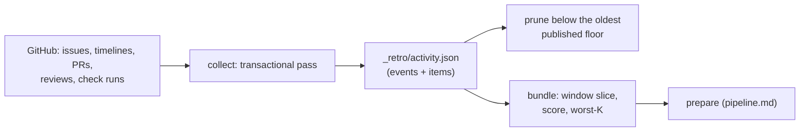

# `retro_activity.py` — the GitHub activity evidence and its pain score

*What happened on the fleet's issues and PRs this week, and which items hurt most?*
[`agents/retro_activity.py`](../../../retro_activity.py) keeps one shared activity state
(`_retro/activity.json`) for every series. `collect` runs every 30 minutes
(`retro-activity-collect`, [`retro-activity-argo.yaml`](../../../coordinator/retro-activity-argo.yaml),
through `retro_pipeline.py collect`); `bundle` is called by `prepare`
([pipeline.md#retro-bundle-frozen](pipeline.md#retro-bundle-frozen)). It reads GitHub only, through
the read-only `retro-git` identity ([`retro-git.yaml`](../../../coordinator/retro-git.yaml)); it does
not join session manifests, token cost or legacy commit statuses, and says so in every bundle's
`limitations`. [UC-1](use-cases/uc-1-weekly-series.md) step ⓪.

## Interface — the machine half

**[`activity.schema.json`](activity.schema.json)** — the event, the item, the state, the bundle task.

| Requirement | Governs (schema) | Status |
|---|---|---|
| [RETRO-ACTIVITY-COLLECT](#retro-activity-collect) | `$defs.state`, `$defs.event`, `$defs.item` | 🚧 WIP — no evidence pipeline yet (suite: `retro-activity-window`, world `fake-github`) |
| [RETRO-ACTIVITY-SCORE](#retro-activity-score) | `$defs.task`, `$defs.bundle_population` | 🚧 WIP — no evidence pipeline yet (suite: `retro-activity-window`) |
| [RETRO-ACTIVITY-PRUNE](#retro-activity-prune) | `$defs.state.properties.events` | 🚧 WIP — no evidence pipeline yet (suite: `retro-activity-window`) |
| [RETRO-RANK-LEGACY](#retro-rank-legacy) | `$defs.legacy_rank_row` | `⚑ gap`: no live caller — `retro-argo.yaml` stopped calling `agents/retro-rank.py` when the activity selector replaced it; its fixture `retro-rank-snapshot-exclusion` still says the workflow calls it |

## Flow overview

## RETRO-ACTIVITY-COLLECT

A collection pass reads, per repo in scope (the live AgentStack claims' repos over the committed
`agents/stacks.json` mirror, `scope_source` saying which), every issue/PR updated since the previous
`collected_until` plus every open item, their timelines, PR reviews and the check runs of every PR
commit. It is transactional: any unreadable endpoint fails the pass and the state is not replaced. A
transient error (HTTP 5xx, a timeout, a reset) is retried in place up to 3 attempts; anything else
fails at once. An event's identity is `<repo>:<item>:<kind>:<source id>`; a re-read whose payload
changed **replaces** that event with a new `observed_at` (a correction, never a second round). A
check run's identity is the run alone, so pending → completed corrects. An agent-summary comment's
dated `<!-- agent-event kind=… ts=… -->` lines each become an `agent-<kind>` event at their own time.
Collection never moves backwards and never claims an `until` it did not read.

**World: [fake-github](worlds/README.md)**.

| description | world | api_answers | result? |
|---|---|---|---|
| ⚖ a transient 5xx is retried | fake-github | 504, then 200 | collected |
| a permanent error fails the pass | fake-github | 403 | raises; state unchanged |
| a check completing corrects its event | fake-github | check pending → completed | one event, conclusion updated |
| a closed PR's pending checks are revisited | fake-github | PR closed, its SHA pending | re-read until complete |
| a stats correction is not a new round | fake-github | the same marker re-read with a new cost | one event, new `observed_at` |

## RETRO-ACTIVITY-SCORE

`bundle --since --until --keep 40` slices the events inside the window, groups them per item and
scores each item; the worst 40 by score (ties by key) go into the prompt, compacted to their last 8
events, with all population counters computed before sampling and before PR→issue crediting.

| term | weight | counted when |
|---|---|---|
| failure event | 1000 | a check `failure` / `timed_out`; a `CHANGES_REQUESTED` review; a cancelled check classified `other` |
| infra failure | 500 | a cancelled check whose output says `shutdown signal` / `lost communication` |
| agent pain | 1000 | an `agent-block` / `-strike` / `-arbitrate` / `-park` event; an `agent/error` or `agent/blocked` label added or removed |
| extra round | 500 per round after the first | rounds = max(dispatch markers, stats markers) |
| direct event | 10 | any non-reference event |
| standing stall | 0.005 per second | open idle time after the last substantive event, only on `agent/*` / `task/goal` items and PRs |

A cancellation superseded by a newer SHA (the item's `head_sha`, else its newest check SHA) or by a
"higher priority" request is not pain; it is counted as `superseded_cancellations`. A PR's failure
events and direct events are credited to the issues it cross-references (PR → issue only; PR → PR
never). ⚖ The weights are a ranking device, not a measurement: a week-blocked issue outranks a PR
with a handful of real cancellations.

**World: [fake-github](worlds/README.md)**.

| description | world | events | score_order? |
|---|---|---|---|
| ⚖ a blocked issue outranks a cancellation-only PR | fake-github | issue: `agent/blocked` + a week idle; PR: 3 `other` cancellations | issue first |
| a superseded cancellation is not a failure | fake-github | cancelled check on an old SHA | `failure_events` 0, `superseded_cancellations` 1 |
| ⚖ PR failures roll up to the linked issue | fake-github | PR with 2 failed checks cross-referencing the issue | issue `failure_events` 2 |
| a PR → PR reference credits nothing | fake-github | PR referencing a sibling PR | sibling unchanged |

## RETRO-ACTIVITY-PRUNE

`collect --prune-until --prune-covered-at` (set by `retro_pipeline.py collect` to the OLDEST published
checkpoint across all series, so a series still owed a window keeps its evidence; no publication
keeps everything) drops the events that published window accounted for — occurred before `until`
and observed by `covered_at` — but keeps late arrivals, the lifecycle events of every item still
present, references while either end lives, and items with pending checks. A stored reference's
timeline `source` is kept only as what the bundle reads (`type`, `issue.number`,
`issue.repository.full_name`, `issue.html_url`).

**World: [fake-github](worlds/README.md)** / [local-store](worlds/README.md) for the floor.

| description | world | published_floors | event | kept? |
|---|---|---|---|---|
| no publication keeps everything | local-store | none | any | yes |
| ⚖ the oldest floor wins | local-store | `platform` 09-28, `feedback-triage` 09-21 | an event at 09-25 | yes |
| a late arrival survives the prune | fake-github | 09-28 | occurred 09-20, observed after `covered_at` | yes |
| a retired item with pending checks stays | fake-github | 09-28 | closed 09-20, SHA pending | yes |

## RETRO-RANK-LEGACY

[`agents/retro-rank.py`](../../../retro-rank.py) pain-ranks the whole ledger (snapshot rows excluded,
the top-KEEP re-read live and closed-with-a-strong-link-merged-PR rows dropped). Its replacement is
the windowed ledger slice ([RETRO-LEDGER-WINDOW](pipeline.md#retro-ledger-window)) plus the activity
score above; nothing on master invokes it. ⚖ Deleting it (with its suite and fixture) or naming a
caller is the open choice — the index row carries the gap.

**World: [rank-ledger](worlds/README.md)**.

| description | world | ledger_rows | top_k? |
|---|---|---|---|
| a snapshot row never ranks | rank-ledger | a `snapshot: true` row that would sort first | absent; exclusion counted |
| ⚖ a closed issue with a merged strong-link PR leaves the rank | rank-ledger | blocked row, issue CLOSED, `fixes #N` merged | absent; counted |
| an unreadable probe keeps the row | rank-ledger | `gh` fails | kept; counted unverified |
