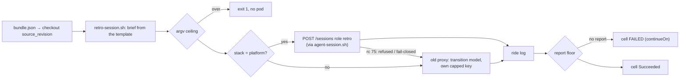

# `retro-session.sh` and the retro-cell step — one ride, one report

*Ride this harness over the frozen bundle and come back with a report — or say clearly that there
is none.* [`agents/retro-session.sh`](../../../retro-session.sh) assembles the brief and hands one
ride to `agent-session.sh` (the launch island's launcher); the `retro-cell` template of
[`retro-argo.yaml`](../../../coordinator/retro-argo.yaml) runs it at the bundle's `source_revision`
and then judges its own ride log. Consumed: the gateway's `POST /sessions` for role `retro`
([`gateway/specs/endpoints/sessions.md`](../../../../gateway/specs/endpoints/sessions.md)), through
the shared helper `agents/gateway-admit.sh`; the brief templates `docs/agents/retros/BRIEF.md`,
`CROSS-REVIEW.md` and `SERIES-BRIEF.md` (runtime-read, they stay in place). Exposed: the ride log
(the cell's output artifact), which the harvest reads ([harvest.md](harvest.md)).
[UC-1](use-cases/uc-1-weekly-series.md) steps ②–③.

## Interface — the machine half

**[`cell.schema.json`](cell.schema.json)** — the CLI, the exit codes, the ride-log lines other steps read.

| Requirement | Governs (schema) | Exit | Status |
|---|---|---|---|
| [RETRO-CELL-PATH](#retro-cell-path) | `cli.cell`, `$defs.dispatch_line`, `$defs.old_proxy_line` | `2` model on platform / no transition model | 🚧 WIP — no evidence pipeline yet (fixture: `retro-gateway-cell`); `⚑ gap (2026-11-07, spike PR #3147)`: 13 old self-routing sites remain on the transition path ([§Self-routing](#self-routing-left-on-the-transition-path)) |
| [RETRO-CELL-KEY](#retro-cell-key) | `$defs.key_cr` | `1` no key, no ride | 🚧 WIP — no evidence pipeline yet (fixture: `retro-key`); `⚑ gap`: old-proxy only — the gateway cell holds no key; deleted with the old proxy |
| [RETRO-CELL-PAYLOAD](#retro-cell-payload) | `cli`, `exit` | `1` over the argv ceiling | 🚧 WIP — no evidence pipeline yet (fixture: `argv-payload/retro-handoff`, a launch-island family) |
| [RETRO-CELL-RUNID](#retro-cell-runid) | `$defs.run_id`, `$defs.task_key` | `1` invalid frozen run id | 🚧 WIP — no evidence pipeline yet (suite: `retro-activity-window`) |
| [RETRO-REPORT-FLOOR](#retro-report-floor) | `$defs.report_floor` | `1` with one reason line | 🚧 WIP — no evidence pipeline yet (fixture: `retro-cell-report`) |
| [RETRO-CELL-SELFCHECK](#retro-cell-selfcheck) | `$defs.cell_step` | `1` no report | 🚧 WIP — no evidence pipeline yet (fixture: `retro-cell-report`) |

## Flow overview

## RETRO-CELL-PATH

A cell is a harness (`claude`, `goose`). On the platform stack it is ONE `POST /sessions` admission
for role `retro` — `AGENT_GATEWAY=sessions AGENT_GATEWAY_ROLE=retro` handed to `agent-session.sh`
with `--harness` (the ride command is harness-literal, so the harness narrows the walk to its
dialect) and no model, no key; the caller is the retro pod's projected ServiceAccount token (audience
`agent-gateway`), granted role `retro` and the bind into `openrouter-operator` by the gateway
policy's `callers`. A platform cell that names a model (`claude:opus`) is refused before anything is
assembled. A defer exits like any failed hand-off. Exit 75 from the hand-off (a refusal before any
request, or a fail-closed admission) is the transition fallback: the cell rides the old proxy on its
harness's transition model (`claude` → `opus`, `goose` → `deepseek/deepseek-v4-pro`). Off-platform
stacks ride the old proxy directly — a bare harness on its transition model, `<harness>:<model>` as
given. A harness with no transition model and no model is refused. The cross-review leg (`--review`)
takes the same path with task `retro-rN-xrev`.

**World: [cell-bridge](worlds/README.md)** — run id `r10`, `STACK=platform`, `CELL=claude` unless a
row overrides; `path?` legend: `gateway` = the gateway hand-off with role `retro`, `old-proxy h/m` =
`--harness h --model m`.

| description | world | STACK | CELL | REVIEW | HANDOFF_RC | path? | task? | rc? |
|---|---|---|---|---|---|---|---|---|
| gateway-claude | cell-bridge | platform | claude | — | 0 | gateway | retro-r10 | 0 |
| gateway-goose-review | cell-bridge | platform | goose | `docs/agents/retros/x.md` | 0 | gateway | retro-r10-xrev | 0 |
| gateway-defer | cell-bridge | platform | claude | — | 1 | gateway | retro-r10 | 1 |
| ⚖ gateway-fallback-claude | cell-bridge | platform | claude | — | 75 | gateway, then old-proxy claude/opus | retro-r10 | 0 |
| gateway-fallback-goose | cell-bridge | platform | goose | — | 75 | gateway, then old-proxy goose/deepseek/deepseek-v4-pro | retro-r10 | 0 |
| ⚖ platform-model-refused | cell-bridge | platform | claude:opus | — | — | none | — | 2 |
| oracle-bare-harness | cell-bridge | oracle | goose | — | — | old-proxy goose/deepseek/deepseek-v4-pro | retro-r10 | 0 |
| oracle-pinned | cell-bridge | oracle | claude:sonnet | — | — | old-proxy claude/sonnet | retro-r10 | 0 |
| oracle-unknown-harness | cell-bridge | oracle | opencode | — | — | none | — | 2 |

Evidence — latest run

--8<-- "RETRO-CELL-PATH.md"

### Self-routing left on the transition path

The redrawn contract is the gateway's: the caller names a role and a harness, the gateway names the
model, the rail and the credential. What the retro still decides itself, on the old-proxy branch
(off-platform stacks and the rc-75 fallback), counted on `island/retro` 2026-11-07 — executable lines
only:

| site | where | what the caller decides |
|---|---|---|
| `<harness>:<model>` cell syntax | `retro-session.sh:74-75` | the model, from the cell string |
| `retro_fallback_model` | `retro-session.sh:91-97` (2 model literals: `opus`, `deepseek/deepseek-v4-pro`) | the transition model per harness |
| fallback call sites | `retro-session.sh:99`, `:238` | when the transition model applies |
| `resolve-model.sh --role retro --class audit` | `retro-session.sh:250` | the old `/route` lookup, short-circuited by `--model` |
| rail by harness (`claude` = subscription, no key) | `retro-session.sh:265` | the rail |
| the key mint (`estimate_budget.py --label agent-budget/xs`, `OpenRouterKey` apply + wait) | `retro-session.sh:286-381` | the credential and its cap |
| `RETRO_OPENROUTER_SECRET` pass-through | `retro-session.sh:269`, `:385` | a pinned credential |
| `--model` to the launcher | `retro-session.sh:387` | the model |
| `retroKeySecret` parameter | `retro-argo.yaml:101`, `:367` | a pinned credential |
| the `subscription-capacity` semaphore | `retro-argo.yaml:313` | capacity — the FU-088 claude slot pool, held by BOTH cells (the gateway already admits on capacity) |
| the old-proxy `served_model` branch | `retro-argo.yaml` harvest, `served_model()` | reading the model off the old proxy's line |

Together: 13 sites, 2 model literals. All leave with the old proxy (FU-270's transition table "is
deleted with the old proxy"). Unverified — expected: zero on the gateway branch, which passes only
`--harness`, `--task`, `--run`.

## RETRO-CELL-KEY

On the old-proxy branch a non-subscription cell rides an `OpenRouterKey` it mints for itself — one per
(run, cell), forced to tier `xs` / `budgetUSD: 0.5` (the lane's measured $0.02–0.08 per cell × the
estimator's ×2.0 buffer, never the estimator's fixer-shaped band) — deleting any same-named CR first
(OpenRouter's PATCH cannot extend a key's expiry), reading `secretName` out of the emitted CR, and
waiting up to 120 s for `.status.openrouter.hash` before the hand-off. ⚖ There is no fallback: a mint
that fails ends the ride; the stack fixer's standing key is never spent. A `claude` cell mints
nothing (subscription); `RETRO_OPENROUTER_SECRET` pins a pre-minted key and mints nothing.

**World: [key-world](worlds/README.md)** — `STACK=oracle`, run `r4`, `CELL=goose`.

| description | world | CELL | RETRO_OPENROUTER_SECRET | cr_shape | minted? | budgetUSD? | handoff_secret? |
|---|---|---|---|---|---|---|---|
| minted | key-world | goose | — | inline | yes | 0.5 | `oracle-fleet-session-retro-r4-deepseek-v4-pro-openrouter` |
| minted-block-style | key-world | goose | — | block | yes | 0.5 | the CR's `secretName` |
| minted-labels-first | key-world | goose | — | labels before `name` | yes | 0.5 | the CR's `secretName` |
| pinned | key-world | goose | a Secret name | — | no | — | that Secret |
| subscription | key-world | claude | — | — | no | — | none |

Evidence — latest run

--8<-- "RETRO-CELL-KEY.md"

## RETRO-CELL-PAYLOAD

The brief travels base64-encoded inside the ONE `--run` argument handed to `agent-session.sh`, so the
hand-off is refused before any pod is created when that argument would exceed Linux's per-string
ceiling (131 072 bytes, `agents/argv-guard.sh`), naming the run and the brief and the growable inputs
(`--deep-dive-k`, the harness excerpts, the reviewed report). Unverified here — the row lives in the
launch island's `argv-payload/retro-handoff` family.

> **External:** MUST — [Linux execve(2) · NOTES § Limits on size of arguments and environment, MAX_ARG_STRLEN](https://man7.org/linux/man-pages/man2/execve.2.html#NOTES) (32 × page size per string).

## RETRO-CELL-RUNID

The cell's run id is the frozen bundle's `run_id` when present (it must match `r[1-9][0-9]*`, else the
cell refuses), so a report PR still unmerged when a retry fires keeps its number; only a bare
invocation counts the committed reports. The task key is `retro-rN` for the stack's own series and
`retro-<series>-rN` for a named one (`-xrev` appended on a cross-review), so two series never share a
transcript prefix.

**World: [local-store](worlds/README.md)** — the `retro-window-run-id` clause run alone.

| description | world | bundle_run_id | counted_run_id | RUN_ID? | rc? |
|---|---|---|---|---|---|
| ⚖ the frozen run id wins | local-store | r99 | r6 | r99 | 0 |
| an injected run id is refused | local-store | `r99; malicious` | r6 | — | 1 |

## RETRO-REPORT-FLOOR

[`agents/retro-report-floor.sh <in> <out> <log|report>`](../../../retro-report-floor.sh) is the ONE
definition of a [report](glossary.md#report), shared by the cell's self-check, the harvest and
`retro-session.sh --review`. The caller declares what `<in>` is. `log`: both markers are required and
the LAST complete block is extracted (zero or one marker → `no-markers`, however long the transcript).
`report`: the file is the report. Either way the content must be non-empty (`empty`) and hold at
least 20 content lines (`under-floor: N content lines < 20`). Exit 0 writes the report to `<out>`;
exit 1 prints exactly one reason line; exit 2 is usage.

**World: [cell-report-logs](worlds/README.md)**.

| description | world | ride_log | reason? | rc? |
|---|---|---|---|---|
| present | cell-report-logs | one block, a full report | — | 0 |
| missing | cell-report-logs | no markers | `no-markers` | 1 |
| ⚖ skeleton | cell-report-logs | one block, 9 heading-only lines | `under-floor: 0 content lines < 20` | 1 |
| multi-block | cell-report-logs | three empty echoes, then the real block | — (the last block only) | 0 |
| ⚖ longlog | cell-report-logs | a long marker-less transcript | `no-markers` | 1 |

Evidence — latest run

--8<-- "RETRO-REPORT-FLOOR.md"

## RETRO-CELL-SELFCHECK

The `retro-cell` step runs under `pipefail` (a session that died fails the step) and then checks its
OWN ride log with the report floor: no report → the step fails with the floor's reason, even when the
ride exited 0 (a session that died clean). The DAG's `continueOn {failed, error}` keeps the sibling
cell and the harvest running, and the ride log is still an artifact. A single-cell series' empty
`harnessB` leg is a no-op that writes no log and succeeds — no report is its contract.

**World: [cell-report-logs](worlds/README.md)**.

| description | world | CELL | ride_log | step? |
|---|---|---|---|---|
| present | cell-report-logs | goose | a full report | Succeeded |
| ⚖ missing | cell-report-logs | goose | ride exited 0, no markers | Failed |
| harnessB empty | — | (empty) | none | Succeeded, nothing rides |

The single-cell no-op is unverified — expected to behave as its row says.

Evidence — latest run

--8<-- "RETRO-CELL-SELFCHECK.md"

