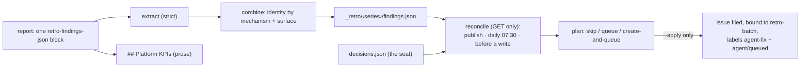

# Findings — from a report's candidates to (only actionable) issues

*Which of this week's candidate findings are real, already owned, or new work — and who may turn one
into an issue?* A report carries candidates; [`agents/retro_findings.py`](../../../retro_findings.py)
deduplicates them into the series' finding state and reconciles each against live GitHub (GETs
only); [`agents/retro_queue.py`](../../../retro_queue.py) plans and — only on the seat's explicit
acceptance act — files and queues the accepted ones. History stays in git (the report) and the bucket
(`_retro/<series>/findings.json`, publications); GitHub gets an issue only for accepted, still-open
work (the responder-findings direction: issues are ACTIONABLE only). Reconciliation runs at publish,
daily at 07:30 UTC (`retro-findings-reconcile`,
[`retro-activity-argo.yaml`](../../../coordinator/retro-activity-argo.yaml)) and immediately before
every queue write. [UC-1](use-cases/uc-1-weekly-series.md) steps ⑤–⑦.

## Interface — the machine half

**[`findings.schema.json`](findings.schema.json)** — the candidate envelope, the finding state, the
decision, the plan actions.

| Requirement | Governs (schema) | Errors | Status |
|---|---|---|---|
| [RETRO-FINDINGS-BLOCK](#retro-findings-block) | `$defs.envelope`, `$defs.candidate` | `report requires exactly one retro-findings-json block`, `candidate contains unsupported fields`, `finding requires occurrence evidence`, `related_work requires canonical GitHub issue/PR URLs` | 🚧 WIP — no evidence pipeline yet (suite: `retro-activity-window`, world `fake-github`) |
| [RETRO-FINDINGS-IDENTITY](#retro-findings-identity) | `$defs.finding.id`, `$defs.occurrence` | — | 🚧 WIP — no evidence pipeline yet (suite: `retro-activity-window`) |
| [RETRO-FINDINGS-RECONCILE](#retro-findings-reconcile) | `$defs.reconciliation` | `decision evidence must be URLs`, `matched_work must contain canonical GitHub references`, `canonical_issue must be a GitHub issue URL` | 🚧 WIP — no evidence pipeline yet (suite: `retro-activity-window`) |
| [RETRO-ACCEPT-QUEUE](#retro-accept-queue) | `$defs.decision`, `$defs.action` | `new findings require a --batch or origin_issue before filing`, `batch must be an open retro-batch container`, `new ordinary work requires machine-block Touches and Base: master`, `acceptance cannot manufacture Goal or lifecycle labels`, `duplicate finding issues require disposition` | 🚧 WIP — no evidence pipeline yet (suite: `retro-activity-window`); `⚑ gap (2026-11-07, spike PR #3147)`: queueing writes the labels `agent-fix` + `agent/queued` and reads `agent/*`, `task/*`, `retro-batch:` titles and its own body marker — 7 grammar sites outside the shared parser ([§Grammar sites](#grammar-sites-outside-the-shared-parser)) |
| [RETRO-KPI-BUCKET-A](#retro-kpi-bucket-a) | `$defs.kpi` | — | `⚑ gap (2026-11-07, spike PR #3147)`: no code computes, stores or exports the count — each cell estimates it in prose |

## Flow overview

## RETRO-FINDINGS-BLOCK

A report carries exactly one fenced `retro-findings-json` block (between the brief's
`BEGIN-RETRO-FINDINGS` / `END-RETRO-FINDINGS` lines): `{"schema_version": 1, "findings": [...]}`, at
most six [candidate findings](glossary.md#candidate-finding), an empty list valid. A candidate holds
only `mechanism`, `surface`, `summary` (non-empty strings), `evidence` (≥ 1 `https://` URL) and
`related_work` (canonical GitHub issue/PR URLs). ⚖ A candidate cannot carry acceptance, disposition
or queue fields — report text never authorizes itself. A report that breaks the envelope is excluded
from the findings and recorded as a report defect ([RETRO-PUBLISH-CHECKPOINT](pipeline.md#retro-publish-checkpoint)).

**World: [fake-github](worlds/README.md)**.

| description | world | block | candidate_fields | accepted? |
|---|---|---|---|---|
| a valid candidate | fake-github | 1 | mechanism, surface, summary, evidence, related_work | yes |
| no block | fake-github | 0 | — | no (`exactly one … block`) |
| ⚖ a candidate claiming acceptance | fake-github | 1 | + `accepted_by` | no (`unsupported fields`) |
| no evidence | fake-github | 1 | evidence `[]` | no (`requires occurrence evidence`) |
| a non-canonical related ref | fake-github | 1 | related_work `https://example.com/x` | no (`canonical GitHub issue/PR URLs`) |

## RETRO-FINDINGS-IDENTITY

A [finding](glossary.md#finding)'s id is `rf-` + the first 16 hex characters of sha256 over
`[mechanism, surface]` lower-cased with whitespace collapsed — never an issue number. The same
mechanism and surface from another cell or a later run add an **occurrence** (model, report sha256,
summary, evidence) to the existing finding instead of a new finding; re-running the same reports adds
nothing; `related_work` accumulates as a set. Occurrence history survives every later disposition. ⚖
Semantic duplicates in different words are not merged by the code; cross-review catches them.

**World: [fake-github](worlds/README.md)**.

| description | world | reports | findings? | occurrences? |
|---|---|---|---|---|
| ⚖ two cells, one mechanism | fake-github | opus + goose, same mechanism/surface | 1 | 2 |
| a re-run is idempotent | fake-github | the same two reports again | 1 | 2 |

## RETRO-FINDINGS-RECONCILE

Each finding's disposition is derived, never declared by a report: from the seat's
[decision](glossary.md#decision) (if any) and live GETs of every related, matched and canonical URL.
The table of dispositions is the glossary's ([finding](glossary.md#finding)). Mere references never
establish coverage: only `matched_work` with evidence does; a merged matched PR is
`implemented_unverified`, not verified; a closed issue without a merge proves nothing; unreadable
matched work stays `insufficient_evidence` ("do not queue duplicate work"); a related PR merged after
acceptance sends a `new_work_needed` decision back for a substance recheck. A finding is
`queue_prepared` only when `new_work_needed`, accepted (`accepted_by`, `accepted_at`, a canonical
issue, evidence), the canonical issue reads `open` and no read errored.

**World: [fake-github](worlds/README.md)**.

| description | world | decision | live_reads | disposition? | queue_prepared? |
|---|---|---|---|---|---|
| no decision | fake-github | — | related PR merged | insufficient_evidence | no |
| ⚖ a matched merged PR is not proof | fake-github | matched PR + evidence | PR merged | implemented_unverified | no |
| a closed issue does not prove a fix | fake-github | matched issue + evidence | issue closed, no merge | insufficient_evidence | no |
| open matched work covers it | fake-github | matched issue + evidence | issue open | covered_by_existing_work | no |
| verified needs its own evidence | fake-github | `verified`, evidence `[]` | — | insufficient_evidence | no |
| accepted new work is prepared | fake-github | `new_work_needed`, accepted, canonical issue, evidence | canonical open | new_work_needed | yes |
| ⚖ a fix landing after acceptance holds the queue | fake-github | `new_work_needed`, accepted at T | related PR merged after T | insufficient_evidence | no |

## RETRO-ACCEPT-QUEUE

`retro_pipeline.py accept --decisions <json>` merges the decisions into `_retro/<series>/decisions.json`
(every key must name an existing finding) and prints the plan: `skip` (not accepted, or not
`new_work_needed` and not an open matched issue, or the canonical issue closed), `queue` (an accepted
canonical issue), `create-and-queue` (accepted new work: `issue.repo`, `title`, a body whose machine
block carries `Touches` and `Base: master`, a `task/*` label, and no `agent/*` or `task/goal` label).
Nothing is written without `--apply`, the seat's acceptance act; scheduled reconciliation never calls
it. With `--apply`, every mutation re-plans first; a new issue needs an open `retro-batch:` container
(`--batch`) or the finding's `origin_issue`; it is found again by its exact body marker
`<!-- retro-finding:<id> -->` before it is created (receipts in `acceptance-receipts.json` make a
retry idempotent; two marked issues refuse); it is bound as a native sub-issue of its parent; it is
queued with `agent-fix` + `agent/queued` only if it is open, carries `Touches`, and holds no `agent/*`
label — an existing lifecycle decision is never overwritten. `acceptance.json` records the completion
separately: publication is not disposition, disposition is not dispatch.

**World: [local-store](worlds/README.md)** with GitHub stubbed.

| description | world | decision | issue_state | apply | action? | labels_written? |
|---|---|---|---|---|---|---|
| ⚖ an unaccepted report cannot queue | local-store | none | open | yes | skip | none |
| plan only | local-store | accepted canonical | open | no | queue | none |
| accepted canonical issue queues | local-store | accepted canonical | open, no `agent/*` | yes | queue | `agent-fix`, `agent/queued` |
| ⚖ an existing hold is preserved | local-store | accepted canonical | open, `agent/blocked` | yes | queue | none |
| an invalid batch refuses before creation | local-store | accepted new work, `--batch` closed | — | yes | create-and-queue | none (refused) |
| ⚖ new work cannot be a Goal | local-store | accepted new work labelled `task/goal` | — | no | refused | none |

### Grammar sites outside the shared parser

ADR-122 (3) rules one machine block and one parser; §Interfaces of
[context-and-autonomy.md](../../../../docs/spikes/context-and-autonomy.md) counts 15 labels and 11 body
keys carrying five facts. `retro_queue.py` already reads the machine block through
`agents/issue_body.py` (`parse_block`, `get`); what it still reads or writes on its own, counted
2026-11-07: the `task/*` requirement, the `agent/*`/`task/goal` refusal, the `agent/*` hold check, the
`agent-fix` + `agent/queued` write, the `retro-batch:` title test (twice), and the
`<!-- retro-finding:<id> -->` body marker found by scanning every issue of the repo
(`state=all`, all pages) — 7 sites. Unverified — expected: after P3 the labels and the container test
come from the one vocabulary file, and the queue fact from the one machine block.

## RETRO-KPI-BUCKET-A

ADR-103 (3) asks the weekly retro to score the [bucket-A count](glossary.md#bucket-a-count) —
platform-logic failure events in the window — with its trend and one proposed next gate; sustained
non-fall is ADR-103's named trigger to revisit label-carried loop state. The brief
(`docs/agents/retros/BRIEF.md`, "score these FIRST, every run") asks each cell to count it from the
responder ledger and platform-repo issues and report it under `## Platform KPIs`. No code computes
it: neither the activity bundle, the ledger slice, the finding state nor any pushed metric carries
it, so each cell's number is its own estimate and two cells of one run disagree (r7 2 vs 13, r8 1
vs 14, r10 6 vs "could not recompute" — the report headings, 2026-10-05 … 11-02). ⚖ The series did not
stop at 38 on 2026-08-31: the cells kept scoring it every run through r10 (2026-11-02); what stopped
is a single comparable number. Unverified — expected once built: the bundle carries a deterministic
count over the window's platform-repo issues and the responder ledger, the report quotes it, and a
gauge carries it per series.

**World:** none — the row states intent.

| description | world | window_events | bucket_a? |
|---|---|---|---|
| ⚖ the count is computed, not estimated | — | the window's platform-logic issues + responder findings | one integer in the bundle, quoted by every cell |
