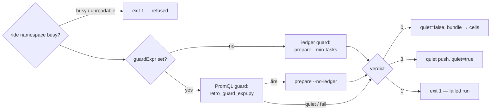

# The guard step — may this series ride this week?

*Is there work worth two paid rides, and is the ride namespace free?* The first step of every run of
the `retro-session` WorkflowTemplate ([`retro-argo.yaml`](../../../coordinator/retro-argo.yaml)
`templates[guard]`). Its consumers are the DAG (the `quiet` output parameter gates both cells and the
harvest), the cells and the harvest (the `evidence` artifact — the [frozen bundle](glossary.md#frozen-bundle)),
and the overdue belt (a quiet week pushes `retro_report_last_success_timestamp` under
`outcome=quiet`). [UC-1](use-cases/uc-1-weekly-series.md) step ①.

## Interface — the machine half

**[`guard.schema.json`](guard.schema.json)** holds the workflow parameters the guard reads, the
Prometheus answer it parses, its outputs and its exit codes.

| Requirement | Governs (schema) | Exit / outcome | Status |
|---|---|---|---|
| [RETRO-GUARD-BUSY](#retro-guard-busy) | `params.stack`, `exit` | `1` refused (busy or unverifiable) | 🚧 WIP — no evidence pipeline yet (no fixture: the busy probe sits above the `retro-quiet-guard` markers) |
| [RETRO-GUARD-LEDGER](#retro-guard-ledger) | `params.minWindowTasks`, `outputs.quiet`, `exit` | `0` fire · `3`→quiet · `1` fail | 🚧 WIP — no evidence pipeline yet (fixture: `retro-quiet-guard` rows `prepare-*`; `local-store` for the floor itself) |
| [RETRO-GUARD-EXPR](#retro-guard-expr) | `params.guardExpr`, `$defs.prometheus_response`, `exit` | `0` fire · `3` quiet · `1` fail | 🚧 WIP — no evidence pipeline yet (fixture: `retro-quiet-guard` rows `expr-*`) |
| [RETRO-GUARD-QUIET](#retro-guard-quiet) | `outputs.quiet`, `outputs.evidence`, `$defs.quiet_push` | `0` quiet · `1` push failed | 🚧 WIP — no evidence pipeline yet (fixture: `retro-quiet-guard` rows `quiet-push-*`, `expr-quiet`) |

## Flow overview

## RETRO-GUARD-BUSY

Both cells ride the stack's fixer namespace (the `PROJECT` that
[`retro-project.sh`](../../../retro-project.sh) maps the stack to: `platform` → `openrouter-operator`,
`oracle` → `oracle-fleet`, `sleep` → `sleep-tracking`) and may hold its WIP slot, so the guard refuses
while any `app=agent-session` pod runs there. Only that one namespace is probed — a busy fixer in a
sibling namespace of the same stack never refuses the run. A probe that fails counts as busy, never
as idle. A refusal fails the workflow visibly (exit 1). An unknown stack fails the same way.

**World:** none committed — unverified, expected to behave as the rows say.

| description | world | pods_in_PROJECT | probe | rc? |
|---|---|---|---|---|
| idle ride namespace | — | none | ok | continue |
| a worker rides the ride namespace | — | ≥ 1 | ok | 1 |
| ⚖ the probe itself failed — busy, not idle | — | — | error | 1 |
| ⚖ a fixer in a sibling platform namespace does not refuse | — | none (busy in `homelab`) | ok | continue |

> **External:** kubectl prints "No resources found in <ns> namespace." to STDERR with exit 0 on an
> empty list — the probe reads stdout only (`retro-argo.yaml` guard comment, homelab#237; verify during
> implementation of an evidence row).

## RETRO-GUARD-LEDGER

With `guardExpr` empty the guard is `retro_pipeline.py prepare --min-tasks <minWindowTasks>`
([pipeline.md#retro-bundle-frozen](pipeline.md#retro-bundle-frozen) owns what prepare freezes). The
verdict is prepare's exit code: `0` the window has at least `minWindowTasks` ledger tasks and rides;
`3` it has 1 … `minWindowTasks`−1 and is a [quiet week](glossary.md#quiet-week); `1` anything else —
including **zero** ledger tasks, which is a dead ledger source, never a quiet week.

**World: [guard-bridge](worlds/README.md)** — `prepare` is an exit code.

| description | world | PREP_RC | QUIET? | rc? |
|---|---|---|---|---|
| prepare-ok | guard-bridge | 0 | false | 0 |
| prepare-fails | guard-bridge | 1 | — | 1 |
| quiet-push-ok | guard-bridge | 3 | true | 0 |

Evidence — latest run

--8<-- "RETRO-GUARD-LEDGER.md"

The floor prepare applies, over the window's ledger tasks (`min_tasks` 8, the default):

| description | world | ledger_tasks | min_tasks | exit? |
|---|---|---|---|---|
| enough tasks ride | local-store | 8 | 8 | 0 |
| ⚖ a thin week is quiet and rolls forward | local-store | 3 | 8 | 3 |
| ⚖ zero tasks is a dead ledger source, not quiet | local-store | 0 | 8 | 1 |

## RETRO-GUARD-EXPR

A named series may guard on its own gauge instead of the ledger: `guardExpr` is one PromQL instant
query, written to yield a single 0/1 sample (`max(<gauge>) > bool <threshold>`). The guard queries
Prometheus once and [`retro_guard_expr.py`](../../../retro_guard_expr.py) rules: any sample > 0 fires
(then `prepare --no-ledger` freezes the run's coordinates only); every sample 0 is a quiet week; no
sample, a non-`success` status, unparsable JSON, a malformed or NaN sample, or an unreachable
Prometheus fails the run. ⚖ An absent gauge is a broken exporter, never a quiet week — the same
reasoning as the ledger guard's zero-task rule, so `RetroReportOverdue` still pages.

**World: [guard-bridge](worlds/README.md)** — `SERIES=feedback-triage`, `GUARD_EXPR=max(g)>bool(604800)`.

| description | world | PROM_VALUE | QUIET? | prepare_called? | rc? |
|---|---|---|---|---|---|
| expr-fires | guard-bridge | 1 | false | `--no-ledger` | 0 |
| expr-quiet | guard-bridge | 0 | true | no | 0 |
| ⚖ expr-absent | guard-bridge | absent | — | no | 1 |
| expr-error | guard-bridge | error | — | no | 1 |
| expr-prom-down | guard-bridge | down | — | no | 1 |

Evidence — latest run

--8<-- "RETRO-GUARD-EXPR.md"

`expr-fires` also reads the series' CronWorkflow declaration (`retro-feedback-triage suspend=false`,
unsuspended 2026-11-07 after the hand-fired run, #3202).

## RETRO-GUARD-QUIET

A quiet verdict (exit 3 from either guard) is a clean, skipped run: the guard writes
`{"quiet": true}` as the evidence artifact and `true` to the `quiet` output, the cells and the harvest
are skipped by their `when`, nothing is published (the window rolls forward), and the guard pushes
`retro_report_last_success_timestamp <now>` to
`…/metrics/job/platform-retro/series/<series>/outcome/quiet`. The push is retried once after 3 s; a
push that still fails fails the guard, so the workflow phase and the overdue alert agree.

**World: [guard-bridge](worlds/README.md)** — `PREP_RC=3` (the ledger guard's quiet verdict).

| description | world | CURL_RC_1 | CURL_RC_2 | push_attempts? | QUIET? | rc? |
|---|---|---|---|---|---|---|
| quiet-push-ok | guard-bridge | 0 | — | 1 | true | 0 |
| quiet-push-retry-ok | guard-bridge | 1 | 0 | 2 | true | 0 |
| ⚖ quiet-push-fails | guard-bridge | 1 | 1 | 2 | true | 1 |

Evidence — latest run

--8<-- "RETRO-GUARD-QUIET.md"

The belt that reads the push is [harvest.md#retro-belt](harvest.md#retro-belt).
