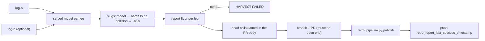

# The harvest step — reports into git, coverage forward, the overdue belt

*Which reports landed, under what names, in which PR — and has the series reported this week?* The
`harvest` template of [`retro-argo.yaml`](../../../coordinator/retro-argo.yaml) extracts each cell's
report, files it as `docs/agents/retros/<date>-<series>-<run>-<slug>.md` on branch
`retro/<date>-<series>-<run>`, opens (or reuses) the report PR as `coordinator-git`, publishes the
run ([pipeline.md#retro-publish-checkpoint](pipeline.md#retro-publish-checkpoint)) and pushes the
success timestamp. History goes to git (the reports) and the bucket (the publication); no issue is
written here. Its consumers: the operator (reads the merged reports), `RetroReportOverdue`
(`argocd/resources/pushgateway/prometheusrule.yaml`), and the next run's `prepare` (the report files
number the next run). [UC-1](use-cases/uc-1-weekly-series.md) steps ④–⑤.

## Interface — the machine half

**[`harvest.schema.json`](harvest.schema.json)** — the report path, the branch, the PR, the belt push.

| Requirement | Governs (schema) | Status |
|---|---|---|
| [RETRO-HARVEST-NAME](#retro-harvest-name) | `$defs.report_path`, `$defs.served` | 🚧 WIP — no evidence pipeline yet (fixture: `retro-harvest`) |
| [RETRO-HARVEST-PARTIAL](#retro-harvest-partial) | `$defs.pr.body` | 🚧 WIP — no evidence pipeline yet (fixture: `retro-harvest` rows `one-cell-dead`, `cell-errored`) |
| [RETRO-HARVEST-PR](#retro-harvest-pr) | `$defs.branch`, `$defs.pr` | 🚧 WIP — no evidence pipeline yet (fixture: `retro-harvest-push`); ⚖ the template's own header says "auto-merge NOT armed — a human reads", the PR body and the 2026-10-15 ruling say it merges on the bot review — the PRs do (#3153, #3201 armed by the agents App) |
| [RETRO-BELT](#retro-belt) | `$defs.belt_push`, `$defs.alert` | 🚧 WIP — no evidence pipeline yet (fixture: `retro-push-belt`; the alert: `retro-report.promtool-test`) |

## Flow overview

## RETRO-HARVEST-NAME

A report is named after its leg's [served model](glossary.md#served-model) — read from the ride log's
dispatch facts, never from the report's prose, so a report that quotes a dispatch line cannot rename
itself. The slug is the model id's last path segment (`claude/opus` → `opus`,
`opencode-go/kimi-k3.1-pro` → `kimi-k3.1-pro`), filtered to `[a-zA-Z0-9.-]`. When both legs' slugs
collide the harness is prefixed (`claude-opus`, `goose-opus`); when they still collide the leg is
suffixed (`-a`, `-b`). Naming depends on the dispatch facts only, so a missing report never changes
the surviving leg's name. A leg with no dispatch line is `<harness>:unserved`. The date is the
bundle's `prepared_at` day and the run its `run_id`; a named series files under its series name.

**World: [harvest-logs](worlds/README.md)** — `RUN=r3`, stack `oracle`, `harnessA=claude`,
`harnessB=goose` unless the row overrides.

| description | world | LOG_A_NAME | LOG_B_NAME | a_served? | b_served? | a_dest? | b_dest? |
|---|---|---|---|---|---|---|---|
| slug | harvest-logs | (default) | (default) | claude:opus | goose:deepseek/deepseek-v4-pro | opus | deepseek-v4-pro |
| slug-collision | harvest-logs | (default) | goose-opus-report | claude:opus | goose:opus | claude-opus | goose-opus |
| slug-collision-identical | harvest-logs | (default) | claude-opus-legb-report | claude:opus | claude:opus | claude-opus-a | claude-opus-b |
| gateway-served | harvest-logs | gw-claude-opus-report | gw-goose-kimi-report | claude:claude/opus | goose:opencode-go/kimi-k3.1-pro | opus | kimi-k3.1-pro |
| ⚖ gateway-same-model | harvest-logs | gw-claude-kimi-report | gw-goose-kimi-k3-report | claude:moonshotai/kimi-k3 | goose:moonshotai/kimi-k3 | claude-kimi-k3 | goose-kimi-k3 |
| gateway-fallback | harvest-logs | gw-claude-opus-report | gw-fallback-deepseek-report | claude:claude/opus | goose:deepseek/deepseek-v4-pro | opus | deepseek-v4-pro |
| ⚖ gateway-report-quotes | harvest-logs | gw-quoting-report | (default) | claude:unserved | goose:deepseek/deepseek-v4-pro | unserved | deepseek-v4-pro |
| single-cell | harvest-logs | (default) | never-written (`HARNESS_B` empty, `SERIES=feedback-triage`) | claude:opus | — | opus | — |

Evidence — latest run

--8<-- "RETRO-HARVEST-NAME.md"

## RETRO-HARVEST-PARTIAL

Each configured leg is floor-checked with the report floor in `log` mode
([RETRO-REPORT-FLOOR](cell.md#retro-report-floor)); a leg without a report is named in the PR body as
a ⚠ PARTIAL RUN ("one cell's view, not the cross-checked pair"), and the surviving report still lands.
No report at all fails the harvest. A single-cell series has no leg B and never declares one dead.
An errored cell (its pod died before writing a log, so the artifact is never staged) is the same
dead-cell case.

**World: [harvest-logs](worlds/README.md)**.

| description | world | LOG_B_NAME | DEAD_CELL | reports? | pr_body_names? |
|---|---|---|---|---|---|
| one-cell-dead | harvest-logs | goose-death | goose:deepseek/deepseek-v4-pro | 1 | goose:deepseek/deepseek-v4-pro |
| ⚖ cell-errored | harvest-logs | never-written | goose:unserved | 1 | goose:unserved |

Evidence — latest run

--8<-- "RETRO-HARVEST-PARTIAL.md"

## RETRO-HARVEST-PR

A retry reuses only an OPEN report PR on the branch (re-applying the harvested files on top of its
head); a MERGED one is reused, with nothing pushed, only when its reports already equal master's;
otherwise a new branch is pushed and a PR opened (`retros: <series> <run> (<N> report(s), scheduled
retro)`). The PR body states the ruling it merges under: the bot review merges it and the operator
reads it after merge (operator ruling 2026-10-15). The harvest itself never arms auto-merge —
unverified which component arms it; expected the platform's machine-PR arming.

**World: [harvest-push-bridge](worlds/README.md)**.

| description | world | OPEN_PR | MERGED_PR | GIT_DIFF_RC | pushed? | report_pr? |
|---|---|---|---|---|---|---|
| new-pr | harvest-push-bridge | — | — | 1 | yes | a new PR |
| open-pr | harvest-push-bridge | `…/pull/2278` | — | 1 | yes | `…/pull/2278` |
| ⚖ merged-identical | harvest-push-bridge | — | `…/pull/2050` | 0 | no | `…/pull/2050` |

Evidence — latest run

--8<-- "RETRO-HARVEST-PR.md"

## RETRO-BELT

After publishing, the harvest pushes `retro_report_last_success_timestamp <now>` to
`…/metrics/job/platform-retro/series/<series>`, retried once after 3 s; a push that still fails
amends the PR body (⚠ PUSHGATEWAY PUSH FAILED) instead of leaving a log line. `RetroReportOverdue`
fires when, for any series, the newest sample over 8 days (`max by (series)` of
`max_over_time(…[8d])`, so a pushgateway restart does not page) is older than 7 days + 3 h for 30 min;
a never-pushed metric reads as epoch 0. A quiet week's push ([RETRO-GUARD-QUIET](guard.md#retro-guard-quiet))
lands in the same series under `outcome=quiet` and satisfies the same `max by (series)`.

**World: [push-belt-bridge](worlds/README.md)**.

| description | world | CURL_RC_1 | CURL_RC_2 | attempts? | pr_body_amended? |
|---|---|---|---|---|---|
| push-ok | push-belt-bridge | 0 | — | 1 | no |
| push-retry-ok | push-belt-bridge | 1 | 0 | 2 | no |
| ⚖ push-fails | push-belt-bridge | 1 | 1 | 2 | yes |

Evidence — latest run

--8<-- "RETRO-BELT.md"

