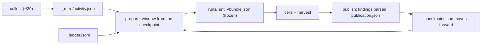

# `retro_pipeline.py` and the `_retro/` store — the window, the frozen bundle, the checkpoint

*Which week does this run account for, what evidence does it read, and when has the week been
covered?* [`agents/retro_pipeline.py`](../../../retro_pipeline.py) owns the series' state in the
`agent-transcripts` bucket under `_retro/` (or a local `--store` directory, the same keys). Its
actions: `collect` (wraps the activity collector — [activity.md](activity.md)), `prepare` (freeze the
window's bundle — called by the guard, [guard.md](guard.md)), `publish` (advance the checkpoint —
called by the harvest, [harvest.md](harvest.md)), `reconcile` and `accept` (the findings — 
[findings.md](findings.md)). [UC-1](use-cases/uc-1-weekly-series.md) steps ①, ⑤.

## Interface — the machine half

**[`pipeline.schema.json`](pipeline.schema.json)** — the CLI, the exit codes and every `_retro/` record.

| Requirement | Governs (schema) | Exit | Status |
|---|---|---|---|
| [RETRO-WINDOW-CUTOFF](#retro-window-cutoff) | `$defs.window`, `$defs.checkpoint.until` | `1` already published | 🚧 WIP — no evidence pipeline yet (suite: `retro-activity-window`, world `local-store`) |
| [RETRO-BUNDLE-FROZEN](#retro-bundle-frozen) | `$defs.bundle` | `1` coverage short · `3` quiet | 🚧 WIP — no evidence pipeline yet (suite: `retro-activity-window`) |
| [RETRO-LEDGER-WINDOW](#retro-ledger-window) | `$defs.bundle.properties.ledger` | — | 🚧 WIP — no evidence pipeline yet (suite: `retro-activity-window`) |
| [RETRO-PUBLISH-CHECKPOINT](#retro-publish-checkpoint) | `$defs.publication`, `$defs.checkpoint` | `1` hash / contiguity / backwards / no parseable report | 🚧 WIP — no evidence pipeline yet (suite: `retro-activity-window`) |
| [RETRO-STORE-READ](#retro-store-read) | `$defs.store_keys` | `1` unreadable | 🚧 WIP — no evidence pipeline yet (suite: `retro-activity-window`) |

## Flow overview

## RETRO-WINDOW-CUTOFF

A run's [window](glossary.md#window) ends at the Monday 00:00 UTC at or before `--now` and starts at
the series' checkpoint `until` — or seven days earlier on a first run. Only publication moves the
checkpoint, so a refused, failed or missed week is folded into the next window, never skipped. A
window that would start at or after its end is already published and is refused. State is per
series: one series' checkpoint never moves another's.

**World: [local-store](worlds/README.md)**.

| description | world | now | checkpoint_until | since? | until? | rc? |
|---|---|---|---|---|---|---|
| first run covers the preceding week | local-store | 2026-09-30T13:00:00Z | — | 2026-09-21T00:00:00Z | 2026-09-28T00:00:00Z | 0 |
| ⚖ a missed week extends the next window | local-store | 2026-09-30T13:00:00Z | 2026-09-14T00:00:00Z | 2026-09-14T00:00:00Z | 2026-09-28T00:00:00Z | 0 |
| a published week is refused | local-store | 2026-09-30T13:00:00Z | 2026-09-28T00:00:00Z | — | — | 1 |

## RETRO-BUNDLE-FROZEN

`prepare` writes the run's [frozen bundle](glossary.md#frozen-bundle) once, at
`_retro/<series>/runs/<until, digits only>/bundle.json`, and every later `prepare` of the same window
returns that same bundle byte for byte, whatever the activity state has become. A ledger-guarded
bundle needs the activity state collected through the window's end (else exit 1) and carries the
activity sample (`retro_activity.py bundle --keep 40`), the windowed ledger slice
([RETRO-LEDGER-WINDOW](#retro-ledger-window)), the last 30 prior findings, `run_id` (one past the
highest of the series' committed reports `docs/agents/retros/*-<series>-rN-*` and the checkpoint's),
`source_revision` (`git rev-parse HEAD` of the clone), `prepared_at`, `series`, `storage_key` and
`bundle_id` = sha256 over the sorted-key JSON of everything else. It never exceeds 60 000 serialized
bytes: prior findings drop oldest-first, then the longer of the two worst-K samples is trimmed;
population counters are final before trimming. `--no-ledger` (a PromQL-guarded series) freezes the
same shape with empty populations and `guard: external`, reading neither activity nor ledger.

**World: [local-store](worlds/README.md)**.

| description | world | existing_bundle | activity_until | no_ledger | bundle? | rc? |
|---|---|---|---|---|---|---|
| a retry reuses the frozen bundle | local-store | yes | (state replaced) | no | the same bytes | 0 |
| coverage short of the cutoff refuses | local-store | no | 2026-09-27T23:30:00Z | no | none written | 1 |
| ⚖ a PromQL series freezes coordinates only | local-store | no | (invalid) | yes | `guard: external`, `task_count` 0 | 0 |

## RETRO-LEDGER-WINDOW

The bundle's `ledger` section is the task ledger (`_ledger.jsonl`, emitted by `agents/ledger.py`)
**windowed, never ranked all-time**: only rows whose `ts` lies inside the window count; one row per
task, the latest emit superseding an earlier (mid-flight `snapshot`) one; population counters
(`rows_emitted`, `task_count`, `snapshot_tasks`, `by_terminal_label`, `by_exit_status`,
`by_error_class`, `first_touch_by_model`) computed over all of them before the worst-25 sample, which
is ordered blocked first, then rounds, cost and wall time descending. Each sampled row's `rounds` is
compacted to `[model, exit_status, error_class, ci]`. A row stamped exactly at the cutoff belongs to
the next window.

**World: [local-store](worlds/README.md)** — four ledger rows: `homelab#913` (2026-08-25, 8 rounds,
blocked), `oracle-fleet#753` emitted twice inside the window (a blocked snapshot, then `agent/done`),
`homelab#2000` at the cutoff.

| description | world | rows_in_window | sample_keys? | latest_label? | rows_emitted? |
|---|---|---|---|---|---|
| ⚖ an August blocked task never re-ranks | local-store | 2 (`oracle-fleet#753` ×2) | `oracle-fleet#753` | `agent/done` | 2 |

## RETRO-PUBLISH-CHECKPOINT

`publish --bundle --report MODEL=PATH … --pr URL` refuses a bundle whose series differs, whose
`bundle_id` does not re-hash, or whose window is not contiguous with the published checkpoint (the
checkpoint's `until` must equal the bundle's `since`, or its `until` on a re-publish). It parses every
report's findings block ([RETRO-FINDINGS-BLOCK](findings.md#retro-findings-block)) BEFORE coverage
moves: a report without a valid block is excluded and recorded in `findings.report_defects` while its
markdown still lands; only a run with no parseable report refuses. It then writes
`runs/<until>/publication.json` and moves `checkpoint.json` to the bundle's `until` — never backwards.
Publication is independent of whether the report PR has merged.

**World: [local-store](worlds/README.md)**.

| description | world | reports | checkpoint_after? | report_defects? | rc? |
|---|---|---|---|---|---|
| no parseable report keeps the checkpoint | local-store | `opus` (no block) | unchanged | — | 1 |
| a valid report publishes | local-store | `opus` (block) | 2026-09-28T00:00:00Z | [] | 0 |
| ⚖ one block-less cell is a recorded partial | local-store | `opus` (block), `goose` (no block) | 2026-09-28T00:00:00Z | [`goose`] | 0 |

## RETRO-STORE-READ

A key that does not exist reads as the caller's default (a first run); any other read failure —
auth, network, an unknown s5cmd error — raises and fails the action, so a transient fault never
resets a checkpoint or the accumulated activity. Missing is recognised by s5cmd's spellings
(`given object … not found` on Garage, `NoSuchKey`, `specified key does not exist`). Writes go
through the writer key, reads through the reader key; the local `--store` writes atomically.

> **External:** s5cmd 2.3 against Garage reports an absent key as `given object <key> not found`
> (read off the wire 2026-10-02, `retro_pipeline.py` `missing()`); other backends' spellings —
> verify during implementation.

**World: [local-store](worlds/README.md)** — the remote `Store` with its command stubbed.

| description | world | s5cmd_stderr | result? |
|---|---|---|---|
| an absent key is a first run | local-store | `given object … not found` | the default |
| ⚖ an unreadable bucket never resets state | local-store | `AccessDenied` | raises |
