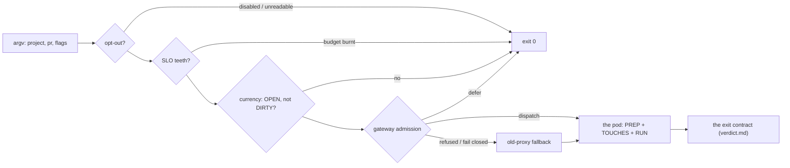

# `reviewer-session.sh <project> <pr>` — may this head be reviewed now, and on which session

*The code reviewer's one entry point.* Three dispatchers call it with the same argv and nothing
else: the reflex tick, the Composition's `review-<stack>` cron and the `review` Sensor. All three
are scan's ([REVIEW-DISPATCH-EDGE](#review-dispatch-edge)). The launcher runs its gates in a fixed
order, each before the next costs anything: the opt-out, the SLO teeth, the currency of the head,
the gateway's admission. Only then does it build the pod. A refusal before the pod is a quiet
`exit 0`, because the review path is level-triggered and the next tick re-picks the PR. A broken
launcher is a loud non-zero exit. [UC-1](use-cases/uc-1-code-then-specs-verdict.md) step ① is this
page. The code is [`agents/reviewer-session.sh`](../../../reviewer-session.sh) lines 79–1441; each
requirement cites its `REPLAY:` clause marker.

## Interface — the machine half

**[`dispatch.schema.json`](dispatch.schema.json)** holds the argv, the Argo parameter sets, the
admission request the launcher sends, and the exit codes.

| Requirement | interface | Governs (schema) | Exit / refusal | Status |
|---|---|---|---|---|
| [REVIEW-DISPATCH-CLI](#review-dispatch-cli) | argv | `argv`, `exit` | `2` unknown arg; `1` FATAL (a heredoc that does not parse, a brief without `TOOL_GAP_SURFACES:`); `3` pod create refused | 🚧 |
| [REVIEW-DISPATCH-OPTOUT](#review-dispatch-optout) | `reviewer-optout.sh <repo>` | `optout` | `exit 0` before any GitHub call | 🚧 (fixture: reviewer-optout) |
| [REVIEW-DISPATCH-CURRENCY](#review-dispatch-currency) | the spawn-time probe | `currency` | `exit 0` on a closed PR / DIRTY head | 🚧 (fixture: reviewer-currency) |
| [REVIEW-DISPATCH-TOUCHES](#review-dispatch-touches) | the pod's `TOUCHES-ESCAPES` line | `touches_escapes` | — (fails open) | 🚧 (fixture: reviewer-touches) |
| [REVIEW-DISPATCH-EDGE](#review-dispatch-edge) | the `review` Sensor + WorkflowTemplate | `argo.review`, `argo.review_perstack` | — | 🚧 |
| [REVIEW-ADMIT-GATEWAY](#review-admit-gateway) | `POST /sessions` | `admission.request`, `admission.outcome` | defer = `exit 0` | 🚧 (fixture: reviewer-gateway-admit); `⚑ gap`: platform only |
| [REVIEW-ADMIT-LEGACY](#review-admit-legacy) | the old-proxy fallback | `legacy` | — | `⚑ gap` |

## Requirement index

| Requirement | Section | Status |
|---|---|---|
| [REVIEW-DISPATCH-CLI](#review-dispatch-cli) | the entry point | 🚧 WIP — no evidence pipeline yet (no fixture) |
| [REVIEW-DISPATCH-OPTOUT](#review-dispatch-optout) | gates | 🚧 WIP — no evidence pipeline yet (fixture: reviewer-optout) |
| [REVIEW-DISPATCH-CURRENCY](#review-dispatch-currency) | gates | 🚧 WIP — no evidence pipeline yet (fixture: reviewer-currency) |
| [REVIEW-DISPATCH-TOUCHES](#review-dispatch-touches) | what the pod is told | 🚧 WIP — no evidence pipeline yet (fixture: reviewer-touches) |
| [REVIEW-DISPATCH-EDGE](#review-dispatch-edge) | the entry point | 🚧 WIP — no evidence pipeline yet (no fixture) |
| [REVIEW-ADMIT-GATEWAY](#review-admit-gateway) | admission | 🚧 WIP — no evidence pipeline yet (fixture: reviewer-gateway-admit); `⚑ gap`: `AGENT_GATEWAY=sessions` is honoured for the `platform` stack only — every other stack's review takes the old-proxy path |
| [REVIEW-ADMIT-LEGACY](#review-admit-legacy) | admission | `⚑ gap (2026-11-07, spike → work: the old proxy's retirement)`: 2 model literals (`MODEL="sonnet"`, `MODEL="opencode-go/qwen3.7-plus"`), 3 old-proxy routing reads (`POST /route`, `GET /opencode-limit`, the `/anthropic` ref env), the `subscription-latch.sh` ladder |

## Flow overview

**Reading the tables.** The header is the parameter list. Every column after `description` is an
input, and a column ending in `?` is an expected observable. `—` means not printed / not set.
`exit 0 (quiet)` means the launcher exits 0 with one `→ …` line and creates no pod. Where a table
is proven by a tabular replay fixture, the description cell is the fixture's row id verbatim.

## The entry point

### REVIEW-DISPATCH-CLI

`reviewer-session.sh <project> <pr> [--repo owner/name] [--model m] [--rubric path] [--round N]
[--loop-ns NS] [--decorrelate-from family] [--permission-mode m]`. `<project>` is the repo name,
and the slug defaults to `teststuffstash/<project>`. `--loop-ns` runs the pod in the stack's loop
namespace as `agentstack-loop`, and the pod then fetches its review-bot token from the proxy's
TokenReview-gated `/loop-git-token?role=reviewer`. Without the flag the pod runs in
`agent-coordinator` as `default` (`reviewer-session.sh:91-103`, `:182-195`). The rubric is
project-relative and defaults to `.agents/review.md`. An absent rubric is not an error, and the
generic reviewer runs. `--model` is the hand-run override. No dispatcher passes it, and it keeps
the review off the gateway ([REVIEW-ADMIT-GATEWAY](#review-admit-gateway)). Every refusal before
the pod exits 0. A launcher defect exits non-zero before any pod exists: the three assembled pod
parts and their concatenation are each `bash -n`'d host-side (homelab#1113), and a brief that lost
its `TOOL_GAP_SURFACES:` line is FATAL ([REVIEW-VERDICT-TOOLGAP](verdict.md#review-verdict-toolgap)).
After the pod, the launcher exits with the pod's own exit code. A phase it cannot read is exit 1
(fail closed).

Legend: `rc?` = the launcher's exit status; `pod?` = whether a reviewer pod is created.

| description | world | argv | condition | rc? | pod? |
|---|---|---|---|---|---|
| an unknown flag is a usage error | — | `homelab 42 --bogus` | — | 2 | no |
| a disabled stack is a quiet skip | claims | `agent-runtime 57` | `reviewer.enabled: false` | 0 | no |
| a burnt error budget is a quiet skip | — | `homelab 42` | `slo-teeth.sh` refuses | 0 | no |
| a heredoc that does not parse aborts before the pod | — | `homelab 42` | an apostrophe in an interpolated value | 1 | no |
| the pod's exit is the launcher's | pr-green-armed | `homelab 42` | the pod exits 10 | 10 | yes |
| an unreadable pod phase fails closed | pr-green-armed | `homelab 42` | phase unknown, no exit code | 1 | yes |
| a refused create names the namespace fix | — | `snore-recorder 37` (no `--loop-ns`) | pod create Forbidden | 3 | no |

Unverified — expected to behave as written. Only the last row has a fixture
(`reviewer-create-refusal/forbidden`, `already-exists`: rc 3 both, with distinct messages).

_Evidence: none yet — unverified._

### REVIEW-DISPATCH-EDGE

The `agent-loop` EventSource's `POST /review {repo, number[, loop_ns]}` feeds two triggers of the
`review` Sensor ([`review-argo.yaml`](../../../coordinator/review-argo.yaml)). The global trigger
submits the `review` WorkflowTemplate with `{repo, number}` in `agent-coordinator`. The per-stack
trigger fires only when `body.loop_ns` matches the regex `.+`, and it submits in that namespace
with `{repo, number, loop_ns}`, adding `--loop-ns`. A graduated POST satisfies both dependencies,
and the global workflow defers it by reading the `stacks.json` graduation. Both workflows `exec`
the same launcher from a fresh master clone.

> **External:** MUST — [Argo Events · Sensor filters § Data filter, `comparator` + `value` regex](https://argoproj.github.io/argo-events/sensors/filters/data/) — string data-filter values are regular expressions; an absent path extracts to `""` and fails `.+` (verify during implementation: read off the deployed Argo Events version).

| description | world | body | trigger? | workflow params? |
|---|---|---|---|---|
| a plain event takes the global trigger alone | argo-review-event | `{repo: homelab, number: 42}` | submit-review | `{repo: homelab, number: 42}` |
| a graduated event takes the per-stack trigger | argo-review-event | `{repo: sleep-tracking, number: 9, loop_ns: sleep-agents}` | submit-review + review-perstack | per-stack: `{repo, number, loop_ns: sleep-agents}`; global: defers |
| an empty `loop_ns` is not graduated | argo-review-event | `{repo: homelab, number: 42, loop_ns: ""}` | submit-review | `{repo: homelab, number: 42}` |

_Evidence: none yet — unverified._

## Gates — refusals that cost nothing

### REVIEW-DISPATCH-OPTOUT

The stack's `spec.reviewer.enabled` is read in ONE place, [`reviewer-optout.sh`](../../../reviewer-optout.sh),
which all three dispatch sites pass through (`REPLAY:optout-gate`, the first gate, before the
head-sha probe). The read fails CLOSED. `kubectl get` can print a valid empty List while it exits
1, so the exit status is authoritative, and the payload must carry an `items` array. An unreadable
claim list skips every repo, loudly. A repo in no claim at all is a known answer and is reviewed.
Only `enabled == false` is an opt-out, because the XRD defaults the field to `true`. The knob lives
in the cluster claim only, and `agents/stacks.json` does not carry it (homelab#204).

Legend: `claims` = what `kubectl get agentstacks -o json` returns; `exit?` = the predicate's status
(0 = dispatch).

| description | world | claims | repo | exit? | stderr? |
|---|---|---|---|---|---|
| a stack that opted out is skipped | claims | stack `runtime` with `reviewer.enabled: false`, repo `agent-runtime` | agent-runtime | 1 | `[agent-runtime] skipped — stack 'runtime' set reviewer.enabled=false` |
| an enabled stack dispatches quietly | claims | `reviewer.enabled: true` | homelab | 0 | — |
| an unreadable read skips everyone ⚖ | claims | exit 1, empty List on stdout | homelab | 1 | `claims read PROBE-FAILED … SKIPPING reviewer dispatch for: homelab` |
| a repo in no claim is reviewed ⚖ | claims | no claim names the repo | fresh-repo | 0 | — |

The two ⚖ rows are the posture. Skipping a review costs minutes, because the path is
level-triggered. Running a review that the operator disabled costs the gate itself, because
auto-merge completes the PR.

_Evidence: none yet — unverified._

### REVIEW-DISPATCH-CURRENCY

One combined `gh pr view --json headRefOid,state,mergeStateStatus` at spawn time
(`REPLAY:reviewer-currency-gate`). A PR that is not OPEN, or a head that is DIRTY, is skipped
quietly: DIRTY belongs to the merge-conflict lane. BEHIND proceeds. GitHub re-points a review's
`commit_id` across an update-branch merge, so a verdict on a BEHIND head survives the updater
(homelab#1422). A failed probe proceeds, and the pod is then named with a timestamp suffix instead
of the head sha8. The pod's STEP 0 re-checks every precondition at execution time
([REVIEW-VERDICT-ASIDE](verdict.md#review-verdict-aside)).

| description | world | state | mergeStateStatus | proceeds? | pod name? |
|---|---|---|---|---|---|
| current-proceeds | pr-state | OPEN | CLEAN | yes | `reviewer-<project>-<pr>-<sha8>` |
| behind-proceeds | pr-state | OPEN | BEHIND | yes | `reviewer-<project>-<pr>-<sha8>` |
| dirty-skips | pr-state | OPEN | DIRTY | no (exit 0) | — |
| probe-fail-proceeds | pr-state | (unparsable) | (unparsable) | yes | `reviewer-<project>-<pr>-<HHMMSS>` |

A non-OPEN PR is skipped the same way (`reviewer-session.sh:237-240`). That row has no fixture.

_Evidence: none yet — unverified._

## What the pod is told

### REVIEW-DISPATCH-TOUCHES

Inside the pod, after PREP, the closing issue's declared `Touches:` footprint is compared with the
changed paths, and the result is handed to the model as one computed fact, `TOUCHES-ESCAPES: <v>`
([ADR-097](../../../../docs/adr.md#adr-097--dispatch-parallelism-keys-on-declared-footprints-not-track-labels)).
It is never a verdict on its own. The helpers (`touches-check.sh`, `footprint.sh`,
`issue_body.py`) are fetched from master's raw URL, because the pod holds only the project's clone.
The footprint is read through the ONE body parser: machine block first, then the legacy line form
([ADR-122](../../../../docs/adr.md#adr-122--issue-authoring-is-dumb-the-container-disposes-filing-is-inert-a-tree-member-has-a-disposition-the-walk-retires-2026-09-03)).
A malformed block is no signal, never "clean". A file whose entire delta is REPLAY sentinel
markers is exempt. The check fails OPEN: anything it cannot compute is `unavailable`, and the
review proceeds (`REPLAY:reviewer-touches-check`).

Legend: `TOUCHES-ESCAPES?` = the value interpolated into the prompt.

| description | world | issue | declared | changed | TOUCHES-ESCAPES? |
|---|---|---|---|---|---|
| undeclared | pr-state | (none) | — | any | `undeclared` |
| escapes-none | pr-state | #124 | covers every path | inside | `none` |
| escapes-computed | pr-state | #123 | `argocd/**, docs/**` | + a governance path | the escaped paths, governance ones prefixed `[GOVERNANCE]` |
| multiline-union | pr-state | #123 | two `Touches:` lines | covered only by their union | `none` |
| block-authored | pr-state | #123 | the `---` block `Touches: argocd/**, docs/**` | `argocd/resources/test.yaml`, `docs/test.md` | `none` |
| block-malformed | pr-state | #123 | a block with an unknown key (`Nope:`) | same | `unavailable` |
| sentinel-exempt | pr-state | #123 | `argocd/**, docs/**` | + `agents/coordinator-session.sh` (sentinel markers only) | `none` |
| unavailable | pr-state | #125 | — | — (helpers unreachable) | `unavailable` |

_Evidence: none yet — unverified._

## Admission — the model and the harness are the gateway's

### REVIEW-ADMIT-GATEWAY

Under `AGENT_GATEWAY=sessions`, a review of a repo whose claims-mirror stack is `platform` is
admitted through the gateway's `POST /sessions` via the shared helper `agents/gateway-admit.sh`
(`REPLAY:reviewer-gateway-admit`, FU-270). The request is
`{stack: platform, role: reviewer, task: review-<repo>-<pr>, round, harness: claude, bind: {<ns>, <pod SA>, <pod name>}}`.
It sets `harness: claude` because the pod runs claude only, and the gateway's walk then keeps only
anthropic-dialect cells. The request names no model. A `dispatch` answer sets the pod's model
from the gateway's wire model with the rail prefix stripped
([GW-MODEL-RESOLVE](../../../../gateway/specs/endpoints/anthropic-messages.md#gw-model-resolve)).
It also skips the `/route` consult and the latch ladder, sets the pod's LLM env to the pull URL +
key names (no credential), and releases the session on exit
([GW-SESSIONS-PULL](../../../../gateway/specs/endpoints/sessions.md#gw-sessions-pull)). A `defer`
is a quiet exit 0. A refusal before the request, or a fail-closed answer, falls back to the
old-proxy path with one loud line ([REVIEW-ADMIT-LEGACY](#review-admit-legacy)).

**World: [`platform-mirror`](worlds/README.md#replay-worlds-exist)** — `homelab` in stack
`platform`, loop ns `platform-agents`, SA `agentstack-loop`, pod `reviewer-homelab-42-0a1b2c3d`.

Legend: `env` = the launcher's environment; `expect?` = the fixture's expected stream
(`expected/<value>.txt`).

| description | env | expect? |
|---|---|---|
| off | — | `off`: no request, the pod keeps the `/anthropic` ref env |
| other-stack | `AGENT_GATEWAY=sessions` | `other-stack`: one WARN, no request |
| explicit-model | `AGENT_GATEWAY=sessions` | `explicit-model`: one WARN, no request |
| dispatch-subscription | `AGENT_GATEWAY=sessions` | `dispatch-subscription`: the POST above, `MODEL=sonnet`, `MODEL_RAIL=anthropic`, `GO_SERVED=0`, `AGENT_ROUTER=off`, the pull env, the session label, the DELETE |
| dispatch-go | `AGENT_GATEWAY=sessions` | `dispatch-go`: as above, `GO_SERVED=1` |
| defer | `AGENT_GATEWAY=sessions` | `defer`: `→ review of homelab#42 deferred — gateway rail-capacity (retry_after=60s)`, exit 0 |
| unreachable | `AGENT_GATEWAY=sessions` | `unreachable`: `gateway admission refused rc=3 — old-proxy fallback` |
| no-caller-token | `AGENT_GATEWAY=sessions AGENT_GATEWAY_CALLER_TOKEN_FILE=/nonexistent/agent-gateway/token` | `no-caller-token`: no request; `gateway admission refused rc=2 — old-proxy fallback` |
| harness-unrunnable | `AGENT_GATEWAY=sessions` | `harness-unrunnable`: a dispatch naming harness `codex` is released (DELETE) and fails closed: `refused rc=3 — old-proxy fallback` |

The author's served model (`--decorrelate-from`) is logged beside the admitted one as evidence
only. The gateway takes no family-exclusion input. That is ⚖: decorrelating the reviewer from the
author is the launcher header's stated doctrine, and the gateway does not enforce it.

_Evidence: none yet — unverified._

### REVIEW-ADMIT-LEGACY

The island names no model. The reviewer's model is whatever the gateway's policy gives
`role: reviewer`, and the specs reviewer admits the same way
([REVIEW-SPECS-ADMIT](specs-gate.md#review-specs-admit)). The old-proxy path survives in
`reviewer-session.sh` as the transition fallback, and it names models and routes by itself:

| description | site | what it decides? |
|---|---|---|
| the default model literal | `:91` `MODEL="sonnet"` | the model on the fallback path |
| the Go failover literal | `:1209` `MODEL="opencode-go/qwen3.7-plus"` (`REPLAY:reviewer-go-failover-gate`) | the model when the subscription is latched |
| the router consult | `:352-410` `POST $ROUTER_URL/route` (`REPLAY:route-request`) | a routed model, at shadow |
| the Go capacity read | `:1193` `GET $PROXY/opencode-limit` | whether the Go failover may serve |
| the old credential ref | `:278` `ANTHROPIC_BASE_URL=…openrouter-proxy…/anthropic` + `ref:agent-coordinator/coordinator-claude` | the pod's LLM env on the fallback path |
| the subscription latch | `:1189` `subscription-latch.sh` | defer vs Go failover |

That is 2 model literals and 3 old-proxy routing reads, plus the latch. The fixtures that pin them
(`reviewer-go-failover/*`, `reviewer-route-carrier/*`, `reviewer-rail-label/*`) pin the fallback,
not the contract. They retire with it. `re-review.sh` defaults to `sonnet` (27 mentions) by design,
because it IS the sonnet benchmark channel ([REVIEW-REREVIEW-SHADOW](re-review.md#review-rereview-shadow)).
It is a jail tool, and the gateway does not admit it.

_Evidence: none yet — unverified._
