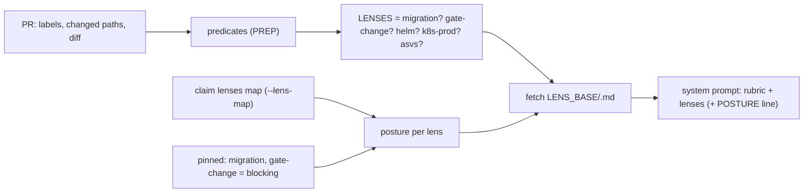

# Lens selection and posture — which external standard a diff is read against, and with what weight

*Which briefs does this review's system prompt carry, beyond the rubric?* A [lens](../../../../docs/glossary.md)
is a brief sourced from an externally maintained standard. A deterministic predicate over the PR's
labels, changed paths and diff selects it, and it is appended to the code reviewer's system prompt
after the project rubric (`.agents/review.md`). The lenses live in
[`agents/lenses/`](../../../lenses/) and are fetched at review time from master's raw URL
(`LENS_BASE`). They are never baked into an image and never read from the PR. A PR that edits a
lens is therefore judged by master's copy. The specs reviewer's wiring lens
([`specs.md`](../../../lenses/specs.md)) is loaded by the specs tick instead
([REVIEW-SPECS-PACK](specs-gate.md#review-specs-pack)). [UC-1](use-cases/uc-1-code-then-specs-verdict.md)
step ② (prep) reads this page.

## Interface — the machine half

**[`lenses.schema.json`](lenses.schema.json)** holds the lens names, the claim's `lenses` map, the
posture values and the prep log lines.

| Requirement | interface | Governs (schema) | Status |
|---|---|---|---|
| [REVIEW-LENS-SELECT](#review-lens-select) | the PREP predicates | `lens`, `selection` | 🚧 (fixture: asvs — the asvs predicate only) |
| [REVIEW-LENS-POSTURE](#review-lens-posture) | `reviewer-optout.sh --lens-map <repo>`, the handling block | `lens_map`, `posture`, `attach_line` | 🚧 (fixture: lens-posture); `⚑ gap` |

## Requirement index

| Requirement | Section | Status |
|---|---|---|
| [REVIEW-LENS-SELECT](#review-lens-select) | selection | 🚧 WIP — no evidence pipeline yet (fixture: asvs — the asvs predicate; migration / gate-change / helm / k8s-prod predicates have no fixture); `⚑ gap (2026-11-07, spike → work: unfiled)`: the migration lens's lockfile-only-major arm is in the lens text, not the predicate |
| [REVIEW-LENS-POSTURE](#review-lens-posture) | posture | 🚧 WIP — no evidence pipeline yet (fixture: lens-posture); `⚑ gap (2026-11-07, spike → work: unfiled)`: a repo in NO claim gets an empty map (`L4`), and the pinning `. + {migration, gate-change}` over empty input yields nothing, so `migration` and `gate-change` attach as advisory and the `POSTURE: blocking` line is not appended |

## Flow overview

## Selection

### REVIEW-LENS-SELECT

The predicates run in the pod's PREP, over `gh pr view --json labels,files` and `gh pr diff`
(`reviewer-session.sh:725-767`). Each predicate adds its lens independently, so one PR may carry
several. **migration** is selected by a label `major` or `deps-review`. **gate-change** is selected
by a changed path under `scripts/`, and only when the repo's DEFAULT branch carries
`scripts/gate-drift.sh`. That fact is read from `origin/HEAD`, never from the PR, so a PR that
deletes the file cannot deselect the lens
([ADR-142](../../../../docs/adr.md#adr-142--trial-scripts-leaves-the-codeowner-gate-and-the-worker-deny-set-the-reviewers-gate-change-lens-is-the-gate-2026-09-28)).
**helm** is selected by a changed path under `chart/` or `charts/`. **k8s-prod** is selected by a
chart template or a YAML under `argocd|k8s|manifests|deploy/`, or by a diff that adds a
`kind: Deployment|StatefulSet|DaemonSet|CronJob`. **asvs** is selected by added lines that signal
auth imports, auth function definitions, session management, input parsing, or a new route
registration in Go / Python / TypeScript. The ASVS predicate prefers a quiet miss
(`REPLAY:asvs-predicate`).

⚖ **The lens file and the predicate disagree on migration.** `agents/lenses/migration.md` and the
prompt's STEP 1 both say the lens is selected by the label *or* by a lockfile-only diff that
crosses a major. The PREP predicate reads only the labels. An unlabelled lockfile-only major is
therefore classified as a dependency bump by the model's STEP 1, but it gets no migration lens
text. The intent row below follows the owning doc (the lens). The code reads no lens there today.

> **External:** MUST — [OWASP ASVS v5.0](https://github.com/OWASP/ASVS) (May 2025) is the asvs lens's pinned source; [Helm · Chart Best Practices](https://helm.sh/docs/chart_best_practices/) (v4 docs @ 2026-07) the helm lens's; [learnk8s · kubernetes-production-best-practices](https://github.com/learnk8s/kubernetes-production-best-practices) (master @ 2026-07) the k8s-prod lens's — each lens file carries its pin; a new major of a source is a re-baseline issue, never an inline edit.

#### Which lens each diff class selects

Legend: `default branch` = whether `origin/HEAD:scripts/gate-drift.sh` exists; `lenses?` = the
`LENSES` set after PREP.

| description | world | labels | changed | diff adds | default branch | lenses? |
|---|---|---|---|---|---|---|
| a labelled major takes the migration lens | pr-green-armed | `major` | `devbox.lock` | — | — | `migration` |
| an unlabelled lockfile-only major takes the migration lens ⚖ | pr-green-armed | — | `devbox.lock` (crosses a major) | — | — | `migration` |
| a check edit takes the gate-change lens where the repo opted in ⚖ | pr-green-armed | — | `scripts/lint.sh` | — | has `gate-drift.sh` | `gate-change` |
| a check edit in a repo without the report step takes none | pr-green-armed | — | `scripts/lint.sh` | — | no `gate-drift.sh` | (none) |
| a chart edit takes helm | pr-green-armed | — | `charts/app/values.yaml` | — | — | `helm` |
| a chart template takes helm and k8s-prod | pr-green-armed | — | `charts/app/templates/deploy.yaml` | — | — | `helm k8s-prod` |
| a new workload anywhere takes k8s-prod | pr-green-armed | — | `src/gen.py` | `kind: CronJob` | — | `k8s-prod` |

Unverified — expected to behave as the predicates read. No fixture constructs these.

#### The ASVS predicate — over-match and quiet-miss

The description cells are the suite's assertion names (`agents/asvs-replay.sh`, fixture `asvs`).

| description | world | diff adds | asvs? |
|---|---|---|---|
| 1a: Go JWT import → ASVS attached | — | an `import` of a jwt package | yes |
| 1b: Python login function → ASVS attached | — | `def login(` | yes |
| 1c: session.Save → ASVS attached | — | `session.Save(` | yes |
| 1d: gin route → ASVS attached | — | `gin.Default()` | yes |
| 1m: def tokenizer → ASVS attached (PR#980 deliberate over-match) ⚖ | — | `def tokenizer(` | yes |
| 2a: config change → no ASVS | — | a config value | no |
| 2e: def retokenize → no ASVS | — | `def retokenize(` | no |
| 3a: natural language 'auth' → no ASVS | — | the word "auth" in prose | no |

_Evidence: none yet — unverified._

## Posture

### REVIEW-LENS-POSTURE

A lens is **advisory** unless the stack's claim says otherwise. Advisory findings are `LENS(<lens>):`
follow-ups, and they never change the verdict. The claim's `spec.lenses` map (`{<lens>: blocking |
advisory}`) is read by `reviewer-optout.sh --lens-map <repo>`, in the same single claims read
the opt-out uses (`REPLAY:lens-posture-gate`). An unreadable claim read returns `{}` (fail closed:
every lens advisory). `migration` and `gate-change` are pinned blocking in the pod, outside the
map, so no stack can lower them. A blocking lens gets one line appended after its text,
`**POSTURE: blocking** — findings from this lens MAY determine the verdict.`. A lens whose fetch
fails is skipped. For a blocking lens that skip is a loud WARN, never a silent advisory, and the
review proceeds (`REPLAY:lens-posture-handling`).

The `L*`, `F*` and `H*` description cells are the suite's assertion names
(`agents/lens-posture-replay.sh`, fixture `lens-posture`).

#### The map a repo gets

| description | world | claim | repo | exit? | map? |
|---|---|---|---|---|---|
| L1: k8s-prod is blocking | claims | platform: `lenses: {k8s-prod: blocking, helm: advisory}` | homelab | 0 | `{"k8s-prod": "blocking", "helm": "advisory"}` |
| L2: sleep stack — no lenses block, empty map | claims | sleep: no `lenses` | sleep-tracking | 0 | `{}` |
| L3: k8s-prod is advisory | claims | oracle: `lenses: {k8s-prod: advisory}` | oracle-fleet | 0 | `{"k8s-prod": "advisory"}` |
| L4: unclaimed repo — empty output | claims | no claim names the repo | fresh-repo | 0 | (empty) |
| F1: fail-closed — exit 1 | claims | the read fails | homelab | 1 | (empty; the launcher's `\|\| echo {}` makes it `{}`) |

#### What the prompt carries per lens

| description | world | lens | map | fetch | attach line? | POSTURE line? |
|---|---|---|---|---|---|---|
| H1: advisory lens attaches normally | claims | k8s-prod | `{k8s-prod: advisory}` | ok | `lens attached: k8s-prod (advisory — FU-101)` | no |
| H2: blocking lens attaches | claims | k8s-prod | `{k8s-prod: blocking}` | ok | `lens attached: k8s-prod (BLOCKING — blocking)` | yes |
| H3: blocking fetch fail — loud WARN | claims | k8s-prod | `{k8s-prod: blocking}` | fails | `WARN: lens k8s-prod fetch FAILED — lens is BLOCKING …` | no |
| H4: advisory fetch fail — standard message | claims | k8s-prod | `{}` | fails | `WARN: lens k8s-prod fetch failed — review proceeds without it (advisory-only, never blocks)` | no |
| H5: lens not in map → advisory | claims | helm | `{}` | ok | `lens attached: helm (advisory — FU-101)` | no |
| migration stays blocking for an unclaimed repo ⚖ | claims | migration | (empty — `L4`) | ok | `lens attached: migration (BLOCKING — blocking)` | yes |

The last row is intent: a lens that is "blocking by construction" stays blocking for every repo.
It is the `⚑ gap` in the index. The code reads advisory there today, and the
lens file's own "BLOCKING BY CONSTRUCTION" text is then the only blocking signal the model gets.

_Evidence: none yet — unverified._
