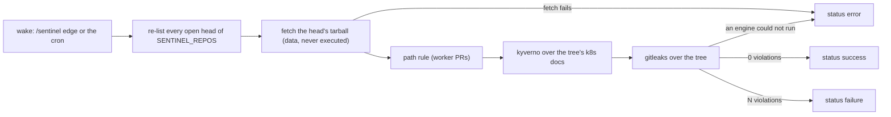

# The IAC-G04 sentinel — the `iac-sentinel` commit status on every open head

*Does this head break a homelab-owned rule that the PR's author cannot edit?* The sentinel is the
review island's deterministic identity. It has no model, and it evaluates PR heads against rules
that live in homelab's own master clone (`policy/iac/`, the exceptions, the path rule). A hostile
PR's copy of those rules therefore changes nothing. It posts its verdict as a required commit
status (`iac-sentinel`) with the reviewer App's token, never the worker's, which could pass
itself. IAC-G04's design (why the sentinel exists, which repos' rulesets require the context, the
L0b freshness belt) is owned by [`iac-lane.md`](../../../../docs/agents/iac-lane.md) §L0b. This
page pins only the interface. The script is [`scripts/iac-sentinel.sh`](../../../../scripts/iac-sentinel.sh).
It runs as the `iac-sentinel` WorkflowTemplate ([`sentinel-argo.yaml`](../../../coordinator/sentinel-argo.yaml)),
woken by the `/sentinel` [doorbell](glossary.md#doorbell) on a new head and by the hourly cron
backstop in `reflexes-argo.yaml`. No use case walks it yet. UC-1's PR would get the status beside
its review, and that leg is a candidate UC-2.

> **External:** MUST — [GitHub REST · Commit statuses § Create a commit status, `state`](https://docs.github.com/en/rest/commits/statuses#create-a-commit-status) — `error | failure | pending | success`; a ruleset requiring the context blocks merge on anything but `success` (verify during implementation: the ruleset's required-context semantics on `error`).

## Interface — the machine half

**[`sentinel.schema.json`](sentinel.schema.json)**.

| Requirement | interface | Governs (schema) | Status |
|---|---|---|---|
| [REVIEW-SENTINEL-STATUS](#review-sentinel-status) | `POST repos/…/statuses/<sha>` context `iac-sentinel`; `job/iac-sentinel` metrics | `status`, `metrics` | 🚧 |
| [REVIEW-SENTINEL-PATHRULE](#review-sentinel-pathrule) | the path rule over a worker PR's files | `path_rule` | 🚧 |
| [REVIEW-SENTINEL-ENGINES](#review-sentinel-engines) | Kyverno + gitleaks over the head's tarball | `engines` | 🚧 (smoke) |
| [REVIEW-SENTINEL-SMOKE](#review-sentinel-smoke) | `iac-sentinel.sh --smoke [root]` | `smoke_exit` | 🚧 (smoke) |

## Requirement index

| Requirement | Section | Status |
|---|---|---|
| [REVIEW-SENTINEL-STATUS](#review-sentinel-status) | the verdict | 🚧 WIP — no evidence pipeline yet (no fixture) |
| [REVIEW-SENTINEL-PATHRULE](#review-sentinel-pathrule) | the rules | 🚧 WIP — no evidence pipeline yet (no fixture) |
| [REVIEW-SENTINEL-ENGINES](#review-sentinel-engines) | the rules | 🚧 WIP — no evidence pipeline yet (smoke: sentinel-smoke runs the engines over the local tree only) |
| [REVIEW-SENTINEL-SMOKE](#review-sentinel-smoke) | the CI twin | 🚧 WIP — no evidence pipeline yet (smoke: sentinel-smoke) |

## Flow overview

## The verdict

### REVIEW-SENTINEL-STATUS

For every open PR head of `SENTINEL_REPOS` (`sleep-iac oracle-iac circles-iac homelab`), one
status is posted with context `iac-sentinel`. `success` means every engine ran and found 0
violations. `failure` means N violations, with the details in the workflow logs. `error` means a
fetch, probe or engine failure. `error` is fail CLOSED: it is never success, never a "violation"
with a bogus reason, and the next tick re-evaluates every open head. With no
`SENTINEL_STATUS_TOKEN` the sentinel is in shadow mode: logs and metrics only, no GitHub write. A
failed status POST is loud and non-fatal, because the required check stays pending until the next
tick. A wake absorbs the Pending sibling rings before it lists the heads, because the evaluation is
unscoped. Every cron tick pushes the heartbeat `iac_sentinel_last_run_timestamp_seconds` and a
per-wake-source timestamp. A cron tick that posts the FIRST status on a head older than 10 minutes
also emits `iac_sentinel_cron_serviced_timestamp_seconds{repo,pr}`: that is a missed edge ring,
said loudly. `--tree` never pushes the heartbeat.

| description | world | engines | violations | token | status? | description field? |
|---|---|---|---|---|---|---|
| a clean head is green | sentinel-heads | ran | 0 | set | `success` | `0 violations (kyverno + gitleaks + path-rule)` |
| a violating head is red | sentinel-heads | ran | 2 | set | `failure` | `2 violation(s) — details in the iac-sentinel workflow logs` |
| an engine that could not run is a probe error ⚖ | sentinel-heads | kyverno rc≠0, no fail summary | — | set | `error` | `sentinel probe failed (engine tool error) — retries next tick` |
| an unfetchable head is a probe error | sentinel-heads | (fetch failed) | — | set | `error` | `sentinel probe failed — retries next tick` |
| no token is shadow | sentinel-heads | ran | 2 | (empty) | (no write) | — |

The box-posted contexts (`management-sentinel`, `opnsense-test-vm`) that this script answers
in-cluster for a homelab head touching no box surface are the mgmt-box island's interface
(ADR-131, [`docs/management-box.md`](../../../../docs/management-box.md) §MB3). They ride the same
App token and are not pinned here.

_Evidence: none yet — unverified._

## The rules

### REVIEW-SENTINEL-PATHRULE

For a PR authored by the worker App (`app/homelab-agents-1234`), any changed file under
`.github/workflows/` or matching `^scripts/ci` is a `workflow-touch` violation. That closes the
self-merge hole (sleep-iac#28). Two exemptions apply, and each one fails closed. **Master's own
content:** a file counts only when its head blob differs from its blob at
`merge-base(default branch, head)`. A master-sync PR into a `goal/**` base therefore carries
master's CI edits without blame (homelab#2412). A merge-base read that fails refuses to clear the
head. **The revert chain:** a `revert-wf-<sha8>` head whose every changed file is restored byte-for-byte to
`<sha8>^`, with the chain's trailer and `<sha8>` merged on the default branch, is the chain's own
revert, not a worker edit (homelab#2561). PRs from any other author are not path-ruled.

| description | world | author | changed | blob vs merge-base | violation? |
|---|---|---|---|---|---|
| a worker edit of a workflow is red | sentinel-heads | worker App | `.github/workflows/ci.yaml` | differs | `workflow-touch` |
| a human edit of a workflow is not path-ruled | sentinel-heads | operator | `.github/workflows/ci.yaml` | differs | — |
| master's own edit carried by a sync PR is not the worker's ⚖ | sentinel-heads | worker App | `.github/workflows/ci.yaml` | equal | — |
| an unreadable merge base refuses to clear | sentinel-heads | worker App | `.github/workflows/ci.yaml` | (read failed) | counted (+ `iac_sentinel_probe_failed`) |
| the chain's byte-exact revert is exempt | sentinel-heads | worker App, head `revert-wf-1a2b3c4d` | `.github/workflows/ci.yaml` restored to `1a2b3c4d^` | differs | — |

_Evidence: none yet — unverified._

### REVIEW-SENTINEL-ENGINES

The head is fetched as a tarball, never cloned, so it runs no hooks and pulls no submodules:
hostile content is data. **Kyverno** is THE rule engine (operator ruling 2026-08-03). It applies
every `policy/iac/*.yaml` to every k8s document in the tree (apiVersion + kind, comments stripped,
`kustomize.config.k8s.io/*` excluded), with the per-repo exceptions read from the sentinel's OWN
master clone. A missing exceptions file is said aloud, because it changes the verdict. Audit-mode
policies warn and never count. **gitleaks** looks for secret values in the tree (the
`policy/iac/gitleaks.toml` config). An engine that exits non-zero without its summary is a TOOL
error, which makes the status `error`, never a violation (homelab#1134).

| description | world | tree | exceptions | kyverno? | gitleaks? |
|---|---|---|---|---|---|
| a raw Secret is a policy violation | sentinel-heads | a `kind: Secret` with `data:` | repo file present | fail 1 (`no-raw-secrets`) | — |
| a waived baseline object is not | sentinel-heads | a ClusterRole listed in `exceptions/homelab.yaml` | repo file present | pass | — |
| a missing exceptions file is said, not silent | sentinel-heads | same ClusterRole | (none) | fail 1 + `no exceptions file at …` | — |
| an Audit policy warns only | sentinel-heads | a CronJob without priority | present | `warn: 1`, not counted | — |
| a committed token is a leak | sentinel-heads | a credential-shaped literal | — | — | violation |
| a crashed engine is no verdict | sentinel-heads | any | present | rc 2, no `fail:` summary → tool error | — |

_Evidence: none yet — unverified._

## The CI twin

### REVIEW-SENTINEL-SMOKE

`iac-sentinel.sh --smoke [repo-root]` runs the SAME engines over the local checkout: tracked files
plus the worktree, never `.git` / `.devbox`, and no GitHub. It exits by the same discrimination the
tick posts. `ci` runs it as `devbox run sentinel-smoke`, so a toolchain-lock bump that breaks an
engine reds its own PR instead of every open PR one tick after it lands (homelab#1131, kyverno
1.19.0). The repo identity comes from the `origin` remote's basename, then from the common git
dir. It never comes from the checkout's directory name, because a linked worktree is named after
its branch and would select no exceptions file. Smoke never pushes metrics.

| description | world | tree | smoke exit? |
|---|---|---|---|
| a clean tree passes | local-tree | this repo at master | 0 |
| a violation in the tree fails | local-tree | + a raw Secret manifest | 1 |
| an engine that cannot run fails differently | local-tree | kyverno binary broken | 2 |
| a worktree resolves to its repo's exceptions | local-tree | a linked worktree `wt-<slug>` of homelab | 0 (exceptions `homelab.yaml`) |

_Evidence: none yet — unverified._
