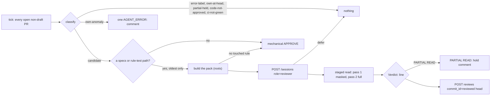

# The specs gate — `homelab-specs-reviewer`'s tick, and the verdict it posts

*Do the spec rows this PR touches encode intent, and are they proven at this head?* The specs
reviewer is the island repos' SECOND required approval
([ADR-155](../../../../docs/adr.md#adr-155--the-specs-reviewer-is-a-second-app-identity-and-the-island-repo-requires-two-approvals-2026-10-16)).
It is one level-triggered tick ([`specs-reviewer-session.sh`](../../../specs-reviewer-session.sh),
the `specs-review` CronWorkflow `*/5` + the `/specs-review` doorbell,
[`specs-review-argo.yaml`](../../../coordinator/specs-review-argo.yaml)). It walks every open
non-draft PR of `SPECS_REVIEW_REPOS` (`homelab oracle-fleet`) at its
[content commit](glossary.md#content-commit) and sorts each PR into one class. Most PRs get the
[mechanical approval](glossary.md#mechanical-approval). At most one PR per tick, the oldest
candidate, gets an LLM pass over a [context pack](../../../../docs/glossary.md) built by the
pinned snippets wheel. The pass runs the pinned rows and evidence briefs behind homelab's wiring
lens ([`specs.md`](../../../lenses/specs.md)). It never reads implementation code, and it is never
admitted with a model name. The design prose, including the shadow-cell measurements, is
[`../docs/specs-reviewer.md`](../docs/specs-reviewer.md). [UC-1](use-cases/uc-1-code-then-specs-verdict.md)
steps ④ and ⑤ are this page.

## Interface — the machine half

**[`specs-gate.schema.json`](specs-gate.schema.json)**.

| Requirement | interface | Governs (schema) | Refusal | Status |
|---|---|---|---|---|
| [REVIEW-SPECS-CLASSIFY](#review-specs-classify) | `classify <pr-json>` | `class` | — | 🚧 (self-test) |
| [REVIEW-SPECS-MECHANICAL](#review-specs-mechanical) | the fixed-body review | `mechanical_body`, `trigger` | — | 🚧 (self-test) |
| [REVIEW-SPECS-ROOTS](#review-specs-roots) | `pack_roots <repo>`, the claim's `repos[].specs` | `roots`, `claim_specs`, `claim_specs_list` | — | 🚧 (self-test); `⚑ gap`; `🚧 WIP` (the list) |
| [REVIEW-SPECS-PACK](#review-specs-pack) | `build_pack` → `evidence-pack` | `pack` | no review (fail closed) | 🚧 (self-test) |
| [REVIEW-SPECS-ADMIT](#review-specs-admit) | `POST /sessions`, `/outcome`, `DELETE` | `admission`, `outcome_class` | defer = stop | 🚧 (self-test) |
| [REVIEW-SPECS-VERDICT](#review-specs-verdict) | the `Verdict:` line → `POST …/reviews` | `verdict_line`, `submit`, `markers` | head moved = no verdict | 🚧 (self-test) |
| [REVIEW-SPECS-BELTS](#review-specs-belts) | `job/specs-review` on the pushgateway | `metrics` | — | 🚧 |

## Requirement index

| Requirement | Section | Status |
|---|---|---|
| [REVIEW-SPECS-CLASSIFY](#review-specs-classify) | the walk | 🚧 WIP — no evidence pipeline yet (self-test: specs-review-self-test) |
| [REVIEW-SPECS-MECHANICAL](#review-specs-mechanical) | the walk | 🚧 WIP — no evidence pipeline yet (self-test: specs-review-self-test) |
| [REVIEW-SPECS-ROOTS](#review-specs-roots) | the pass | 🚧 WIP — no evidence pipeline yet (self-test: specs-review-self-test); `⚑ gap (2026-11-01, §C8 → work: the claim's specs field as a list)`: one root pair per repo — homelab's names `gateway/specs`, so `agents/islands/*/specs` reaches the pass and is approved mechanically; `🚧 WIP`: the list contract below |
| [REVIEW-SPECS-PACK](#review-specs-pack) | the pass | 🚧 WIP — no evidence pipeline yet (self-test: specs-review-self-test) |
| [REVIEW-SPECS-ADMIT](#review-specs-admit) | the pass | 🚧 WIP — no evidence pipeline yet (self-test: specs-review-self-test) |
| [REVIEW-SPECS-VERDICT](#review-specs-verdict) | the verdict | 🚧 WIP — no evidence pipeline yet (self-test: specs-review-self-test) |
| [REVIEW-SPECS-BELTS](#review-specs-belts) | the verdict | 🚧 WIP — no evidence pipeline yet (no fixture) |

## Flow overview

**Reading the tables.** The description cells are `--self-test` check names, verbatim
(`agents/specs-reviewer-session.sh` `self_test()`; world [`self-test`](worlds/README.md#self-test-worlds-exist-not-replay)).
A row with no such check says so in the prose under its table.

## The walk

### REVIEW-SPECS-CLASSIFY

`classify` returns exactly one word per PR, from one jq prelude shared with the code reviewer's
grammar. The first match wins, in this order: `error-label` (touch nothing) → `own-anomaly` (more
than one own [live verdict](glossary.md#live-verdict)) → `own-at-head` → `partial-held` (an own
`PARTIAL READ:` marker naming the content sha8) → `code-not-approved` (no live `homelab-reviewer`
APPROVED: the code gate goes first) → `ci-not-green` → `candidate`. Green means at least one check
exists and every check concluded SUCCESS / NEUTRAL / SKIPPED. A CANCELLED run counts only when no
other run of the same check concluded, because concurrency cancels superseded runs. An
`own-anomaly` gets ONE `AGENT_ERROR:` comment keyed `<!-- specs-review agent-error head=<sha8> -->`
and no label, because this identity has no `issues:write`.

| description | reviews | rollup | labels / comments | class? |
|---|---|---|---|---|
| code approved at head → candidate | code APPROVED after the content commit | ci SUCCESS | — | `candidate` |
| code approval older than content → code-not-approved | code APPROVED before it | ci SUCCESS | — | `code-not-approved` |
| own live verdict at head → own-at-head | code ✓, own APPROVED | ci SUCCESS | — | `own-at-head` |
| own DISMISSED is not a verdict → candidate | code ✓, own DISMISSED | ci SUCCESS | — | `candidate` |
| two own live verdicts → own-anomaly | code ✓, own APPROVED + own CHANGES_REQUESTED | ci SUCCESS | — | `own-anomaly` |
| partial-read marker at the content commit → partial-held | code ✓ | ci SUCCESS | own `partial-read head=aaaa1111` | `partial-held` |
| partial-read marker at an OLDER content commit → candidate (a push released the hold) | code ✓ | ci SUCCESS | own `partial-read head=00000000` | `candidate` |
| superseded CANCELLED beside its SUCCESS → candidate (#2636) | code ✓ | approve CANCELLED + approve SUCCESS + ci SUCCESS | — | `candidate` |
| only-CANCELLED check → ci-not-green | code ✓ | approve CANCELLED + ci SUCCESS | — | `ci-not-green` |
| empty rollup → ci-not-green | code ✓ | (none) | — | `ci-not-green` |
| agent/error → error-label (touch nothing) | code ✓ | ci SUCCESS | `agent/error` | `error-label` |

_Evidence: none yet — unverified._

### REVIEW-SPECS-MECHANICAL

A `candidate` whose files carry no specs path and no rule-test path is approved with a fixed body
and no model. The file list is read through REST `pulls/<n>/files --paginate`, because
`gh pr view --json files` caps at 100 and a truncated list could misclassify. The trigger is
`(^|/)specs/` OR `^<tests root>/`, with the tests root from
[REVIEW-SPECS-ROOTS](#review-specs-roots). A candidate that does match goes to the pass, where
`touched-rules` decides. Zero touched rules is the mechanical approval after all, with a second
fixed body that names the snippets version. Both bodies start `## Specs review` and
`Verdict: APPROVE — mechanical:`. That prefix is how the prior-review pick skips them.

| description | repo | path | LLM pass? |
|---|---|---|---|
| specs path predicate: gateway/specs/access.md | homelab | `gateway/specs/access.md` | yes |
| specs path predicate: specs/x.md at root | — | `specs/x.md` | yes |
| trigger: homelab rule-test path → LLM pass | homelab | `gateway/tests/test_access.py` | yes |
| trigger: a non-gateway tests dir is NOT a homelab rule-test path | homelab | `scripts/tests/x.py` | no (mechanical) |
| trigger: oracle-fleet rule-test path → LLM pass | oracle-fleet | `tests/test_rt.py` | yes |
| specs path predicate: docs/specs-reviewer.md is NOT a specs path | homelab | `docs/agents/specs-reviewer.md` | no (mechanical) |
| an island's specs page reaches the pass, then no rule ⚖ | homelab | `agents/islands/review/specs/verdict.md` | yes → `touched-rules` over `gateway/specs` finds none → mechanical (`found no rule this diff touches`) |

The last row has no self-test check. It is the observed shape of
[REVIEW-SPECS-ROOTS](#review-specs-roots)'s gap, read from the code (`build_pack` passes one
`--specs-root`). §C8 read the first mechanical body verbatim on #3093 and #3096.

_Evidence: none yet — unverified._

## The pass

### REVIEW-SPECS-ROOTS

`pack_roots <repo>` prints `"<specs-root> <tests-root>"`. The ride, the trigger and the pack read
this ONE place for a repo's [spec root pair](glossary.md#spec-root-pair). The answer is the
claim's `repos[].specs {root, tests}` when one AgentStack read serves a well-formed field (two
non-empty strings). Otherwise the per-repo table answers: `homelab → gateway/specs gateway/tests`,
every other repo `specs tests`. The table covers a repo with no field, a malformed field, and every
run without a cluster. The claims are read once per tick. A failed read is said once on stderr,
because stdout is the roots, and the table then answers.

| description | claim | repo | roots? |
|---|---|---|---|
| pack roots: homelab (claim field) | `homelab: {root: gateway/specs, tests: gateway/tests}` | homelab | `gateway/specs gateway/tests` |
| pack roots: a claim field moves the roots | `moved: {root: docs/specs, tests: qa/rules}` | moved | `docs/specs qa/rules` |
| pack roots: field without tests → table | `half: {root: specs}` | half | `specs tests` |
| pack roots: non-string root → table | `typed: {root: [specs], tests: tests}` | typed | `specs tests` |
| pack roots: repo absent from every claim → table | — | some-island | `specs tests` |
| pack roots: homelab, claim read failed → table | (read failed) | homelab | `gateway/specs gateway/tests` |

**⚑ The contract admits one pair per repo, and a monorepo of islands has many.** On homelab the
gateway owns the pair, so every other island's `specs/` (this one included) reaches the pass and
is approved mechanically. The second gate reads nothing on this island
([context-and-autonomy.md §C8](../../../../docs/spikes/context-and-autonomy.md)). Three more
places assume one pair per repo: `evidence_bucket` (`homelab → gateway-specs`), the legacy artifact
name `gateway-evidence`, and `build_pack`'s single `--specs-root` / `--tests-root`.

#### 🚧 The redrawn contract — `specs` is a list of root pairs

Unverified — expected once built. The claim's `repos[].specs` becomes a LIST of
`{root, tests, pin?, evidence?}`, and the legacy object is read as a one-item list. homelab's
list names `gateway/specs` and each `agents/islands/<island>/specs`. The trigger fires on any
root's `root/` or `tests/`. The pass builds ONE pack per touched root pair: `touched-rules` and
`evidence-pack` already take one root each, so N roots means N packs. The verdict is one review
whose body carries one section per pack, because GitHub counts one approval per identity. A
blocking finding in any pack means `CHANGES_REQUESTED`. A root with no evidence publisher states
it, and that becomes the evidence brief's `NO_EVIDENCE` finding, never a refusal. Whether each
root names its own bucket (`evidence`) or the island shares the repo's is ⚖. Whether N packs
share one gateway session (one `LLM_TIMEOUT_S`) or take one session each is ⚖ too.

| description ⚖ | claim specs | changed | packs? | trigger? |
|---|---|---|---|---|
| the legacy object reads as one pair | `{root: gateway/specs, tests: gateway/tests}` | `gateway/specs/access.md` | `[gateway/specs]` | yes |
| an island root is its own pack | `[{gateway/specs, gateway/tests}, {agents/islands/review/specs, agents/replay/fixtures}]` | `agents/islands/review/specs/verdict.md` | `[agents/islands/review/specs]` | yes |
| a PR touching two roots gets two packs, one review | same | `gateway/specs/access.md`, `agents/islands/review/specs/lenses.md` | `[gateway/specs, agents/islands/review/specs]` | yes |
| a fixture dir is an island's tests root | same | `agents/replay/fixtures/reviewer-optout/…` | `[agents/islands/review/specs]` (the rules its tests label) | yes |
| a path under no root stays mechanical | same | `docs/agents/workflow.md` | `[]` | no (mechanical) |

The fixture-dir row assumes that the replay harness labels rows with requirement IDs, which it
does not do today (rule 5 above). Until it does, an island whose tests root is
`agents/replay/fixtures` reaches no rule through its tests.

_Evidence: none yet — unverified._

### REVIEW-SPECS-PACK

The pack is built BEFORE admission, so a broken input costs no model session. Every build failure
is no review (fail CLOSED): the lens fetch (`LENS_BASE/specs.md`, which must start `# LENS: specs`),
an authenticated clone of the base + `pull/<n>/head` (a head that moved while fetching = the next
tick), the snippets wheel `v0.6.9` verified against its pinned sha256, an empty PR body, the pack
build itself, and a pack without `process/briefs/{finding-contract,rows,evidence}.md`. ABSENT
EVIDENCE is not a refusal: the pack states it, and the evidence brief turns it into a finding. The
head's evidence pack and the baseline are read anonymously from the repo's bucket web endpoint
(`evidence/<pr-N|base>/<sha>.tar.gz`). The round context comes from the launcher: the issue's
`## Acceptance` section copied verbatim, and the newest own LLM review in ANY state, because a
push dismisses it. The model is confined. It runs under `env -i` with exactly the gateway's
dispatch env + OTEL + a throwaway HOME, never `GH_TOKEN` / `GH_TOKEN_FILE` and no `settings.json`.
Its tool scope is `Read(//<inputs>/**)` + `Glob` under `--permission-mode default`. When the
pinned `evidence-pack` offers `--mask-descriptions`, the pass is the staged read: pass 1 reads only
the manifest's masked files, its findings are frozen as `pass1.md`, and pass 2 reviews the full
pack.

| description | input | built? |
|---|---|---|
| acceptance: section only | issue body with `## Acceptance` + `### sub` | the section, subsections kept |
| acceptance: none → whole body under a note | issue body with no `## Acceptance` | `(no \`## Acceptance\` section, so the whole body)` + the body |
| prior review: newest own LLM review, DISMISSED included | own reviews: an LLM CHANGES_REQUESTED (DISMISSED), a mechanical APPROVE | the DISMISSED one |
| evidence bucket: absent key → rc 1 | no `evidence/pr-N/<sha>.tar.gz` | rc 1 (stated in the pack, not a refusal) |
| evidence bucket: oracle-fleet → oracle-specs | repo oracle-fleet | bucket `oracle-specs` |
| env builder: no GH_TOKEN / GH_TOKEN_FILE / GATEWAY_URL / PUSHGATEWAY | dispatch env + a pod env carrying them | none of the four in the model's env |
| seeded HOME: no settings file carries a permissions key | the image's `settings.json` with `permissions.allow` | no settings file in the throwaway HOME |
| env builder: shell-hostile key is a refusal | a dispatch `env` key `A;B` | refusal (no review) |

The fail-closed build steps (lens, clone, wheel digest, pack) have no self-test check. They are
unverified — expected to behave as `build_pack` reads.

_Evidence: none yet — unverified._

### REVIEW-SPECS-ADMIT

The pass is admitted through `POST /sessions` with
`{stack: platform, role: reviewer, task: "specs-review <repo>#<n>", round: 0, attempt, harness: claude}`,
authenticated by the pod's projected ServiceAccount token (audience `agent-gateway`), which rides
`-H @<fd>`, never argv ([GW-SESSIONS-AUTH](../../../../gateway/specs/endpoints/sessions.md#gw-sessions-auth)).
It names no model. The model comes from the dispatch env's `ANTHROPIC_MODEL`, and a dispatch
without one is no review. `defer` logs and stops, and the next tick retries; the pass never polls
in-process. Before release the pass reports its own ride's outcome in the gateway's one vocabulary
([GW-SESSIONS-OUTCOME](../../../../gateway/specs/endpoints/sessions.md#gw-sessions-outcome)). A
verdict of either kind is `clean`, because rounds are not strikes. A struck ride re-admits at the
same round with `attempt + 1`, at most `SPECS_REVIEW_AUTO_ATTEMPTS` (2) times and only while the
840 s wall budget still holds a whole pass. The session is always released (trap).

| description | harness rc | result JSON | parsed verdict | outcome class? |
|---|---|---|---|---|
| outcome: a verdict is clean (APPROVE) | 0 | yes | APPROVE | `clean` |
| outcome: a verdict is clean (CHANGES_REQUESTED — a round, not a strike) | 0 | yes | CHANGES_REQUESTED | `clean` |
| outcome: a PARTIAL READ is clean (the model did its job; no strike) | 0 | yes | PARTIAL | `clean` |
| outcome: no parsable verdict → no-verdict | 0 | yes | — | `no-verdict` |
| outcome: the LLM_TIMEOUT_S kill → timeout | 124 | — | — | `timeout` |
| outcome: a non-zero exit → harness-death | 1 | — | — | `harness-death` |
| outcome: no JSON result → harness-death | 0 | no | — | `harness-death` |

_Evidence: none yet — unverified._

## The verdict

### REVIEW-SPECS-VERDICT

The verdict is the model's first line matching `^Verdict: (APPROVE|CHANGES_REQUESTED|PARTIAL READ)`,
and the SCRIPT posts it. An unparsable result is no terminal. The post is pinned to the reviewed
head in two ways. The head is re-read immediately before the submit, and a moved head drops the
verdict (rc 3), so the next tick reads the new head. The review is then posted through REST
`POST repos/…/pulls/<n>/reviews` with `commit_id` = the reviewed head, `APPROVE` → `APPROVE` and
`CHANGES_REQUESTED` → `REQUEST_CHANGES`. `PARTIAL READ` posts no review. It posts ONE comment
`PARTIAL READ: …` keyed `<!-- specs-review partial-read head=<content sha8> -->`, which holds the
PR until a push ([partial read](glossary.md#partial-read)). After the walk, every PR the tick
posted on is re-read. If no own live verdict exists at its content commit, the tick exits 10.

| description | model output / head | verdict? | API write? |
|---|---|---|---|
| verdict parse: APPROVE | `Verdict: APPROVE — no blocking check failed` | `APPROVE` | — |
| verdict parse: CHANGES_REQUESTED | `Verdict: CHANGES_REQUESTED — 1, 6` | `CHANGES_REQUESTED` | — |
| verdict parse: PARTIAL READ | `Verdict: PARTIAL READ — <files>` | `PARTIAL` | — |
| verdict parse: missing → empty | `no verdict here` | (empty) | — |
| pinned verdict: head moved → rc 3 | reviewed `aaaa…`, now `bbbb…` | dropped | none |
| pinned verdict: POST carries commit_id=reviewed head + REQUEST_CHANGES | reviewed = now | `CHANGES_REQUESTED` | `POST …/reviews commit_id=<reviewed> event=REQUEST_CHANGES` |

> **External:** MUST — [GitHub REST · Pull request reviews § Create a review for a pull request, `commit_id`](https://docs.github.com/en/rest/pulls/reviews#create-a-review-for-a-pull-request) — the review attaches to the named commit, so a push between the re-read and the POST leaves the verdict on the old (now stale) commit; `dismiss_stale_reviews_on_push` dismisses only reviews submitted BEFORE the push (read 2026-10-16 on PR#2613 round 2; verify during implementation).

_Evidence: none yet — unverified._

### REVIEW-SPECS-BELTS

Every tick pushes to `job/specs-review` on the pushgateway, including shadow ticks and zero-PR
ticks. It pushes `specs_review_last_tick_timestamp_seconds`, `specs_review_shadow` and
`specs_review_tick_verdicts{kind}` for EVERY kind in
`mechanical|approve|request_changes|defer|error|partial`. Each push replaces the group, so a kind
absent this tick reads 0 and no series vanishes. A missing `specs-reviewer-git` token is shadow:
the tick logs, pushes `specs_review_shadow 1` and exits 0, and it never reviews under another
identity. The alerts that read these live in
[`argocd/resources/pushgateway/prometheusrule.yaml`](../../../../argocd/resources/pushgateway/prometheusrule.yaml):
`SpecsReviewTickStale` (30 m), `SpecsReviewNoProgress` (every tick for an hour reported `error` or
`defer`) and `SpecsReviewPartialRead` (any `partial`).

| description | world | tick | shadow? | tick_verdicts? |
|---|---|---|---|---|
| a quiet tick still beats | self-test | 0 open PRs | 0 | every kind 0 |
| a missing token is shadow, not another identity | self-test | `GH_TOKEN_FILE` empty | 1 | every kind 0 |
| a mechanical sweep counts each | self-test | 3 candidates without specs paths | 0 | `mechanical` 3, others 0 |
| a partial read is its own kind | self-test | 1 pass → `PARTIAL READ` | 0 | `partial` 1 |

Unverified: no self-test check observes the push body. The rows are read from `push_metrics`.

_Evidence: none yet — unverified._
