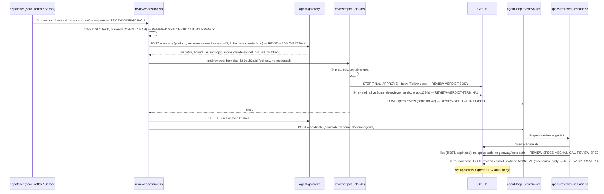

# UC-1 — one platform PR: code verdict → doorbell → mechanical specs approval → two approvals

**Persona:** the merge path, for `teststuffstash/homelab#42`. It is a worker's code PR: CI is
green at content commit `abc1234d`, auto-merge is armed, the PR closes an issue under an open Goal,
and no path is under `specs/`. **Its one question:**

> *May this head merge — and who says so?*

Two identities answer, in order, and GitHub counts them: the code reviewer's native approval,
then the specs reviewer's. The specs approval here is mechanical, because the PR touches no spec
row. On homelab every PR needs both (`required_approvals = 2`), so this walk is the common case,
not the edge. Neither identity names a model. The code reviewer is admitted by the gateway with
`role: reviewer`, and the mechanical approval needs no model at all.

## Flow

## Walk-through data (the golden thread)

The data lives in [`uc-1/`](uc-1/). Values in guillemets (`«…»`) are produced by the run. The
admission pair and the launcher state are the `reviewer-gateway-admit` fixture's
`dispatch-subscription` row, verbatim. The exit contract is the `reviewer-exit-contract` fixture's
`live-verdict-at-head` row. The code-review body and the specs tick are constructed from the
contract and have no fixture.

| Stage | Input | Expected output | Requirements |
|---|---|---|---|
| ① dispatch | [`uc-1/dispatch-argv.json`](uc-1/dispatch-argv.json) | gates pass; pod `reviewer-homelab-42-<head sha8>` (`reviewer-homelab-42-0a1b2c3d` in the fixture world) | REVIEW-DISPATCH-CLI, REVIEW-DISPATCH-OPTOUT, REVIEW-DISPATCH-CURRENCY |
| ① admission | [`uc-1/admit-request.json`](uc-1/admit-request.json) | [`uc-1/admit-response.json`](uc-1/admit-response.json) → [`uc-1/launcher-state.json`](uc-1/launcher-state.json) | REVIEW-ADMIT-GATEWAY |
| ② the review | the PR at `abc1234d` + `.agents/review.md` | [`uc-1/code-review.json`](uc-1/code-review.json) | REVIEW-VERDICT-BODY, REVIEW-LENS-SELECT, REVIEW-DISPATCH-TOUCHES |
| ③ exit + doorbells | the PR state after the model | [`uc-1/exit-contract.json`](uc-1/exit-contract.json) | REVIEW-VERDICT-TERMINAL, REVIEW-VERDICT-DOORBELL |
| ④–⑤ specs tick | the `/specs-review` ring | [`uc-1/specs-tick.json`](uc-1/specs-tick.json) | REVIEW-SPECS-CLASSIFY, REVIEW-SPECS-MECHANICAL, REVIEW-SPECS-ROOTS, REVIEW-SPECS-VERDICT, REVIEW-SPECS-BELTS |

### Canonical variations

| # | Variation | Expected |
|---|---|---|
| V1 | the PR edits `gateway/specs/access.md` | step ⑤ is an LLM pass: pack over `gateway/specs`, `POST /sessions {…, task: "specs-review homelab#42", round: 0, attempt: 1, harness: claude}`, a `Verdict:` line posted pinned to the head (REVIEW-SPECS-ADMIT, REVIEW-SPECS-PACK) |
| V2 | the PR edits `agents/islands/review/specs/verdict.md` | step ⑤ reaches the pass, `touched-rules` over `gateway/specs` finds no rule, so the second mechanical body is posted. **This is the ⚑ gap**: [REVIEW-SPECS-ROOTS](../specs-gate.md#review-specs-roots) |
| V3 | the head is DIRTY at spawn | step ① exits 0 quietly, no pod, no admission (REVIEW-DISPATCH-CURRENCY) |
| V4 | the gateway defers (`rail-capacity`, 60 s) | step ① exits 0 with `deferred — gateway rail-capacity (retry_after=60s)`; the reflex re-picks (REVIEW-ADMIT-GATEWAY) |
| V5 | a check is still running when the pod looks | step ② posts a standing aside `pre=checks-pending`; step ③ finds that terminal, rings no `/specs-review` (REVIEW-VERDICT-ASIDE, REVIEW-VERDICT-DOORBELL) |
| V6 | the PR's issue has no open container | the NO CONTAINER rule is appended; the body carries no `Follow-ups:` (REVIEW-VERDICT-BODY) |

## What this use case does not cover (so nobody infers it)

Which PR the reflex picks, and when: that is scan's `review-reflex.sh`, and this walk starts at its
argv. Also not covered: the dependency-major lane (the migration lens's four headings and
`major-handoff.sh`), the sentinel's `iac-sentinel` status beside the review (a candidate UC-2,
[sentinel.md](../sentinel.md)), the old-proxy fallback ([REVIEW-ADMIT-LEGACY](../dispatch.md#review-admit-legacy)),
a non-platform stack's review (no gateway admission yet), and the time-travel re-review
([re-review.md](../re-review.md)).
