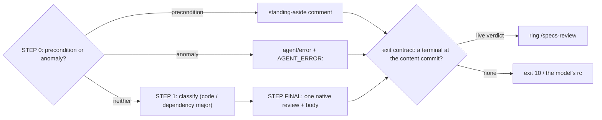

# The code verdict — what `homelab-reviewer` writes to a PR, and what the pod exits with

*The merge path's answer.* A code-review session ends in exactly one [terminal](glossary.md#terminal)
at the [content commit](glossary.md#content-commit). The terminal is a native GitHub review
(`APPROVE` / `REQUEST_CHANGES`), a [standing aside](glossary.md#standing-aside), or the
`agent/error` breaker. Each one is a record that its readers act on. GitHub's ruleset counts the
approval, and auto-merge completes the PR, so nobody clicks merge. Scan's clauses read the label
and the review state, the harvest reads the `Follow-ups:` bullets, `major-handoff.sh` reads the
migration headings, and the specs gate reads the live approval as its premise. The pod's exit
code tells the launcher, and through it Argo, whether a terminal exists. [UC-1](use-cases/uc-1-code-then-specs-verdict.md)
steps ② and ③ are this page. The model's half (STEP 0 → STEP FINAL) is the prompt inside
[`reviewer-session.sh`](../../../reviewer-session.sh). The deterministic half is the RUNPART's
exit contract (`REPLAY:reviewer-exit-contract`).

> **External:** MUST — [GitHub REST · Pull request reviews § Create a review for a pull request, `event`](https://docs.github.com/en/rest/pulls/reviews#create-a-review-for-a-pull-request) — `APPROVE` / `REQUEST_CHANGES` / `COMMENT`; an App installation cannot approve a PR it authored, so the reviewer is a distinct App from the worker (verify during implementation: the self-approval refusal text).

## Interface — the machine half

**[`verdict.schema.json`](verdict.schema.json)** holds the terminal set, the aside marker grammar,
the body markers, the doorbell payloads and the pod's exit codes.

| Requirement | interface | Governs (schema) | Exit | Status |
|---|---|---|---|---|
| [REVIEW-VERDICT-TERMINAL](#review-verdict-terminal) | the exit contract | `terminal`, `pod_exit` | `0` / the model's rc / `10` | 🚧 (fixture: reviewer-exit-contract) |
| [REVIEW-VERDICT-ASIDE](#review-verdict-aside) | the STEP 0 comment | `aside`, `agent_error` | — | 🚧 |
| [REVIEW-VERDICT-BODY](#review-verdict-body) | the review body | `body` | — | 🚧 (fixtures: reviewer-epic-container, reviewer-sprout-depth, reviewer-depth-lane-split) |
| [REVIEW-VERDICT-TOOLGAP](#review-verdict-toolgap) | the `TOOL_GAP:` line | `tool_gap` | FATAL at dispatch when undeclared | 🚧 (fixture: tool-gap-surfaces) |
| [REVIEW-VERDICT-DOORBELL](#review-verdict-doorbell) | `POST /specs-review`, `POST /coordinate` | `doorbell` | never changes the exit | 🚧 (fixture: reviewer-exit-contract) |

## Requirement index

| Requirement | Section | Status |
|---|---|---|
| [REVIEW-VERDICT-TERMINAL](#review-verdict-terminal) | the exit | 🚧 WIP — no evidence pipeline yet (fixture: reviewer-exit-contract) |
| [REVIEW-VERDICT-ASIDE](#review-verdict-aside) | the model's terminals | 🚧 WIP — no evidence pipeline yet (no fixture for the model's choice; the detection side: reviewer-exit-contract) |
| [REVIEW-VERDICT-BODY](#review-verdict-body) | the model's terminals | 🚧 WIP — no evidence pipeline yet (fixtures: reviewer-epic-container, reviewer-sprout-depth, reviewer-depth-lane-split) |
| [REVIEW-VERDICT-TOOLGAP](#review-verdict-toolgap) | the model's terminals | 🚧 WIP — no evidence pipeline yet (fixture: tool-gap-surfaces) |
| [REVIEW-VERDICT-DOORBELL](#review-verdict-doorbell) | the exit | 🚧 WIP — no evidence pipeline yet (fixture: reviewer-exit-contract — the `/specs-review` half; the `/coordinate` half has none) |

## Flow overview

## The exit

### REVIEW-VERDICT-TERMINAL

After the model returns, the pod re-reads the PR's reviews, comments, labels and commits, and
asserts that ONE terminal exists for `homelab-reviewer` at the content commit (homelab#560). They
are tested in this order: a [live verdict](glossary.md#live-verdict); this session's silent-dedup
record; a standing-aside comment whose marker names the content sha8; the `agent/error` label. A
merge commit as the newest commit (update-branch, conflict resolution, `Merge pull request`) never
moves the anchor. With a terminal present, the pod exits 0 whatever the model did, because the
review landed and its record is on the PR. With none, the pod exits the model's own non-zero rc,
or 10 when the model "succeeded": that is the silent green this contract exists to kill. A
re-read that fails is no terminal (fail closed). A GitHub blip reds one run, while a silent green
would mask a dead review plane.

**World: [`clean`](worlds/README.md#replay-worlds-exist)** — PR #42, one non-merge commit
`abc1234d`, nothing else. Each row overlays its terminal with `patch`.

Legend: `patch` = the jq overlay applied to `gh/pr-view-42.json`; `env` = `RC` (the model's exit),
`STUB_GH_FAIL` (the re-read fails), `SILENT_DEDUP` (this session wrote the record); `expect?` = the
fixture's expected outcome (`FINAL` + `TERMINAL_OK` + the ring line).

| description | patch | env | expect? |
|---|---|---|---|
| live-verdict-at-head | `add-verdict.jq` | `RC=0` | `live-verdict` — FINAL 0, rings `/specs-review` |
| standing-aside-at-head | `add-aside.jq` | `RC=0` | `standing-aside` — FINAL 0, no ring |
| agent-error-present | `add-agent-error.jq` | `RC=0` | `agent-error` — FINAL 0, no ring |
| no-terminal-silent-green | — | `RC=0` | `no-terminal-green` — FINAL 10 |
| no-terminal-claude-crashed | — | `RC=127` | `no-terminal-crashed` — FINAL 127 |
| state-read-fails | — | `RC=0 STUB_GH_FAIL=1` | `state-read-fails` — FINAL 10 |
| conflict-merge-aside-at-content-sha | `conflict-merge-aside.jq` | `RC=0` | `standing-aside` — FINAL 0 |
| conflict-merge-verdict-between-content-merge | `conflict-merge-verdict.jq` | `RC=0` | `live-verdict` — FINAL 0 |
| issue-unreadable-standing-aside | `add-issue-unreadable.jq` | `RC=0` | `standing-aside` — FINAL 0 |
| silent-dedup-checks-pending | `silent-dedup-checks-pending.jq` | `RC=0 SILENT_DEDUP=1` | `silent-dedup-recorded` — FINAL 0 |

_Evidence: none yet — unverified._

### REVIEW-VERDICT-DOORBELL

Two doorbells follow the exit. Neither is a work item, and neither changes the exit.
**`/specs-review`** is rung from inside the pod on the live-verdict terminal and only on it. That
approval is the specs gate's dispatch premise, so the second approval follows in seconds instead
of on the `*/5` cron (operator, 2026-10-27). An aside or `agent/error` moves nothing for the specs
gate. **`/coordinate`** is rung by the launcher after a pod that exited 0. When the PR's
`reviewDecision` reads `CHANGES_REQUESTED` (GitHub's aggregate, re-read by the launcher, not this
session's own verdict), it carries the unit `changes-requested|<project>|pr-<N>`. For a repo of a
graduated stack (`agents/stacks.json`) it adds `{stack, loop_ns}` (`reviewer-session.sh:1394-1440`). An unreachable
EventSource is one log line. The cron is the backstop.

| description | world | terminal | pod exit | specs ring? | coordinate ring? |
|---|---|---|---|---|---|
| a live approval rings both | clean | live-verdict (APPROVED) | 0 | `{"repo":"homelab","number":42}` | `{"repo":"homelab","stack":"platform","loop_ns":"platform-agents"}` |
| a change request carries its unit | clean | live-verdict (CHANGES_REQUESTED) | 0 | `{"repo":"homelab","number":42}` | `{"repo":"homelab","stack":"platform","loop_ns":"platform-agents","unit":"changes-requested\|homelab\|pr-42"}` |
| an aside rings coordinate only | clean | standing-aside | 0 | — | `{"repo":"homelab","stack":"platform","loop_ns":"platform-agents"}` |
| no terminal rings nothing | clean | (none) | 10 | — | — |
| an unreachable EventSource is a log line | clean | live-verdict | 0 | `NOT rung … the */5 cron picks it up` | — |

The `/specs-review` column is the fixture's (the `CALL curl` line on the two live-verdict rows).
The `/coordinate` column is unverified — expected to behave as the launcher's last block reads.

_Evidence: none yet — unverified._

## The model's terminals

### REVIEW-VERDICT-ASIDE

The model's STEP 0 sorts what it sees into two classes and submits no review in either. A
**precondition** is a dispatch premise that was true when the review was queued and is no longer
true at execution. Five states are preconditions, each with a slug: `merge-state` (DIRTY or
UNKNOWN), `checks-pending`, `own-verdict-at-head`, `issue-unreadable`, and
`checks-red-unattributed` (the last only for an un-armed `major`). A precondition gets ONE comment
whose first line is
`STANDING ASIDE: <precondition> at <content sha8> — … <!-- standing-aside head=<sha8> pre=<slug> -->`,
with no label. An existing aside with the same (head, pre) is reused silently, and the session
records `SILENT_DEDUP_ASIDE:`. An **anomaly** is a state that a later dispatch would not change: more than one live own
verdict at head, a pile of near-identical bot verdicts or asides, a review on a non-ancestor
commit. An anomaly gets the `agent/error` label (REST, never the GraphQL porcelain) and exactly one
comment starting `AGENT_ERROR:`. A label already present means stop silently. The test the prompt
gives: *will this state look different if I am dispatched again in fifteen minutes?*

| description ⚖ | world | what the model sees | terminal? | marker? |
|---|---|---|---|---|
| a conflicted head is the merge lane's ⚖ | pr-green-armed | `mergeStateStatus: DIRTY` | standing-aside | `pre=merge-state` |
| a re-run check is the next pass's ⚖ | pr-green-armed | a check `IN_PROGRESS` at head | standing-aside | `pre=checks-pending` |
| a dismissed own review is not a verdict ⚖ | pr-green-armed | own review `DISMISSED` at head | a review (STEP 1) | — |
| two live own verdicts are a loop ⚖ | pr-green-armed | two own `APPROVED` at head | agent-error | `AGENT_ERROR:` |
| empty COMMENTED carriers are not the pile ⚖ | pr-green-armed | six own `COMMENTED` reviews, each wrapping one inline comment, then one verdict | — (the pass already ended) | — |
| the same aside twice is reused | pr-green-armed | own aside `head=<sha8> pre=checks-pending` exists | silent-dedup | — |

Unverified — the model's choice has no fixture. The detection of the resulting marker is proven
under [REVIEW-VERDICT-TERMINAL](#review-verdict-terminal) (`standing-aside-at-head`,
`issue-unreadable-standing-aside`, `silent-dedup-checks-pending`).

_Evidence: none yet — unverified._

### REVIEW-VERDICT-BODY

A verdict body carries only the sections its readers parse. **`Follow-ups:`** (one backlog-ready
bullet each) exists only where a container absorbs it: the PR's closing issue has an open epic
ancestor (`Goal` / `stint:` / `theme:` / `post-launch:` / `retro-batch:`, or the `task/goal` label),
or the PR's base is a `goal/**` branch. With no container, the NO CONTAINER rule is appended to the
prompt. It removes the class: every in-diff finding that passes the harvest bar blocks, an
out-of-diff finding a worker may author blocks with its paths named, and only a finding on
operator-only paths stays a comment under exactly `Operator-lane (no container):`
([ADR-127](../../../../docs/adr.md#adr-127--no-container-no-follow-ups-the-reviewer-defers-only-into-an-open-epic-elsewhere-in-diff-findings-block-comprehensively-the-round-caps-rise-35-2026-09-11)).
At sprout depth ≥ 2 inside a container, the depth rule collapses the tail (FU-090). A lens finding
is a bullet prefixed `LENS(<lens>):`. A dependency-major review is shaped by the migration lens's
four headings, `Upstream`, `Known issues`, `Platform compatibility` and `Evidence`, which
`major-handoff.sh` matches line-anchored. The rubric (`.agents/review.md`) decides what is
BLOCKING. This page pins only where the body puts it.

**World: [`epic-tree`](worlds/README.md#replay-worlds-exist).**

Legend: `container?` = the `epic-container-walk` output printed at prep; `rule?` = whether the NO
CONTAINER rule is appended.

| description | issue | base | container? | rule? |
|---|---|---|---|---|
| a — a Goal's child | #11 | master | `goal#10` | no |
| b — a stint's child | #51 | master | `stint#50` | no |
| c — a closed Goal is walked past | #61 | master | `none` | yes |
| d — a plain work item has no container | #71 | master | `none` | yes |
| e — the nearest container wins | #81 | master | `theme#80` | no |
| f — the title prefix is case- and space-tolerant | #91 | master | `post-launch#90` | no |
| g — the label keys a Goal | #101 | master | `goal#100` | no |
| h — a goal/** base needs no walk | #11 | `goal/10-x` | `goal-lane` | no |
| i — an unreadable parent keeps the channel open ⚖ | #11 (#10 unreadable) | master | `unknown` | no |

The description letters are the fixture's row letters (`reviewer-epic-container/fixture.yaml`).
The fixture keys rows by letter, not by id, and that is the join's first rename. The `LENS(…)`
prefix and the migration headings are unverified on this page: the first is the lenses' own text
([REVIEW-LENS-POSTURE](lenses.md#review-lens-posture)), and the second is pinned by scan's
`major-handoff` fixtures.

_Evidence: none yet — unverified._

### REVIEW-VERDICT-TOOLGAP

When a named tool or read was unavailable and its absence changed what the reviewer could verify,
the reviewer emits ONE line per tool per session, starting exactly
`TOOL_GAP: <tool-or-verb> — <what it was needed for>`. It goes in a surface that the inventory
READS. That set is declared once, on the `TOOL_GAP_SURFACES:` line of the janitor brief
(`agents/coordinator/README.md`, scan's). The launcher interpolates the line into the prompt
instead of restating it (homelab#1776: an emitter that said "review body" and a reader that read
"issue comments + PR bodies" lost 13 filings in 30 days). A brief without the line is a broken
contract: dispatch is FATAL, never an empty set. The deliberate absence of devbox and network in
the review sandbox is never a gap.

Legend: `world` = the brief the launcher reads; `env` = the surface a filing landed on (`SURFACE`)
and the brief file (`BRIEF_NAME`); `expect?` = `reader-reads` / `reader-misses` / `reader-none`.

| description | world | env | expect? |
|---|---|---|---|
| reader-reads-issue-comment | brief-declares | `SURFACE=issue-comments` | `reader-reads` |
| reader-reads-pr-body | brief-declares | `SURFACE=pr-bodies` | `reader-reads` |
| reader-reads-pr-review-body | brief-declares | `SURFACE=pr-review-bodies` | `reader-reads` |
| base-brief-misses-review-body | base-brief | `SURFACE=pr-review-bodies BRIEF_NAME=README.md` | `reader-misses` |
| brief-declares-none | no-line | `SURFACE=pr-review-bodies BRIEF_NAME=README.md` | `reader-none` |

_Evidence: none yet — unverified._
