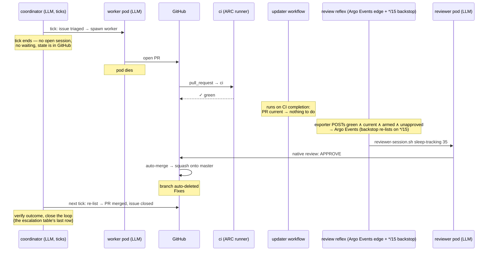
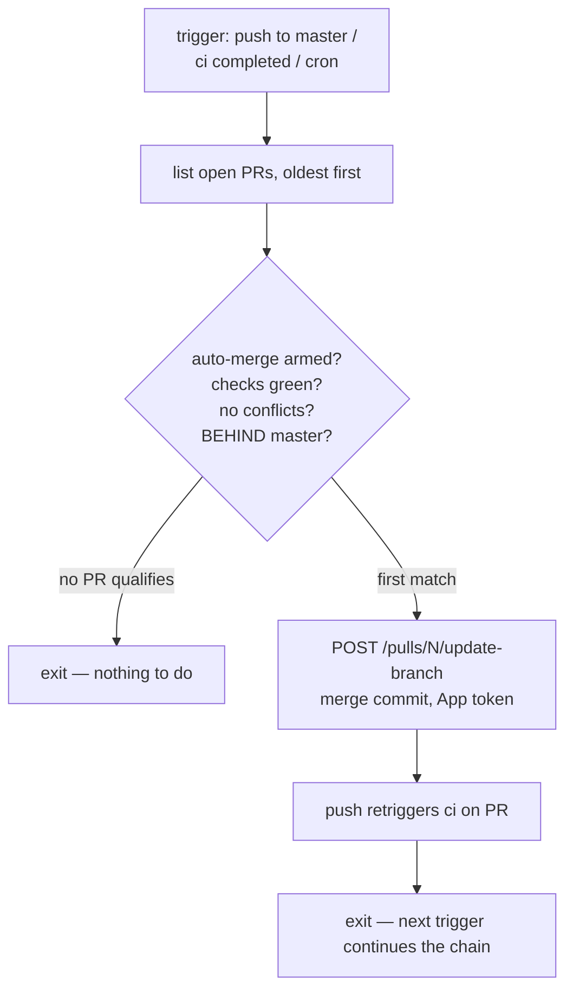

# The merge-path mechanism — the updater and the review reflex (scan island)

> Moved here from [`docs/agents/merge-path.md`](../../../../docs/agents/merge-path.md) (2026-11-07,
> island specs spike, draft PR #3147): the sections that describe the MECHANISM the scan island
> owns — the updater ([`agents/update-pr-branch.sh`](../../../update-pr-branch.sh)) and the review
> reflex ([`agents/review-reflex.sh`](../../../review-reflex.sh)). The contract is pinned as rows in
> [`../specs/updater.md`](../specs/updater.md) and [`../specs/review-reflex.md`](../specs/review-reflex.md);
> this page keeps the design narrative (why). The problem statement, options table, worked
> examples, scaling model, failure modes and decisions stay in `merge-path.md`; the state machine
> stays in [`merge-path-fsm.md`](../../../../docs/agents/merge-path-fsm.md). Island:
> [`../README.md`](../README.md). Terms: [`../specs/glossary.md`](../specs/glossary.md),
> [`docs/glossary.md`](../../../../docs/glossary.md).
>
> Where this narrative and the code disagree, the code and its rows win — the narrative predates
> ADR-125 in places and says so inline.

## Chosen design

Four deterministic pieces around the existing gates:

1. **Worker arms auto-merge** at PR creation: `gh pr merge <N> --auto --squash` (already documented
   in `agents/reviewer-session.sh`'s header; becomes a mandatory step in `agent-session.sh`).
2. **Updater** — in-cluster since the ADR-111 cutover (2026-08-26, homelab#745):
   [`agents/update-pr-branch.sh`](../../../update-pr-branch.sh), dispatched by the exporter's
   `maybe_dispatch_behind` edge (repo-scoped, near-instant) with a `*/15` Argo CronWorkflow
   sweeping the whole stacks.json universe
   ([`update-pr-argo.yaml`](../../../coordinator/update-pr-argo.yaml)). Semantics carried over
   from the adRise-action era unchanged: update *before* review (see ordering, below), FIFO
   (oldest first), armed-only, and **exactly one PR per (repo, base) lane per pass** (ADR-125) —
   the oldest open PR in that lane that is green,
   auto-merge-armed, conflict-free, and behind — via the update-branch API (merge commit; the
   endpoint cannot rebase, which is what we want — no history rewrite, no force-push, a stale
   worker clone can still `git pull`).
   **Stacked PRs are excluded by arming** (2026-08-05, the `Base:` line): a PR based on an
   unmerged branch is never armed, and the pick is armed-only — the action-era `base: master`
   configuration did the same job by a second route. The conflict labeler (leg 3) is armed-only
   too, so it stays quiet on them.
3. **Review reflex** — the *coordinator subsystem's* deterministic half, in ns `agent-coordinator`
   (it holds both reviewer secrets), pure bash + `gh`. **Now edge-triggered (ADR-093):** the
   github-exporter POSTs a reviewable PR to an Argo Events webhook EventSource → Sensor → `review`
   WorkflowTemplate → `reviewer-session.sh <repo> <pr>` for that exact PR, near-instant. A `*/15`
   **CronWorkflow backstop** (the old `*/5` reflex, generalized) re-lists as a level-triggered
   catch-all for anything the edge missed: across the agent repos, list open PRs; filter
   **green AND auto-merge-armed AND
   unapproved AND no changes-requested** (up-to-date is NOT a precondition since ADR-125 —
   BEHIND-but-green is admitted for a first review, DIRTY still skips; §Why update-before-review) (*unapproved* = the reviewer bot has no approval at the
   current head — NOT GitHub's `reviewDecision`, which on code-owner-gated repos stays
   `REVIEW_REQUIRED` until the human owner approves; see the edge case below); pick the oldest
   **one per (repo, base) lane** (ADR-125 — within a lane, reviews
   must serialize — see below); run `agents/reviewer-session.sh <repo> <pr>` for each, **capped at
   K concurrent reviewer pods globally** (start K=2). Reviews in different lanes can't invalidate
   each other (their bases move independently), so the per-lane serialization that protects review
   economics costs nothing across lanes; K exists only to protect the shared subscription quota.
   Anything it *can't* mechanically progress (conflict, round limit, flip-flop — see the
   escalation table) it **labels for the coordinator** rather than acting on. Edge-triggered by the
   exporter POST with the `*/15` backstop (ADR-093) — the edge+level pattern from
   [`workflow.md`](../../../../docs/agents/workflow.md) §Triggers, now live; double-dispatch is safe (see merge-path.md §Concurrent
   triggers). This collapsed the reflex's separate PR-list GraphQL poll (a rate-limit burn).
4. **GitHub auto-merge** completes the PR the moment approval lands (the PR is already green and
   current — the reflex only reviews PRs in that state). Nobody — human or LLM — clicks merge.

### Reflexes vs judgment — where the coordinator sits

These reflexes are **not a second controller beside the coordinator** — they are the mechanical
transitions of the same level-triggered reconciler described in [`workflow.md`](../../../../docs/agents/workflow.md),
extracted so they never cost an LLM turn. [`README.md`](../../../../docs/agents/README.md) already states the rule:
*"don't put an agent where a status check will do."*

The coordinator **keeps start-to-finish ownership of every issue** as an overseer:

- **It reads freely** — discovery is not mutation: `gh pr view`, `kubectl get`, Grafana/MCP,
  transcripts, whatever it needs to judge a situation.
- **It writes only coordination state** — labels, comments, issue/PR lifecycle. Code, branches,
  approvals, and merges are never its verbs; those go through delegated worker/reviewer sessions
  and the deterministic gates (ADR-079: agents propose, GitOps applies).
- **It is never woken for a decision-free transition** — those run as the reflexes below.
- **It is the tie-breaker** — when worker and reviewer disagree (approve↔changes flip-flop, or a
  fix round that argues the review is wrong), the coordinator reads both sides and rules.

| event | who acts | what happens |
|---|---|---|
| PR green + behind | reflex (updater workflow) | update-branch API call — EXCEPT an untouched Renovate PR on a grouped Actions branch (`renovate/github-actions`, `renovate/github-actions-major`): those ride `rebaseWhen: behind-base-branch` and Renovate rebases them itself; an updater push would mark the PR edited and stop Renovate maintaining it (ADR-141, PR#2004) |
| PR green + current + unapproved | reflex (exporter POST → Argo Events → review WorkflowTemplate; `*/15` CronWorkflow backstop) | dispatch reviewer session |
| approval lands | reflex (GitHub auto-merge) | merge, delete branch |
| update-branch returns 422 (conflict) | reflex labels → **coordinator decides** | the brief's §The `merge-conflict` clause: resume on the branch (a merge-only fix round; the push dismisses approvals, so the codeowner re-reads the resolution only) when the conflict is confined to the PR's own files or append-only surfaces; close + re-queue when it reaches the diff's substance, the PR was never approved, or a resume already failed; escalate when the conflicting master change is the seat's |
| reviewer requests changes, rounds left | reflex (the reconciler's `changes-requested → round N+1` transition, `workflow.md`) | spawn a fresh worker with PR + review thread; PR re-enters the queue mechanically |
| rounds exhausted (`workflow.md` §Hazards: bounded rounds) or worker↔reviewer flip-flop | reflex labels → **coordinator tie-breaks** | reads the diff + review thread (discovery), rules: re-dispatch with clarified instructions, close as not-mergeable, or escalate to the human |
| CI red beyond T hours | reflex labels → **coordinator decides** | re-dispatch, park, or escalate |
| PR merged (issue auto-closed via `Fixes #N`) | **coordinator closes the loop** | next tick: verify the outcome actually holds; comment; reopen + re-dispatch if it doesn't |
| ARMED `major` PR opens (a GRADUATED GitHub Actions major — ADR-141 as amended 2026-09-27; un-graduated Actions majors ride the grouped `automerge` lane and never reach the lens) | **reflex** (armed = its world) | reviewer runs the migration lens as a batch member (Renovate has no fixer behind it — a missed-on-master call site is its next rebase, never a finding); APPROVED is the merge gate (distinct identity, one-review rule); a post-merge master failure rolls back via the FU-1990 chain (`deploy-revert-argo.yaml`, PR#2002), the re-proposal is refused by `pin-only-lint` check (e) in `ci` until a newer release |
| ARMED `major` devbox lock bump PR opens (a lock major, 2026-10-07 — [`dependency-upgrades.md`](../../../../docs/dependency-upgrades.md) §2 Review; `lock-lane: arm`) | **reflex** (armed = its world; the lens's APPROVED completes the merge, the `workflow-pin-revert` lock shape is the rollback) |
| un-armed `major` devbox bump PR opens (a `HUMAN_PACKAGES` major — opentofu; `lock-lane: human`) | **coordinator owns end-to-end** (never the reflex — it's un-armed) | investigate (dispatch reviewer *even while red* — the review explains the break) → worker fixes breakage if within budget → green + approved → relabel `major/awaiting-human`; a **human** merges. See `agents/coordinator/README.md` §"Dependency major bumps". |

Two properties fall out. First, the merge path stays fully deterministic (constraint 1): every
box on the mechanical rows is a GitHub workflow, an Argo Events Sensor, or an Argo CronWorkflow.
Second, nothing ever leaves the
coordinator's authority: the reflexes are *its* machinery (they live in its namespace, they report
into its label vocabulary), so from the issue's point of view there is one owner from triage to
close — the coordinator just isn't billed an LLM turn for the trivial 90 %. Its brief loses the
*mechanical* "trigger the reviewer" step and gains the exception plays in the table.

**Arming is the boundary between the two.** The review reflex only ever selects auto-merge-**armed**
PRs; everything un-armed is outside its world. The devbox lock gate leans on exactly this: a **`major`**
bump whose HUMAN_PACKAGES member crossed (opentofu — the one move a lock revert cannot undo) is
deliberately left **un-armed** (a human merges that crossing, not the bot), so it is invisible to the
reflex and falls to the **coordinator**, which owns it end-to-end (investigate → fix-if-in-budget →
`major/awaiting-human` → human merge — the escalation-table row); every other lock major is ARMED at
creation and the reflex's (2026-10-07). This keeps the
split collision-free *by construction*: **the arm, never the label, decides the owner** — an un-armed
`major` is the coordinator's, an armed `major` is the reflex's (ADR-141: a GitHub Actions major is the
CI-exercised blast class, so Renovate arms it and the reflex's reviewer runs the migration lens as the
merge gate; `coordinator-scan.sh` keys its major clause on `autoMergeRequest == null`, and the reflex's
selector on the arm) — so the reflex and the coordinator can never contend for the same PR. Crucially the coordinator dispatches the major's
investigation review **directly, while the PR is still red** — the review's job there is to *explain* the
break — which is precisely why a major can't ride the reflex (green-only, decision-free) path. Non-major
devbox bumps stay armed and ride the reflex like any other PR. **Proven E2E (2026-07-05):** an opus
coordinator drove sleep-tracking#18 (helm 3→4) through this exact lane — investigate-while-red → worker
applied `--verify=false` → green → `major/awaiting-human` → human merged (2026-07-05).

The corollary is **arm-at-open discipline (FU-079)**: any PR opened by an operator or a stacked
workflow must either be armed immediately (`gh pr merge <N> --auto --squash`) or carry an owning
lane label — an un-armed, unlabeled PR is invisible to the updater, the reflex, AND auto-merge, and
stalls silently (live: oracle-fleet#16 stuck at ci "Expected" after a stacked-base retarget, then
BEHIND). `coordinator-scan` reports every such PR as a report-only orphan.

### Why update-before-review, and why reviews serialize per (repo, base) lane

Two orderings were on the table:

- *Review first, then update* (the adRise default, `required_approval_count ≥ 1`): approval lands →
  PR is behind → updater pushes → **`dismiss_stale_reviews_on_push` eats the approval** → re-review.
  Every behind-PR costs 2+ reviewer runs.
- *Update first, review last* (`required_approval_count: 0`): the PR is brought current and green
  **before** the reviewer ever runs; approval is the final event and auto-merge fires immediately.
  One reviewer run per PR.

But update-before-review only holds if reviews are **serialized within a lane**: if the reflex
eagerly dispatched reviews for *all* current+green PRs sharing one base (say 3 PRs opened against
the same master tip — none is "behind"), the first merge makes the other two stale, their updates dismiss their fresh
approvals, and we're back to double reviews. Hence: the review reflex dispatches **one review at a time per
lane**, exactly like the updater updates one at a time per lane. PRs in *different* lanes
parallelize freely (a merge in repo X can't stale a PR in repo Y, and a master merge can't stale a
`goal/**`-based PR). The cost is within-lane review
latency (they queue); at ~4–8 min per review on an autonomous pipeline, that's irrelevant.

**The serialization unit is the (repo, BASE) LANE, not the repo** (ADR-125, homelab#1422): the
staling chain above only ever runs between PRs sharing a base, so the reflex picks one PR per lane
and the updater's main leg updates one per lane — the default branch is one lane, every `goal/**`
base is another, and a master merge cannot dismiss a goal-lane approval. `REVIEW_CONCURRENCY` and
the FU-088 subscription latch are untouched and stay the fleet-wide ceiling; lanes buy parallelism
inside it. The same currency reading retired **BEHIND as a first-review precondition**: an
update-branch merge does NOT dismiss a review (GitHub re-points the review's `commit_id` —
approvals survived 4 updater merges on PR#1386, 2026-09-05), while the skip starved real work
(PR#1437 sat BEHIND through 7 master moves and 3 updater merges without a first review). So a
BEHIND-but-green, never-reviewed PR is admitted and the update + CI follow the verdict; DIRTY still
skips on both the reflex predicate and the launcher's spawn-time gate, and a changes-requested PR
with no new content is still not reviewable.

The only remaining double-review window: master moves in the seconds between "approval submitted"
and "auto-merge executes" (e.g. an operator direct-push, which bypasses the gates as OrgAdmin).
Then that PR is updated and re-reviewed once. Rare, self-healing, counted in scenario L below.

### Sequence — one PR, quiet master (scenario S)

Totals: **1 CI cycle, 1 reviewer run, 0 updates.** Identical to today's happy path — the machinery
only wakes when PRs stack up or master moves.

**Timing: nobody waits on anybody.** Between its ticks the coordinator isn't running at all — it
holds *state, never a call stack* (`workflow.md`). It learns "issue fixed" the same way it learns
every other fact: by re-listing on the next tick and finding the merged PR + auto-closed issue.
It does not need to have *spawned* the review to know the outcome, any more than it needs to spawn
CI to read CI results — the verdict is a native PR review, durable state. (If the LLM-coordinator
were the review spawner, it would have to be awake at the right moment — i.e. LLM-polling a
boolean every few minutes, a billed turn per poll for a decision with zero content.) The review is
now edge-triggered (ADR-093): the github-exporter POSTs the reviewable PR to Argo Events the moment
it goes green ∧ armed ∧ unapproved, so dispatch is near-instant against the 8–20 min CI cycle; the
`*/15` CronWorkflow backstop only covers a missed event. For tasks predicted small, the
coordinator may also stay hot through the whole cycle and verify in-session — the "hot tick"
micro-opt in `workflow.md` §Worker = a pure function (watch and nudge, never dispatch).

### Updater decision logic

One update per lane per invocation, oldest first (ADR-125). A red or conflicted PR is *skipped,
not blocking*: the next qualifying PR in that lane gets the slot, and the skipped PR just sits
(red → worker/human fixes it;
conflicted → can't be auto-updated, needs a coordinator decision — the review reflex never
reviews it because it can never become "current").

