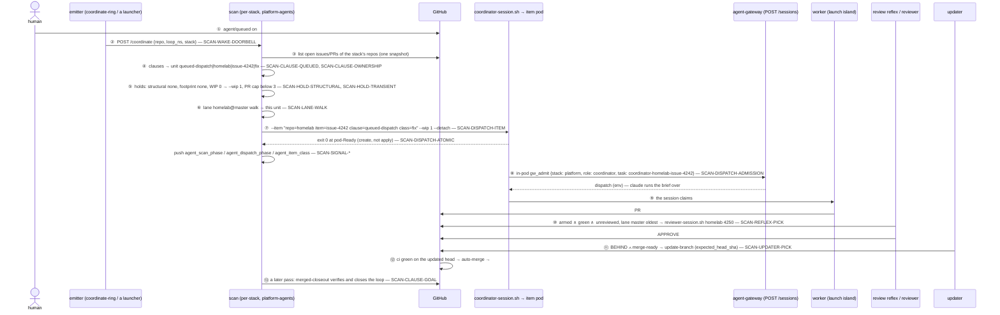

# UC-1 — a queued issue: ring → scan → one unit → item session → PR → review → current → merged

**Persona:** the scan (`agents/coordinator-scan.sh --spawn`) on the `platform` stack, woken by a
ring after a human applied `agent/queued` to homelab#4242. **Its one question:**

> *Is there anything a coordinator session would act on — and if so, which one unit per lane,
> with which launcher-owned parameters?*

Everything in the island exists to answer that with **no LLM woken to find nothing**, **no model
named by the scan** (the redrawn contract — today still a ⚑ gap), and **no merge decision taken by
anything but GitHub's auto-merge**. The walk-through numbers (#4242, PR #4250) are placeholders,
not live items. Terms: [../glossary.md](../glossary.md), [docs/glossary.md](../../../../../docs/glossary.md).

## Flow

## Walk-through data (the golden thread)

The data lives in [`uc-1/`](uc-1/); placeholders in guillemets (`«headRefOid»`) are values a run
produces. World: constructed — the `platform` stack's four repos (`agents/stacks.json`), open items only
in `homelab`, no live worker, no other queued issue, no open PR at step ③.

| step | input | expected |
|---|---|---|
| ② the ring | [`uc-1/ring.json`](uc-1/ring.json) | the per-stack trigger submits the scan into `platform-agents` (`loop_ns` set) |
| ③–④ the snapshot → the unit | [`uc-1/issue-list.json`](uc-1/issue-list.json) (machine block: `Touches`, `Class`) | [`uc-1/expected-unit.txt`](uc-1/expected-unit.txt) |
| ⑦ the dispatch | the unit + `wipmap` (0 live workers) | [`uc-1/expected-dispatch.json`](uc-1/expected-dispatch.json) — `--model` marked ⚑ |
| ⑧ admission | the item pod | [`uc-1/expected-admission.json`](uc-1/expected-admission.json) (shape owned by [gateway sessions.schema.json](../../../../../gateway/specs/endpoints/sessions.schema.json)) |
| ⑩ the reflex pick | [`uc-1/pr-list.json`](uc-1/pr-list.json) (armed, green, BEHIND, unreviewed) | [`uc-1/expected-reflex-pick.txt`](uc-1/expected-reflex-pick.txt) — BEHIND is admitted for a first review |
| ⑪ the updater | the same PR before / after the approval | [`uc-1/expected-updater.json`](uc-1/expected-updater.json) — skipped until merge-ready, then one update |

Steps ⑨ and ⑫ belong to other islands (launch; GitHub) and are named, not specified, here. ⚖ In a
repo whose ruleset requires a codeowner approval (`REVIEW_REQUIRED`), step ⑪ never fires on the
bot approval alone — the PR is a park until the human approves (the updater's #1649 rows).

## Not in this use case

The PR clauses (changes-requested, merge-conflict, ci-red, arbitrate), the goal lane, the phantom
reconcile and the major handoff each want their own walk (UC-2: a CHANGES_REQUESTED fix round via
the fast path; UC-3: a Goal decompose → checkpoint → assembly; UC-4: a Renovate major to a human
merge). Until written, their contract pages carry `use-cases: []` or name UC-1 only for the
shared prefix (②–⑦).
