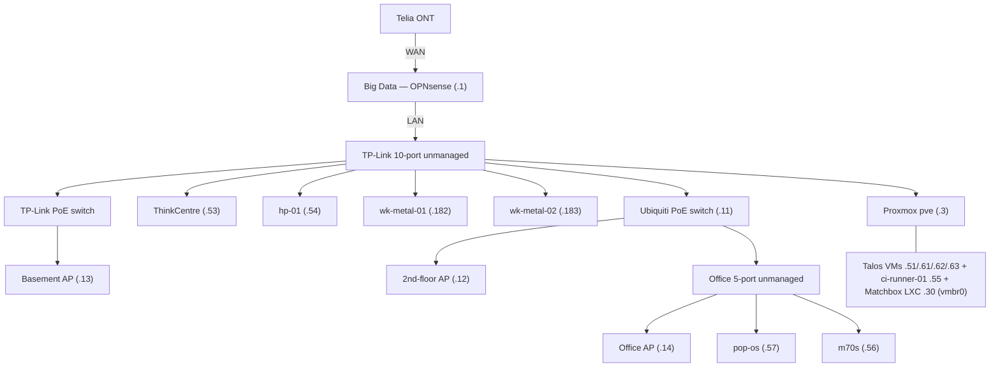

# Physical network topology

_Part of the [homelab docs](README.md). Logical/IP view: [`/README.md`](../README.md) +
[`CLAUDE.md`](../CLAUDE.md); **IP allocation rules: [`ip-plan.md`](ip-plan.md)** (ADR-088);
service exposure / BGP rationale: [`adr.md`](adr.md) ADR-021._

> ⚠ **The router changed after the last capture:** `.1` is the nx-02 + pve CARP pair since 2026-10-09
> ([`router-move.md`](router-move.md) §Status); Big Data is powered off as the fallback. The diagram
> below predates the pair and needs a re-capture.

Cabling/switch layout (distinct from the logical/IP view). Captured 2026-06-03; re-captured
2026-08-12 (operator cabling + live guest-agent reads: the wk-metal fleet, hp-01, ci-runner-01).
Operator corrections 2026-10-13: `m70s` (.56) is on the office 5-port; `wk-metal-03` (.184) moved to
the basement (which switch is not recorded, so it is off both diagrams). The nx-01/nx-02 twin is
not captured either. Operator 2026-10-20: `wk-metal-04` (.186) is now the Big Data box (the old
desktop died) and hangs off the **basement 8-port switch** — that switch's uplink is not recorded,
so it too is off both diagrams.

```
                         Internet (fibre)
                              │
                        ┌─────┴─────┐
                        │ Telia ONT │  fibre → ethernet
                        └─────┬─────┘
                              │ WAN  (onboard NIC)
              ┌───────────────┴─────────────────┐
              │  "Big Data"  —  OPNsense router  │
              │  + Intel 4×1GbE PCIe card:       │
              │    LAN (192.168.2.1), OPT1-3     │
              └───────────────┬─────────────────┘
                              │ LAN
                ┌─────────────┴──────────────┐
                │ TP-Link 10-port (UNMANAGED) │   ← core LAN switch
                └─┬───┬───┬───┬───┬───┬───┬──┘
                  │   │   │   │   │   │   │
   Proxmox "pve" ◄┘   │   │   │   │   │   └─► TP-Link PoE switch
   (X99, .3)          │   │   │   │   │         └─► Basement AP (U6Lite, .13)
   └ vmbr0:           │   │   │   │   │
     ├ Talos VMs      │   │   │   │   └─► Ubiquiti PoE switch (.11, USW-Lite)
     │  cp-01 .51     │   │   │   │        ├─► 2nd-floor AP (U6Lite, .12)
     │  wk-01 .61     │   │   │   │        └─► Office: 5-port (UNMANAGED)
     │  wk-02 .62     │   │   │   │             ├─► Office AP (UAP-AC-Lite, .14)
     │  wk-03 .63     │   │   │   │             ├─► pop-os (.57)
     ├ ci-runner-01   │   │   │   │             └─► m70s (.56)
     │  (VM 9001, .55)│   │   │   │
     └ Matchbox .30   │   │   │   │
                      │   │   │   └─► hp-01 (.54)
   ThinkCentre Edge ◄─┘   │   └─► wk-metal-02 (.183)
   (.53)                  └─► wk-metal-01 (.182)
```

## Notes relevant to PXE / provisioning

- **`ThinkCentre Edge` (.53) is still cabled where the tree shows it, but is no longer a cluster
  node** (left cluster duty 2026-09-12 → the R12 out-of-band management-box pilot, FU-097). When it
  is stood up, R12 wants it **dual-homed** — a second NIC on a dedicated management switch — which
  is a change to this map, not just to the box; update both the ASCII tree and the mermaid graph in
  the same edit.

- **The office 5-port's `m70s` port wedged into a PAUSE storm (2026-10-13).** After a ~6 min
  m70s-only blackout at 06:10Z (no carrier change), the switch sent m70s ~2,600 802.3x PAUSE
  frames/s (XOFF 0xffff / XON alternating, src 00:00:00:00:00:00) — counted in `rx_dropped`, not
  `rx_errs` — capping its egress at ~100 Mbit while the link still read 1000. The Prometheus
  volume's replica rebuild to hp-01 hit Longhorn's 8 s engine-replica timeout on every attempt
  (`LokiNamespaceLogVolumeHigh` on longhorn-system was the only alert). Moving the cable to
  another port cleared it instantly. Diagnose: `talosctl read /sys/class/net/<if>/statistics/rx_dropped`
  rate vs the neighbours, then `talosctl pcap` and count ethertype `0x8808`.
- **Everything above is ONE flat L2 domain** (every switch unmanaged or L2-only; no VLANs), so
  DHCP/PXE broadcasts reach Matchbox (LXC on Proxmox `vmbr0`) from EVERY port — including
  wk-metal-03/-04 two switch hops away in the office. Verified in practice: all four wk-metal
  nodes + hp-01 PXE-provisioned through this layout.
- **ThinkCentre, hp-01, wk-metal-01/-02 and Proxmox share the core TP-Link 10-port switch**, one
  hop from OPNsense LAN. (The ThinkCentre's 2026-06 "flaky PXE" was ultimately a **bad NIC
  cable** — 100Mbps + link flapping — replaced 2026-06-11; PXE has worked since.)
- **Unmanaged switches** (TP-Link 10-port, office 5-port) → no STP forwarding delay to
  blame for a PXE-vs-STP race.
- The managed UniFi switch (.11) is **downstream** of the core switch; wk-metal-03/-04 and
  pop-os (the jail host) sit below it on the office 5-port.


