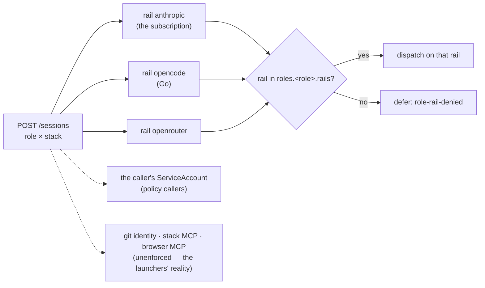

# Access — the role × stack × service inventory

Operator ruling (2026-10-15): the role × stack × service [access inventory](glossary.md#access-inventory)
is P2 scope. **One table**: rows are roles, columns are services, cells are `allowed` / `denied` /
`🚧 WIP`. v0 enforces **only the rail columns** (`roles.<role>.rails` in the policy —
[GW-SESSIONS-ADMIT](endpoints/sessions.md#gw-sessions-admit)), plus who may call the control plane
for which stack and role ([GW-SESSIONS-AUTH](endpoints/sessions.md#gw-sessions-auth) — per caller
ServiceAccount, not per role, so it is a row of the enforcement table below, not a column); every other column documents
today's reality as the launchers render it (`agents/agent-session.sh`, `agents/stacks.json`,
`agents/reviewer-session.sh`, `agents/coordinator-session.sh`, `agents/coordinator/responder-argo.yaml`,
`agents/retro-session.sh`, `agents/research-fanout.sh`, the AgentStack composition's prober,
`agents/specs-reviewer-session.sh`) and is marked unenforced. Read 2026-10-15 (specs reviewer row
added 2026-10-16); a cell is what the launcher does, not what a doc says it should.

## Flow overview

A role asks for a rail; the policy's `roles.<role>.rails` list answers
([GW-ACCESS](#gw-access)). Who may ask at all, for which stack and role, is the policy's
`callers` map ([Role and caller](#role-and-caller)); the columns no gateway code reads are the
[inventory](#the-inventory-today-by-launcher).

## Requirement index

| Requirement | Section | Status |
|---|---|---|
| [GW-ACCESS](#gw-access) | the enforced half |  |

## The inventory (today, by launcher)

| role | rail `anthropic` | rail `opencode` | rail `openrouter` | git identity | stack MCP (`spec.mcp`) | browser MCP |
|---|---|---|---|---|---|---|
| worker | allowed — claude harness, `ref:<ns>/claude-session`; under the opt-in below: denied (the policy's worker rails) | allowed — `opencode-go/*` models on the claude harness; **opt-in `AGENT_GATEWAY=sessions` (FU-270, platform stack only, ⚖ env knob, no claim field yet):** admitted through `POST /sessions` with `bind` (the pod's namespace, ServiceAccount and name), authenticated as the dispatcher's ServiceAccount (`platform-agents:agentstack-loop`; the jail canary mints that SA's token — [GW-SESSIONS-AUTH](endpoints/sessions.md#gw-sessions-auth)) — the launcher never sees the token: the pod pulls its `env` from `POST /sessions/{id}/env` with its projected ServiceAccount token (audience `agent-gateway`, TokenReview'd, at most once — [GW-SESSIONS-PULL](endpoints/sessions.md#gw-sessions-pull)); no Secret, no ref rail, the gateway's model and harness | allowed — goose/opencode, `ref:<ns>/<project>-openrouter` (session key); under the opt-in: the gateway's walk past a full [Go rail](../../docs/agents/chainless-redesign.md), the stack key resolved gateway-side (no ref in the pod) | broker — `GIT_CRED_BROKER_URL` per-op token, no standing Secret (FU-089) | allowed when the claim sets `spec.mcp.endpoint` (`stack-mcp`, #1041/#1276) | denied — no pod renders it (jail sidecar only) |
| reviewer | allowed — `ref:agent-coordinator/coordinator-claude`, review class first; **platform stack (FU-270, `AGENT_GATEWAY=sessions` from its review dispatchers):** admitted through `POST /sessions` as `platform-agents:agentstack-loop`, `harness: claude` (the pod runs claude only), bound to the reviewer pod, which pulls its env — no ref; a refused admission falls back to the ref (transition fallback) | allowed — failover when the subscription is latched (`opencode-go/qwen3.7-plus`, homelab#424); platform: the gateway's walk onto an anthropic-dialect Go cell | denied — the class lists it second, the FU-188 incident pin keeps reviews on the subscription; platform: the policy's reviewer rails list no openrouter, and `harness: claude` skips cells this pod cannot speak | standing — `reviewer-git` Secret `GH_TOKEN` (the homelab-reviewer App) | allowed when the claim sets it (`--mcp-config`) | denied |
| specs reviewer (gateway role `reviewer`) | allowed — the FIRST launcher admitted through `POST /sessions` (ADR-155, FU-270 dogfood), as the caller `agent-coordinator:specs-review` — the tick's own SA, #2685 (GW-SESSIONS-AUTH): `env` exported verbatim, no ref rail | allowed — the role's failover, as the gateway walks it | denied — the role's list | standing — `specs-reviewer-git` Secret `GH_TOKEN` (the homelab-specs-reviewer App; absent = shadow, no verdicts) | denied — none rendered (inputs are a diff, a body, a CI log) | denied |
| coordinator | allowed — `ref:agent-coordinator/coordinator-claude`; **the platform stack's headless sessions (FU-270):** admitted through `POST /sessions` IN the session pod, unbound, as that pod's own ServiceAccount (the loop's `platform-agents:agentstack-loop`; a jail-launched pod `agent-coordinator:agent-coordinator`) via `agents/gateway-admit.sh` — the dispatch `env` exported to claude, the gateway's model; a refusal before any request or a fail-closed answer falls back to the ref rail (the transition fallback, deleted with the old proxy); **the island intake sitting (tier `heavy`) and a fix-debounce set-pass whose whole set is platform's** likewise, as `agent-coordinator:agent-coordinator` in the responder row's unbound lane shape | allowed — a stack whose `coordinatorModel` is `opencode-go/*` (none today: platform's `opencode-go/deepseek-v4-flash` went back to `opus` on 2026-10-27, #2960) | denied — class `dispatch` rails = subscription only | standing — `coordinator-git` Secret `GH_TOKEN` (ESO) | denied — none rendered | denied |
| responder | allowed — `ref:agent-coordinator/coordinator-claude`; **platform-routed triages and the deep dig: admitted through `POST /sessions`** (FU-270 rollout, unbound — `agents/gateway-admit.sh` `gw_admit_lane`, caller `agent-coordinator:agent-coordinator`; the dispatch `env` rides onto the claude call; a refusal or fail-closed falls back to the ref rail, logged) | allowed — an `opencode-go/*` rail case in the triage step; under the gateway: the role's failover as the gateway walks it | denied — class `dispatch` | standing — `coordinator-git` `GH_TOKEN` | denied — none rendered | denied |
| retro | allowed — the claude-harness cell (`harnessA`); **platform stack: admitted through `POST /sessions` as role `retro`** (FU-270, operator ruling 2026-11-01), caller `agent-coordinator:agent-coordinator` bound into the ride namespace, the gateway's model, the report named after the served one; off-platform and the transition fallback: `claude:opus` on the subscription | platform: the gateway's walk (the goose cell's openai dialect); off-platform: denied (`retro-session.sh` runs claude / goose only) | platform: the gateway's walk; off-platform: the goose cell `goose:deepseek/deepseek-v4-pro` on an ephemeral xs key | standing, read-only — `RETRO_GH_TOKEN` file mount (retro-git.yaml, #2171); the broker URL is not rendered | inherits the worker launcher's knob | denied |
| prober | allowed — `ref:<loopns>/claude-session` | denied — not rendered | denied — not rendered; **under the opt-in: the entry canary** ([GW-CATALOG-OR](endpoints/catalog.md#the-entry-canary)) — `gateway/scripts/canary-entrants.sh` admits one prober ride per candidate cell (`canary: {model, provider}`, harness opencode) as the dispatcher's ServiceAccount, whose `callers` entry grants `prober` beside `worker` ([GW-SESSIONS-AUTH](endpoints/sessions.md#gw-sessions-auth), 2026-10-20) — unbound | broker — the loop git token fetched with the pod's SA token | denied — none rendered | denied |
| researcher | allowed — `claude/<alias>` draws on the claude harness; **platform stack: each arm admitted through `POST /sessions` as role `researcher`** (FU-270, operator ruling 2026-11-01), the jail minting `platform-agents:agentstack-loop`'s token, no draw — the gateway's model, recorded per arm | platform: the gateway's walk; off-platform: denied — class `research` rails = openrouter only | allowed — off-platform: goose, pool draws on the stack key | broker — inherits the worker launcher | inherits the worker launcher's knob | denied |

| column | enforced by v0? | enforcement point | what "enforced" would mean later |
|---|---|---|---|
| rail `anthropic` / `opencode` / `openrouter` | **yes** | `POST /sessions` — `roles.<role>.rails`; a rail not listed is `defer: role-rail-denied`, and no session means no data-plane credential | — |
| control-plane caller (who may call `/sessions`, for which stack, role and bind namespace; who may list and judge) | **yes** (`enforce` since 2026-10-17) | `POST /sessions`, `GET` / `DELETE /sessions/{id}`, `GET /sessions?task=` — the policy's `callers`, keyed by the caller's reviewed ServiceAccount ([GW-SESSIONS-AUTH](endpoints/sessions.md#gw-sessions-auth)); a known caller outside its entry is refused in both modes, a caller with no valid token is counted under `observe` and refused under `enforce` | — |
| git identity | no | the launchers render it; the broker is `openrouter-proxy`'s `/git-token` today and leaves for its own service (FU-269, ADR-139 step 1) | the broker consults the session's role before minting |
| stack MCP | no | the launcher reads the claim knob and renders the harness config | the gateway's `env` carries the MCP config; the knob moves into the policy |
| browser MCP | no (and not reachable) | the browser sidecar is a jail-host network (`jail-browser`); no cluster pod joins it | a decision, not a wiring — `🚧 WIP` until one exists |

### Role and caller

Which CALLER may ask for which role is the policy's `callers` map, per
ServiceAccount ([GW-SESSIONS-AUTH](endpoints/sessions.md#gw-sessions-auth)): the platform loop's
dispatcher SA (`platform-agents:agentstack-loop`) `worker` + `prober` — its graduated workers, the
entry canary's rides and the `probe-platform` tick's outer session (the AgentStack prober template's
`prober.gateway: sessions`, one unbound session through the shared helper) — and `coordinator` +
`reviewer` (bind namespace `platform-agents`) for the loop's coordinator and
reviewer pods — the coordinator session admits unbound from its own pod (operator ruling 2026-11-01: the platform lanes move onto the
gateway; granted ahead of the launchers, which adopt the shared admission helper
`agents/gateway-admit.sh` one PR at a time — until then the inventory rows above stay as they are; the coordinator row has),
plus `researcher` for the jail's research fan-out, which impersonates it;
the coordinator namespace's shared SA (`agent-coordinator:agent-coordinator`) `coordinator` +
`responder`, no bind — the responder, deep dig, island intake and fix-debounce lanes, each one
unbound session (the fix-debounce set-pass's `dispatch-unit` class maps to `coordinator`) — and
`retro`, bound into `openrouter-operator`, for the retro cron's cells (worker-launcher rides in the
platform retro's ride namespace); the oracle loop's SA (`oracle-agents:agentstack-loop`) `prober` only, no bind —
the `probe-oracle` tick's nested mission child on the codex rail (operator ruling 2026-10-24); the specs reviewer's SA (`agent-coordinator:specs-review`) `reviewer` +
`worker` — the tick and its shadow cell; the [judge](glossary.md#judge)'s SA
(`agent-coordinator:outcome-judge`, the deploy-revert chain's judge step, FU-270 (b)) no role at
all — `outcome: any`, so it lists a task's sessions and reports `wrong-verdict` on them
([GW-SESSIONS-OUTCOME](endpoints/sessions.md#gw-sessions-outcome)). No other caller, no wildcard;
the deployed map is `argocd/resources/agent-gateway/policy.json` (`kustomization.yaml` comments it).

## Per stack

The service set is the same for every stack; what differs per stack is which credential each
rail resolves to and which rail the coordinator rides today (`agents/stacks.json`, the
committed mirror of the cluster claims — the cluster wins at runtime).

| stack | `coordinatorModel` (mirror) | coordinator rail today | openrouter credential | `spec.mcp` |
|---|---|---|---|---|
| sleep | `sonnet` | anthropic | the stack's session key (`<project>-openrouter`) | cluster claim only — not mirrored, `🚧 WIP` to read |
| platform | `opus` | anthropic | the stack's session key | `🚧 WIP` |
| oracle | `sonnet` | anthropic | the stack's session key | `🚧 WIP` |
| circles | `sonnet` | anthropic | the stack's session key | `🚧 WIP` |

## GW-ACCESS

v0 enforces the rail columns of the [access inventory](glossary.md#access-inventory) and nothing
else of it (the caller check is GW-SESSIONS-AUTH's, per ServiceAccount): a role's allowed rails
are exactly `roles.<role>.rails` in the policy, consulted in that order by
[GW-SESSIONS-ADMIT](endpoints/sessions.md#gw-sessions-admit); a rail outside the list is never
walked, even when explicitly requested — the answer is `defer` with the reason
`role-rail-denied`, whatever capacity and credential the rail has. A rail inside the list
dispatches on it. The `policy-default` world encodes the inventory above with one deliberate
difference, flagged ⚖: the **worker** loses the `anthropic` rail (the brief's example policy; the
subscription's slots are the review and coordination lanes' safety net — `model-routing.md` M10)
even though today's launcher lets a haiku-tier worker ride it.

The non-rail columns change nothing at this seam: the gateway mints no git token, its `env` carries
no MCP configuration and no cluster pod reaches the browser sidecar (unverified — expected to hold;
no row drives these columns, they are documented in the inventory only).

**World: [policy-default](worlds/README.md#policy-worlds)** — every row is one `POST /sessions`
for stack `platform` naming the `rail` explicitly, no caller token (`control_plane_auth: observe`),
the role's default harness and tier. Legend: `decision?` = the answer's `decision`; `reason?` = its
`reason` (`none` on a dispatch).

#### Who may ride the subscription rail

| description | role | rail | decision? | reason? |
|---|---|---|---|---|
| the worker never rides the subscription — its slots are the review and coordination lanes' ⚖ | `worker` | `anthropic` | `defer` | `role-rail-denied` |
| the reviewer's review lane is the subscription | `reviewer` | `anthropic` | `dispatch` | `none` |
| the coordinator's dispatch lane is the subscription | `coordinator` | `anthropic` | `dispatch` | `none` |
| the responder's triage lane is the subscription | `responder` | `anthropic` | `dispatch` | `none` |
| the retro's claude cell is the subscription | `retro` | `anthropic` | `dispatch` | `none` |
| the prober's only rail is the subscription | `prober` | `anthropic` | `dispatch` | `none` |
| the researcher's draws may ride the subscription | `researcher` | `anthropic` | `dispatch` | `none` |

#### Who may ride the Go rail

| description | role | rail | decision? | reason? |
|---|---|---|---|---|
| the Go rail is the worker's rail | `worker` | `opencode` | `dispatch` | `none` |
| the Go rail is the reviewer's failover | `reviewer` | `opencode` | `dispatch` | `none` |
| the Go rail is the coordinator's failover | `coordinator` | `opencode` | `dispatch` | `none` |
| the Go rail is the responder's failover | `responder` | `opencode` | `dispatch` | `none` |
| the retro has no Go cell | `retro` | `opencode` | `defer` | `role-rail-denied` |
| the prober has no Go rail | `prober` | `opencode` | `defer` | `role-rail-denied` |
| the researcher has no Go rail | `researcher` | `opencode` | `defer` | `role-rail-denied` |

#### Who may ride the OpenRouter rail

| description | role | rail | decision? | reason? |
|---|---|---|---|---|
| OpenRouter is the worker's pool rail | `worker` | `openrouter` | `dispatch` | `none` |
| the reviewer never rides OpenRouter | `reviewer` | `openrouter` | `defer` | `role-rail-denied` |
| the coordinator never rides OpenRouter | `coordinator` | `openrouter` | `defer` | `role-rail-denied` |
| the responder never rides OpenRouter | `responder` | `openrouter` | `defer` | `role-rail-denied` |
| the retro's API cell is OpenRouter | `retro` | `openrouter` | `dispatch` | `none` |
| the prober never rides OpenRouter | `prober` | `openrouter` | `defer` | `role-rail-denied` |
| OpenRouter is the researcher's draw rail | `researcher` | `openrouter` | `dispatch` | `none` |

> Tombstones (removed by PR #TBD; one cycle): ~~the seven "allowed rails (set, in order) / denied
> rails (set)" rows~~ — carried now, one rail per row, by the three tables above (the order is
> [GW-SESSIONS-ADMIT](endpoints/sessions.md#gw-sessions-admit)'s); ~~an explicit rail inside the
> role's set~~ → "the Go rail is the reviewer's failover"; ~~an explicit rail outside the role's set~~
> → "the prober never rides OpenRouter"; ~~an explicit rail outside the set, even with capacity and a
> credential~~ → "the worker never rides the subscription — …"; ~~the git / MCP / browser column
> changes nothing here~~ → the marked prose above.

Evidence — latest run

--8<-- "GW-ACCESS.md"

