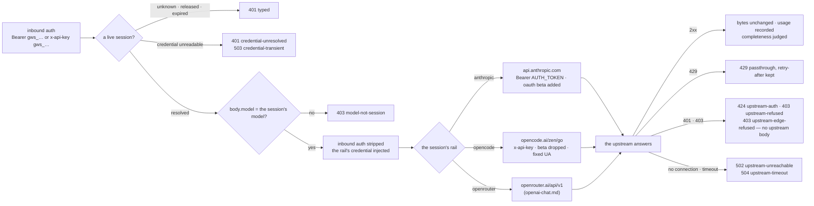

# POST /anthropic/v1/messages — the Anthropic Messages dialect, on any rail that speaks it

The data-plane path a `claude` harness rides ([UC-1](../use-cases/uc-1-worker-ride.md) step ③,
anthropic [dialect](../glossary.md#dialect)). Per request: the [session token](../glossary.md#session-token)
is resolved to a [session](../glossary.md#session) ([GW-CRED-BOUNDARY](#gw-cred-boundary)); the
body's `model` is checked against the session's model ([GW-MODEL-RESOLVE](#gw-model-resolve)); the
session's [rail](../glossary.md#rail) decides the upstream URL, the credential and the header
rewrites ([GW-RAIL-ANTHROPIC](#gw-rail-anthropic), [GW-RAIL-OPENCODE](#gw-rail-opencode),
[GW-RAIL-OPENROUTER](openai-chat.md#gw-rail-openrouter)); the upstream response streams back
**byte-unchanged** (SSE included); usage is recorded on the session best-effort. This page owns the
four requirements below; the OpenRouter rail's rows live on [openai-chat.md](openai-chat.md) and are
linked from the coupling table.

## Interface — the machine half

**[`anthropic-messages.schema.json`](anthropic-messages.schema.json)** holds the inbound
envelope the gateway inspects (`model`, `stream`, the auth and session headers), the response
contract (passthrough) and the error envelope; the service **imports it**. The Anthropic
Messages body itself is the vendor's — the gateway validates only what it reads.

| Requirement | Governs (schema) | Error codes | Status |
|---|---|---|---|
| [GW-RAIL-ANTHROPIC](#gw-rail-anthropic) | `upstream.anthropic` (URL, auth, `anthropic-beta`), `output.complete` | `upstream-auth`, `upstream-unreachable`, `upstream-timeout` | v0 |
| [GW-RAIL-OPENCODE](#gw-rail-opencode) | `upstream.opencode` (URL, auth, session headers), `input.headers.x-opencode-session`, `input.headers.x-claude-code-session-id` | `upstream-auth`, `upstream-unreachable`, `upstream-timeout` | v0; the `upstream-timeout` row `🚧 WIP` (the `upstream-slow` world is clock-faked only) |
| [GW-MODEL-RESOLVE](#gw-model-resolve) | `input.body.model` | `model-not-session` | v0 — the ADR-096 ladder `⚑ gap` ([the ladder gaps](#gaps-the-adr-096-ladder)); the provider pin is [GW-RAIL-OPENROUTER §Selection](openai-chat.md#selection--the-gateways-own-evidence-never-exacto)'s (homelab#2741 — no `:exacto`, not ported) |
| [GW-CRED-BOUNDARY](#gw-cred-boundary) | `input.headers.authorization`, `input.headers.x-api-key`, `upstream.*.auth` | `session-unknown`, `session-expired`, `session-released`, `credential-unresolved`, `credential-transient`, `upstream-auth`, `upstream-refused`, `upstream-edge-refused`, `header-refused` | v0; the codex rail's `upstream-auth` is still 502 (`⚑ gap`, [the codex rail's verdict](#gaps-the-codex-rails-verdict)) |
| [GW-RAIL-OPENROUTER](openai-chat.md#gw-rail-openrouter) (owned on openai-chat.md) | `upstream.openrouter` | `upstream-auth`, `upstream-unreachable` | linked — the anthropic-dialect cell is a verified row there |
| [GW-SESSIONS-RELEASE](sessions.md#gw-sessions-release) (owned on sessions.md) | `input.headers.authorization` | `session-expired`, `session-released` | linked |
| [GW-CRED-RESOLVE](sessions.md#gw-cred-resolve) (owned on sessions.md) | `upstream.*.auth` | `credential-unresolved`, `credential-transient` | linked |

## Flow overview

A request enters through the [credential boundary](#gw-cred-boundary) — the session token is
the only inbound credential, and it is stripped before anything leaves — then its body's model is
[resolved against the session](#gw-model-resolve), and the session's rail decides the upstream, the
credential and the header rewrites: the [subscription](#gw-rail-anthropic) or the
[Go rail](#gw-rail-opencode) here, the [OpenRouter rail](openai-chat.md#gw-rail-openrouter) on
its own page. Whatever the upstream answers comes back unchanged or typed: a 2xx byte for byte with
its [completeness judged](#stream-completeness-the-terminal-event-decides), a 429 as it is, a
401/403 as a [credential verdict or a refusal](#a-credential-verdict-against-a-refusal) with no
upstream body, a failed connection or a timeout as 502/504.

## Requirement index

Every requirement of this page, in reading order; the flow overview above links into it.

| Requirement | Section | Status |
|---|---|---|
| [GW-RAIL-ANTHROPIC](#gw-rail-anthropic) | the subscription rail | |
| [GW-RAIL-OPENCODE](#gw-rail-opencode) | the Go rail | the `upstream-timeout` row `🚧 WIP` (the `upstream-slow` world is clock-faked only) |
| [GW-MODEL-RESOLVE](#gw-model-resolve) | the model check | the ADR-096 ladder `⚑ gap` ([the ladder gaps](#gaps-the-adr-096-ladder)) |
| [GW-CRED-BOUNDARY](#gw-cred-boundary) | the credential boundary | the codex rail's `upstream-auth` is still 502 (`⚑ gap`, [the codex rail's verdict](#gaps-the-codex-rails-verdict)) |

## GW-RAIL-ANTHROPIC

The `anthropic` [rail](../glossary.md#rail) is the operator's Claude subscription: upstream
`https://api.anthropic.com/v1/messages`, credential `Authorization: Bearer <AUTH_TOKEN>` (the
OAuth token from the stack's `claude-session` Secret). claude-code sends the beta
`oauth-2025-04-20` only when IT holds the OAuth token; through the gateway it does not, so the
gateway **adds** `anthropic-beta: oauth-2025-04-20`, merged with any inbound beta list (the old
proxy's `OAUTH_BETA` precedent). The rail speaks the anthropic [dialect](../glossary.md#dialect)
only: an openai-dialect request on a session pinned here is 501 `dialect-unsupported-on-rail`, and
so is the models list. Upstream 429 passes through with its `retry-after`; upstream 401/403 is 424
`upstream-auth`, 403 `upstream-refused` or 403 `upstream-edge-refused`
([GW-CRED-BOUNDARY](#gw-cred-boundary)) with no upstream body; timeouts are connect 10 s / read
600 s (504 `upstream-timeout`); a connection that fails for any other reason — refused, DNS, TLS,
reset — is 502 `upstream-unreachable` (nothing reached the vendor; the request row is written, so a
dead upstream is visible on the session and in `gateway_requests_total{status="502"}`). The
connect-timeout half of `upstream-timeout` is unverified — expected to answer 504 like the read
half; the `upstream-slow` world fakes only the read.

**Stream completeness.** A 2xx is recorded **complete** only when its body reached its end: a
non-streamed body read to its last byte, a stream that carried its terminal event — `message_stop`
on this dialect (`data: [DONE]` on the openai one, [GW-RAIL-OPENROUTER](openai-chat.md#gw-rail-openrouter)),
seen through any `content-encoding` the gateway can decode. Otherwise the request row carries
`incomplete` = `no-terminal` (the body ended without it), `timeout` (a mid-stream read timeout;
the row's status is 504), `transport-error` (the connection broke mid-body) or `client-closed` (the
pod hung up), the session's `requests_incomplete` + 1, and
`gateway_requests_incomplete_total{rail,dialect,reason}` + 1 ([GW-METRICS](metrics.md#gw-metrics)).
A broken stream is never a clean 200 with 0 tokens. The bytes the pod got are unchanged either way.
The experiment's tap (2026-10-17) saw 8 opencode streams cut by the client mid-body; the old
record showed each as a 200.

**World: [`policy-default`](../worlds/README.md#policy-worlds)** — a reviewer session (harness
`claude`) on this rail, carrying `Authorization: Bearer <session token>`; the fake anthropic
upstream in the [behaviour](../worlds/README.md#upstream-behaviours-fake-upstreams) the `upstream`
column names. The canonical pair is
[`uc-1/anthropic-request.json`](../use-cases/uc-1/anthropic-request.json) →
[`anthropic-response.json`](../use-cases/uc-1/anthropic-response.json).

### The subscription credential and the header rewrites

Legend: `inbound` = the header the pod sends beside its session bearer (`(none)` = no extra
header; `<session token>` = the session token); `upstream_header?` = the same header as the
upstream received it (`(absent)` = it did not reach upstream; `<AUTH_TOKEN>` = the
`claude-session` Secret's key, never a value).

| description | upstream | inbound | upstream_header? |
|---|---|---|---|
| the credential is the OAuth token as a bearer | `upstream-ok` | `(none)` | `Authorization: Bearer <AUTH_TOKEN>` |
| no x-api-key reaches upstream | `upstream-ok` | `x-api-key: <session token>` | `x-api-key: (absent)` |
| the OAuth beta is added | `upstream-ok` | `(none)` | `anthropic-beta: oauth-2025-04-20` |
| the OAuth beta is merged, not replaced | `upstream-ok` | `anthropic-beta: interleaved-thinking-2025-05-14` | `anthropic-beta: interleaved-thinking-2025-05-14,oauth-2025-04-20` |
| the OAuth beta is never duplicated | `upstream-ok` | `anthropic-beta: oauth-2025-04-20` | `anthropic-beta: oauth-2025-04-20` |
| anthropic-version passes through | `upstream-ok` | `anthropic-version: 2023-06-01` | `anthropic-version: 2023-06-01` |
| the claude-code session id passes through | `upstream-ok` | `X-Claude-Code-Session-Id: 7b1e-uuid` | `X-Claude-Code-Session-Id: 7b1e-uuid` |
| the user agent passes through (`user_agent: forward`) ⚖ | `upstream-ok` | `User-Agent: claude-cli/2.1.281` | `User-Agent: claude-cli/2.1.281` |

### What a 2xx carries back and records

Legend: `stream` = the body's `stream` flag; `body?` = the answer's body against the upstream's
own answer to the same call (`the upstream bytes` = byte-identical, SSE included, same
content-type); `content_encoding?` = the answer's `content-encoding` (`(none)` = no header);
`recorded?` = the session's `requests · tokens_in · tokens_cache_read · tokens_cache_write ·
tokens_out` after the call — a non-streamed answer's from its `usage`, a stream's from its final
`message_delta` (the `message_start` input count), decoded through the content-encoding;
`input_tokens` already excludes the cache.

| description | upstream | stream | status? | body? | content_encoding? | recorded? |
|---|---|---|---|---|---|---|
| a messages call lands | `upstream-ok` | `false` | `200` | `the upstream bytes` | `(none)` | `1 · 12 · 0 · 0 · 7` |
| a streamed call streams | `upstream-stream` | `true` | `200` | `the upstream bytes` | `(none)` | `1 · 23 · 0 · 0 · 9` |
| cache classes are recorded apart | `upstream-ok-cached` | `false` | `200` | `the upstream bytes` | `(none)` | `1 · 12 · 300 · 40 · 7` |
| a gzipped stream still counts | `upstream-stream-gzip` | `true` | `200` | `the upstream bytes` | `gzip` | `1 · 23 · 0 · 0 · 9` |

### Upstream answers that are not a 2xx

Legend: `body?` as above, or `<code> envelope` = the gateway's error envelope with that code and
no upstream body; `retry_after?` = the answer's `retry-after` header (`(none)` = no header);
`requests?` = the session's `requests` after the call.

| description | upstream | status? | body? | retry_after? | requests? |
|---|---|---|---|---|---|
| a rate limit passes through | `upstream-429` | `429` | `the upstream bytes` | `30` | `1` |
| an upstream auth failure is typed and hidden | `upstream-401` | `424` | `upstream-auth envelope` | `(none)` | `1` |
| an unreachable upstream is typed | `upstream-down` | `502` | `upstream-unreachable envelope` | `(none)` | `1` |
| a read past 600 s is a typed timeout | `upstream-slow` | `504` | `upstream-timeout envelope` | `(none)` | `1` |

### The dialect this rail does not speak

Legend: `op` = the inbound call (`chat` = `POST /openai/v1/chat/completions`, `models` =
`GET /openai/v1/models`); `code?` = the error envelope's code; `upstream_calls?` = the requests
the upstream received.

| description | upstream | op | status? | code? | upstream_calls? |
|---|---|---|---|---|---|
| the openai dialect is not served on the subscription | `upstream-ok` | `chat` | `501` | `dialect-unsupported-on-rail` | `0` |
| the models list is not served on the subscription | `upstream-ok` | `models` | `501` | `dialect-unsupported-on-rail` | `0` |

### The subscription upstream

Legend: `op` = `messages` (`POST /anthropic/v1/messages`); `upstream_path?` = the path the
upstream received; `production_url?` = the URL the same call takes under the production default
(`ANTHROPIC_UPSTREAM` unset).

| description | upstream | op | upstream_path? | production_url? |
|---|---|---|---|---|
| the subscription upstream is api.anthropic.com/v1/messages | `upstream-ok` | `messages` | `/v1/messages` | `https://api.anthropic.com/v1/messages` |

### Stream completeness: the terminal event decides

Legend (a streamed call, `stream: true`): `requests_incomplete?` = the session's counter after the
call; `incomplete?` = the request row's `incomplete` (`(none)` = null, complete);
`incomplete_total?` = `gateway_requests_incomplete_total{rail="anthropic",dialect="anthropic",reason}`
for the row's reason (`no-terminal` when the row is complete).

| description | upstream | requests_incomplete? | incomplete? | incomplete_total? |
|---|---|---|---|---|
| a stream that ends without message_stop is recorded incomplete | `upstream-stream-truncated` | `1` | `no-terminal` | `1` |
| a gzipped stream's message_stop is seen through the encoding | `upstream-stream-gzip` | `0` | `(none)` | `0` |

### Stream completeness: the pod hangs up

A pod that closes its connection after the first relayed chunk ends the stream on the gateway's
side: the request row records `client-closed`, whatever the upstream still had to send. Legend as
above.

| description | upstream | requests_incomplete? | incomplete? | incomplete_total? |
|---|---|---|---|---|
| the client going away mid-stream is recorded incomplete | `upstream-stream` | `1` | `client-closed` | `1` |

Evidence — latest run

--8<-- "GW-RAIL-ANTHROPIC.md"

## GW-RAIL-OPENCODE

The `opencode` [rail](../glossary.md#rail) is the OpenCode Go subscription, served from the
gateway's own mounted key. Both [dialects](../glossary.md#dialect) are spoken: anthropic →
`https://opencode.ai/zen/go/v1/messages` with `x-api-key: <go key>`; openai →
`https://opencode.ai/zen/go/v1/chat/completions` with `Authorization: Bearer <go key>`;
`GET /openai/v1/models` → `https://opencode.ai/zen/go/v1/models`. `anthropic-beta` is **dropped**
on this rail. ⚖ **The User-Agent is the gateway's own** (`user_agent: fixed`, a per-rail policy key,
`fixed` by default). The caller's UA never reaches opencode.ai, whose edge judges client signatures:
it answered `Python-urllib` with a 403 block page and accepted `agent-gateway` (probed live from the
gateway pod, 2026-10-17). **Accept-Encoding is the client's** (every rail): the upstream answers in
the encoding the client asked for, and the bytes come back unchanged. A client that sent none is
sent upstream as `identity`, so it never gets a gzip body it did not ask for (the transport's own
default asked for gzip — a 2026-10-17 observation). The vendor routes by a session id and 400s
(`MissingSessionID`) without one — measured, not argued
([chainless-redesign.md §Proved on the wire, 2026-09-17](../../../docs/agents/chainless-redesign.md)):
either `X-Claude-Code-Session-Id` or `x-opencode-session` alone clears the gate and carries
prompt-cache affinity, so both pass through untouched. ⚖ A request carrying **neither** gets
`x-opencode-session: <gateway session id>` — a per-ride bucket, the granularity the 09-17 re-read
found correct (the credential-ref fallback bucketed too coarsely). The body's `model` is the
[wire id](../glossary.md#wire-id) — the policy id with `opencode-go/` removed
([GW-MODEL-RESOLVE](#gw-model-resolve)). A 429, a 401 and a failed connection are typed as on the
[subscription rail](#upstream-answers-that-are-not-a-2xx); the vendor's own 400 is relayed as it is.

**World: [`policy-default`](../worlds/README.md#policy-worlds)** — a session on this rail whose
harness speaks the call's dialect (`messages` → a claude reviewer pinned to the Go rail, `chat` /
`models` → an opencode worker), carrying `Authorization: Bearer <session token>`; the fake Go
upstream in the [behaviour](../worlds/README.md#upstream-behaviours-fake-upstreams) the `upstream`
column names. The canonical pair is beside the anthropic one under
[`uc-1/`](../use-cases/uc-1-worker-ride.md).

Legend for every table of this rule: `op` = the inbound call (`messages` =
`POST /anthropic/v1/messages`, `chat` = `POST /openai/v1/chat/completions`, `models` =
`GET /openai/v1/models`); `inbound` = the header(s) the pod sends beside its session bearer
(`Name: value` pairs, `;`-separated; `(none)` = no extra header; a value `(none)` = the client sent
no such header at all); `upstream_header?` = the same header(s) as the upstream received them
(`(absent)` = it did not reach upstream; `<OPENCODE_GO_API_KEY>` = the mounted Go key, never a
value; `<session id>` = the gateway's id for this session).

### The Go credential and the beta

| description | upstream | op | inbound | upstream_header? |
|---|---|---|---|---|
| the Go key rides as x-api-key on the anthropic dialect | `upstream-ok` | `messages` | `(none)` | `x-api-key: <OPENCODE_GO_API_KEY>` |
| no bearer reaches the Go anthropic endpoint | `upstream-ok` | `messages` | `(none)` | `Authorization: (absent)` |
| the Go key rides as a bearer on the openai dialect | `upstream-ok` | `chat` | `(none)` | `Authorization: Bearer <OPENCODE_GO_API_KEY>; x-api-key: (absent)` |
| anthropic-beta is dropped | `upstream-ok` | `messages` | `anthropic-beta: oauth-2025-04-20` | `anthropic-beta: (absent)` |

### The vendor's session id

| description | upstream | op | inbound | upstream_header? |
|---|---|---|---|---|
| the claude-code session id passes through alone | `upstream-ok` | `messages` | `X-Claude-Code-Session-Id: u1` | `X-Claude-Code-Session-Id: u1; x-opencode-session: (absent)` |
| the opencode session id passes through alone | `upstream-ok` | `chat` | `x-opencode-session: c1` | `x-opencode-session: c1; X-Claude-Code-Session-Id: (absent)` |
| both session headers pass through | `upstream-ok` | `messages` | `x-opencode-session: c1; X-Claude-Code-Session-Id: u1` | `x-opencode-session: c1; X-Claude-Code-Session-Id: u1` |
| no session header — the gateway supplies its session id ⚖ | `upstream-ok` | `messages` | `(none)` | `x-opencode-session: <session id>` |

### The client's signature and encoding

| description | upstream | op | inbound | upstream_header? |
|---|---|---|---|---|
| the caller's user agent is replaced by the gateway's own ⚖ | `upstream-ok` | `chat` | `User-Agent: Python-urllib/3.13` | `User-Agent: agent-gateway` |
| the client's Accept-Encoding passes through | `upstream-ok` | `chat` | `Accept-Encoding: gzip` | `Accept-Encoding: gzip` |
| no Accept-Encoding from the client is identity upstream ⚖ | `upstream-ok` | `chat` | `Accept-Encoding: (none)` | `Accept-Encoding: identity` |

### A call lands on the Go upstream

Legend: `upstream_path?` = the path the Go upstream received (the production default is
`https://opencode.ai/zen/go` + this path); `body?` = the answer's body against the upstream's own
answer to the same call (`the upstream bytes` = byte-identical, SSE included, same content-type);
`recorded?` = the session's `requests · tokens_in · tokens_cache_read · tokens_cache_write ·
tokens_out` after the call (the openai dialect's `prompt_tokens` / `completion_tokens`, a stream's
last chunk's `usage`).

| description | upstream | op | upstream_path? | status? | body? | recorded? |
|---|---|---|---|---|---|---|
| an anthropic-dialect call lands | `upstream-ok` | `messages` | `/v1/messages` | `200` | `the upstream bytes` | `1 · 12 · 0 · 0 · 7` |
| an openai-dialect call lands | `upstream-ok` | `chat` | `/v1/chat/completions` | `200` | `the upstream bytes` | `1 · 7 · 0 · 0 · 3` |
| the models list passes through | `upstream-ok` | `models` | `/v1/models` | `200` | `the upstream bytes` | `1 · 0 · 0 · 0 · 0` |
| a stream streams | `upstream-stream` | `chat` | `/v1/chat/completions` | `200` | `the upstream bytes` | `1 · 19 · 0 · 0 · 4` |

### A Go answer that is not a 2xx

Legend: `body?` as above, or `<code> envelope` = the gateway's error envelope with that code and
no upstream body; `retry_after?` = the answer's `retry-after` header (`(none)` = no header).

| description | upstream | op | status? | body? | retry_after? |
|---|---|---|---|---|---|
| a rate limit passes through | `upstream-429` | `messages` | `429` | `the upstream bytes` | `30` |
| an upstream auth failure is typed and hidden | `upstream-401` | `chat` | `424` | `upstream-auth envelope` | `(none)` |
| the vendor's MissingSessionID is passed through, not masked ⚖ | `upstream-400-missing-session` | `messages` | `400` | `the upstream bytes` | `(none)` |
| an unreachable upstream is typed | `upstream-down` | `messages` | `502` | `upstream-unreachable envelope` | `(none)` |
| a read past 600 s is a typed timeout | `upstream-slow` | `messages` | `504` | `upstream-timeout envelope` | `(none)` |

Evidence — latest run

--8<-- "GW-RAIL-OPENCODE.md"

## GW-MODEL-RESOLVE

A [session](../glossary.md#session) pins one model; **no caller names a model**. The body's
`model` is resolved against the session: it must name the session's model (as the harness spells
it), else 403 `model-not-session`, logged with the session id and both names. The
[wire id](../glossary.md#wire-id) sent upstream is the policy id with its rail prefix removed —
`opencode-go/x` → `x` on the Go rail; an openrouter id is already bare. ⚖ On the `anthropic`
rail the policy names an alias (`claude/sonnet`, as `model-classes.json` spells it) that the claude
CLI resolves to a dated id before the request leaves the pod, so the check there is by **family**
(the alias name is a prefix-family of the dated id: `sonnet` ⊂ `claude-sonnet-4-6`) and the body is
forwarded **untouched** (the old proxy's "anthropic leg: model untouched", kept). ⚖ A rail may
declare `side_models` in [policy](../glossary.md#policy) — the families a harness's own side-calls
name regardless of the session's model: claude-code makes small calls on the haiku family
(`ANTHROPIC_SMALL_FAST_MODEL`'s default) under a sonnet session, so the anthropic rail admits the
session's family **and** `claude/haiku` (seat ruling, 2026-10-16); the key lives in policy because
no model id lives in code, and a rail that declares none (the Go rail today) keeps the exact check.
An absent `model` is filled with the wire id. The dispatch answer's `model` is the policy id — the
first id of `rails.<rail>.models.<tier>` (an ordered list; a bare string is one item) when nothing
is struck or cooled ([tier](../glossary.md#tier)). The ADR-096 ladder — classes, label tiers — is
a gap ([below](#gaps-the-adr-096-ladder)); strikes and cooldowns are
[GW-SESSIONS-ADMIT](sessions.md#gw-sessions-admit)'s, and the provider pin is
[GW-RAIL-OPENROUTER §Selection](openai-chat.md#selection--the-gateways-own-evidence-never-exacto)'s
(present once the endpoint snapshot covers the session's model; `:exacto` is not ported — operator
2026-10-19).

**The deployed policy** (`argocd/resources/agent-gateway/policy.json`, the
`agent-gateway-policy` configMapGenerator's source) loads under the island's loader with the worlds'
shape — the [`policy-codex`](../worlds/README.md#policy-worlds) world's rails (`policy-default`'s
plus `codex`, the rail lit 2026-10-22, FU-270), `policy-default`'s roles, every rail's tiers
`light` / `standard` / `heavy` — and every id it names is **known** ⚖: every anthropic model and
side-model id is a `models.*.ids` value of `model-classes.json` (the `claude/<alias>` spelling the
subscription rail resolves); every opencode, openrouter and codex id is a candidate row of its rail
in the committed [tier evidence](../glossary.md#tier-evidence)
`argocd/resources/agent-gateway/benchmarks.json` ([GW-MODEL-TIERS](catalog.md#gw-model-tiers)) —
the gateway's own `GET /catalog/opencode` read (listed models with a monthly limit under the plan),
its `GET /catalog/openrouter` read (ranked ∩ benched, [GW-CATALOG-OR](catalog.md#gw-catalog-or)),
the enrolled account's codex evidence — never `model-classes.json`, the old proxy's table, which
carries no Go or codex id (operator, 2026-10-17; the derivation drew `z-ai/glm-5.3-flash` the
moment its first cell passed the canary, an id that table never held). The opencode rail's
`max_sessions` is `model-classes.json`'s `rails.opencode-go.concurrency`.

**World: [`policy-default`](../worlds/README.md#policy-worlds)**, every fake upstream at
`upstream-ok`; a session's (rail, policy model) pair is reached through the admission that lands
there ([`policy-default`'s roles](../worlds/README.md#policy-worlds)).

### The body's model against the session's

Legend: `session_model` = the policy id the session pins (the dispatch answer's `model`);
`body_model` = the body's `model` (`(absent)` = no key); `code?` = the error envelope's code
(`(none)` on a 200); `upstream_model?` = the `model` the upstream received (`(no upstream call)` on
a refusal).

| description | rail | session_model | body_model | status? | code? | upstream_model? |
|---|---|---|---|---|---|---|
| the Go wire id is the policy id without its prefix | `opencode` | `opencode-go/deepseek-v4.1-flash` | `deepseek-v4.1-flash` | `200` | `(none)` | `deepseek-v4.1-flash` |
| the openrouter wire id is the policy id itself | `openrouter` | `deepseek/deepseek-v4-flash` | `deepseek/deepseek-v4-flash` | `200` | `(none)` | `deepseek/deepseek-v4-flash` |
| an absent model is filled | `opencode` | `opencode-go/deepseek-v4.1-flash` | `(absent)` | `200` | `(none)` | `deepseek-v4.1-flash` |
| a different model is refused | `opencode` | `opencode-go/deepseek-v4.1-flash` | `claude-haiku-5-5` | `403` | `model-not-session` | `(no upstream call)` |
| the policy spelling is not the wire spelling ⚖ | `opencode` | `opencode-go/deepseek-v4.1-flash` | `opencode-go/deepseek-v4.1-flash` | `403` | `model-not-session` | `(no upstream call)` |
| a Go-rail claude id is exact, not family | `opencode` | `opencode-go/claude-haiku-5-5` | `claude-haiku-5-5` | `200` | `(none)` | `claude-haiku-5-5` |
| a Go-rail claude id refuses a dated sibling | `opencode` | `opencode-go/claude-haiku-5-5` | `claude-sonnet-4-5` | `403` | `model-not-session` | `(no upstream call)` |

### The anthropic rail's family check and the side-call families

Legend as above; on the anthropic rail `upstream_model?` is the body's own spelling, untouched.

| description | rail | session_model | body_model | status? | code? | upstream_model? |
|---|---|---|---|---|---|---|
| an anthropic alias matches its family ⚖ | `anthropic` | `claude/haiku` | `claude-haiku-4-5` | `200` | `(none)` | `claude-haiku-4-5` |
| an anthropic alias refuses another family | `anthropic` | `claude/sonnet` | `claude-opus-4-1` | `403` | `model-not-session` | `(no upstream call)` |
| a bare alias in the body matches ⚖ | `anthropic` | `claude/sonnet` | `sonnet` | `200` | `(none)` | `sonnet` |
| a claude-code haiku side-call under a sonnet session is admitted ⚖ | `anthropic` | `claude/sonnet` | `claude-haiku-4-5` | `200` | `(none)` | `claude-haiku-4-5` |
| a bare haiku side-call under a sonnet session is admitted ⚖ | `anthropic` | `claude/sonnet` | `haiku` | `200` | `(none)` | `haiku` |
| a side-call family is policy, not code: the Go rail declares none | `opencode` | `opencode-go/claude-haiku-5-5` | `claude-haiku-4-5` | `403` | `model-not-session` | `(no upstream call)` |

### The dispatch answer names the policy id

One `POST /sessions` per role (stack `platform`, the role's default tier and harness), on a store
with nothing struck or cooled. Legend: `rail?` / `model?` = the dispatch answer's `rail` and `model`.

| description | role | rail? | model? |
|---|---|---|---|
| a worker lands on the Go rail's standard model | `worker` | `opencode` | `opencode-go/deepseek-v4.1-flash` |
| a reviewer lands on the subscription's heavy list, first id | `reviewer` | `anthropic` | `claude/sonnet` |
| a coordinator lands on the subscription's standard model | `coordinator` | `anthropic` | `claude/sonnet` |
| a responder lands on the subscription's standard model | `responder` | `anthropic` | `claude/sonnet` |
| a retro lands on the subscription's heavy list, first id | `retro` | `anthropic` | `claude/sonnet` |
| a prober lands on the subscription's light model | `prober` | `anthropic` | `claude/haiku` |
| a researcher lands on openrouter's heavy model | `researcher` | `openrouter` | `deepseek/deepseek-v4.1-flash` |

### The policy is the only home of a model id

Legend: `policy_document` = the policy world read; `leaked_ids?` = the policy's model ids (full,
and bare of their rail prefix) found anywhere under `src/` (`(none)`).

| description | policy_document | leaked_ids? |
|---|---|---|
| no model id from the policy appears in src/ | `policy-default` | `(none)` |

### The anthropic body is forwarded untouched

Legend: `body_model` = the body's `model` (a raw, indented JSON body on a prober session);
`upstream_body?` = the bytes the upstream received against the bytes the pod sent (`the inbound
bytes` = identical).

| description | rail | body_model | upstream_body? |
|---|---|---|---|
| the anthropic body is forwarded byte-untouched | `anthropic` | `claude-haiku-4-5` | `the inbound bytes` |

### The deployed policy

Legend: `policy_document` = the deployed document, relative to the repo root; `shape?` = its
rails, roles and tiers against the worlds' (`the worlds' shape` as the prose above states it);
`unknown_ids?` = the deployed ids that are no candidate row of their rail's tier evidence, or, on
the anthropic rail, not spelled as `model-classes.json` (`(none)`); `opencode_max_sessions?` =
`rails.opencode.max_sessions`, which equals `model-classes.json`'s `rails.opencode-go.concurrency`.

| description | policy_document | shape? | unknown_ids? | opencode_max_sessions? |
|---|---|---|---|---|
| the deployed policy loads under the island's loader, every id known ⚖ | `argocd/resources/agent-gateway/policy.json` | `the worlds' shape` | `(none)` | `3` |

### Gaps: the ADR-096 ladder

| description | input | v0 answer | the gap |
|---|---|---|---|
| ⚑ gap: a per-task deny list | claim `modelDeny` names the session's model | dispatched anyway | the claim's `modelDeny` projection into the policy |
| ⚑ gap: a mid-session model change | a strike on this session | the same model until release | strikes / cooldowns / the pair hold |

Evidence — latest run

--8<-- "GW-MODEL-RESOLVE.md"

## GW-CRED-BOUNDARY

Pods never see a real key. Inbound, the only credential is the
[session token](../glossary.md#session-token) — `Authorization: Bearer gws_…` or
`x-api-key: gws_…` (claude-code sends the former through `ANTHROPIC_AUTH_TOKEN`; some SDKs the
latter); when both are sent the bearer is consulted ⚖. The inbound auth header **never** reaches
upstream; the upstream credential is injected from the session's rail
([GW-CRED-RESOLVE](sessions.md#gw-cred-resolve)) and hop-by-hop headers are stripped. An
unknown, expired or released token is a typed 401; a resolvable session whose credential
cannot be read is 401 `credential-unresolved` (definitive) or 503 `credential-transient`.
Upstream 401/403 never relays its body — a key hint never crosses back — and is told apart by
what it says (the body is read, never forwarded): a 401, or a 403 whose error names a credential
reason (`type` `authentication_error` / `permission_error`, `code` `api_key_expired` /
`invalid_api_key` / …), is **424 `upstream-auth`**: the
rail credential is bad, and the [admission](sessions.md#capacity--the-ladders-capacity-half) skips
that credential until a 2xx on it or a new value. ⚖ 424 (Failed Dependency), not 502: the pinned
harnesses retry 5xx with backoff (opencode retried the expired Go key's 502 nine times in the
2026-10-17 experiment, `docs/spikes/gateway-free-models-2026-10-17/cells.tsv`), and they retry
neither 424 nor 403 — a dead credential must end the ride, not stall it. A 403 whose JSON error object names no credential reason is a
**policy refusal**: **403 `upstream-refused`**, and the credential is untouched. ⚖ The observed one
is OpenRouter's harness gate (`… is only available on agentic harnesses`, `failed_routing_step:
Gate Free Endpoints by Agentic Harness`): the model refused this caller, and the key is fine.
⚖ A 403 with **no readable JSON error object**, such as an HTML block page or Cloudflare's
`error code: 1010`, is an **edge refusal**: **403 `upstream-edge-refused`**. A proxy in front of
the vendor judged THIS request's client signature, so the refusal is scoped to that request, never
rail-wide, and the credential is untouched. The 2026-10-17 defect: a `Python-urllib` caller's 403
1010 was read as a credential verdict (the old "unreadable 403 = credential" rule) and self-latched
the Go rail until a restart.
The boundary also runs outward: a credential-shaped value (the [GW-REDACT](sessions.md#gw-redact)
patterns) in any header the gateway does not own is 502 `header-refused` before any upstream
call — the old proxy's FU-251 tripwire; a harness that smuggles a real key in a vendor header
never gets it past this hop.

**World: [`policy-default`](../worlds/README.md#policy-worlds)** — unless a `rail` column says
otherwise, a goose worker's session on the openrouter rail (`POST /openai/v1/chat/completions`);
`<A>` and `<B>` are the session tokens of two such sessions A and B; the fake upstream in the
[behaviour](../worlds/README.md#upstream-behaviours-fake-upstreams) the `upstream` column names.

### Which header carries the session token

Legend: `authorization` / `x_api_key` = the two inbound auth headers (`(none)` = not sent);
`code?` = the error envelope's code (`(none)` on a 200); `served?` = which session's `requests`
counted the call (`(none)` = neither).

| description | upstream | authorization | x_api_key | status? | code? | served? |
|---|---|---|---|---|---|---|
| a bearer session token | `upstream-ok` | `Bearer <A>` | `(none)` | `200` | `(none)` | `A` |
| an x-api-key session token | `upstream-ok` | `(none)` | `<A>` | `200` | `(none)` | `A` |
| the bearer is consulted first ⚖ | `upstream-ok` | `Bearer <A>` | `<B>` | `200` | `(none)` | `A` |
| no credential | `upstream-ok` | `(none)` | `(none)` | `401` | `session-unknown` | `(none)` |
| a token nobody minted | `upstream-ok` | `Bearer gws_AAAAAAAAAAAAAAAAAAAAAAAAAAAAAAAA` | `(none)` | `401` | `session-unknown` | `(none)` |
| a real-looking key is not a session | `upstream-ok` | `Bearer sk-or-v1-FAKEFAKEFAKE` | `(none)` | `401` | `session-unknown` | `(none)` |

A real-looking key never reaches upstream and is logged as `session-unknown` with its value absent.

### A session that can no longer serve

Session A's bearer on every row. Legend: `state` = what happened to session A before the call
(`released` = `DELETE /sessions/{id}`; `expired` = the clock past `expires_at`; `credential ref a
definitive miss` = its rail credential's Secret gone; `credential read transient` = the kube API
failing on that ref).

| description | upstream | state | status? | code? |
|---|---|---|---|---|
| a released session's token | `upstream-ok` | `released` | `401` | `session-released` |
| an expired session's token | `upstream-ok` | `expired` | `401` | `session-expired` |
| a session whose credential went away | `upstream-ok` | `credential ref a definitive miss` | `401` | `credential-unresolved` |
| a session whose credential read is failing | `upstream-ok` | `credential read transient` | `503` | `credential-transient` |

### What of the inbound reaches upstream

Legend: `inbound` = the header(s) the pod sends beside `Authorization: Bearer <session token>`
(`Name: value` pairs, `;`-separated; `(none)` = the bearer alone); `upstream_header?` = the same
header(s) as the upstream received them (`(absent)` = it did not reach upstream; `(the gateway's
own)` = the gateway's HTTP client's value, never the pod's; `<OPENROUTER_API_KEY>` = the stack
key's Secret key, never a value). No `gws_` token reaches upstream on any row.

| description | upstream | inbound | upstream_header? |
|---|---|---|---|
| the inbound bearer is stripped | `upstream-ok` | `(none)` | `Authorization: Bearer <OPENROUTER_API_KEY>` |
| the inbound x-api-key is stripped | `upstream-ok` | `x-api-key: <session token>` | `x-api-key: (absent)` |
| hop-by-hop headers are stripped | `upstream-ok` | `Connection: close; Keep-Alive: timeout=5; TE: trailers; Trailer: x; Upgrade: h2c; Proxy-Authorization: Basic x` | `Connection: (the gateway's own); Keep-Alive: (absent); TE: (absent); Trailer: (absent); Upgrade: (absent); Proxy-Authorization: (absent); Transfer-Encoding: (absent)` |
| content-type passes through | `upstream-ok` | `Content-Type: application/json` | `Content-Type: application/json` |
| an unknown vendor header passes through | `upstream-ok` | `x-foo: bar` | `x-foo: bar` |

### A credential-shaped vendor header

Legend: `inbound` as above; `code?` = the error envelope's code; `upstream_calls?` = the
requests the upstream received.

| description | upstream | inbound | status? | code? | upstream_calls? |
|---|---|---|---|---|---|
| a credential-shaped value in a vendor header is refused | `upstream-ok` | `x-foo: Bearer sk-ant-oat-x` | `502` | `header-refused` | `0` |

### An upstream 401 or 403 never relays its body

Legend: `upstream_body_relayed?` = whether the answer's body is the upstream's own (`no` = the
gateway's envelope, no credential value in it); `log_line_prefix?` = how the one `upstream-auth`
log line starts (`upstream-auth <rail> <upstream status>`, summarised — never the body).

| description | upstream | status? | code? | upstream_body_relayed? | log_line_prefix? |
|---|---|---|---|---|---|
| an upstream 401 never leaks | `upstream-401` | `424` | `upstream-auth` | `no` | `upstream-auth openrouter 401` |
| an upstream 403 naming a credential reason is the same class | `upstream-403` | `424` | `upstream-auth` | `no` | `upstream-auth openrouter 403` |

### A credential verdict against a refusal

Legend: `rail` = the session's rail (a goose worker's); `upstream-401-key-expired` = the Go
vendor's live `api_key_expired` answer; `upstream-403-refused` = OpenRouter's harness gate;
`upstream-403-edge` = `text/plain` `error code: 1010`; `upstream-403-html` = an HTML block page
(what opencode.ai's edge answered `Python-urllib`, probed live); `credentials_rejected?` =
`gateway_credentials_rejected{rail}` after the call (`1` = the rail's credential is skipped by
admission); `upstream_body_relayed?` as above (`no` = neither the gate text nor the routing step
nor the block page crosses back).

| description | rail | upstream | status? | code? | credentials_rejected? | upstream_body_relayed? |
|---|---|---|---|---|---|---|
| an expired key is a credential verdict ⚖ | `opencode` | `upstream-401-key-expired` | `424` | `upstream-auth` | `1` | `no` |
| a policy refusal is not a credential verdict ⚖ | `openrouter` | `upstream-403-refused` | `403` | `upstream-refused` | `0` | `no` |
| an edge's error-code 403 is not a credential verdict ⚖ | `opencode` | `upstream-403-edge` | `403` | `upstream-edge-refused` | `0` | `no` |
| an edge's HTML 403 is not a credential verdict | `opencode` | `upstream-403-html` | `403` | `upstream-edge-refused` | `0` | `no` |

> Tombstone (removed by the data-plane migration PR; one cycle): ~~a refusal's body is not
> relayed either~~ — carried now by the `upstream_body_relayed?` cell of "a policy refusal is not
> a credential verdict ⚖" (above).

### Gaps: the codex rail's verdict

| description | input | v0 answer | the gap |
|---|---|---|---|
| ⚑ gap: the codex rail's upstream-auth | an upstream 401/403 on the dark codex rail | 502 `upstream-auth` ([GW-RAIL-CODEX](openai-responses.md#gw-rail-codex)), no rejection mark | the codex rail's own lifecycle owns its credential verdicts (GW-CODEX-OAUTH); aligning its status waits on that rail leaving dark |

Evidence — latest run

--8<-- "GW-CRED-BOUNDARY.md"

