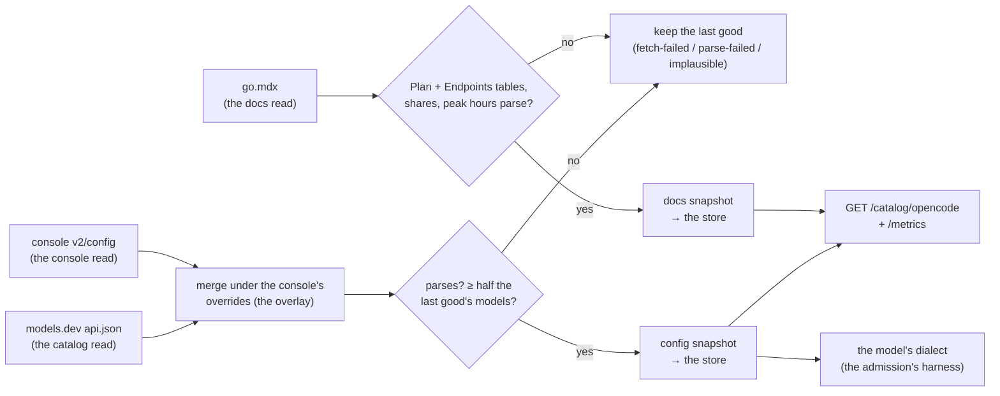

# GET /catalog/opencode · GET /catalog/openrouter — the two rails' vendor facts, read from the vendor

*What the gateway knows about models, and where it comes from.* The [Go rail](../../../docs/agents/chainless-redesign.md)'s
models, prices and plan limits — the [Go catalog](../glossary.md#go-catalog) — were once copied by
hand into `policy.json` and `gometer.py`, and the copy went stale: the gateway's only Go model left
the Go catalog on 2026-10-14 and nothing noticed
([opencode-go-catalog.md](../../../docs/spikes/opencode-go-catalog.md) §F3). The gateway now reads
its vendor facts on a schedule, keeps the last good snapshot of each source in its store, and shows
them on the two views here and on `/metrics`. Admission reads the snapshots — the Go window draw's
prices, each model's own windows, `not-in-catalog`
([GW-SESSIONS-ADMIT §Capacity](sessions.md#capacity--the-ladders-capacity-half)); this page owns
only the reading. The design input and the operator's rulings are the spike's §Rulings.

Three legs, two rules each: **the Go catalog** — the refresh ([GW-CATALOG-GO](#gw-catalog-go)) and
what its two reads say ([GW-CATALOG-GO-PARSE](#gw-catalog-go-parse)); **the OpenRouter catalog** —
the registry the [endpoint snapshot](../glossary.md#endpoint-snapshot) is read into
([GW-CATALOG-OR](#gw-catalog-or)) and the budget-capped entry [canary](../glossary.md#canary) a cell
passes to enter the order ([GW-CATALOG-OR-CANARY](#gw-catalog-or-canary); operator rulings
2026-10-19, homelab#2742); **the tier evidence** — the deployed policy's per-(rail, tier) model
lists, derived from benchmark evidence and never hand-picked
([GW-MODEL-TIERS](#gw-model-tiers), the [tier evidence](../glossary.md#tier-evidence)), and the
admission's choice between a model's [twin](../glossary.md#twin) cells on two rails
([GW-RAIL-CHOICE](#gw-rail-choice)).

## Interface — the machine half

**[`catalog.schema.json`](catalog.schema.json)** holds the two views' shapes (`output`,
`openrouter_output`), the normalised snapshots the store keeps (`$defs.config_snapshot`,
`$defs.docs_snapshot`, `$defs.openrouter_snapshot`), the tier-evidence snapshot
(`$defs.benchmarks_snapshot`) and the policy blocks the legs read (`$defs.tiers_block`,
`$defs.catalog_block`, `$defs.canary_block`). The metric families are declared in
[metrics.schema.json](metrics.schema.json) with the other families. No error codes: both views
answer 200 (no snapshot = empty rows, never an error) and carry no credential, like `/metrics`.

| Requirement | Governs (schema) | Error codes | Status |
|---|---|---|---|
| [GW-CATALOG-GO](#gw-catalog-go) | `$defs.config_snapshot`, `$defs.docs_snapshot`, `output.sources`; metrics `families.gateway_go_catalog_*` | — | v0 — the read leg; admission reads it ([GW-SESSIONS-ADMIT](sessions.md#gw-sessions-admit) §Capacity owns those rows); since 2026-10-20 the `config` source is models.dev's catalog under the console's overlay (the console answer became override-only that day); `⚑ gap (2026-10-20, PR #2766 → work #2768)`: rail-served ids the catalog does not list (`/zen/go/v1/models` is unread), and listed is not a liveness signal; `⚑ gap (2026-11-06, PR #3187 → work #3118)`: a vendor reset time is unread (the "⚑ gap" rows below) |
| [GW-CATALOG-GO-PARSE](#gw-catalog-go-parse) | `output` (the view, its model rows), `$defs.config_snapshot.models[].dialect`, `$defs.docs_snapshot` (`plans`, `plan_fees`, `peak_*`, `window_shares`); the policy's `rails.opencode.plan` and the vendor facts a policy may no longer hold | — (the loader refuses a policy without a plan, or carrying a vendor fact) | v0 — split from GW-CATALOG-GO 2026-11-06 ⚖: what the two reads SAY (the dialect, the limits, the fees, the cost rows, the view's shape) and the policy's plan declaration |
| [GW-CATALOG-OR](#gw-catalog-or) | `openrouter_output`, `$defs.openrouter_snapshot`, `$defs.catalog_block`; metrics `families.gateway_openrouter_catalog_*` | — | v0 — the registry (ranking ∩ benched → endpoints per candidate, the persisted snapshot, the view with its `pinnable` / `floor` verdict per harness — homelab#2791, the families, the stale alert) |
| [GW-CATALOG-OR-CANARY](#gw-catalog-or-canary) | `$defs.canary_block`, `$defs.cell_state`, `openrouter_output.canary`, `openrouter_output.models[].endpoints[].state`; sessions.schema.json `post.input.canary` + the defer reasons `canary-budget`, `canary-not-due`; metrics `families.gateway_openrouter_cells`, `gateway_canary_*` | — (`not-in-catalog` / `canary-not-due` / `canary-budget` are defers, never HTTP errors) | v0 — split from GW-CATALOG-OR 2026-11-06 ⚖: the entry canary and its cap; the canary RIDE's launcher is the jail's `gateway/scripts/canary-entrants.sh` (`⚑ gap` rows below: no in-cluster trigger, the Go rail's canary); a 429'd canary is NO verdict — the cell backs off exponentially, the admission is not consumed, the walk moves on (operator ruling 2026-10-22, homelab#2775 closed) |
| [GW-MODEL-TIERS](#gw-model-tiers) | `$defs.benchmarks_snapshot` (the committed `argocd/resources/agent-gateway/benchmarks.json`), `$defs.tiers_block` (the policy's `tiers`, incl. `cost`), `$defs.manual_benchmarks` (the committed `benchmarks-manual.json`), `$defs.price_basis`, `$defs.rides`; `output.pricing` (the Go price on `GET /catalog/opencode`); metrics `families.gateway_tier_evidence_age_seconds` | — (the loader refuses a malformed `tiers` block; `tiers check` exits 1 on a drifted list; `tiers snapshot` exits 2 on a malformed manual benchmark file) | v0 — the derivation by COST PER CLEAN RIDE (the openrouter model's selected endpoint, the Go plan's discounted price, the cell's clean-ride rate), the committed snapshot and its staleness alert, the equality check with undecided tiers (homelab#2743); `⚑ gap (2026-10-18, PR #2716 → work #2977)`: no price for the subscription rail (score ascending is the proxy), the coding/agentic axes unused, Go-only id spellings unbenched; `⚑ gap (2026-10-20, homelab#2743)`: the strike overhead unmeasured (the "⚑ gap" rows below) |
| [GW-RAIL-CHOICE](#gw-rail-choice) | sessions.schema.json `$defs.rail_choice` (the dispatch answer's `rail_choice`); metrics `families.gateway_rail_choice_total`; `$defs.rides` (the cell's clean-ride evidence the choice reads) | — | v0 — split from GW-MODEL-TIERS 2026-11-06 ⚖: the admission's rail choice between a model's twin cells on two rails (homelab#2743); `⚑ gap (2026-10-20, homelab#2743)`: the Go rail's quantization undeclared, the Go cell's clean-rate prior (the "⚑ gap" row below) |

## Flow overview

```mermaid
flowchart LR
  MD["models.dev api.json\n+ the console's overrides"] --> CS["config snapshot\n(listed models, cost, dialect)"]
  GP["the Go page go.mdx"] --> DS["docs snapshot\n(limits per plan, fees, shares)"]
  CS --> GV["GET /catalog/opencode\n(+ the Go price)"]
  DS --> GV
  RK["MCP: weekly ranking\n∩ AA-benched"] --> EP["GET /v1/models/‹id›/endpoints\nper candidate"]
  EP --> OS["openrouter snapshot\n(cells: candidate)"]
  OS --> CN["entry canary\n(one pinned ride per cell)"]
  CN --> EL["eligible / excluded\n(429: backs off)"]
  EL --> OV["GET /catalog/openrouter\n(pinnable, selected)"]
  GV --> BJ["benchmarks.json\n(AA rows + both views)"]
  OV --> BJ
  BJ --> DV["derive: bands of the rail's best,\ncheapest per clean ride"]
  DV --> PL["the deployed tier lists\n(check / apply)"]
  PL --> AD["admission: a twin on two rails\n→ the rail choice"]
  click MD href "#gw-catalog-go" "GW-CATALOG-GO — the config source" _self
  click GP href "#gw-catalog-go" "GW-CATALOG-GO — the docs source" _self
  click CS href "#the-models-dialect" "GW-CATALOG-GO-PARSE — the dialect" _self
  click DS href "#what-the-page-says-per-model" "GW-CATALOG-GO-PARSE — the limits" _self
  click GV href "#the-views-shape-go" "GW-CATALOG-GO-PARSE — the view" _self
  click RK href "#a-refresh-builds-the-snapshot" "GW-CATALOG-OR — ranked ∩ benched" _self
  click EP href "#a-refresh-builds-the-snapshot" "GW-CATALOG-OR — the endpoints per candidate" _self
  click OS href "#gw-catalog-or" "GW-CATALOG-OR — the registry" _self
  click CN href "#gw-catalog-or-canary" "GW-CATALOG-OR-CANARY — the entry canary" _self
  click EL href "#a-429d-canary-is-no-verdict" "GW-CATALOG-OR-CANARY — the verdict and the backoff" _self
  click OV href "#the-floors-verdict-on-the-view" "GW-CATALOG-OR — pinnable and selected" _self
  click BJ href "#gw-model-tiers" "GW-MODEL-TIERS — the snapshot" _self
  click DV href "#the-bands-on-a-hand-written-rail" "GW-MODEL-TIERS — the derivation" _self
  click PL href "#the-deployed-policy" "GW-MODEL-TIERS — the deployed policy" _self
  click AD href "#gw-rail-choice" "GW-RAIL-CHOICE — the rail choice" _self
```

The two Go reads land as the config and docs snapshots the Go view serves
([GW-CATALOG-GO](#gw-catalog-go), [GW-CATALOG-GO-PARSE](#gw-catalog-go-parse)); the OpenRouter
registry is built from the weekly ranking ∩ the AA-benched set, each candidate's endpoints read into
the snapshot as `candidate` cells ([GW-CATALOG-OR](#gw-catalog-or)), which the entry canary admits
to `eligible` one clean ride at a time ([GW-CATALOG-OR-CANARY](#gw-catalog-or-canary)); the two
views and the AA rows are cut into the committed benchmark snapshot the tier lists derive from
([GW-MODEL-TIERS](#gw-model-tiers)), and when a tier names one model on two rails the admission
chooses the rail by cost per clean ride ([GW-RAIL-CHOICE](#gw-rail-choice)).

## Requirement index

Every requirement of this page, in reading order; the section flowcharts below link into it.

| Requirement | Section | Status |
|---|---|---|
| [GW-CATALOG-GO](#gw-catalog-go) | the Go catalog | `⚑ gap (2026-10-20, PR #2766 → work #2768)`: rail-served ids the catalog does not list (`/zen/go/v1/models` is unread), and listed is not a liveness signal (the rail's own `/models` answer is the one source that could be); `⚑ gap (2026-11-06, PR #3187 → work #3118)`: a vendor reset time — this leg reads no Go usage, the headroom Goal reads the account's windows |
| [GW-CATALOG-GO-PARSE](#gw-catalog-go-parse) | the Go catalog | |
| [GW-CATALOG-OR](#gw-catalog-or) | the OpenRouter catalog | — |
| [GW-CATALOG-OR-CANARY](#gw-catalog-or-canary) | the OpenRouter catalog | `⚑ gap` rows below: no in-cluster canary trigger, the Go rail's canary |
| [GW-MODEL-TIERS](#gw-model-tiers) | the tier evidence | `⚑ gap (2026-10-18, PR #2716 → work #2977)`: no price for the subscription rail, the coding/agentic axes unused, Go-only id spellings unbenched; `⚑ gap (2026-10-20, homelab#2743)`: the strike overhead unmeasured |
| [GW-RAIL-CHOICE](#gw-rail-choice) | the tier evidence | `⚑ gap (2026-10-20, homelab#2743)`: the Go rail's quantization undeclared, the Go cell's clean-rate prior |

## The Go catalog — the opencode rail's vendor facts (`GW-CATALOG-GO`, `GW-CATALOG-GO-PARSE`)

The first leg: the Go rail's models, prices and per-model plan limits, read from the vendor's two
sources on a schedule, each kept as a last good snapshot.

### GW-CATALOG-GO

Two **sources**, each refreshed every **21600 s** ⚖ (6 h; the first refresh runs at start — unless
the stored snapshots are younger than the interval, then at the oldest one's `fetched_at` + 21600 s:
⚖ a pod roll re-reads nothing, [#2775](https://github.com/teststuffstash/homelab/issues/2775)) and
each with its own snapshot:

- **`config`** — two reads, merged the way the vendor's own client merges them
  (`packages/core/src/plugin/provider/opencode.ts`; ⚖ 2026-10-20). The **catalog read**:
  `https://models.dev/api.json`, the vendor's own public registry (the spike's §F4) — the leg
  keeps its `opencode-go.models`: per model the `name`, `family`, `tool_call`, `limit.context` /
  `limit.output`, and `cost` (`input` / `output` / `cache_read` / `cache_write`, then each
  `tiers[]` row with its `tier: {type: context, size}` as the rate above that many tokens; the
  legacy `context_over_200k` spelling is not read, and alone it is a shape the parser does not
  know) and the **dialect** — the wire the model is served on, read from the per-model `provider`
  override ([GW-CATALOG-GO-PARSE §The model's dialect](#the-models-dialect)). A row whose `status`
  is `deprecated` is not listed — the vendor's loader (`plugin/models-dev.ts`) drops it before any
  overlay. Then the **console read**: `GET https://opencode.ai/console/api/v2/config`, the
  console's V2 config, which any Go key can read — since 2026-10-20 it carries the WORKSPACE'S
  OVERRIDES on that catalog, not the catalog (`providers["opencode-go"].models` is `{}` for this
  account; until that day it carried every row, which the 10-17 build read as the catalog):
  `"disabled": true` unlists the row; a `cost` (the vendor's list-or-one-row spelling), a `limit`
  field, a `name`, `family` or `capabilities.tools` present on a row wins over the catalog's; an
  override naming no catalog row is listed only when it is a complete row of its own (a cost and
  both limits) — and an id the catalog read DROPPED this refresh names no row and is never
  re-listed (#2933: the complete-row branch would list it with a guessed `openai` dialect, which
  the ruling forbids). The console request carries the Go key as a bearer, a `User-Agent` and a
  fresh `x-opencode-session` — Cloudflare answers 1010 to a bare client; the catalog read carries
  no credential. The two reads are one source: the first that fails ends the refresh with its
  outcome (the log line names the read: unverified — expected, no row), and the merged listing is
  the one snapshot admission reads.
- **`docs`** — the vendor's Go page source, `go.mdx` on the vendor repo's default branch
  (`raw.githubusercontent.com/anomalyco/opencode/dev/services/site/src/docs/content/console/go.mdx`),
  fetched with no credential. The leg reads each plan's **monthly fee** (the page's Plan table —
  `| **Go** | **$10/month** |`; the [Go price](../glossary.md#go-price) divides the policy plan's),
  each model's **monthly limit** under each plan tab (`go`, `go-plus`), a promotion's multiplier,
  the `(Peak)` price rows, the peak-hours sentence and the 5-hour / weekly / monthly share of the
  monthly limit. A plan row's trailing **` (<N>% off)`** is the page's promotion spelling on a
  name the Endpoints table has: the row is read under the stripped name and the multiplier **N/100**
  (0.5 at 50 % off) is kept per model in the snapshot's `promotion` map, beside the limit cells'
  Nx `bonus` multiplier (a price promotion, not a usage one — #2933, ruling 2026-10-26, case (a)).
  The fees are read from the Plan table's `**Go**` / `**Go Plus**` rows only; a Plan-table row
  naming any other plan (the vendor's **Go Teams**, #3011) is passed over with one log line naming
  the row — not a plan this leg models, and no third key enters `plan_fees`. Rows are keyed by
  **model id** through the page's own Endpoints table (display name → Model ID); the fees by the
  Plan table's plan names. ⚖ `go-models.ts` (the spike's second file) is not read: it keys rows by
  family (`deepseek-flash`), and limits are per model (ruling 3); `go.mdx` carries every fact the
  leg needs.

The parse is **strict**: a shape the parser does not know is a parse failure, never a guess —
whatever the parser raises on it is counted `parse-failed`, and one source's failure never skips
the other source's refresh (unverified — expected, no row). ⚖ **One listed-model exception
(drop-and-count, #2933, ruling 2026-10-26)**: a row whose DIALECT the parser does not know *(config
source)* is dropped from that refresh — counted and logged, the rest of the source lands; the
dialect is still never guessed, and a model the gateway cannot speak cannot be admitted, so dropping
loses nothing that worked. A dropped id is **not re-listed by the console overlay**: the overlay's
complete-row branch (the override naming no catalog row) skips it — a complete override for a
dropped id cannot bring it back with a guessed `openai` dialect. ⚖ **A second exception, the docs
source's unmodelled Plan row (#3011)**: a Plan-table row whose plan name the leg does not model
(neither `**Go**` nor `**Go Plus**` — the vendor's new **Go Teams** row) is **passed over** with one
log line naming the row — not a model, so not the drop counter (#2933); a plan the policy cannot
name (`rails.opencode.plan` is `go` | `go-plus`) buys admission nothing, so passing it over loses
nothing that worked. A row of another shape (a wrong cell count) is still a parse failure, and a
Plan table missing `**Go**` or `**Go Plus**` stays a whole-source parse failure — the fees cannot
price both plans. A refresh whose fetch fails, whose parse fails, or whose model count drops below
**half** ⚖ of the last good snapshot's (zero models always) keeps the last good snapshot. The
snapshot is written to the gateway's store (`catalog_snapshots`, one row per source), so a
restarted gateway starts from it.

**World: [`policy-default`](../worlds/README.md#policy-worlds) · the fake vendor**
([worlds/README.md §The Go catalog's fakes](../worlds/README.md#the-go-catalogs-fakes)): the
`catalog` knob is what models.dev answers (`catalog-ok` = `tests/fixtures/go-catalog/models-dev.json`,
models.dev's `opencode-go` — five listed models and one `status: deprecated` row), the `config` knob
what the console answers (`config-ok` = the override-only answer, `opencode-go.models: {}`), the
`docs` knob the Go page (`docs-ok` = `go.mdx`, the same five models); the first two trimmed from the
live answers of 2026-10-20, the page from 2026-10-17/20. T0 = 2027-01-15T08:00:00Z; a refresh runs at
T0 unless an `at` cell says otherwise. Legend, every table below: `last_good` = the snapshot before
the refresh (`none`; `5, fetched T0` = one good refresh at T0, five models); `outcome?` = the
refresh's outcome; `fetched_at?` = the snapshot's `fetched_at` after it; `models?` = the snapshot's
model count; `listed?` = the listed ids (`the five` = the fixture's five; `the five minus X` / `the
five + X`); `unlisted?` = ids either read carries that the listing lacks.

#### A good fetch lands

| description | last_good | catalog | config | at | outcome? | fetched_at? | models? | listed? |
|---|---|---|---|---|---|---|---|---|
| a first good fetch becomes the snapshot | none | catalog-ok | config-ok | T0 | ok | T0 | 5 | the five |
| an override-only console answer lists the catalog as is ⚖ | 5, fetched T0 | catalog-ok | config-ok | T0 | ok | T0 | 5 | the five |
| a later good fetch replaces it | 5, fetched T0 | catalog-ok | config-ok | T0 + 21600 s | ok | T0 + 21600 s | 5 | the five |

#### Which rows the merged listing holds

Rows run with no last good snapshot. Legend: `config-disables` = `deepseek-v4-pro: {disabled: true}`;
`config-adds` = a console-only `deepseek-v4-flash` whose override carries `family` `deepseek-flash`,
`capabilities.tools` true, a cost row 0.14 / 0.28 / 0.028 / — (input / output / cache read / cache write),
`limit.context` 1000000 and `limit.output` 384000; `config-adds-bare` =
`deepseek-v4-flash: {disabled: false}`; `catalog-google` = models.dev lists `gemini-4-argon` on
`@ai-sdk/google`; `config-adds-gemini` = a complete console override for that dropped id.

| description | catalog | config | models? | listed? | unlisted? |
|---|---|---|---|---|---|
| a deprecated catalog row is not listed | catalog-ok | config-ok | 5 | the five | step-5-preview-free |
| a disabled override unlists the row | catalog-ok | config-disables | 4 | the five minus deepseek-v4-pro | deepseek-v4-pro, step-5-preview-free |
| a console-only row with a cost and both limits is listed ⚖ | catalog-ok | config-adds | 6 | the five + deepseek-v4-flash | step-5-preview-free |
| a console-only row without them lists nothing ⚖ | catalog-ok | config-adds-bare | 5 | the five | deepseek-v4-flash, step-5-preview-free |
| the unknown dialect drops that model, the refresh keeps the others ⚖ | catalog-google | config-ok | 5 | the five | gemini-4-argon, step-5-preview-free |
| a dropped id is not re-listed by the console overlay ⚖ | catalog-google | config-adds-gemini | 5 | the five | gemini-4-argon, step-5-preview-free |

#### An override's fields win

Legend: `cost?` = the row's cost rows as `in / out / cache_read / cache_write` per 1M tokens (`—` =
none), `; above N:` the tier above N tokens; `config-reprices` = two `cost` rows and `limit.context`
200000 for `claude-haiku-5-5`.

| description | config | model | family? | tools? | cost? | context? | output? |
|---|---|---|---|---|---|---|---|
| a cost or limit override wins | config-reprices | claude-haiku-5-5 | claude-haiku | true | 0.2 / 1 / 0.02 / 0.25; above 200000: 1 / 5 / 0.1 / 1.25 | 200000 | 128000 |
| a console-only row's fields are the override's ⚖ | config-adds | deepseek-v4-flash | deepseek-flash | true | 0.14 / 0.28 / 0.028 / — | 1000000 | 384000 |

#### A failed read keeps the last good

Legend: `catalog-503` / `config-503` = that read answers 503; `catalog-down` / `config-down` = a
connect failure on that read.

| description | last_good | catalog | config | outcome? | fetched_at? | models? |
|---|---|---|---|---|---|---|
| an upstream error on the catalog read keeps the last good | 5, fetched T0 | catalog-503 | config-ok | fetch-failed | T0 | 5 |
| an upstream error on the console read keeps the last good | 5, fetched T0 | catalog-ok | config-503 | fetch-failed | T0 | 5 |
| an unreachable catalog host keeps the last good | 5, fetched T0 | catalog-down | config-ok | fetch-failed | T0 | 5 |
| an unreachable console keeps the last good | 5, fetched T0 | catalog-ok | config-down | fetch-failed | T0 | 5 |

#### A shape the parser does not know

Legend: `catalog-malformed` = `deepseek-v4-pro` without its `cost`; `catalog-legacy-tier` = the
legacy `context_over_200k` spelling alone, no `tiers`; `config-malformed` = `deepseek-v4-pro: {cost:
"free"}`; `*-no-provider` = the answer without an `opencode-go` provider object.

| description | last_good | catalog | config | outcome? | models? |
|---|---|---|---|---|---|
| a catalog row without its cost is a parse failure | 5, fetched T0 | catalog-malformed | config-ok | parse-failed | 5 |
| a legacy context_over_200k row with no tiers is a parse failure ⚖ | 5, fetched T0 | catalog-legacy-tier | config-ok | parse-failed | 5 |
| an override whose cost is not a cost is a parse failure | 5, fetched T0 | catalog-ok | config-malformed | parse-failed | 5 |
| a catalog without the Go provider is a parse failure | 5, fetched T0 | catalog-no-provider | config-ok | parse-failed | 5 |
| a console answer without the Go provider is a parse failure | 5, fetched T0 | catalog-ok | config-no-provider | parse-failed | 5 |

#### The half rule

Legend: `catalog-shrunk` = two listed models; `catalog-trimmed` = three; `catalog-empty` = none.

| description | last_good | catalog | outcome? | fetched_at? | models? | listed? |
|---|---|---|---|---|---|---|
| a drop below half the models is implausible ⚖ | 5, fetched T0 | catalog-shrunk | implausible | T0 | 5 | the five |
| a drop to half or more is taken ⚖ | 5, fetched T0 | catalog-trimmed | ok | T0 | 3 | claude-haiku-5-5, deepseek-v4-pro, deepseek-v4.1-flash |
| zero models is implausible with no last good | none | catalog-empty | implausible | none | 0 | none |

#### The Go page lands or the last good stands

The `docs` source keeps its snapshot by the same rules; its model count is the number of model ids
with a row in either plan tab. Legend, the three docs tables: `last_good` = `none` or `5` (one good
page read at T0, five models); the refresh runs at T0 + 60 s; `docs-shrunk` = the page's tables cut
to two models.

| description | last_good | docs | outcome? | models? |
|---|---|---|---|---|
| the page parses | none | docs-ok | ok | 5 |
| a 404 keeps the last good — the page moved | 5 | docs-404 | fetch-failed | 5 |
| a drop below half the models is implausible | 5 | docs-shrunk | implausible | 5 |

#### A page shape the parser does not know

Legend: `docs-unknown-model` = a `DeepSeek V4.2 Flash` plan row the Endpoints table lacks;
`docs-short-endpoint-row` = an Endpoints row `| Step 5 Preview |`; `docs-header-drift` = the limit
column renamed `Limit`; `docs-no-peak-hours` / `docs-no-shares` = the page without that sentence;
`docs-no-plan-table` = no Plan table; `docs-no-go-plus` = a Plan table without its Go Plus row.

| description | last_good | docs | outcome? | models? |
|---|---|---|---|---|
| a plan row naming a model the Endpoints table lacks is a parse failure | 5 | docs-unknown-model | parse-failed | 5 |
| an Endpoints row with one cell is a parse failure | 5 | docs-short-endpoint-row | parse-failed | 5 |
| a renamed limit column is a parse failure | 5 | docs-header-drift | parse-failed | 5 |
| peak rows without the peak-hours sentence are a parse failure | 5 | docs-no-peak-hours | parse-failed | 5 |
| no share sentence is a parse failure ⚖ | 5 | docs-no-shares | parse-failed | 5 |
| no plan table is a parse failure ⚖ | 5 | docs-no-plan-table | parse-failed | 5 |
| a Plan table without the Go Plus row is a parse failure | 5 | docs-no-go-plus | parse-failed | 5 |

#### The page's promotion and plan rows

Legend: `docs-promo` = the live Gemini 4 Argon rows (ruling 2026-10-26 case (a)): `| Gemini 4 Argon
(50% off) | …` under both plan tabs plus its Endpoints row; `docs-teams` = the live **Go Teams**
Plan-table row under Go Plus (`**Go Teams**` / `**$20/member/month**`, read 2026-10-28);
`promotion?` = the snapshot's `promotion` map (`model ×multiplier`); `limits?` = the promoted
models' limits (`go / go-plus`); `plan_fees?` = the snapshot's `plan_fees`; `passed_over?` = the
Plan-table rows the refresh's log names as passed over.

| description | docs | outcome? | models? | promotion? | limits? | plan_fees? | passed_over? |
|---|---|---|---|---|---|---|---|
| a plan row's (50% off) suffix is a promotion multiplier, the name is the Endpoints row ⚖ | docs-promo | ok | 6 | gemini-4-argon ×0.5 | gemini-4-argon $30 / $120 | go 10 / go-plus 40 | none |
| a Plan-table row naming a plan the leg does not model is passed over ⚖ | docs-teams | ok | 5 | none | none | go 10 / go-plus 40 | `**Go Teams**` |

#### What a fetch sends

Legend: `read` = which of the three reads (`config` = the console, `catalog` = models.dev, `docs` =
the page); `x_opencode_session?` = the `x-opencode-session` header over two fetches.

| description | read | authorization? | user_agent? | x_opencode_session? |
|---|---|---|---|---|
| the console read carries the key and a client identity | config | `Bearer <the Go key>` | `agent-gateway/<version> (go-catalog)` | a UUID, new on every fetch |
| the catalog read carries no credential | catalog | absent | `agent-gateway/<version> (go-catalog)` | absent |
| the docs fetch carries no credential | docs | absent | `agent-gateway/<version> (go-catalog)` | absent |

#### No key, no fetch; the key never logged

Legend: `key` = `OPENCODE_GO_API_KEY` set or unset; `config-401-echo` = the console answers 401
with the key in its body; `requests?` = the requests the vendor saw on the config source's two
reads; `log_lines_with_key?` = `gateway.catalog` lines carrying the key, raw or formatted.

| description | config | key | outcome? | requests? | log_lines_with_key? |
|---|---|---|---|---|---|
| no key, no config fetch | config-ok | unset | fetch-failed | 0 | 0 |
| the key never reaches a log line | config-401-echo | set | fetch-failed | 2 | 0 |

#### Kept across a restart

Legend: `stored` = what the store holds when gateway #2 starts (`both snapshots at T0` = gateway #1
refreshed both sources at T0; `a config row that is not JSON`); `restart_at` = when #2 starts;
`age_s?` = the view's `age_s`, config · docs; `startup_delay?` = the seconds the loop waits before
its first refresh; `retry_after_s?` = a `not-in-catalog` defer's `retry_after_s` on #2 before any
refresh.

| description | stored | restart_at | age_s? | models? | startup_delay? | retry_after_s? |
|---|---|---|---|---|---|---|
| a PVC store keeps the snapshot | both snapshots at T0 | T0 + 600 s | 600 · 600 | 5 | 21000 | 21000 |
| a corrupt stored snapshot is ignored | a config row that is not JSON | T0 | none · none | 0 | 0 | 60 |
| a restart inside the interval refreshes nothing at start ⚖ | both snapshots at T0 | T0 + 3600 s | 3600 · 3600 | 5 | 18000 | 18000 |
| a restart after the interval refreshes at start | both snapshots at T0 | T0 + 21600 s | 21600 · 21600 | 5 | 0 | 60 |

#### What /metrics says about the Go catalog

No family carries a `model` label ([GW-METRICS](metrics.md#gw-metrics)): the missing ids are named
in the refresh's log line and in the view's `policy_models`. The alert rules on these families —
`GoCatalogStale` (a source's last good snapshot older than 24 h ⚖, or none), `GoCatalogParseFailed`
(the last refresh parse-failed or was implausible) and `GoCatalogPolicyModelMissing` (a policy Go
model uncovered) — live in `argocd/resources/agent-gateway/prometheusrule.yaml`, with their
promtool fixture `go-catalog.promtool-test` beside it. The **drop counter**
`gateway_go_catalog_models_dropped_total` (#2933) carries no alert of its own: a drop is not a
fault (the rest of the source landed) — it is the visible trace of a dialect the parser cannot
speak, read when a model wanted on a new wire goes missing.

Legend: `refreshes` = the config source's refreshes before the read, in order; `read_at` = when
`/metrics` is read; `series` = the series sampled (two, `/`-separated, give two values).

| description | refreshes | read_at | series | value? |
|---|---|---|---|---|
| age is seconds since the last good fetch | catalog-ok | T0 + 600 s | gateway_go_catalog_age_seconds{source="config"} | 600 |
| no snapshot, no age | none | T0 | gateway_go_catalog_age_seconds{source="config"} | absent |
| the model count of the last good snapshot | catalog-ok, then catalog-shrunk | T0 | gateway_go_catalog_models{source="config"} | 5 |
| every refresh is counted by outcome | catalog-ok, then catalog-malformed | T0 | gateway_go_catalog_refresh_total{source="config",outcome="ok"} / gateway_go_catalog_refresh_total{source="config",outcome="parse-failed"} | 1 / 1 |
| the last outcome is 1, the others 0 | catalog-ok, then catalog-malformed | T0 | gateway_go_catalog_last_outcome{source="config",outcome="parse-failed"} / gateway_go_catalog_last_outcome{source="config",outcome="ok"} | 1 / 0 |
| a model the source cannot speak is counted dropped ⚖ | catalog-google | T0 | gateway_go_catalog_models_dropped_total{source="config",reason="unknown-dialect"} / gateway_go_catalog_models_dropped_total{source="docs",reason="unknown-dialect"} | 1 / 0 |

#### The missing policy models are counted and named

`policy-default` names the Go ids `deepseek-v4.1-flash` and `claude-haiku-5-5`. Legend: `missing?` =
`gateway_go_catalog_policy_models_missing{source=…}`; `uncovered?` = the policy Go models the view's
`policy_models` shows without a listing (config) or without a limit row under the plan (docs).

| description | source | behaviour | missing? | uncovered? |
|---|---|---|---|---|
| every policy Go model listed: none missing | config | catalog-ok | 0 | none |
| policy Go models the config does not list are counted | config | catalog-shrunk | 1 | claude-haiku-5-5 |
| policy Go models without a limit row under the plan are counted | docs | docs-shrunk | 1 | claude-haiku-5-5 |

#### Named gaps — the Go catalog

| description | input | v0 answer | the gap |
|---|---|---|---|
| ⚑ gap: a rail-served id the catalog does not list | `/zen/go/v1/models` naming an id models.dev lacks (37 served against 29 listed, 2026-10-20) | not-in-catalog (ruling 4) | [#2768](https://github.com/teststuffstash/homelab/issues/2768): *listed* is the vendor's client view (models.dev minus deprecated, under the workspace's overrides), never the rail's model list — the rail's own `/models` answer is unread, and no price comes with it |
| ⚑ gap: listed is not alive | a listed id that answers 400 `Model is unavailable` | listed | the spike's §F3 / gap 4: no vendor source is a liveness signal; the shadow cells and the 4xx/5xx belts are; the rail's own `/models` answer ([#2768](https://github.com/teststuffstash/homelab/issues/2768)) is the one source that could be |
| ⚑ gap: a vendor reset time | a Go 429 | — (this leg reads no usage) | the spike's gap 6: no real Go 429 has been observed; the account's windows and their reset are the headroom Goal's read ([#3118](https://github.com/teststuffstash/homelab/issues/3118)) |

Evidence — latest run

--8<-- "GW-CATALOG-GO.md"

### GW-CATALOG-GO-PARSE

What the two reads SAY, once landed — the facts admission and the Go price consume — and how the
policy names the plan. Split from [GW-CATALOG-GO](#gw-catalog-go) (the refresh) 2026-11-06 ⚖.

**The model's dialect.** Each listed model's wire dialect is kept from the models.dev per-model
`provider` override the catalog read carries (the vendor serves a Go model on one of its two
endpoints): `npm: "@ai-sdk/anthropic"` is the anthropic one, no `npm` the openai one — any other
`npm` value is a dialect this parser does not know, and its row is **dropped** from the refresh
(#2933 ruling 2026-10-26: counted, logged, the rest lands — the dialect is still never guessed, and
a catalog-level fault like a missing provider object is a parse failure whole,
[GW-CATALOG-GO](#gw-catalog-go)). The snapshot carries it per model (a console-only row, which has
no override, is `openai`: unverified — expected, no row), and the admission walk takes the harness
from it ([GW-SESSIONS-ADMIT §The harness follows the cell](sessions.md#the-harness-follows-the-cell)).

**The page's facts.** The view `GET /catalog/opencode` shows, per model, the monthly limit under
the policy's plan, the `bonus` multiplier, the `(Peak)` price row and the model's windows (its
monthly limit × the page's 5-hour / weekly / monthly shares); the docs snapshot keeps both plans'
limits, the plan fees, the peak hours and weekdays and the shares; the config snapshot keeps each
model's cost rows (the base rate and each context tier above N tokens). A model the page tabulates
that the config does not list is shown with `listed: false` and its limit — the limit is the
page's fact, the listing the catalog's.

**The plan.** The policy names the plan (`rails.opencode.plan`: `go` | `go-plus`, required) because
no vendor API says which plan a key is on (ruling 4). What the policy no longer holds (ruling 5):
the vendor facts live in the snapshot, so a policy that still carries one refuses to load — a
stale hand copy can never shadow the catalog. `rails.<rail>.admission.latch_scope` takes `account`
(the default — a 429 latches the whole rail) or `model` (a 429 cools only that model's cell); any
other value refuses the load, naming `latch_scope`. The same rule holds a Go model's harness window:
the dispatch answer's `context_tokens` is the snapshot's `context`, and a policy `context_tokens`
entry for an `opencode-go/*` model refuses the load — the rows live on
[GW-SESSIONS-ENV](sessions.md#gw-sessions-env).

**World: [`policy-default`](../worlds/README.md#policy-worlds) · the fake vendor** as above:
`catalog-ok` + `config-ok` + `docs-ok` unless a cell names another knob; a `$` cell is a monthly
limit in USD, `unlimited` the page's word.

#### The model's dialect

| description | catalog | model | dialect? |
|---|---|---|---|
| a provider override of @ai-sdk/anthropic is the anthropic dialect | catalog-ok | claude-haiku-5-5 | anthropic |
| a model with no provider override is the openai dialect | catalog-ok | deepseek-v4.1-flash | openai |
| an npm the parser does not know drops the row ⚖ | catalog-google | gemini-4-argon | absent |

#### What the page says, per model

Legend: `go?` = the view's `monthly_limit_usd` (plan `go`); `go_plus?` = the docs snapshot's
`go-plus` row; `bonus?` = the Nx multiplier (`—` = none); `peak?` = the `(Peak)` row as `in / out /
cache_read / cache_write` (`—` = none).

| description | model | go? | go_plus? | bonus? | peak? |
|---|---|---|---|---|---|
| a plain row gives the monthly limit per plan | deepseek-v4.1-flash | $80 | $160 | — | 0.3 / 1.2 / 0.006 / — |
| a promotion reads the current limit, not the struck one | step-5-preview | $60 | $240 | 4 | — |
| Unlimited is unlimited | longcat-2.5-preview-free | unlimited | unlimited | — | — |
| context-tier rows are one model with one limit | claude-haiku-5-5 | $15 | $60 | — | — |

#### The page's constants

Legend: `field` = the view's key (`plan_fees` = the docs snapshot's); `peak_hours_utc` as
`HH-HH` ranges; `window_shares` / `windows_usd` as `window value`.

| description | docs | field | value? |
|---|---|---|---|
| the plan fees come from the page ⚖ | docs-ok | plan_fees | go 10 / go-plus 40 |
| the peak hours come from the page ⚖ | docs-ok | peak_hours_utc | 01-04, 06-10 |
| the peak weekdays come from the page | docs-ok | peak_weekdays | mon, tue, wed, thu, fri |
| the window shares come from the page ⚖ | docs-ok | window_shares | 5h 0.2 · 7d 0.5 · 30d 1 |
| a model's windows are its monthly limit times the shares | docs-ok | models.deepseek-v4.1-flash.windows_usd | 5h 16 · 7d 40 · 30d 80 |

#### The model's cost rows

Legend: `cost?` = the view's cost rows as `in / out / cache_read / cache_write` per 1M tokens, `;
above N:` the tier above N tokens (models.dev's `cost` + its `tiers[0]`).

| description | catalog | model | cost? |
|---|---|---|---|
| the config's prices are the model's cost rows | catalog-ok | claude-haiku-5-5 | 0.1 / 0.5 / 0.01 / 0.125; above 100000: 0.5 / 2.5 / 0.05 / 0.625 |

#### A model the page tabulates but the config does not list

Legend: `catalog-trimmed` = three listed models, no `step-5-preview`.

| description | catalog | docs | model | listed? | monthly_limit_usd? |
|---|---|---|---|---|---|
| a model the page tabulates but the config does not list is shown unlisted | catalog-trimmed | docs-ok | step-5-preview | false | $60 |

#### The view's shape (Go)

Legend: `shape?` = `exactly the schema's required keys` when the view's keys, each model row's and
each source state's equal the `required` sets of `output`, of its model row and of
`$defs.source_state`; else the difference.

| description | catalog | docs | shape? |
|---|---|---|---|
| the view's shape is the schema's | catalog-ok | docs-ok | exactly the schema's required keys |

#### The plan

Legend: `rail` / `plan` = `rails.<rail>.plan` in an otherwise `policy-default` document (`absent` =
the key removed); `load?` = the policy load's answer.

| description | rail | plan | load? |
|---|---|---|---|
| the declared plan picks the limits' tab | opencode | go | loads; the view's plan is go |
| no plan refuses the load | opencode | absent | refused, naming rails.opencode.plan |
| an unknown plan refuses the load | opencode | pro | refused, naming rails.opencode.plan |
| a plan on another rail refuses the load | openrouter | go | refused, naming rails.openrouter.plan |

#### What the policy no longer holds

Legend: `path` / `value` = the entry set under `rails.opencode.admission` in an otherwise
`policy-default` document (`the old deepseek-v4.1-flash price row` = `{in 0.15, out 0.60,
cache_read 0.003}`; `9.00 / 9.00` = a fallback `{in, out}`).

| description | path | value | load? |
|---|---|---|---|
| a price row in the policy refuses the load | window_draw.prices | the old deepseek-v4.1-flash price row | refused, naming prices |
| a fallback price refuses the load | window_draw.fallback | 9.00 / 9.00 | refused, naming fallback |
| a window budget refuses the load | window_draw.windows.5h.budget_usd | 12 | refused, naming budget_usd |
| a window the vendor gives no share refuses the load | window_draw.windows.1d | threshold 0.8, anchor weekly, weekday mon | refused, naming windows.1d |
| an unknown latch scope refuses the load | latch_scope | rail | refused, naming latch_scope |

Evidence — latest run

--8<-- "GW-CATALOG-GO-PARSE.md"

## The OpenRouter catalog — the registry and its entry canary (`GW-CATALOG-OR`, `GW-CATALOG-OR-CANARY`)

The second leg: the openrouter rail's registry is read from the vendor, and a provider enters the
order only after a clean canary through our stack (operator rulings 2026-10-19: the candidate set
is never a hand table; vendor numbers alone do not whitelist — laguna read 100 % up while we saw
81 % 429s; the canary is ON DEMAND, part of this catalog's update, and CAPPED by a budget).

```mermaid
flowchart LR
  R["MCP list-daily-model-rankings\n(week, per slice)"] --> I["ranked ∩ benched\n= candidates"]
  B["MCP list-benchmarks\n(artificial-analysis)"] --> I
  I --> E["GET /v1/models/‹id›/endpoints\nper candidate"]
  E --> P{"≥ 1 model, ≥ half\nthe last good?"}
  P -->|no| K["keep the last good"]
  P -->|yes| S["openrouter snapshot\n(new cells: candidate)"]
  S --> V["GET /catalog/openrouter\n(pinnable / floor per harness)"]
  V --> L["canary-entrants.sh\n(pinnable candidates, cheapest first)"]
  L --> A{"budget: max_per_refresh,\nusd_per_day?"}
  A -->|over| D["defer canary-budget"]
  A -->|under| C["one canary ride,\npinned, no failover"]
  C -->|clean| G["eligible → selection pins it"]
  C -->|strike| X["excluded (cooldown_s)\n→ candidate again"]
  C -->|429| H["no verdict: retry_at,\nbackoff doubles"]
  click R href "#a-refresh-builds-the-snapshot" "A refresh builds the snapshot" _self
  click B href "#a-refresh-builds-the-snapshot" "A refresh builds the snapshot" _self
  click I href "#a-dated-permaslug-joins-its-id" "A dated permaslug joins its id" _self
  click E href "#a-refresh-builds-the-snapshot" "A refresh builds the snapshot" _self
  click P href "#a-failed-read-keeps-the-last-good-openrouter" "A failed read keeps the last good" _self
  click K href "#a-failed-read-keeps-the-last-good-openrouter" "A failed read keeps the last good" _self
  click S href "#kept-across-a-restart-openrouter" "Kept across a restart" _self
  click V href "#the-floors-verdict-on-the-view" "The floors' verdict on the view" _self
  click L href "#the-launcher" "The launcher" _self
  click A href "#the-budget-cap" "The budget cap" _self
  click D href "#the-spend-cap" "The spend cap" _self
  click C href "#what-a-sessions-ride-pins" "What a session's ride pins" _self
  click G href "#is-the-cell-due" "Is the cell due" _self
  click X href "#a-struck-canary" "A struck canary" _self
  click H href "#a-429d-canary-is-no-verdict" "A 429'd canary is no verdict" _self
```

### GW-CATALOG-OR

*The openrouter rail's registry is read from the vendor.* The leg mirrors
[GW-CATALOG-GO](#gw-catalog-go): read on a schedule (⚖ `GATEWAY_OR_CATALOG_REFRESH_S`, 21600 s —
6 h, the Go catalog's interval; the first refresh at start — unless the stored snapshot is younger
than the interval, then at its `fetched_at` + 21600 s, the Go leg's rule), parsed strictly, the last
good snapshot kept on any failure and persisted in the store, shown on `/metrics` and on
`GET /catalog/openrouter`. What it reads:

- **The ranked set** — the vendor's weekly ranking, the MCP `list-daily-model-rankings` with
  `period: week`, one call per policy slice (`rails.openrouter.catalog.ranking_slices`: ⚖
  `programming`, a category, and `tool_calling`, a modality — the two slices the MCP gained by
  2026-10-19), the latest week's rows, the top N by tokens (⚖ `ranking_top_n` 30, the old proxy's
  `RANKINGS_TOP_N`). Rows are DATED permaslugs (`deepseek/deepseek-v4.1-flash-20260910`); the id is
  the stamp stripped (the old proxy's `_CAP_ID_RE`), so two stamps of one model are one candidate
  (⚖ their tokens summed — both are the model's traffic).
- **The benched set** — the MCP `list-benchmarks`, source `artificial-analysis`, keyed the same
  way; ⚖ a `:variant` id joins its family's row, as [GW-MODEL-TIERS](#gw-model-tiers)'s join does.
  Both MCP calls ride the openrouter ACCOUNT key (`catalog.account_ref`, a labelled Secret — the
  old proxy's `ROUTER_ACCOUNT_REF`; the gateway's own namespace gains the one get-secrets Role,
  `argocd/resources/agent-gateway/rbac.yaml`) over the MCP's JSON-RPC (`initialize`, then
  `tools/call`; a real User-Agent — Cloudflare 403s a bare client).
- **Candidates** = ranked ∩ benched. Per candidate, `GET <openrouter>/v1/models/<id>/endpoints`
  (public, unauthenticated), parsed by GW-RAIL-OPENROUTER's `parse_endpoints` into the
  [endpoint snapshot](../glossary.md#endpoint-snapshot) (`$defs.openrouter_snapshot`: the rows plus
  the model's ranking tokens and AA indices — what [#2743](https://github.com/teststuffstash/homelab/issues/2743)'s
  comparison needs on equal terms). ⚖ A candidate whose endpoints cannot be read is absent from
  this refresh (counted, never guessed); an MCP source that fails is `fetch-failed`, one that
  answers a shape the leg cannot read is `parse-failed`; a fresh snapshot with no model, or fewer
  than half the last good one's, is `implausible` — the last good snapshot stands.
- **The whole benched set is kept** ⚖ (the runtime-tiers Goal, [#3305](https://github.com/teststuffstash/homelab/issues/3305)):
  the snapshot carries every benched row the answer holds — ranked or not, the candidates' or not —
  as `benchmarks`, per id its `intelligence`, `coding`, `agentic` (an index the feed does not give
  stays `null`, never 0), keyed as the candidates are; `GET /catalog/openrouter` serves it. The
  candidate set (ranked ∩ benched) is unchanged by it. ⚖ On the existing view, not a view of its
  own (`GET /catalog/benchmarks` rejected): one snapshot, one refresh, one failure rule — the set
  rides the last good snapshot and survives a restart with it. It is the evidence the tier
  derivation of the next children reads for all rails (the `anthropic/…` and `openai/…` ids their
  candidates join).

**The floors' verdict on the view** ⚖ (operator ruling 2026-10-21, homelab#2775 — a bug, not a
design question: the first canary admission of 2026-10-20 went to `deepseek-v4.1-flash@open-inference`,
quantization fp4, below the fp8 floor — `eligible` after its clean ride, never pinnable, because the
launcher walked candidate cells alphabetically with the floors unknown to it). Every endpoint row
carries **`pinnable`** — per harness the policy's `providers.tool_choice` names (never a code list),
the floors' verdict of [§Selection](openai-chat.md#selection--the-gateways-own-evidence-never-exacto)
evaluated by the data plane's own predicate (`providers.eligible()`: quantization at or above the
floor, every tool-choice mode the harness uses, `uptime_last_1d` at or above the floor — a `null`
clears none — status 0; a provider's service tiers carry the representative's verdict) — and
**`floor`**, the reason per harness that fails (`{}` when every harness passes). The deployed
policy's floors decide, so the flag follows the policy, not the data; `selected` is always a cell
that is both `eligible` and pinnable for the canary harness — an eligible cell the floors reject is
passed over whatever its price.

The alert rules — `OpenRouterCatalogStale` (no good refresh for 24 h, or no snapshot) and
`OpenRouterCatalogParseFailed` — live in `argocd/resources/agent-gateway/prometheusrule.yaml`, with
their promtool fixture `openrouter-catalog.promtool-test`. ⚖ The per-process counter
`gateway_openrouter_catalog_refresh_total` restarts at 0 with the process, as any Prometheus
counter — `increase()` absorbs it; it gates nothing.

**World: [`policy-default` · `openrouter-catalog`](../worlds/README.md#the-openrouter-catalog-world)**:
the fake MCP answers the two slices and the AA benchmarks from the live MCP answers of 2026-10-19,
trimmed (13 ranked ids across the latest week, 8 benched, 8 candidates); the openrouter rail's fake
serves `/v1/models/<id>/endpoints` for `deepseek/deepseek-v4.1-flash` (**M**) and
`z-ai/glm-5.3-flash` (**G**) and 404 for the other six. T0 = the test clock. The account key is
the fixture Secret `agent-egress/router-account-key`. Legend, every table below: `mcp_answer` = what the
fake MCP answers (`ok`, `503`, `down` = a connect failure, `malformed` = a tool result that is not
JSON, `rankings-undated`, `benchmarks-empty`, `benchmarks-no-family`, `ranking-without-one` = the
ranking served without one benched id, `benchmarks-malformed` = a benchmarks answer whose `data` is not a list); `endpoints` = the endpoints route's behaviour per
model (`ok`; `endpoints-503 for G`; `endpoints-null-uptime for G` = G's first endpoint's
`uptime_last_1d` null); `last_good` = the models in the snapshot before the refresh (`none`, `2`);
`models?` = the snapshot's models after it; `cells?` = its candidate cells.

#### A refresh builds the snapshot

Legend: `candidates?` = ranked ∩ benched, with the slices' ranked ids and the benched rows;
`unreadable?` = candidates whose endpoints could not be read; `uptime_null?` = endpoint rows in the
snapshot whose `uptime_1d` is null.

| description | mcp_answer | endpoints | outcome? | models? | candidates? | unreadable? | cells? | uptime_null? |
|---|---|---|---|---|---|---|---|---|
| a first refresh: ranked ∩ benched, then the endpoints per candidate | ok | ok | ok | M, G | 8 (13 ranked, 8 benched) | 6 | 15 | 0 |
| a candidate whose endpoints read fails is absent; the refresh still lands ⚖ | ok | endpoints-503 for G | ok | M | 8 (13 ranked, 8 benched) | 7 | 8 | 0 |
| an endpoint without an uptime figure does not fail its model's parse ⚖ | ok | endpoints-null-uptime for G | ok | M, G | 8 (13 ranked, 8 benched) | 6 | 15 | 1 |

#### A dated permaslug joins its id

Legend: `rankings` = the stamps of M the latest week's rows carry; `programming_tokens?` /
`tool_calling_tokens?` = M's `ranking` tokens per slice in the snapshot.

| description | rankings | models? | programming_tokens? | tool_calling_tokens? |
|---|---|---|---|---|
| a dated permaslug joins its id: two stamps of one model are one candidate ⚖ | M-20260910 and M-20261017, both slices | M, G | 9904923281600 | 36555899534763 |

#### A `:free` id joins its family's AA row

Legend: `rankings` = the ranking row the case carries: **the `:free` row** is
`nvidia/nemotron-3-ultra-550b-a55b-20260604:free` in the latest week's `programming` slice (its
stamp stripped, `:free` kept: it is a candidate under that id when its family benches); `benchmarks`
= the AA answer (`ok`: the fixture, with the family's row; `benchmarks-no-family`: the fixture
without it). `candidates?` = as in §A. `free_read?` = whether the refresh asked the rail for the
`:free` id's endpoints (`requested`: the id is a candidate; `absent`: it is not). The rail answers
404 for the `:free` id's endpoints in this world, so the id holds no snapshot row and the view
carries none of the family row's indices.

| description | rankings | benchmarks | candidates? | free_read? |
|---|---|---|---|---|
| a `:free` id joins its family's AA row and is a candidate under its own id ⚖ | the `:free` row in programming | ok | 8 (13 ranked, 8 benched) | requested |
| a `:free` id whose family AA does not bench is no candidate | the `:free` row in programming | benchmarks-no-family | 7 (13 ranked, 7 benched) | absent |

#### The `other` bucket is never ranked

Legend: **the `other` row** is the rankings' `other` permaslug in both slices' latest week.
`candidates?` = as in §A (`other` is not one of the 13 ranked).
`other_read?` = whether the refresh asked the rail for an `other` id's endpoints.

| description | rankings | benchmarks | candidates? | other_read? |
|---|---|---|---|---|
| the `other` bucket is never ranked and never a candidate ⚖ | the `other` row in both slices | ok | 8 (13 ranked, 8 benched) | absent |

#### The benched set is kept whole

Legend: `candidates?` = as in §A; `benchmarks?` = the view's `benchmarks` object. The unranked id is
`xiaomi/mimo-v2.5`, which `ranking-without-one` leaves out of both slices (it has no endpoint
fixture, so no model row changes). The null row is a recorded one: `deepseek/deepseek-v4.1-flash`
carries `coding` and `agentic` as null in the fixture.

| description | mcp_answer | candidates? | benchmarks? |
|---|---|---|---|
| every benched row is kept, ranked or not ⚖ | ok, the ranking served without one benched id | 7 (12 ranked, 8 benched) | 8 ids, the unranked one among them |
| a benched row outside the ranking is served with its three indices ⚖ | ok, the ranking served without one benched id | 7 (12 ranked, 8 benched) | the unranked id: its `intelligence`, `coding`, `agentic` as the recorded answer gives them |
| an index the feed does not give stays null, never 0 ⚖ | ok | 8 (13 ranked, 8 benched) | a recorded row with a null index: that index null, the others as given |
| a row is keyed as the candidates are — the stamp stripped, a `:variant` under its family ⚖ | ok | 8 (13 ranked, 8 benched) | no dated permaslug and no `:variant` among the keys |

#### A failed read keeps the last good benched set

| description | last_good | mcp_answer | outcome? | benchmarks? |
|---|---|---|---|---|
| an MCP error keeps the last good set | fetched T0, 8 ids | 503 | fetch-failed | the 8 ids of T0 |
| a benchmarks answer the leg cannot read is a parse failure, the set stands | fetched T0, 8 ids | benchmarks-malformed | parse-failed | the 8 ids of T0 |

#### The benched set is kept across a restart

| description | last_good | mcp_answer | benchmarks? |
|---|---|---|---|
| the set survives a restart | fetched T0, 8 ids | none (restart at T0 + 3600 s) | the 8 ids of T0 |

#### A failed read keeps the last good (OpenRouter)

Legend: `account_key` = the labelled Secret `catalog.account_ref` names is `present` / `absent`;
`mcp_calls?` = the MCP requests the refresh made.

| description | last_good | mcp_answer | endpoints | account_key | outcome? | models? | mcp_calls? |
|---|---|---|---|---|---|---|---|
| the MCP answers an error: fetch-failed, the last good kept | 2 | 503 | ok | present | fetch-failed | 2 | 1 |
| the MCP is unreachable: fetch-failed | 2 | down | ok | present | fetch-failed | 2 | 0 |
| a tool result that is not JSON is a parse failure ⚖ | 2 | malformed | ok | present | parse-failed | 2 | 2 |
| rankings without dates are a parse failure | 2 | rankings-undated | ok | present | parse-failed | 2 | 2 |
| every endpoints read failing keeps the last good | 2 | ok | endpoints-503 for M and G | present | implausible | 2 | 6 |
| no benched candidate: implausible, nothing taken ⚖ | none | benchmarks-empty | ok | present | implausible | 0 | 6 |
| no account key: fetch-failed, no MCP call | none | ok | ok | absent | fetch-failed | 0 | 0 |

#### What a fetch sends (OpenRouter)

Legend: `calls?` = the MCP requests in order (`initialize` before each tool call);
`ranking_arguments?` = the two `list-daily-model-rankings` requests' arguments.

| description | mcp_answer | calls? | authorization? | user_agent? | ranking_arguments? |
|---|---|---|---|---|---|
| the MCP calls carry the account key and a client identity ⚖ | ok | initialize, list-daily-model-rankings, initialize, list-daily-model-rankings, initialize, list-benchmarks | `Bearer <the account key>` | `agent-gateway/<version> (openrouter-catalog)` | period week · category programming; period week · modality tool_calling |

#### Kept across a restart (OpenRouter)

A good refresh at T0 on gateway #1; gateway #2 starts on the same DB at `restart_at`. Legend:
`age_s?` / `models?` / `cells?` = the view on #2 before any refresh; `startup_delay?` = the seconds
#2's loop waits before its first refresh; `retry_after_s?` = a canary on a cell the snapshot lacks
defers `not-in-catalog` with this `retry_after_s` on #2.

| description | restart_at | age_s? | models? | cells? | startup_delay? | retry_after_s? |
|---|---|---|---|---|---|---|
| a PVC store keeps the snapshot and the cells across a restart | T0 + 600 s | 600 | 2 | 15 | 21000 | 21000 |
| a restart inside the interval refreshes nothing at start ⚖ | T0 + 3600 s | 3600 | 2 | 15 | 18000 | 18000 |
| a restart after the interval refreshes at start | T0 + 21600 s | 21600 | 2 | 15 | 0 | 60 |

#### What /metrics says about the OpenRouter catalog

Legend: `refreshes` = the refreshes before the read, in order; `read_at` = when `/metrics` is read;
`series` = the series sampled (two, `/`-separated, give two values).

| description | refreshes | read_at | series | value? |
|---|---|---|---|---|
| age is seconds since the last good refresh | ok | T0 + 600 s | gateway_openrouter_catalog_age_seconds | 600 |
| the model count of the last good snapshot | ok | T0 | gateway_openrouter_catalog_models | 2 |
| every refresh is counted by outcome | ok, then mcp 503 | T0 | gateway_openrouter_catalog_refresh_total{outcome="ok"} / gateway_openrouter_catalog_refresh_total{outcome="fetch-failed"} | 1 / 1 |
| the last outcome is 1, the others 0 | ok, then mcp 503 | T0 | gateway_openrouter_catalog_last_outcome{outcome="fetch-failed"} / gateway_openrouter_catalog_last_outcome{outcome="ok"} | 1 / 0 |

#### The view's shape (OpenRouter)

Legend: `shape?` = `exactly the schema's required keys` when the view's keys (`benchmarks` among
them), each model row's, each endpoint row's, each benchmarks row's and `canary`'s equal the `required` sets of `openrouter_output`; else the
difference.

| description | mcp_answer | shape? |
|---|---|---|
| the view's shape is the schema's | ok | exactly the schema's required keys |

#### The floors' verdict on the view

The policy's `providers.tool_choice` names three harnesses (`opencode` / `goose`: `auto`; `claude`:
`auto`, `required`, `function`), its floors are fp8 and uptime 95 (the `policy-default` world);
M's rows as [§Selection](openai-chat.md#selection--the-gateways-own-evidence-never-exacto) lists
them. Legend: `cell` = M's cell by provider (`M@morph`: fp8, uptime 99.5, tool_choice `auto` only;
`M@open-inference`: fp4; `M@deepinfra`: fp8, with its `/flex` (uptime 84.5) and `/priority` service
tiers; `M@inference-net`: fp8); `quantization_floor` = the policy's `providers.quantization_floor`
(`fp4` = a second gateway on the same DB under the fixture with that floor); `pinnable?` = the view
row's `pinnable` as `opencode / goose / claude`; `floor?` = its `floor` map (`none` = `{}`; `all
three:` when the three harnesses share the reason); `rows?` = the view rows of that provider.

| description | cell | endpoints | quantization_floor | pinnable? | floor? | rows? |
|---|---|---|---|---|---|---|
| the view says which cells selection could pin: a cell without required/function is pinnable for opencode and goose, not claude ⚖ | M@morph | ok | fp8 | true / true / false | claude: no tool_choice required,function | 1 |
| the 2026-10-20 cell: fp4 is pinnable for no harness | M@open-inference | ok | fp8 | false / false / false | all three: quantization fp4 < fp8 | 1 |
| a cell clearing every floor is pinnable everywhere; its service tiers carry the representative's verdict ⚖ | M@deepinfra | ok | fp8 | true / true / true | none | 3 |
| a null uptime clears no floor on any harness ⚖ | M@inference-net | endpoints-null-uptime@inference-net/fp8 for M | fp8 | false / false / false | all three: uptime_1d unknown | 1 |
| the flag follows the policy, not the data ⚖ | M@open-inference | ok | fp4 | true / true / true | none | 1 |

#### Selected is a pinnable cell

Legend: `canaried` = the cells a clean canary made `eligible`; `selected?` / `order?` = M's
`selected` and `order` on the view; `open_inference?` / `deepinfra?` = that cell's `state` and
`pinnable.opencode`.

| description | canaried | selected? | order? | open_inference? | deepinfra? |
|---|---|---|---|---|---|
| selected is always a pinnable cell: the cheaper eligible fp4 cell is passed over ⚖ | M@open-inference (out $0.08/M) and M@deepinfra (out $0.42/M) | deepinfra | deepinfra | eligible, pinnable false | eligible, pinnable true |

#### Named gaps — the registry

None.

Evidence — latest run

--8<-- "GW-CATALOG-OR.md"

### GW-CATALOG-OR-CANARY

*A provider enters the order only after a clean canary through our stack.* Split from
[GW-CATALOG-OR](#gw-catalog-or) (the registry) 2026-11-06 ⚖. A `(model, provider)`
[cell](../glossary.md#cell) new to the snapshot — or back from exclusion — is **`candidate`**, not
`eligible`: [selection](openai-chat.md#selection--the-gateways-own-evidence-never-exacto) pins only
`eligible` cells, and ⚖ a model none of whose cells has passed rides **unpinned** (the vendor's own
routing, exactly as before this leg — never refused for lack of a canary). A cell becomes
`eligible` when ONE [canary](../glossary.md#canary) ride completes a tool-call loop through the
gateway on exactly that cell: a session admitted by `POST /sessions` with **`canary: {model,
provider}`** (the policy's `canary.role` — `prober` — on rail openrouter; a `canary` body from any other role is a `400 malformed-body`, the harness the cell
serves — `canary.harness`, `opencode` — unless the body names another the rail speaks), pinned to
that provider with fallbacks off and **no failover**, whose outcome is the verdict: `clean` →
`eligible`; any strike (the consumer's class, or the gateway's own transport class) → `excluded`
with the class, a `candidate` again after `canary.cooldown_s` (⚖ 86400 s). A canary session is a
session like any other (a token, an env, the outcome endpoint), so its rides are metered by the
gateway; its model is the catalog's, not the policy's (⚖
[GW-MODEL-RESOLVE](anthropic-messages.md#gw-model-resolve)'s one exception: the catalog is the
entry gate the policy's lists are derived from). The checks, in order: the cell is in the snapshot
(`not-in-catalog`, `retry_after_s` = the next refresh), it is a candidate (`canary-not-due` —
already eligible, or excluded inside its cooldown: `retry_after_s` = the cooldown's end, and for an
already-eligible cell, which has no cooldown, the seconds to the next catalog refresh — 21600 at T0
in the rows below, the refresh interval), the
budget, then the rail's slot count and credential as any admission.

**Who rides the canaries** is the jail's `gateway/scripts/canary-entrants.sh`: it reads the view,
launches one prober ride per candidate cell through `agents/agent-session.sh`'s
`AGENT_GATEWAY_CANARY` knob (the ride names no model: the launcher's preflight refuses `--model`
under `AGENT_GATEWAY=sessions`, and the pod's provider + model are the admission's
`OPENCODE_CONFIG_CONTENT`), and walks only the candidate cells that are **pinnable for its ride's
harness** (`opencode`, the script's own `HARNESS`), **cheapest first** — the endpoint's output price,
then its input price, then the model id — naming the cells it skipped, each with its `floor`, in
its banner, so `--dry-run < /dev/null` shows the whole decision without a ride. It superseded
FU-161's model scout, whose canary leg and digest both retired on 2026-11-01.

⚖ **A 429'd canary is no verdict** (operator ruling 2026-10-22, homelab#2775: *exponential backoff
for providers — skip and move on, eventual consistency*). The 2026-10-20 window's 429s were the
PINNED provider throttling OpenRouter's **shared** upstream account (`error.metadata.limit_source:
upstream_provider_shared_pool` — the key was fine, the same cell served 200s minutes earlier and
again a day later), which a regular ride never sees (request-level failover) and a pinned canary
with fallbacks off cannot avoid; the catalog's `uptime_1d` reads 100 % through it. So a 429 on the
canary ride's cell judges nothing: the cell stays **`candidate`**, the ride **consumes no
admission** (the per-refresh count skips a canary session whose 429 was the last word — one with no
`clean` outcome after it), and the cell gets a persisted **re-try horizon** — `retry_at` = now +
`canary.backoff_s` on the first 429'd canary, the step **doubling per consecutive one** up to
`canary.backoff_max_s` (⚖ policy knobs; prod 3600 s → 86400 s: the budget's own retry unit up to
the catalog's stale horizon); the 429 body's `limit_source` rides onto the cell so a key-level 429
stays telling. Inside the horizon a canary on the cell defers **`canary-not-due`** (`retry_after_s`
= the horizon's end) and the launcher skips it, naming it in a `== throttled` banner section; at
the horizon it is due again — judged whenever the provider serves our traffic, never escalated.
Any verdict (a clean ride, a strike) resets the horizon and the step; a strike reported on a ride
that saw a 429 on its cell is the task's strike as ever but **not** the cell's verdict — the 429 is
the likelier cause. The capacity half's own 30/60 s cell cooldown
([sessions.md §Capacity](sessions.md#capacity--the-ladders-capacity-half)) is untouched by this:
that is selection's signal, this is the entry gate's.

**The budget cap** ⚖ — policy knobs, never code constants (`rails.openrouter.canary`):
**`max_per_refresh`** canary admissions between two catalog refreshes (3), and **`usd_per_day`** of
metered canary spend (1.0 — the gateway's own token accounting on canary sessions, priced at the
cell's endpoint rates: uncached input and cache reads at `in`, output at `out`, ⚖ an upper bound).
Over either → the canary defers **`canary-budget`** (`retry_after_s` = the next refresh or the hour,
whichever first ⚖) and entrants stay `candidate`; `gateway_canary_budget_exhausted` reads 1 while
the cap holds and candidates wait — `GatewayCanaryBudgetExhausted` fires on it
(`argocd/resources/agent-gateway/prometheusrule.yaml`, promtool fixture
`openrouter-catalog.promtool-test`). A failed canary excludes exactly its cell, never the model. The
window is the STORE's: its start is the persisted `refreshed_at` the refresh writes,
`admitted_this_refresh` is the canary sessions since it, the spend the sessions' metered usage —
nothing of the cap is in memory, so a restart inside the interval (which refreshes nothing at
start) keeps the count and the defer; only a refresh opens the next window. ⚖ The per-process
counters (`gateway_canary_rides_total`, `gateway_canary_admissions_total`) restart at 0 with the
process, as any Prometheus counter — `increase()` absorbs it; they gate nothing.

**World: [`policy-default` · `openrouter-catalog`](../worlds/README.md#the-openrouter-catalog-world)**
as above, after one good refresh at T0 (M and G, 15 candidate cells); the policy's canary block:
`max_per_refresh` 3, `usd_per_day` 1.0, `cooldown_s` 86400, `backoff_s` 3600, `backoff_max_s`
14400. Legend, every table below: a *canary* = `POST /sessions {role: prober, canary: {M,
<provider>}}`; a *429'd canary* = a canary whose ride deepinfra answered `upstream-429-shared-pool`
and whose consumer reported no outcome; a *struck canary* = one whose ride answered 500
(`provider-5xx`), no outcome; a *clean canary* = one whose ride answered 200 and whose consumer
reported `clean`; `decision?` / `reason?` / `retry_after_s?` = the admission answer (`none` =
absent); times are `T0 + N s`.

#### What a session's ride pins

Legend: `session` = the session whose ride pins; `cell_before` = (M, deepinfra)'s state
when it is admitted; `pin?` = the `provider` block of the body the upstream received;
`canary_provider?` = the session row's `canary_provider`.

| description | session | cell_before | pin? | canary_provider? |
|---|---|---|---|---|
| a new cell is a candidate: selection does not pin it ⚖ | worker, tier heavy (M) | candidate | none | none |
| a canary session is admitted on a candidate cell, pinned to it ⚖ | prober, canary {M, deepinfra} | candidate | order deepinfra, allow_fallbacks false | deepinfra |
| a clean canary makes the cell eligible: selection pins it | worker, tier heavy (M) | eligible (a clean canary) | order deepinfra, allow_fallbacks false | none |

#### Admitting a canary

| description | role | canary | decision? | reason? | retry_after_s? |
|---|---|---|---|---|---|
| the canary role is the policy's ⚖ | worker | {M, deepinfra} | 400 | malformed-body | none |
| a canary on a cell the snapshot lacks | prober | {M, fireworks} | defer | not-in-catalog | 21600 |
| a canary names a model the snapshot lacks | prober | {moonshotai/kimi-k3, deepinfra} | defer | not-in-catalog | 21600 |

#### Is the cell due

Legend: `cell_before` = (M, deepinfra)'s state and how it got there; `at` = when the canary is
admitted.

| description | cell_before | at | decision? | reason? | retry_after_s? |
|---|---|---|---|---|---|
| a canary on an eligible cell is not due ⚖ | eligible (a clean canary at T0) | T0 | defer | canary-not-due | 21600 |
| a canary on an excluded cell inside its cooldown is not due | excluded (a struck canary at T0) | T0 + 3600 s | defer | canary-not-due | 82800 |
| an excluded cell is a candidate again after the cooldown ⚖ | excluded (a struck canary at T0) | T0 + 86400 s | dispatch | none | none |
| a backed-off cell is not due until its horizon ⚖ | backed off (a 429'd canary at T0) | T0 | defer | canary-not-due | 3600 |
| at the horizon the cell is due again | backed off (a 429'd canary at T0) | T0 + 3600 s | dispatch | none | none |

#### A struck canary

Legend: `ride` = what the canary's pinned provider answers; `status?` = the ride's status at the
gateway; `upstream_pins?` = the providers the upstream calls pinned, in order; `state?` / `class?`
/ `cooldown_until?` = (M, deepinfra)'s row after; `other_cell?` = (M, atlas-cloud)'s state.

| description | ride | status? | upstream_pins? | state? | class? | cooldown_until? | other_cell? |
|---|---|---|---|---|---|---|---|
| a struck canary never fails over and excludes exactly its cell ⚖ | deepinfra answers 500 | 500 | deepinfra | excluded | provider-5xx | T0 + 86400 s | candidate |

#### A 429'd canary is no verdict

Legend: `rides` = the canary rides on (M, deepinfra), in order; `state?` / `retry_at?` /
`limit_source?` = the cell's row after (the view's row reads the same); `backoff_s?` = the cell's
`backoff_s` after each 429'd ride, then after any verdict (`none` = cleared); `counted?` =
`gateway_canary_rides_total` by outcome; `strike?` = the last outcome answer's `strike`;
`admitted?` = the view's `canary.admitted_this_refresh`.

| description | rides | state? | retry_at? | backoff_s? | limit_source? | counted? | strike? | admitted? |
|---|---|---|---|---|---|---|---|---|
| a 429'd canary is no verdict: the cell backs off ⚖ | a 429'd canary at T0 | candidate | T0 + 3600 s | 3600 | upstream_provider_shared_pool | no-verdict 1 | none | 0 |
| a cell back from exclusion backs off the same way | a struck canary at T0; a 429'd canary at T0 + 86400 s | candidate | T0 + 90000 s | 3600 | upstream_provider_shared_pool | no-verdict 1, excluded 1 | none | 1 |
| a consecutive 429'd canary doubles the horizon; the policy caps it ⚖ | four 429'd canaries, each at the previous horizon | candidate | T0 + 39600 s | 3600, 7200, 14400, 14400 | upstream_provider_shared_pool | no-verdict 4 | none | 0 |
| a verdict resets the backoff ⚖ | two 429'd canaries at their horizons, then a clean canary | eligible | none | 3600, 7200, none | none | no-verdict 2, eligible 1 | none | 1 |
| a strike on a ride that saw a 429 is not the cell's verdict ⚖ | a 429'd canary at T0, then its consumer reports harness-gave-up | candidate | T0 + 3600 s | 3600 | upstream_provider_shared_pool | no-verdict 1 | harness-gave-up, scope cell | 0 |
| a clean finish after a 429 on the same ride: the cell enters | a 429'd canary at T0; the same session then 200, outcome clean | eligible | none | 3600, none | none | no-verdict 1, eligible 1 | none | 1 |

#### The budget cap

Legend: `canaries_before` = the canaries admitted this refresh before the next one (`2` =
deepinfra, atlas-cloud; `3` = + morph; `3, the first 429'd` = deepinfra's ride 429'd with no
outcome, the other two clean); `then` = what happens before it (`a pod roll +N s` = a new gateway on
the same DB at T0 + N s); `admitted?` = `canary.admitted_this_refresh` after it; `exhausted?` =
`gateway_canary_budget_exhausted` after it (1 once the cap is reached — the next entrant waits).

| description | canaries_before | then | decision? | reason? | retry_after_s? | admitted? | exhausted? |
|---|---|---|---|---|---|---|---|
| under budget: N entrants are canaried | 2 | — | dispatch | none | none | 3 | 1 |
| at the cap the N+1th waits ⚖ | 3 | — | defer | canary-budget | 3600 | 3 | 1 |
| a refresh opens the next N ⚖ | 3 | a refresh | dispatch | none | none | 1 | 0 |
| a 429'd canary consumes no admission ⚖ | 3, the first 429'd | — | dispatch | none | none | 3 | 1 |
| a pod roll inside the window keeps the count ⚖ | 3 | a pod roll +3600 s | defer | canary-budget | 3600 | 3 | 1 |
| a pod roll after the interval refreshes and opens the next N | 3 | a pod roll +21600 s, its refresh at start | dispatch | none | none | 1 | 0 |

#### The spend cap

One canary ride on (M, deepinfra) with the claude harness, metered `usage` at deepinfra's 0.14 /
0.42 $/M; then a canary on (M, atlas-cloud) at `at`. Legend: `spend_usd?` =
`gateway_canary_spend_usd` (= the view's `canary.spend_usd_1d`).

| description | usage | at | decision? | reason? | retry_after_s? | spend_usd? | exhausted? |
|---|---|---|---|---|---|---|---|
| the day's spend at the cap defers ⚖ | in 5M, out 1M | T0 | defer | canary-budget | 3600 | 1.12 | 1 |
| the day rolls over | in 5M, out 1M | T0 + 86400 s | dispatch | none | none | 0 | 0 |
| spend is metered at the cell's endpoint price ⚖ | in 1M, out 1M | T0 | dispatch | none | none | 0.56 | 0 |

#### Cells and verdicts are counted

| description | rides | series | value? |
|---|---|---|---|
| cells are counted by state | a clean canary on (M, deepinfra), a struck one on (M, atlas-cloud) | gateway_openrouter_cells{state="candidate"} / gateway_openrouter_cells{state="eligible"} / gateway_openrouter_cells{state="excluded"} | 13 / 1 / 1 |
| canary verdicts are counted | a clean canary on (M, deepinfra), a struck one on (M, atlas-cloud) | gateway_canary_rides_total{outcome="eligible"} / gateway_canary_rides_total{outcome="excluded"} | 1 / 1 |

#### The launcher

`scripts/canary-entrants.sh --dry-run < /dev/null`, a fake HTTP server handing it the view (the
script needs only `bash`, `curl`, `jq` and a gateway URL; `--dry-run` rides nothing). Legend:
`view` = the view it is handed; `walk?` = the `== canary n/N: <cell>` lines in order (cheapest first
by output price, then input price, then model id; `$/M out` in parentheses here only); `skipped?` =
the `== skipped` banner section, each cell with its floor; `throttled?` = the `== throttled` section.

| description | view | walk? | skipped? | throttled? |
|---|---|---|---|---|
| the launcher walks pinnable candidate cells cheapest-first; the skipped cells and their floor are in the banner ⚖ | after a refresh: 15 candidate cells, 9 pinnable for opencode | M@deepinfra, G@near-ai, G@z-ai, M@atlas-cloud, M@morph, G@morph, G@inceptron, M@inference-net, M@baidu | M@alibaba (quantization unknown), M@open-inference (quantization fp4 < fp8), M@parasail (uptime_1d 77.4359 < 95), G@atlas-cloud (uptime_1d 77.8199 < 95), G@open-inference (quantization fp4 < fp8), G@reka (quantization unknown) | none |
| the launcher skips a backed-off cell and names it in `== throttled` | the same view after a 429'd canary on M@deepinfra (retry_at T0 + 3600 s — T0 is 2027-01-15, ahead of the wall clock) | G@near-ai, G@z-ai, M@atlas-cloud, M@morph, G@morph, G@inceptron, M@inference-net, M@baidu | the same six | M@deepinfra (upstream_provider_shared_pool; candidate again at 2027-01-15T09:00:00Z, backoff 3600 s) |

#### Named gaps — the entry canary

| description | input | v0 answer | the gap |
|---|---|---|---|
| ⚑ gap: no in-cluster canary trigger | a refresh lands N candidate cells | they wait for the jail's `canary-entrants.sh` | the on-demand launcher is a jail verb; a cluster-side trigger (a CronWorkflow reading the view) is unbuilt |
| ⚑ gap: the Go rail's canary | a new Go model in the Go catalog | no entry gate on the opencode rail | [#2743](https://github.com/teststuffstash/homelab/issues/2743): the same canary is the yardstick on both rails |

Evidence — latest run

--8<-- "GW-CATALOG-OR-CANARY.md"

## The tier evidence — the derivation and the rail choice (`GW-MODEL-TIERS`, `GW-RAIL-CHOICE`)

The third leg: the deployed policy's tier lists are the output of a derivation over benchmark
evidence, ordered by cost per clean ride; and when a tier names one model on two rails, the
admission chooses the rail by the same unit.

```mermaid
flowchart LR
  AA["AA capability rows\n(the old proxy's weekly pull)"] --> BJ["benchmarks.json\n(benchmarks-snapshot.sh)"]
  MB["manual benchmark rows\n(only ids the feed lacks)"] --> BJ
  GV["GET /catalog/opencode\n(the Go price)"] --> BJ
  OV["GET /catalog/openrouter\n(selected endpoint's price, rides)"] --> BJ
  BJ --> J["join_aa_id\n(a rule, never a table)"]
  J --> C["cost per clean ride\n= p × T ÷ r + o × (1 ÷ r − 1)"]
  C --> D["derive: bands of the rail's top,\ncheapest first, cap"]
  D --> K{"check: lists == derivation?\nundecided tiers stand"}
  K -->|drift| F["the suite fails;\napply rewrites"]
  K -->|equal| L["the deployed lists"]
  BJ --> AGE["gateway_tier_evidence_age_seconds\n→ TierEvidenceStale"]
  L --> AD["admission: a tier names\na twin on two rails?"]
  AD -->|yes| RC["rail choice: the cheaper twin\ncell per clean ride walks first"]
  AD -->|no| RO["the role's rail order"]
  click AA href "#the-rulings" "The rulings" _self
  click MB href "#manual-benchmark-rows" "Manual benchmark rows" _self
  click GV href "#the-go-price" "The Go price" _self
  click OV href "#the-rulings" "The rulings — the candidates per rail" _self
  click BJ href "#the-snapshots-shape" "The snapshot's shape" _self
  click J href "#the-id-join-go-ids" "The id join" _self
  click C href "#cost-per-clean-ride" "Cost per clean ride" _self
  click D href "#the-bands-on-a-hand-written-rail" "The bands, on a hand-written rail" _self
  click K href "#the-deployed-policy" "The deployed policy" _self
  click F href "#empty-and-undecided-tiers" "Empty and undecided tiers" _self
  click L href "#the-deployed-policy" "The deployed policy" _self
  click AGE href "#the-evidence-age" "The evidence age" _self
  click AD href "#the-twin-rule" "The twin rule" _self
  click RC href "#the-rail-choice" "The rail choice" _self
  click RO href "#the-rail-choice" "The rail choice — no twin" _self
```

### GW-MODEL-TIERS

*The deployed policy's `rails.<rail>.models.{light,standard,heavy}` lists are the output of a
derivation over benchmark evidence, not a hand-picked set* — the
[tier evidence](../glossary.md#tier-evidence) (operator rulings 2026-10-18, FU-270) — *and the
unit every cell is ordered and chosen by is its* [cost per clean ride](../glossary.md#cost-per-clean-ride)
*, never a per-token price* (operator ruling 2026-10-19, homelab#2718; built as homelab#2743: on
OpenRouter the headline price is a 1/price² lottery over 20+ providers and a failed ride bills a
reviewer round + a coordinator re-entry on top; on the Go rail one flat fee buys every model). Three
parts, each a reviewable file in git:

- **The snapshot** — `argocd/resources/agent-gateway/benchmarks.json`
  (`$defs.benchmarks_snapshot`): per rail, every **candidate** policy id with its Artificial
  Analysis row (joined by the rule below), its **price** — the openrouter model's SELECTED
  endpoint's output/input price (`GET /catalog/openrouter` `selected`: after the floors and the
  entry canary, [§Selection](openai-chat.md#selection--the-gateways-own-evidence-never-exacto);
  **null until a cell passed the canary — never the headline**), the Go model's
  [Go price](../glossary.md#go-price) (`GET /catalog/opencode` `pricing`) — its clean-ride
  evidence (`rides`: the cell's clean and judged rides from the outcome store, and the prior) and
  its Go monthly limit. Written by `scripts/benchmarks-snapshot.sh` from three reads: the AA
  capability rows (⚖ the gateway itself never calls AA: the rows are the OLD proxy's weekly pull,
  `_capability_tick` → its router store's `capability(model, source, intelligence, coding, agentic,
  updated_ts)`, read out of that pod) and the gateway's own two catalog views. The snapshot
  rides beside the policy in the deploy (`GATEWAY_BENCHMARKS`): its age is
  `gateway_tier_evidence_age_seconds`, and **`TierEvidenceStale`** fires past ⚖ 7 days (the AA
  pull behind it is weekly; a comparison on a month-old price is a wrong answer with a confident
  face — the 10-18 snapshot read $0.144/M against a live $0.080/M a day later), or when no
  snapshot is mounted (`argocd/resources/agent-gateway/prometheusrule.yaml`, fixture
  `tier-evidence.promtool-test`).
- **The manual benchmark rows** ⚖ — `argocd/resources/agent-gateway/benchmarks-manual.json`
  (`$defs.manual_benchmarks`; operator ruling 2026-11-11): hand-entered Artificial Analysis scores
  for a model the feed has not caught up with (the weekly pull lags a release). `tiers snapshot
  --manual` reads it (`benchmarks-snapshot.sh` passes the committed file; the gateway never mounts
  it). **A manual row scores ONLY an id the feed does not carry**: the moment the feed has the id
  the feed's scores stand and the row is reported **retired** (`sources.capability.manual.retired`,
  and the run says to delete it) — the file cannot shadow real evidence. A snapshot row scored
  from one says so: `score_source: manual` with `score_source_url` and `score_read_at` (optional
  row keys, absent on a feed-scored row). The join stays the rule below: a manual id is one more
  AA id it runs over, never a policy-id → row pair. The file is strict — every row names its
  source url and the day it was read, or the whole file is refused and nothing is written
  ([§Manual benchmark rows](#manual-benchmark-rows)).
- **The rules** — the policy's top-level `tiers` block (`$defs.tiers_block`), which the loader
  validates: `score` (one of `intelligence` | `coding` | `agentic`), `bands` (every tier, a
  fraction in (0, 1], `heavy ≥ standard ≥ light`), `cap` (a positive integer), and **`cost`** —
  the cost-per-clean-ride terms (`ride_tokens_out_m`, `strike_overhead_usd`, `min_rides`;
  [§Cost per clean ride](#cost-per-clean-ride)). Unknown keys refuse the load like every other
  policy block. The fixture worlds carry the same block so one loader shape holds everywhere.
- **The derivation + check** — `agent_gateway.tiers` (`derive`, `join_aa_id`, `same_model`,
  `cost_per_clean_ride`, `check`, `undecided`, `apply_text`; CLI `devbox run tiers -- snapshot |
  derive | check | apply`). The deployed lists EQUAL the derivation, order included — a hand edit
  of a list fails the check and with it the suite; `apply` rewrites exactly the decided tiers'
  lists in the file's own layout. ⚖ A tier whose derivation is **empty** — no benched, priced
  candidate reaches its band (the openrouter rail before its first eligible cell) — is
  **undecided**: the deployed list stands, `check` names it apart and never as a mismatch,
  `apply` refuses to write it. ⚖ A benched candidate with **no value on the score axis** — the feed
  scores a row on some axes and not others — is in no pool, so in no tier and never a rail's top;
  `unscored` names every such id per rail, and `check` and `derive` print them: out of the pool,
  never out of sight.

**Cost per clean ride** ⚖. For a cell with price `p` ($ per 1M output tokens), clean-ride rate `r`
and the policy's `tiers.cost` (`T` M output tokens a ride spends, `o` $ a failed ride costs on top
of itself): **`cost = p × T ÷ r + o × (1 ÷ r − 1)`** — one clean ride takes `1 ÷ r` rides, each at
the cell's price, and every failed one in between bills the strike overhead. `r` is **measured**
from the outcome store (clean rides ÷ judged rides — a ride = a session the cell served a 2xx to
whose latest outcome is reported, [GW-SESSIONS-OUTCOME](sessions.md#gw-sessions-outcome)) once the
cell has `min_rides` judged rides; before that a **prior** stands — the selected endpoint's
`uptime_1d ÷ 100` on openrouter (the same prior [§Selection](openai-chat.md#selection--the-gateways-own-evidence-never-exacto)
orders by), ⚖ 1.0 on the Go rail (one endpoint, no vendor uptime; [GW-RAIL-CHOICE](#gw-rail-choice)'s
gap row). A rate of 0 is an unaffordable cell. The deployed terms: `T` 0.01 (10k output tokens —
the 30-day mean per session of the two openai-dialect rails off the gateway's own ledger,
2026-10-20), `o` 0 (⚖ UNMEASURED: the term exists so the measurement has a home — the gap row; at 0
the order is price over clean rate), `min_rides` 5 (the same number as `providers.min_rides`; two
knobs because two rules).

**The Go price** ⚖. The opencode rail has no per-token price: one monthly fee buys an allowance of
every listed model at list prices. Its price per model is therefore DERIVED: **the list price × the
plan's discount, `fee ÷ max(the rail's trailing-30-day list-priced draw, the model's monthly
limit)`** — the fee buys at least the model's own allowance (`promise`), and a busier rail makes
every Go token cheaper (`measured`); an unlimited model prices at 0 (`unlimited`). The fee is the
Go page's Plan table ([GW-CATALOG-GO-PARSE](#gw-catalog-go-parse), never a policy copy — ruling 5);
the draw is the gateway's own ledger at the catalog's list rates, the window draw's arithmetic
([GW-SESSIONS-ADMIT §Capacity](sessions.md#capacity--the-ladders-capacity-half)); the model's
windows stay the gate — a window at its threshold holds the cell whatever its price. Shown on
`GET /catalog/opencode` `pricing` (`output.pricing`), read by the snapshot and the rail choice.

**World:** the hand-written cells and rails each table names (no gateway, no upstream) for the
arithmetic; [`policy-default` · `openrouter-endpoints`](../worlds/README.md#the-openrouter-endpoints-world)
with the Go catalog (`catalog-ok` + `docs-ok`, plan `go`: fee $10/month; `deepseek-v4.1-flash`
$80/month at list 0.15 in / 0.60 out; `claude-haiku-5-5` $15 at 0.10 / 0.50;
`longcat-2.5-preview-free` unlimited; T0 = Fri 2027-01-15 08:00:00Z) for the Go price; the
committed `argocd/resources/agent-gateway/benchmarks.json` + the deployed `policy.json` for the
rulings and the deployed policy (those rows are skipped when the deploy manifests are absent).

#### Cost per clean ride

Legend: `out_price` = `p` ($/M output); `rides` = the cell's `clean / judged` rides; `prior` = the
prior rate; `terms` = `tiers.cost` as `T · o · min_rides`; `rate?` = the clean-ride rate used and
`basis?` where it came from; `cost?` = $ per clean ride (`inf` = unaffordable).

| description | out_price | rides | prior | terms | rate? | basis? | cost? |
|---|---|---|---|---|---|---|---|
| a clean cell costs its price for one ride's tokens ⚖ | 0.42 | 0 / 0 | 1 | 0.01 · 0 · 5 | 1 | prior | 0.0042 |
| under min_rides the prior stands ⚖ | 0.42 | 2 / 4 | 0.9 | 0.01 · 0 · 5 | 0.9 | prior | 0.004667 |
| a measured clean rate of one half doubles the cost ⚖ | 0.42 | 3 / 6 | 1 | 0.01 · 0 · 5 | 0.5 | measured | 0.0084 |
| the strike overhead is paid once per failed ride ⚖ | 0.42 | 3 / 6 | 1 | 0.01 · 0.1 · 5 | 0.5 | measured | 0.1084 |
| a cell with no clean ride yet is unaffordable ⚖ | 0.42 | 0 / 5 | 1 | 0.01 · 0 · 5 | 0 | measured | inf |

#### The Go price

Legend: `ledger` = the rail's trailing-30-day ledger (`nothing`; `one ride at T0 + 2 h: in 1000M,
out 100M` = $210 at list, off-peak; `the docs snapshot without plan_fees` = written before the Plan
table was read); `discount?` / `basis?` / `out?` / `in?` = the model's row of `go_pricing`
(`out` / `in` in $/M).

| description | ledger | model | discount? | basis? | out? | in? |
|---|---|---|---|---|---|---|
| the plan's promise prices an idle rail ⚖ | nothing | deepseek-v4.1-flash | 0.125 | promise | 0.075 | 0.01875 |
| each model's own allowance is its promise ⚖ | nothing | claude-haiku-5-5 | 0.666667 | promise | 0.333333 | 0.066667 |
| a rail drawing past the allowance is priced on the meter ⚖ | one ride at T0 + 2 h: in 1000M, out 100M | deepseek-v4.1-flash | 0.047619 | measured | 0.028571 | 0.007143 |
| an unlimited model prices at 0 ⚖ | nothing | longcat-2.5-preview-free | 0 | unlimited | 0 | 0 |
| no fee read: no price ⚖ | the docs snapshot without plan_fees | deepseek-v4.1-flash | none | none | none | none |

#### The price on the view

| description | ledger | fee? | draw_30d? | deepseek_v4_1_flash? |
|---|---|---|---|---|
| the price shows on GET /catalog/opencode ⚖ | nothing | 10 | 0 | out 0.075, in 0.01875, discount 0.125, basis promise, rides 0 / 0 |

#### The bands, on a hand-written rail

Legend: `rail` = a hand-written rail — `fx` (priced; `fx/top` 50 · out 2.0 / in 0.5, `fx/near` 46 ·
1.0 / 0.2, `fx/mid` 40 · 0.5 / 0.1, `fx/low` 26 · 0.1 / 0.05, `fx/far` 20 · 0.05 / 0.01, `fx/none`
unbenched · 0 / 0; under `score: coding` `top` 10, `near` 60, `mid` 55, `low` 50, `far` 5), `fxt`
(`fxt/a` 40 · 0.5 / 0.2, `fxt/b` 44 · 0.5 / 0.1, `fxt/c` 44 · 0.5 / 0.2), `anthropic` (`claude/fx-a`
40, `claude/fx-b` 55, `claude/fx-c` 60, no prices), `fx + fx/mid rides 2 / 6` (fx with `fx/mid` at
two clean of six judged rides); bands 0.9 / 0.75 / 0.5, cap 3, `tiers.cost` 0.01 · 0 · 5 throughout;
under `intelligence` fx's top is 50 → heavy ≥ 45, standard ≥ 37.5, light ≥ 25. `list?` = the
derived list of `tier` (several tiers: their lists in that order, `·`-separated).

| description | rail | score | tier | list? |
|---|---|---|---|---|
| heavy = within 0.90 of the rail's top, cheapest first ⚖ | fx | intelligence | heavy | fx/near, fx/top |
| standard = within 0.75 ⚖ | fx | intelligence | standard | fx/mid, fx/near, fx/top |
| light = within 0.50, the cap drops the 4th by price ⚖ | fx | intelligence | light | fx/low, fx/mid, fx/near |
| a price tie breaks by input price, then score, then id ⚖ | fxt | intelligence | heavy | fxt/b, fxt/c, fxt/a |
| the axis is the policy's: the same rail under `score: coding` | fx | coding | heavy | fx/mid, fx/near |
| the subscription rail orders by score ascending ⚖ | anthropic | intelligence | light · standard · heavy | claude/fx-a, claude/fx-b, claude/fx-c · claude/fx-b, claude/fx-c · claude/fx-b, claude/fx-c |
| a measured clean rate reorders a list ⚖ | fx + fx/mid rides 2 / 6 | intelligence | standard | fx/near, fx/mid, fx/top |

#### Which tiers hold a candidate

Legend: `tiers?` = the tiers whose derived list holds `candidate`; `heavy?` = the rail's heavy list;
`fx + fx/nopx` = fx plus a benched candidate at 49 with no price; `fx + fx/noscore` = fx plus a
benched candidate with no `intelligence` (coding 70) · out 0.01 / in 0.01, the cheapest on the rail.

| description | rail | candidate | tiers? | heavy? |
|---|---|---|---|---|
| a model sits in several tiers | fx | fx/near | heavy, light, standard | fx/near, fx/top |
| an unbenched candidate never tiers, however cheap ⚖ | fx | fx/none | none | fx/near, fx/top |
| an unpriced candidate on a priced rail never tiers ⚖ | fx + fx/nopx (49, no price) | fx/nopx | none | fx/near, fx/top |
| a benched candidate with no value on the score axis never tiers, however cheap ⚖ | fx + fx/noscore (no intelligence, coding 70) | fx/noscore | none | fx/near, fx/top |

#### Empty and undecided tiers

Legend: `rail` = `fx-empty` (`fx/none` only, unbenched) or `fx-unpriced` (`fx/a` 50, benched, no
price); the policy under check lists the rail's one candidate in every tier; `derived?` = the three
derived lists; `undecided?` = `undecided()`; `check?` = `check()`'s mismatches; `apply?` = what
`apply_text` does with the derivation.

| description | rail | derived? | undecided? | check? | apply? |
|---|---|---|---|---|---|
| no benched candidate: empty lists, which apply refuses to write | fx-empty | [] · [] · [] | light, standard, heavy | {} | refuses, naming fx-empty.light |
| a tier with no priced candidate is undecided: check passes it, apply refuses it ⚖ | fx-unpriced | [] · [] · [] | light, standard, heavy | {} | refuses, naming fx-unpriced.light |

#### The id join — Go ids

The join to the AA row is a rule, not a table ⚖: AA ids are `vendor/model` with dotted versions; Go
ids are bare: join on the part after the vendor `/` with `-N-N` ↔ `-N.N` normalisation, a
`:variant` suffix dropped, the vendor kept when the policy id names one; a `claude/<alias>` joins the
NEWEST `anthropic/claude-<alias>-<version>` row by version; no match, or more than one, =
unbenched. Legend: `aa_ids` = the AA ids present; `joins?` = the row joined (`none` = unbenched).

| description | policy_id | aa_ids | joins? |
|---|---|---|---|
| a Go id joins the dotted AA id ⚖ | opencode-go/claude-haiku-5-5 | anthropic/claude-haiku-5.5, anthropic/claude-haiku-4.5 | anthropic/claude-haiku-5.5 |
| a dotted Go id joins as is | opencode-go/glm-5.3 | z-ai/glm-5.3, z-ai/glm-5.3-flash | z-ai/glm-5.3 |
| a Go id the table lacks is unbenched | opencode-go/beam-free | anthropic/claude-haiku-5.5, anthropic/claude-haiku-4.5, z-ai/glm-5.3, z-ai/glm-5.3-flash | none |
| a suffix is not a match | opencode-go/hy3 | tencent/hy3-preview | none |
| two vendors' rows for one bare id: unbenched ⚖ | opencode-go/gpt-6-luna | openai/gpt-6-luna, other/gpt-6-luna | none |

#### The id join — aliases and openrouter ids

| description | policy_id | aa_ids | joins? |
|---|---|---|---|
| an alias joins the newest row of its family by version ⚖ | claude/opus | anthropic/claude-opus-5, anthropic/claude-opus-5.5, anthropic/claude-opus-4.1 | anthropic/claude-opus-5.5 |
| an alias with no row of its family is unbenched | claude/haiku | anthropic/claude-opus-5, anthropic/claude-opus-5.5, anthropic/claude-opus-4.1 | none |
| an openrouter id keeps its vendor | deepseek/deepseek-v4-flash | deepseek/deepseek-v4-flash, other/deepseek-v4-flash | deepseek/deepseek-v4-flash |
| a `:free` variant joins its family ⚖ | inclusionai/ling-3.0-flash:free | inclusionai/ling-3.0-flash | inclusionai/ling-3.0-flash |

#### Manual benchmark rows

Legend: `feed` = the capability rows the snapshot is cut from (`id = intelligence`); `manual` = the
manual file's rows (`id = intelligence`, each read at `https://bench.example/fx` on `2027-01-10`;
`none` = no file); `policy_id` = the one anthropic candidate; `aa_id?` / `intelligence?` = its
snapshot row; `score_source?` = `manual · <score_source_url> · <score_read_at>` when the row carries
the three keys, `feed` when it carries none of them; `retired?` = `sources.capability.manual.retired`
(`none` = empty, or no file).

| description | feed | manual | policy_id | aa_id? | intelligence? | score_source? | retired? |
|---|---|---|---|---|---|---|---|
| a manual row scores an id the feed lacks ⚖ | anthropic/claude-fx-5.1 = 50 | anthropic/claude-fx-5.2 = 65 | claude/fx | anthropic/claude-fx-5.2 | 65 | manual · https://bench.example/fx · 2027-01-10 | none |
| the feed wins the moment it carries the id: the manual row is retired ⚖ | anthropic/claude-fx-5.1 = 50, anthropic/claude-fx-5.2 = 63 | anthropic/claude-fx-5.2 = 65 | claude/fx | anthropic/claude-fx-5.2 | 63 | feed | anthropic/claude-fx-5.2 |
| no manual file: the feed alone scores | anthropic/claude-fx-5.1 = 50 | none | claude/fx | anthropic/claude-fx-5.1 | 50 | feed | none |
| a manual row for another family marks no row | anthropic/claude-fx-5.1 = 50 | anthropic/claude-fy-2.0 = 65 | claude/fx | anthropic/claude-fx-5.1 | 50 | feed | none |
| a manual row older than the feed's newest does not score: the join is still newest-by-version | anthropic/claude-fx-5.2 = 63 | anthropic/claude-fx-5.1 = 65 | claude/fx | anthropic/claude-fx-5.2 | 63 | feed | none |

#### The manual file's shape

Legend: `manual` = the file — `the committed file` (`benchmarks-manual.json`), or an edit to a
one-row document `{rows: [{id: anthropic/claude-fx-5.2, intelligence: 65, coding: null, agentic:
null, source_url: https://bench.example/fx, read_at: 2027-01-10, note: fx}]}` (`as is` = unchanged;
`x = v` sets, `x dropped` deletes, `rows.0 twice` repeats the row); `load?` = `parse_manual`'s answer.

| description | manual | load? |
|---|---|---|
| the committed file loads | the committed file | loads |
| a complete row loads | as is | loads |
| a score with no source is refused ⚖ | rows.0.source_url dropped | refused, naming source_url |
| a score with no date read is refused ⚖ | rows.0.read_at = "last week" | refused, naming rows[0].read_at |
| a row with no score is refused | rows.0.intelligence = null | refused, naming no score |
| a score that is not a number is refused | rows.0.intelligence = "65" | refused, naming rows[0].intelligence |
| an id that is not vendor/model is refused | rows.0.id = "fx" | refused, naming rows[0].id |
| one id twice is refused | rows.0 twice | refused, naming duplicate |
| an unknown key is refused | rows.0.weight = 2 | refused, naming weight |
| an unknown top-level key is refused | scores = [] | refused, naming scores |

#### The tiers block's shape

Legend: `tiers` = the edit to `tiers` in an otherwise `policy-default` document (`the world's` =
`{score: intelligence, bands: {heavy: 0.9, standard: 0.75, light: 0.5}, cap: 3, cost: {…}}`
unchanged; `x = v` sets, `x dropped` deletes); `load?` = the policy load's answer.

| description | tiers | load? |
|---|---|---|
| the block loads | the world's | loads; Policy.tiers = the world's block |
| an unknown key refuses the load | foo = 1 | refused, naming tiers |
| an unknown score axis refuses the load | score = "vibes" | refused, naming tiers.score |
| a missing tier band refuses the load | bands.light dropped | refused, naming light |
| a non-positive cap refuses the load | cap = 0 | refused, naming tiers.cap |

#### The tiers block's bands and cost terms

| description | tiers | load? |
|---|---|---|
| a band above 1 refuses the load | bands.heavy = 1.5 | refused, naming tiers.bands.heavy |
| a zero band refuses the load | bands.light = 0 | refused, naming tiers.bands.light |
| bands out of order refuse the load | bands.standard = 0.95 | refused, naming heavy >= standard >= light |
| no cost terms refuse the load ⚖ | cost dropped | refused, naming tiers.cost |
| a non-positive ride size refuses the load | cost.ride_tokens_out_m = 0 | refused, naming tiers.cost.ride_tokens_out_m |
| a non-positive min_rides refuses the load | cost.min_rides = 0 | refused, naming tiers.cost.min_rides |

#### Without a block

| description | tiers | load? | check? |
|---|---|---|---|
| no block: the policy loads with no rules, and the check refuses to run ⚖ | absent | loads; Policy.tiers None | raises naming tiers |

#### The rulings

Each ruling binds on the committed snapshot + the deployed policy. **The candidates per rail** ⚖:
opencode = the Go catalog's `listed` models with a limit under the deployed plan (`opencode-go/<id>`)
**minus any model a subscription rail already serves** — a Go id whose [twin](../glossary.md#twin) is
an anthropic alias's or a codex id's AA row (operator ruling 2026-11-01: Go is the cheaper door to
the priced catalog with the plan's spend limits built in, never a second door to a model the
subscription already pays for) — each at the Go price (`promise` / `measured` / `unlimited`, or
unpriced before the fee is read); openrouter = the OpenRouter catalog's `vendor/model` ids
([GW-CATALOG-OR](#gw-catalog-or)) at the SELECTED endpoint's price (basis `endpoint`, with the
provider) or unpriced — never the headline, never the old proxy's table; anthropic = the policy's
`claude/` aliases (an argument of the snapshot script, never code), unpriced; codex = the
`codex/<id>` ids the snapshot script is handed (`CODEX_CANDIDATES` — the ENROLLED account's model
evidence: its catalog plus one completed turn per id, never a bundled catalog; 2026-10-29 the newest
of each family, [the spike §Account model evidence](../../../docs/spikes/codex-subscription-rail.md#account-model-evidence--2026-10-29-homelab3016)),
unpriced, joined to the AA row by tail (`codex/gpt-6-astra` ↔ `openai/gpt-6-astra`); a codex key on
no list is unbenched or below every band. **The score axis** ⚖ is `intelligence` (operator ruling
2026-10-18) and stays the knob whatever the feed covers: the feed does not score every row on it.
Read on the 2026-11-08 pull (the snapshot of 2026-11-11): 46 of the 54 benched candidate rows carry
`intelligence`; 8 carry `coding` and `agentic` only — opencode `glm-5.2`, `kimi-k2.7-code`,
`longcat-2.0`, `mimo-v2.5`, `mimo-v2.5-pro`, `qwen3.7-plus`, openrouter `deepseek/deepseek-v4-flash`,
`z-ai/glm-5.2` — every one of them scored on `intelligence` in the 2026-10-25 pull, and each a
model with a newer generation in the feed that kept its score (`glm-5.3`, `kimi-k3`, `mimo-v2.6`,
`qwen3.8`, `deepseek-v4.1-flash`). Of the feed's 353 rows that pull refreshed 169: 118 came back
with no `intelligence`, and every candidate row that kept one changed it (`z-ai/glm-5.3` 44.8 →
31.7) while `coding` / `agentic` mostly stood — the shape of an index re-based on the newer models
(unverified — nobody read the vendor's note). Those
8 are in no pool until the feed scores them again. Legend: `invariant` = the
predicate evaluated over the deployed files; `knob?` = the deployed value the ruling rests on;
`violations?` = the ids, rows or lists that break the invariant (`none`).

| description | invariant | knob? | violations? |
|---|---|---|---|
| the score is the Artificial Analysis intelligence index ⚖ | every id of a derived or decided deployed list carries `intelligence`; a benched row without it is in no pool and is named by `unscored` (exactly those rows, never dropped unseen); at least one benched row lacks `coding` (the other axes are loadable, unused — the gap row) | tiers.score: intelligence | none |
| a tier is a band of the rail's best ⚖ | within a rail, every id of a decided deployed list scores ≥ its band × the rail's top score (a model can sit in several tiers) | tiers.bands: heavy 0.9, standard 0.75, light 0.5 | none |
| each list is cheapest per clean ride first, capped at 3 ⚖ | every decided priced-rail list has ≤ cap ids with non-decreasing cost per clean ride (`row_cost` under the deployed `tiers.cost`; ties by input price, score descending, id) | tiers.cap: 3 | none |
| the subscription rail has no price: score ascending is its cost proxy ⚖ | every anthropic and codex row is unpriced (one flat subscription — the ChatGPT one since 2026-10-22, FU-270) and each of their deployed lists is strictly score-ascending | PRICELESS_RAILS: anthropic, codex | none |
| the candidates per rail ⚖ | per rail the snapshot's candidate keys and prices are the sources' (opencode = the Go catalog's listed models at the Go price, minus a subscription rail's twins; openrouter = the OpenRouter catalog's ids at the SELECTED endpoint's price or unpriced; anthropic = the deployed `claude/` aliases, unpriced; codex = the enrolled account's ids, unpriced, every deployed codex id among them) | sources.capability.source: artificial-analysis | none |
| the join to the AA row is a rule, not a table ⚖ | every snapshot row's `aa_id` is what `join_aa_id` returns over the snapshot's AA ids (no row is a hand-written pair) | the rule | none |
| unbenched never tiers ⚖ | no id in a decided deployed list has a null `aa_id`, nor a null `out_price` on a priced rail (the free `beam-free` and `longcat-2.5-preview-free` stay out; every openrouter model until a cell passed the entry canary) | derive | none |

#### The deployed policy

Legend: `policy` = the deployed `policy.json` or the `policy-default` world; `snapshot` = the
committed `benchmarks.json`, as is or `with every openrouter price nulled` (every openrouter tier
undecided); `edit` = a change to the policy before the check; `mismatches?` = `check()`;
`undecided?` = `undecided()`; `undecided_empty?` = undecided tiers whose deployed list is empty.

| description | policy | snapshot | edit | mismatches? | undecided? | undecided_empty? |
|---|---|---|---|---|---|---|
| the deployed tier lists equal the derivation ⚖ | deployed | committed | none | {} | none | none |
| a hand edit of a list fails the check | deployed | committed | rails.anthropic.models.heavy reversed | anthropic.heavy | none | none |
| the fixture worlds carry the block, not the derivation ⚖ | policy-default | committed | none | non-empty (its lists are fixture ids) | none | none |
| an undecided tier keeps its deployed list ⚖ | deployed | with every openrouter price nulled | none | {} | openrouter: light, standard, heavy | none |

#### The snapshot's shape

| description | snapshot | shape? |
|---|---|---|
| the snapshot is the schema's shape | committed | the schema's required keys, plus only its optional ones |

#### The evidence age

Legend: `mounted` = what `GATEWAY_BENCHMARKS` names; `age?` = `gateway_tier_evidence_age_seconds`.

| description | mounted | age? |
|---|---|---|
| age is seconds since snapshot_at ⚖ | a file with snapshot_at T0 − 600 s | 600 |
| no snapshot mounted, no series | a missing file | absent |

#### Named gaps — the tier evidence

| description | input | v0 answer | the gap |
|---|---|---|---|
| ⚑ gap: no price for the subscription rail | the `anthropic` and `codex` rails | score ascending as the cost proxy | a subscription's marginal cost per model is not a per-token price and the subscription's fee buys no listed allowance to divide (the Go rail's derivation needs one); the gateway has no ledger for it (the cost ledger is a gap on [GW-SESSIONS-ADMIT](sessions.md#gw-sessions-admit)) |
| ⚑ gap: coding / agentic unused | `tiers.score: coding` | loads and derives — but most new rows carry null there (the ruling) | AA's task indices have no coverage on the newest models; revisit when they do. Since the 2026-11-08 pull the hole runs both ways: a previous-generation row carries `coding` / `agentic` and no `intelligence`, and so tiers nowhere (8 benched candidates, the ruling) — no single axis covers every benched row, and nothing combines them |
| ⚑ gap: the snapshot is hand-refreshed | a stale `snapshot_at` | `TierEvidenceStale` names it; nothing re-cuts it | no schedule runs `benchmarks-snapshot.sh`: the re-cut is a jail verb and a PR (the alert is the belt, the operator the hands) |
| ⚑ gap: a Go-only id spelling joins nothing | `gemini-4-argon-contributor`, `muse-spark-1.3-contributor`, `hy3`, `hy4-preview`, `qwen3.8-flash`, `space-bunny` | unbenched (9 of 29 listed Go models) | the vendor's `-contributor` / `-preview` suffixes and bare family ids have no AA spelling; a per-id alias would be a table, which the ruling forbids |
| ⚑ gap: the strike overhead is unmeasured | a failed ride | `tiers.cost.strike_overhead_usd` 0: the order is price over clean rate | the reviewer round + the coordinator re-entry a failed ride costs ride the subscription (no per-token price) — the term has a home and no measurement |

Evidence — latest run

--8<-- "GW-MODEL-TIERS.md"

### GW-RAIL-CHOICE

*The gateway chooses between `openrouter` and `opencode-go` for one model on equal terms*
(operator acceptance 2026-10-19, homelab#2743: every bad OpenRouter provider filtered out first —
fp8 vs fp8, tool-call support, uptime — then price per CLEAN ride, a failed provider relaunched
transparently). Split from [GW-MODEL-TIERS](#gw-model-tiers) (the derivation) 2026-11-06 ⚖. When the
admission's tier names ONE model on two of the role's allowed rails — a
[twin](../glossary.md#twin) (`same_model`, one rule, no table): two DIFFERENT policy ids whose tails
agree once the rail prefix (`opencode-go/`, `codex/`, …) and a `:variant` are stripped and the tail
after the vendor's `/` is read in the AA spelling (`-N-N` ↔ `-N.N`); a vendor is kept, never
stripped — when BOTH ids carry one the vendors must agree, and a Go id carries none, so it twins any
vendor's spelling of its tail; an id is not its own twin; a `claude/` alias names a family, never a
model, and twins nothing — the walk's rail order puts the rail whose twin cell costs less per
[clean ride](../glossary.md#cost-per-clean-ride) FIRST, with that twin at the head of its list;
everything else about [GW-SESSIONS-ADMIT](sessions.md#gw-sessions-admit)'s walk stands (the other
rail is still walked when the first yields nothing; the tier's lists decide which models exist —
the choice never adds one). Each twin's standing: the Go cell at the
[Go price](../glossary.md#go-price), its window or its catalog standing holding it (`headroom` — a
window at its threshold or a 429 cooldown; `not-in-catalog`); the openrouter cell at its SELECTED
endpoint's price — the floors, the entry canary, the task's strikes and the cooldowns applied as
[§Selection](openai-chat.md#selection--the-gateways-own-evidence-never-exacto) does
(`no-eligible-endpoint` when nothing is left to price: no cell has passed the canary, or none
clears the floors); each over the cell's clean-ride rate. A twin struck for the task is the retry
contract's business, not the choice's (no choice; the walk skips it). Both unpriced → no choice:
the role's order, and the walk's own defer. The answer carries **`rail_choice: {rail, over,
reason}`** (`null` when no twin) and `gateway_rail_choice_total{model, rail, reason}` counts it
(`model` = the twin's openrouter spelling, the provider families' bound). Reasons: `price` (cheaper
per clean ride and by price alone), `clean-rate` (the measured rate flipped the price order),
`headroom`, `not-in-catalog` (unverified — expected: no row drives it), `no-eligible-endpoint`, and
⚖ `order` — the two twin cells cost exactly the same per clean ride, so the role's rail order
decides and the answer says so (unverified — expected: no row drives an exact tie; the sixth value
of `RAIL_CHOICE_REASONS`, which neither `metrics.schema.json`'s `gateway_rail_choice_total.reason`
nor `sessions.schema.json`'s `rail_choice.reason` enumerates yet). A failed-over request bills the serving provider: its row names that
provider, its outcome judges that cell
([§Failover](openai-chat.md#failover--before-the-first-byte-only) — the choice does not change it).

**World: [`policy-default` · `openrouter-endpoints`](../worlds/README.md#the-openrouter-endpoints-world)**
(the snapshot of `deepseek/deepseek-v4.1-flash` = **M**, every cell eligible) with the Go catalog
(`catalog-ok` + `docs-ok`, plan `go`). A worker with harness opencode at tier **light**: opencode
names `opencode-go/deepseek-v4.1-flash` (**MG**), openrouter `deepseek/deepseek-v4-flash` then M —
M and MG are twins. Go's promise $0.075/M vs deepinfra's $0.42/M, both at the prior rate. T0 = Fri
2027-01-15 08:00:00Z, a Go peak hour.

#### The twin rule

| description | a | b | twins? |
|---|---|---|---|
| a Go id and its openrouter spelling are twins ⚖ | opencode-go/deepseek-v4.1-flash | deepseek/deepseek-v4.1-flash | yes |
| the dotted and the dashed version are twins | opencode-go/claude-haiku-5-5 | anthropic/claude-haiku-5.5 | yes |
| a variant twins its family | inclusionai/ling-3.0-flash:free | inclusionai/ling-3.0-flash | yes |
| two vendors' spellings are not twins ⚖ | deepseek/deepseek-v4.1-flash | other/deepseek-v4.1-flash | no |
| a suffix is not a twin | opencode-go/glm-5.3 | z-ai/glm-5.3-flash | no |
| an alias twins nothing ⚖ | claude/haiku | opencode-go/claude-haiku-5-5 | no |
| the same id is not a twin | deepseek/deepseek-v4.1-flash | deepseek/deepseek-v4.1-flash | no |

#### The rail choice

Legend: `arrange` = the standing before the admission (`the Go window near its share` = a worker
ride on opencode drew in 30M / out 3.2M at T0: $12.84 ≥ 0.80 × $16; `six judged Go rides on MG, one
clean` = rate ⅙: $0.075 ÷ 0.1667 = $0.45/M per clean ride, past deepinfra's $0.42; `the snapshot
trimmed to the ineligible endpoints` = `openrouter-endpoints-ineligible`; `every cell of M candidate`
= the production state of 2026-10-20); `tier` = the worker's tier (`standard` names MG and
`deepseek/deepseek-v4-flash` — no twin); `rail_choice?` = the answer's `{rail} over {over}:
{reason}` (`null` = no twin; `none` = a defer); `counted?` = the `gateway_rail_choice_total{model=M,…}`
series after (`none` = no series).

| description | arrange | tier | decision? | rail? | model? | rail_choice? | counted? |
|---|---|---|---|---|---|---|---|
| Go wins with free headroom and an equal clean rate ⚖ | nothing | light | dispatch | opencode | MG | opencode over openrouter: price | rail="opencode",reason="price" 1 |
| openrouter wins when Go's window is near its share ⚖ | the Go window near its share | light | dispatch | openrouter | M | openrouter over opencode: headroom | rail="openrouter",reason="headroom" 1 |
| openrouter wins when Go's clean rate is lower ⚖ | six judged Go rides on MG, one clean | light | dispatch | openrouter | M | openrouter over opencode: clean-rate | rail="openrouter",reason="clean-rate" 1 |
| no eligible openrouter endpoint: Go ⚖ | the snapshot trimmed to the ineligible endpoints | light | dispatch | opencode | MG | opencode over openrouter: no-eligible-endpoint | rail="opencode",reason="no-eligible-endpoint" 1 |
| no openrouter cell has passed the entry canary yet: Go ⚖ | every cell of M candidate | light | dispatch | opencode | MG | opencode over openrouter: no-eligible-endpoint | rail="opencode",reason="no-eligible-endpoint" 1 |
| both twins held: no choice, the walk defers with the hold that lifts first ⚖ | the Go window near its share; the snapshot trimmed to the ineligible endpoints; the task's earlier ride struck no-verdict on deepseek/deepseek-v4-flash | light | defer | none | none | none | none |
| no twin at the tier: the role's order, no choice | nothing | standard | dispatch | opencode | MG | null | none |

The defer of the both-held row carries `reason: no-eligible-provider`, `retry_after_s: 60` — the
hold that lifts first.

#### The choice survives a failover

Legend: `request_rows?` = the session's request rows as `provider status`; `rides?` = the view's
`rides` of the two cells as `clean / judged`.

| description | arrange | decision? | rail? | rail_choice? | request_rows? | rides? |
|---|---|---|---|---|---|---|
| the choice survives a failover: the ride's rows name the serving provider, its outcome judges that cell ⚖ | the Go window near its share; the openrouter fake's deepinfra answers 500 | dispatch | openrouter | openrouter over opencode: headroom | deepinfra 500, atlas-cloud 200 | atlas-cloud 1 / 1, deepinfra 0 / 0 |

#### A preference for the strongest

⚖ An admission that carries `prefer: strongest`
([GW-SESSIONS-ADMIT §The preferred end of the list](sessions.md#the-preferred-end-of-the-list))
makes no rail choice: the choice puts the CHEAPER twin first, and that body asked for the other end
of the list. The role's rail order stands, each rail's list is walked from its end, `rail_choice` is
`null` and `gateway_rail_choice_total` counts nothing. Legend: as [§The rail choice](#the-rail-choice);
`prefer` = the body's, `(policy)` when it carries none.

| description | arrange | tier | prefer | decision? | rail? | model? | rail_choice? | counted? |
|---|---|---|---|---|---|---|---|---|
| no preference: the twin's cheaper rail is chosen | the Go window near its share | light | (policy) | dispatch | openrouter | M | openrouter over opencode: headroom | rail="openrouter",reason="headroom" 1 |
| strongest makes no rail choice: the role's order, each list from its end ⚖ | the Go window near its share | light | strongest | dispatch | openrouter | M | null | none |
| strongest with both twins free: the role's first rail, uncounted ⚖ | nothing | light | strongest | dispatch | opencode | MG | null | none |

#### Named gaps — the rail choice

| description | input | v0 answer | the gap |
|---|---|---|---|
| ⚑ gap: the Go rail's quantization is undeclared | a Go cell beside an fp8 openrouter cell | compared as if on equal terms | the vendor states no quantization for its endpoints (checked 2026-10-19); the entry canary is the common yardstick both rails lack today ([GW-CATALOG-OR-CANARY](#gw-catalog-or-canary)'s "the Go rail's canary" row) — a Go cell gets no entry gate, its clean-rate prior is 1.0 |

Evidence — latest run

--8<-- "GW-RAIL-CHOICE.md"

