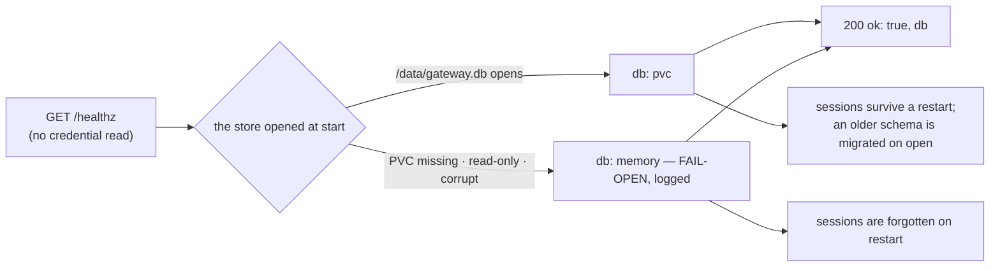

# GET /healthz — liveness, and which store the gateway is running on

The probe target and the one place the [store mode](../glossary.md#store-mode) is visible.
`{ok: true, db: "pvc"}` is the normal answer. ADR-139 keeps the gateway single-replica on SQLite
at `/data/gateway.db` (a 1Gi Longhorn PVC); when the PVC is unusable at start the gateway **fails
open** to an in-memory store, logs it loudly, and says so here (`db: "memory"`) — sessions, and the
admission's capacity marks ([GW-SESSIONS-ADMIT §Kept across a restart](sessions.md#kept-across-a-restart)),
then live only until the next restart. HA (FU-271) is a gap.

## Interface — the machine half

**[`health.schema.json`](health.schema.json)** holds the one output shape and the one error code;
the service **imports it**. A process that is not serving answers nothing; a process whose opened
store stops answering mid-life answers 503 `db-unavailable` (unverified — no row drives the open
store into refusing `SELECT 1`; expected to hold).

| Requirement | Governs (schema) | Error codes | Status |
|---|---|---|---|
| [GW-HEALTH](#gw-health) | `output` | `db-unavailable` (503, unverified) | v0 — HA (FU-271) is `⚑ gap` (row below) |

## Flow overview

The store is chosen once, at start ([which store](#which-store-the-gateway-runs-on)); the probe
reports it on every call ([no credential](#the-probe-needs-no-credential)); what the choice costs
is visible at the next restart ([what survives](#what-survives-a-restart)).

## Requirement index

| Requirement | Section | Status |
|---|---|---|
| [GW-HEALTH](#gw-health) | liveness and the store mode | v0 — HA (FU-271) is `⚑ gap` (row below) |

## GW-HEALTH

The gateway opens its store once, at start, from `GATEWAY_DB`: a path that opens is the `pvc`
[store mode](../glossary.md#store-mode); a path whose directory is missing, that cannot be opened
for writing, or whose file fails SQLite's integrity check falls open to an in-memory store, the
`memory` mode ⚖ — one `ERROR` log line names the path and the cause, and `GET /healthz` reports
the mode in `db` for the process's whole life. The answer is always `200 {ok: true, db}`, nothing
more and nothing less, and the probe reads no credential. A `pvc` store keeps its sessions across a
restart and adds the columns a newer schema needs on open (additive only — the 2026-10-16 schema
without the cache columns opens and its sessions ride); a `memory` store forgets everything at
restart, so a pod's session token is `session-unknown` to its successor.

**World: [policy-default](../worlds/README.md#policy-worlds)** — `GATEWAY_DB=<tmp>/data/gateway.db`
unless a row says `memory`; a worker session is admitted on the Go rail (`opencode`) and its
ride goes to the fake Go upstream, `upstream-ok`.

#### Which store the gateway runs on

Legend: `store_state` = how the DB path looks when the gateway starts — `file` = `/data` exists
and `gateway.db` opens; `missing-dir` = no `/data` directory; `read-only` = `/data` and the file
exist, open for write fails; `corrupt` = the file fails integrity on open; `db?` = the `db` field
of the 200 answer; `log_prefix?` = the start of the store's one log line (the line goes on to name
the path, and the cause on a fail-open).

| description | store_state | db? | log_prefix? |
|---|---|---|---|
| the PVC is mounted and writable | `file` | `pvc` | `db: pvc` |
| the PVC is missing — fail open ⚖ | `missing-dir` | `memory` | `db: memory — FAIL-OPEN, sessions do not survive a restart` |
| the PVC is read-only — fail open ⚖ | `read-only` | `memory` | `db: memory — FAIL-OPEN, sessions do not survive a restart` |
| the DB file is corrupt — fail open ⚖ | `corrupt` | `memory` | `db: memory — FAIL-OPEN, sessions do not survive a restart` |

#### What survives a restart

Legend: `store` = the store mode of two gateways started on the same `GATEWAY_DB` in turn
(`memory` = `:memory:`), the first having dispatched one worker session; `active_after?` =
`gateway_sessions_active{rail="opencode"}` on the second; `ride_after?` = the second gateway's
answer to the first's session token on `POST /openai/v1/chat/completions` — the status, and the
error code when there is one.

| description | store | active_after? | ride_after? |
|---|---|---|---|
| a memory store forgets on restart | `memory` | `0` | `401 session-unknown` |
| a PVC store remembers | `pvc` | `1` | `200` |

#### An older schema is migrated on open

Legend: `schema_at_restart` = the schema of the file the second gateway opens (`2026-10-16` =
`tokens_cache_read` and `tokens_cache_write` dropped from `sessions` and `requests` after the first
gateway closed); `active_after?` as above; `requests?`, `tokens_cache_read?`,
`tokens_cache_write?` = the `GET /sessions/{id}` fields after the old token rode once.

| description | store | schema_at_restart | active_after? | requests? | tokens_cache_read? | tokens_cache_write? |
|---|---|---|---|---|---|---|
| a PVC store from before the cache columns is migrated | `pvc` | `2026-10-16` | `1` | `1` | `0` | `0` |

#### The probe needs no credential

Legend: `authorization` = the request's `Authorization` header (`none` = no header; `an unknown
session token` = `Bearer gws_` + 32 characters no session owns); `status?` = the HTTP status;
`body?` = the whole JSON body, exactly.

| description | authorization | status? | body? |
|---|---|---|---|
| no auth is required | `none` | `200` | `{"ok": true, "db": "pvc"}` |
| a bearer changes nothing — the probe reads no credential | `an unknown session token` | `200` | `{"ok": true, "db": "pvc"}` |

> Tombstone (removed by PR #3184; one cycle): ~~no other field is served~~ — carried now by the
> `body?` cell of both rows above (the whole body, exactly).

#### Gaps

| description | input | v0 answer | the gap |
|---|---|---|---|
| ⚑ gap: a second replica | 2 replicas | both count sessions alone — every cap doubles | HA, FU-271 (a session store + a durable store after a per-request measurement) |

Evidence — latest run

--8<-- "GW-HEALTH.md"

