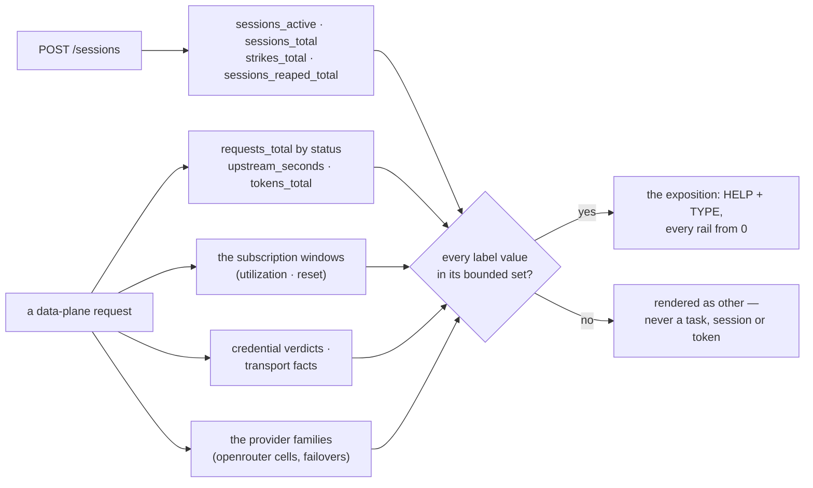

# GET /metrics — the `gateway_*` families, with bounded labels only

The evidence surface the alert belts read. Thirty-seven families in the schema (the codex rail's
two render only while the policy declares that rail), Prometheus text format, no auth (in-cluster,
scraped by the ServiceMonitor). **Every label value is drawn from a bounded set** declared in the
schema — a [bounded label](../glossary.md#bounded-label): never a task key, a session id, or a model
string outside the policy's set — so cardinality is a property of the policy, not of traffic.

## Interface — the machine half

**[`metrics.schema.json`](metrics.schema.json)** declares each family (name, type, labels and
the bounded value set per label); the service **imports it** to register the families, so a
label the schema does not declare cannot be emitted. No error codes: `/metrics` answers 200 or
the process is down.

| Requirement | Governs (schema) | Error codes | Status |
|---|---|---|---|
| [GW-METRICS](#gw-metrics) | `families.*` | — | v0 — the cost ledger / `/generation` USD harvest, the capacity-doorbell signal and the store mode are `⚑ gap` (rows below) |
| [GW-SESSIONS-ADMIT](sessions.md#gw-sessions-admit) (owned there) | `families.gateway_sessions_active` | — | linked — the gauge IS the admission counter |
| [GW-CRED-RESOLVE](sessions.md#gw-cred-resolve) (owned there) | `families.gateway_credential_resolve_total` | — | linked — the `outcome` label is that requirement's verdict class |
| [GW-SESSIONS-AUTH](sessions.md#gw-sessions-auth) (owned there) | `families.gateway_control_plane_unauthenticated_total` | — | linked — the rollout knob's soak signal; its increments are rows there |
| [GW-SESSIONS-ADMIT](sessions.md#gw-sessions-admit) §Capacity (owned there) | `families.gateway_cells_cooled`, `families.gateway_credentials_rejected` | — | linked — the admission's transport facts as gauges |
| [GW-RAIL-ANTHROPIC](anthropic-messages.md#gw-rail-anthropic) / [GW-RAIL-OPENROUTER](openai-chat.md#gw-rail-openrouter) (owned there) | `families.gateway_requests_incomplete_total` | — | linked — the stream-completeness rule |
| [GW-CATALOG-GO](catalog.md#gw-catalog-go) (owned there) | `families.gateway_go_catalog_*` | — | linked — the Go catalog's freshness, size and refresh outcomes; their values are rows there |
| [GW-RAIL-OPENROUTER](openai-chat.md#gw-rail-openrouter) (owned there) | `families.gateway_provider_requests_total`, `families.gateway_provider_failovers_total` | — | linked — the provider axis: attempts per cell and failovers; their values are rows there and below |
| [GW-CATALOG-OR](catalog.md#gw-catalog-or) (owned there) | `families.gateway_openrouter_catalog_*`, `families.gateway_openrouter_cells`, `families.gateway_canary_*` | — | linked — the OpenRouter catalog's freshness and refresh outcomes, the cells by entry state, the canary meter and verdicts; their values are rows there |
| [GW-CODEX-HEADROOM §Gauges](openai-responses.md#gauges) (owned there) | `families.gateway_subscription_utilization`, `families.gateway_subscription_reset_seconds` | — | linked — on the codex rail the two gauges come from an ACCEPTED headroom report, not from headers; their values are rows there |
| [GW-CODEX-HEADROOM §Poll](openai-responses.md#poll) (owned there) | `families.gateway_codex_usage_poll_total` | — | linked — the gateway's own usage poll by outcome, every outcome from 0; its values are rows there |
| [GW-CODEX-HEADROOM §Upstream headers](openai-responses.md#upstream-headers) (owned there) | `families.gateway_codex_upstream_headroom_total` | — | linked — the relayed answers' headroom-header reads by outcome, every outcome from 0; its values are rows there |

## Flow overview

An admission answer increments the [session families](#sessions-and-outcomes-are-counted); a
data-plane request increments the [request families](#requests-are-counted-by-status), observes
[tokens and upstream time](#tokens-and-upstream-time-are-observed-per-rail), reads the
[subscription windows](#the-subscription-windows-are-read), records
[credential verdicts and transport facts](#credential-verdicts-and-transport-facts) and, on the
openrouter rail, the [provider families](#the-provider-families). Every label value passes the
bounded sets ([labels](#labels-are-bounded-sessions-and-requests), [no unbounded
label](#no-unbounded-label-ever)); the alert-read families render
[every rail from 0](#every-rail-renders-from-0) and [every family is declared](#every-family-is-declared).

## Requirement index

| Requirement | Section | Status |
|---|---|---|
| [GW-METRICS](#gw-metrics) | the families | v0 — the cost ledger / `/generation` USD harvest, the capacity-doorbell signal and the store mode are `⚑ gap` (rows below) |

## GW-METRICS

The gateway renders one Prometheus text exposition from in-process counters and gauges, no
registry library in between. A counter increments at the moment its event happens — an admission
answer, a data-plane answer, a strike written, a session reaped, a credential verdict, a probe —
and a gauge reads its source at render time (active sessions, cooled cells, rejected credentials,
the last-seen window headers). Every label value is checked against its family's declared set
before it becomes a series: a value outside the set renders as `other`, so a task key, a session
id, a token or a model the policy does not name can never create a series. The families an alert
reads with `increase()` or `== 0` render every label value from `0` on a fresh process (`rail` on
the credential and session families, every `(route, reason)` on the control-plane family), so a
flat series reads as "no such event" and an absent one as "never scraped"; the codex rail's two
families render only while the policy declares that rail
([GW-CODEX-HEADROOM](openai-responses.md#gw-codex-headroom)). The codex rail's `gateway_sessions_active{rail="codex"}`
renders `0` even where no policy declares it — the rail ships dark ⚖. Values owned by another
requirement (the Go and OpenRouter catalogs, the canary, the codex headroom, the rail choice) are
rows there; this page proves the families' shape and the counters the gateway alone drives.

**World: [policy-default](../worlds/README.md#policy-worlds)** with the upstream behaviour the
`world` cell names ([worlds](../worlds/README.md#upstream-behaviours-fake-upstreams)); the provider
rows ride the [openrouter-endpoints](../worlds/README.md#the-openrouter-endpoints-world) snapshot.
Legend, shared by the tables below: `event` = what happened before the read (`none` = a fresh
gateway; `a worker dispatched on opencode` = one `POST /sessions` for stack `platform`, role
`worker`, admitted on the Go rail; `one openai call on <rail>` = a worker session on that rail,
harness `goose`, then one `POST /openai/v1/chat/completions`, `streamed` = with `stream: true`;
`one call on anthropic` = a reviewer session, harness `claude`, then one `POST /anthropic/v1/messages`;
`every family driven` = a dispatch and a served openai call, a reviewer session and a served
anthropic call, a truncated stream, a `no-verdict` outcome, an unknown stack, an unknown token and a
transient credential); `series` = the sample line read from `GET /metrics`; `value?` = its value.

#### The families — counters

| family | labels | what it counts |
|---|---|---|
| `gateway_sessions_total` | `rail`, `role`, `stack`, `decision` | every `POST /sessions` answer; `rail` = `none` on a defer ⚖ |
| `gateway_requests_total` | `rail`, `dialect`, `status` | every data-plane request, by the status the gateway returned |
| `gateway_tokens_total` | `rail`, `class` | usage recorded from upstream bodies in four classes: `in` (UNCACHED input — the openai dialect's `prompt_tokens` minus `cached_tokens`), `cache_read`, `cache_write`, `out` — the split the window draw and the cost ledger price from ⚖ |
| `gateway_credential_resolve_total` | `rail`, `outcome` | every ref resolution verdict |
| `gateway_upstream_auth_rejected_total` | `rail` | every upstream 401/403 the gateway reads as a CREDENTIAL verdict — the request answered 424 `upstream-auth` ([GW-CRED-BOUNDARY](anthropic-messages.md#gw-cred-boundary); a policy refusal, 403 `upstream-refused`, is not counted here): the event series the dead-key alert reads; `gateway_credentials_rejected` below is the state. Every rail renders from 0 ⚖ |
| `gateway_strikes_total` | `class`, `source` | strikes written to the store ([GW-SESSIONS-OUTCOME](sessions.md#gw-sessions-outcome)): `class` a strike class of the one vocabulary, `source` `outcome` (the consumer) or `gateway` (a transport fact) |
| `gateway_sessions_reaped_total` | `rail` | sessions released because their pod was gone ([GW-SESSIONS-LIVENESS](sessions.md#gw-sessions-liveness)); every rail renders from 0 |
| `gateway_codex_usage_poll_total` | `outcome` | the codex rail's usage polls by outcome ([GW-CODEX-HEADROOM §Poll](openai-responses.md#poll)): `accepted` = the headroom took the report; the rest name why it did not. The family exists only while the policy declares the codex rail, then every outcome renders from 0 ⚖ — the alerts read `increase()` (an undeclared rail has no series, so `CodexUsagePollSilent` cannot fire on it) |
| `gateway_codex_upstream_headroom_total` | `outcome` | the codex rail's relayed answers read for their `x-codex-*` headroom headers ([GW-CODEX-HEADROOM §Upstream headers](openai-responses.md#upstream-headers)): `accepted` = the headroom took the report, `absent` = no window header on the answer, the rest name the refusal. Declared-gated and rendered from 0 exactly like the poll family ⚖ |
| `gateway_credential_probes_total` | `rail`, `outcome` | re-verifications of a rejected credential ([§Capacity](sessions.md#capacity--the-ladders-capacity-half)): `cleared` (a 2xx), `rejected` (a credential verdict again), `inconclusive` (no verdict) |
| `gateway_requests_incomplete_total` | `rail`, `dialect`, `reason` | 2xx answers whose body stopped before its end — `no-terminal`, `timeout`, `transport-error`, `client-closed` ([GW-RAIL-ANTHROPIC](anthropic-messages.md#gw-rail-anthropic)) |
| `gateway_go_catalog_refresh_total` | `source`, `outcome` | refresh attempts by outcome; every pair renders from 0 ([GW-CATALOG-GO](catalog.md#gw-catalog-go)) |
| `gateway_go_catalog_models_dropped_total` | `source`, `reason` | listed models a refresh dropped, by reason — a wire dialect the parser does not know (drop-and-count, #2933) |
| `gateway_control_plane_unauthenticated_total` | `route`, `reason` | every control-plane call with no valid caller token — admitted under `control_plane_auth: observe`, refused under `enforce`; every (`route`, `reason`) pair renders from 0, so a flat series reads as "no such call" ⚖ |
| `gateway_provider_requests_total` | `rail`, `model`, `provider`, `outcome` | every ATTEMPT on a (rail, model, provider) cell of the openrouter rail by how it ended ([GW-RAIL-OPENROUTER](openai-chat.md#gw-rail-openrouter)): `ok`, `incomplete`, the pre-byte failures the gateway fails over on (`5xx`, `429`, `unreachable`, `timeout`, `content-type`, `provider-error`) and the request-scoped answers it never does (`refused`, `auth`, `edge`). ⚖ `model` is bounded to the POLICY's openrouter ids, `provider` to the endpoint SNAPSHOT's slugs plus `unattributed` — never a value a response invented (one slugged by rule renders `other`) |
| `gateway_provider_failovers_total` | `model`, `from`, `to` | requests reissued to the next provider before the first byte; the same bounds |
| `gateway_openrouter_catalog_refresh_total` | `outcome` | OpenRouter catalog refresh attempts by outcome; every outcome renders from 0 ([GW-CATALOG-OR](catalog.md#gw-catalog-or)) |
| `gateway_canary_rides_total` | `outcome` | canary verdicts: `eligible` (a clean ride), `excluded` (a struck one) — and `no-verdict` (a 429'd one: the cell backs off, nothing is judged) |
| `gateway_canary_admissions_total` | `outcome` | canary admissions by answer: `dispatch`, `budget`, `not-due`, `not-in-catalog` |
| `gateway_rail_choice_total` | `model`, `rail`, `reason` | admissions where the tier named one model on two allowed rails ([GW-MODEL-TIERS §The rail choice](catalog.md#the-rail-choice)), by the rail that walked first and why — `price`, `clean-rate`, `headroom`, `not-in-catalog`, `no-eligible-endpoint`; ⚖ `model` is the twin's openrouter spelling, the provider families' bound |

#### The families — gauges and the histogram

| family | type | labels | what it reads |
|---|---|---|---|
| `gateway_sessions_active` | gauge | `rail` | sessions neither released nor expired, per rail — the admission counter |
| `gateway_upstream_seconds` | histogram | `rail` | upstream round-trip, first byte to last |
| `gateway_subscription_utilization` | gauge | `rail`, `window` | last-seen `anthropic-ratelimit-unified-<window>-utilization` (0–1) on the subscription rail — capacity, not dollars ⚖; on the codex rail the last ACCEPTED headroom report's `used_percent` / 100 ([GW-CODEX-HEADROOM §Gauges](openai-responses.md#gauges)) |
| `gateway_subscription_reset_seconds` | gauge | `rail`, `window` | last-seen `anthropic-ratelimit-unified-<window>-reset` (unix seconds); on the codex rail the accepted report's `resets_at` |
| `gateway_cells_cooled` | gauge | `rail` | (rail, model, provider) cells an upstream 429 cooled, until their reset — admission skips them ([§Capacity](sessions.md#capacity--the-ladders-capacity-half)); counted per rail (`model` is no label on this gauge); every rail renders from 0 |
| `gateway_credentials_rejected` | gauge | `rail` | rail credentials an upstream 401/403 rejected, until a 2xx on them or a new value — the alert hook for a dead key; every rail renders from 0 ⚖ |
| `gateway_go_catalog_age_seconds` | gauge | `source` | seconds since the source's last good snapshot was fetched — absent until one exists ([GW-CATALOG-GO](catalog.md#gw-catalog-go)) |
| `gateway_go_catalog_models` | gauge | `source` | models in the source's last good snapshot; 0 = none yet |
| `gateway_go_catalog_last_outcome` | gauge | `source`, `outcome` | 1 for the outcome of the source's latest attempt, 0 for the others — survives no restart, and needs none: the first refresh runs at start |
| `gateway_go_catalog_policy_models_missing` | gauge | `source` | policy Go models the source's snapshot does not cover — a count, so no `model` label |
| `gateway_openrouter_catalog_age_seconds` | gauge | — | seconds since the last good OpenRouter catalog refresh ([GW-CATALOG-OR](catalog.md#gw-catalog-or)) — absent until one exists; `OpenRouterCatalogStale` reads it |
| `gateway_openrouter_catalog_models` | gauge | — | models in the last good snapshot; 0 = none yet |
| `gateway_openrouter_catalog_last_outcome` | gauge | `outcome` | 1 for the latest attempt's outcome, 0 for the others — `OpenRouterCatalogParseFailed` reads it |
| `gateway_openrouter_cells` | gauge | `state` | (model, provider) cells of the catalog by entry state — `candidate`, `eligible`, `excluded`; a provider's service tiers are one cell |
| `gateway_canary_spend_usd` | gauge | — | metered canary spend over the trailing day at the cell's endpoint price |
| `gateway_canary_budget_exhausted` | gauge | — | 1 while the canary cap (per refresh or per day) is spent and candidate cells wait — `GatewayCanaryBudgetExhausted` reads it |
| `gateway_tier_evidence_age_seconds` | gauge | — | seconds since the mounted tier-evidence snapshot's `snapshot_at` (`GATEWAY_BENCHMARKS`) — absent when none is mounted; `TierEvidenceStale` reads it |

#### Sessions and outcomes are counted

Legend (above); `a worker dispatched on opencode, then released` = the same, then `DELETE /sessions/{id}`;
`every worker rail full, a worker deferred` = the Go and OpenRouter caps filled with worker
sessions, then one more `POST /sessions` (deferred `rail-capacity`); `a worker session reports
no-verdict` = `POST /sessions/{id}/outcome {class: no-verdict}` on a dispatched worker; `a bound
opencode session whose pod is gone, one reaper pass` = a session bound to pod `fixer-1`, its env
pulled, the pod gone, then the reaper runs once ([GW-SESSIONS-LIVENESS](sessions.md#gw-sessions-liveness)).

| description | world | event | series | value? |
|---|---|---|---|---|
| a dispatch raises the active gauge | `policy-default · upstream-ok` | `a worker dispatched on opencode` | `gateway_sessions_active{rail="opencode"}` | `1` |
| a release lowers it | `policy-default · upstream-ok` | `a worker dispatched on opencode, then released` | `gateway_sessions_active{rail="opencode"}` | `0` |
| a dispatch is counted with its identity | `policy-default · upstream-ok` | `a worker dispatched on opencode` | `gateway_sessions_total{rail="opencode",role="worker",stack="platform",decision="dispatch"}` | `1` |
| a defer is counted with no rail ⚖ | `policy-default · upstream-ok` | `every worker rail full, a worker deferred` | `gateway_sessions_total{rail="none",role="worker",stack="platform",decision="defer"}` | `1` |
| a strike is counted by class and source | `policy-default` | `a worker session reports no-verdict` | `gateway_strikes_total{class="no-verdict",source="outcome"}` | `1` |
| a reaped session is counted on its rail | `policy-default` | `a bound opencode session whose pod is gone, one reaper pass` | `gateway_sessions_reaped_total{rail="opencode"}` | `1` |

#### Requests are counted by status

Legend (above); `an expired token on /anthropic/v1/messages` = a reviewer session on the
subscription rail whose `session_ttl_s` has passed, then one `POST /anthropic/v1/messages` with
its token.

| description | world | event | series | value? |
|---|---|---|---|---|
| a served request is counted by status | `policy-default · upstream-ok` | `one openai call on opencode` | `gateway_requests_total{rail="opencode",dialect="openai",status="200"}` | `1` |
| a refused request is counted by its status | `policy-default · upstream-ok` | `an expired token on /anthropic/v1/messages` | `gateway_requests_total{rail="none",dialect="anthropic",status="401"}` | `1` |
| an upstream 429 keeps its status | `policy-default · upstream-429` | `one openai call on openrouter` | `gateway_requests_total{rail="openrouter",dialect="openai",status="429"}` | `1` |
| an upstream auth rejection is answered 424 and counted at it | `policy-default · upstream-401` | `one openai call on opencode` | `gateway_requests_total{rail="opencode",dialect="openai",status="424"}` | `1` |
| an unreachable upstream is answered 502 and counted at it | `policy-default · upstream-down` | `one openai call on opencode` | `gateway_requests_total{rail="opencode",dialect="openai",status="502"}` | `1` |

#### Tokens and upstream time are observed per rail

Legend (above); `upstream-ok-cached` = the anthropic fake answers `usage {input_tokens: 12,
cache_read_input_tokens: 300, cache_creation_input_tokens: 40, output_tokens: 7}`.

| description | world | event | series | value? |
|---|---|---|---|---|
| uncached input tokens are counted as in | `policy-default · upstream-ok-cached` | `one call on anthropic` | `gateway_tokens_total{rail="anthropic",class="in"}` | `12` |
| cache reads are counted as cache_read | `policy-default · upstream-ok-cached` | `one call on anthropic` | `gateway_tokens_total{rail="anthropic",class="cache_read"}` | `300` |
| cache writes are counted as cache_write | `policy-default · upstream-ok-cached` | `one call on anthropic` | `gateway_tokens_total{rail="anthropic",class="cache_write"}` | `40` |
| output tokens are counted as out | `policy-default · upstream-ok-cached` | `one call on anthropic` | `gateway_tokens_total{rail="anthropic",class="out"}` | `7` |
| upstream time is observed per rail | `policy-default · upstream-ok` | `one call on anthropic` | `gateway_upstream_seconds_count{rail="anthropic"}` | `1` |

#### The subscription windows are read

Legend (above); the anthropic fake answers every call with the live header set of 2026-10-16:
`anthropic-ratelimit-unified-{5h,7d}-utilization` = `0.13` / `0.67`,
`anthropic-ratelimit-unified-{5h,7d}-reset` = `1792172400` / `1792274400`.

| description | world | event | series | value? |
|---|---|---|---|---|
| the 5h utilization is the header's | `policy-default · upstream-ok` | `one call on anthropic` | `gateway_subscription_utilization{rail="anthropic",window="5h"}` | `0.13` |
| the 7d utilization is the header's | `policy-default · upstream-ok` | `one call on anthropic` | `gateway_subscription_utilization{rail="anthropic",window="7d"}` | `0.67` |
| the 5h reset is the header's epoch | `policy-default · upstream-ok` | `one call on anthropic` | `gateway_subscription_reset_seconds{rail="anthropic",window="5h"}` | `1792172400` |
| the 7d reset is the header's epoch | `policy-default · upstream-ok` | `one call on anthropic` | `gateway_subscription_reset_seconds{rail="anthropic",window="7d"}` | `1792274400` |

#### Credential verdicts and transport facts

Legend (above); `the anthropic ref is a definitive miss, a prober asks` = the stack's
`claude-session` Secret is gone (404), then one `POST /sessions` for role `prober` (whose only rail
is the subscription — deferred `credential-unresolved`); `one openai call on opencode answered 401,
60 s, the re-probe answered upstream-ok` = a worker ride answered `upstream-401-key-expired`, the
fake set back to `upstream-ok`, the clock advanced 60 s, then the re-probe pass runs
([§Capacity](sessions.md#capacity--the-ladders-capacity-half)).

| description | world | event | series | value? |
|---|---|---|---|---|
| a resolution verdict is counted | `policy-default · upstream-ok` | `the anthropic ref is a definitive miss, a prober asks` | `gateway_credential_resolve_total{rail="anthropic",outcome="definitive"}` | `1` |
| an upstream auth rejection is counted apart | `policy-default · upstream-401` | `one openai call on opencode` | `gateway_upstream_auth_rejected_total{rail="opencode"}` | `1` |
| an unreachable upstream is not an auth rejection | `policy-default · upstream-down` | `one openai call on opencode` | `gateway_upstream_auth_rejected_total{rail="opencode"}` | `0` |
| a cooled cell is counted on its rail | `policy-default · upstream-429` | `one openai call on openrouter` | `gateway_cells_cooled{rail="openrouter"}` | `1` |
| a rejected credential is counted on its rail | `policy-default · upstream-401` | `one openai call on openrouter` | `gateway_credentials_rejected{rail="openrouter"}` | `1` |
| an incomplete stream is counted by reason | `policy-default · upstream-stream-truncated` | `one streamed openai call on opencode` | `gateway_requests_incomplete_total{rail="opencode",dialect="openai",reason="no-terminal"}` | `1` |
| a credential re-probe is counted by outcome | `policy-default · upstream-401-key-expired` | `one openai call on opencode answered 401, 60 s, the re-probe answered upstream-ok` | `gateway_credential_probes_total{rail="opencode",outcome="cleared"}` | `1` |

#### Every rail renders from 0

A fresh gateway, no request yet. Legend: `family` = the family read; `value?` = the sample of
`<family>{rail="<r>"}` for every rail `anthropic`, `openrouter`, `opencode`, `codex` — the series
exists and holds this value for each.

| description | world | family | value? |
|---|---|---|---|
| every rail's rejection count renders from 0 ⚖ | `policy-default` | `gateway_upstream_auth_rejected_total` | `0` |
| the cooled-cell gauge renders every rail from 0 | `policy-default` | `gateway_cells_cooled` | `0` |
| the rejected-credential gauge renders every rail from 0 ⚖ | `policy-default` | `gateway_credentials_rejected` | `0` |
| the active gauge renders every rail from 0, codex included ⚖ | `policy-default` | `gateway_sessions_active` | `0` |
| the reaped counter renders every rail from 0 | `policy-default` | `gateway_sessions_reaped_total` | `0` |

#### The provider families

The [openrouter-endpoints](../worlds/README.md#the-openrouter-endpoints-world) world — the snapshot
of `deepseek/deepseek-v4.1-flash`, the openrouter heavy tier; `deepseek/deepseek-v4-flash` (the
standard tier) has no entry and rides unpinned ([GW-RAIL-OPENROUTER](openai-chat.md#gw-rail-openrouter)).
Legend: `deepinfra answers 500, atlas-cloud serves` = a worker ride on the heavy tier, pinned to
`deepinfra` first, whose 500 fails over to `atlas-cloud`; `a ride on deepseek/deepseek-v4-flash, …`
= a worker ride on the standard tier, the answer naming no provider (`the answer unnamed`) or a
display name the snapshot lacks (`the answer names Sail Research`).

| description | world | event | series | value? |
|---|---|---|---|---|
| a failed attempt is counted on its cell by how it ended | `policy-default · openrouter-endpoints` | `deepinfra answers 500, atlas-cloud serves` | `gateway_provider_requests_total{rail="openrouter",model="deepseek/deepseek-v4.1-flash",provider="deepinfra",outcome="5xx"}` | `1` |
| the serving attempt is counted ok on its cell | `policy-default · openrouter-endpoints` | `deepinfra answers 500, atlas-cloud serves` | `gateway_provider_requests_total{rail="openrouter",model="deepseek/deepseek-v4.1-flash",provider="atlas-cloud",outcome="ok"}` | `1` |
| a failover is counted from and to | `policy-default · openrouter-endpoints` | `deepinfra answers 500, atlas-cloud serves` | `gateway_provider_failovers_total{model="deepseek/deepseek-v4.1-flash",from="deepinfra",to="atlas-cloud"}` | `1` |
| an unpinned attempt that names no provider is unattributed ⚖ | `policy-default · openrouter-endpoints` | `a ride on deepseek/deepseek-v4-flash, the answer unnamed` | `gateway_provider_requests_total{rail="openrouter",model="deepseek/deepseek-v4-flash",provider="unattributed",outcome="ok"}` | `1` |
| a provider the snapshot lacks renders as other ⚖ | `policy-default · openrouter-endpoints` | `a ride on deepseek/deepseek-v4-flash, the answer names Sail Research` | `gateway_provider_requests_total{rail="openrouter",model="deepseek/deepseek-v4-flash",provider="other",outcome="ok"}` | `1` |

#### Labels are bounded: sessions and requests

Legend (above); `family` = the family whose series are read (`any` = every family); `label` = the
label read on them; `values_within?` = the set every value seen lies within (⊆, and at least one
value is seen) — a regular expression where the set is a pattern.

| description | world | event | family | label | values_within? |
|---|---|---|---|---|---|
| rail is the rail enum plus none | `policy-default · upstream-ok` | `every family driven` | `any` | `rail` | `anthropic, opencode, openrouter, codex, none` |
| role is the role enum | `policy-default · upstream-ok` | `every family driven` | `gateway_sessions_total` | `role` | `worker, reviewer, coordinator, responder, retro, prober, researcher` |
| stack is a policy key, else other ⚖ | `policy-default · upstream-ok` | `every family driven` | `gateway_sessions_total` | `stack` | `platform, oracle, other` |
| decision is the answer enum | `policy-default · upstream-ok` | `every family driven` | `gateway_sessions_total` | `decision` | `dispatch, defer` |
| dialect is the three paths | `policy-default · upstream-ok` | `every family driven` | `gateway_requests_total` | `dialect` | `anthropic, openai, responses` |
| status is a numeric HTTP status | `policy-default · upstream-ok` | `every family driven` | `gateway_requests_total` | `status` | `^[1-5][0-9][0-9]$` |
| class is one of the four usage classes | `policy-default · upstream-ok` | `every family driven` | `gateway_tokens_total` | `class` | `in, cache_read, cache_write, out` |
| window is 5h or 7d | `policy-default · upstream-ok` | `every family driven` | `gateway_subscription_utilization` | `window` | `5h, 7d, other` |

#### Labels are bounded: credentials, the control plane, the catalog

Legend (above); `the strike classes` = the keys of the one vocabulary
([GW-SESSIONS-OUTCOME](sessions.md#gw-sessions-outcome)) that write a strike.

| description | world | event | family | label | values_within? |
|---|---|---|---|---|---|
| outcome is the verdict class | `policy-default · upstream-ok` | `every family driven` | `gateway_credential_resolve_total` | `outcome` | `resolved, definitive, transient` |
| route is the control-plane route | `policy-default · upstream-ok` | `every family driven` | `gateway_control_plane_unauthenticated_total` | `route` | `admit, lookup, release, outcome, list` |
| reason is why no caller identity was read | `policy-default · upstream-ok` | `every family driven` | `gateway_control_plane_unauthenticated_total` | `reason` | `absent, invalid, review-transient` |
| class is a strike class of the one vocabulary | `policy-default · upstream-ok` | `every family driven` | `gateway_strikes_total` | `class` | `the strike classes` |
| source is the strike's writer | `policy-default · upstream-ok` | `every family driven` | `gateway_strikes_total` | `source` | `outcome, gateway` |
| reason is why a 2xx body stopped before its end | `policy-default · upstream-ok` | `every family driven` | `gateway_requests_incomplete_total` | `reason` | `no-terminal, timeout, transport-error, client-closed` |
| source is the catalog source | `policy-default · upstream-ok` | `every family driven` | `gateway_go_catalog_refresh_total` | `source` | `config, docs` |
| the catalog outcome is the refresh outcome | `policy-default · upstream-ok` | `every family driven` | `gateway_go_catalog_refresh_total` | `outcome` | `ok, fetch-failed, parse-failed, implausible` |

#### Labels are bounded: the OpenRouter catalog, the canary, the providers

Legend (above); `a worker admitted at tier light, a twin on both rails` = one `POST /sessions`
for a worker, harness `opencode`, tier `light`, where the tier names one model on both the Go and
the OpenRouter rail ([GW-MODEL-TIERS §The rail choice](catalog.md#the-rail-choice)); `the
openrouter rail's policy models` = every id of `rails.openrouter.models`; `the endpoint snapshot's
slugs, unattributed` = the snapshot's tag-base slugs plus `unattributed`; a `label` cell naming two
labels reads both.

| description | world | event | family | label | values_within? |
|---|---|---|---|---|---|
| state is a cell's entry state ⚖ | `policy-default` | `none` | `gateway_openrouter_cells` | `state` | `candidate, eligible, excluded` |
| a canary ride's outcome is a verdict | `policy-default` | `none` | `gateway_canary_rides_total` | `outcome` | `eligible, excluded, no-verdict` |
| a canary admission's outcome is an answer | `policy-default` | `none` | `gateway_canary_admissions_total` | `outcome` | `dispatch, budget, not-due, not-in-catalog` |
| model is a policy openrouter id ⚖ | `policy-default · openrouter-endpoints` | `deepinfra answers 500, atlas-cloud serves` | `gateway_provider_requests_total, gateway_provider_failovers_total` | `model` | `the openrouter rail's policy models` |
| provider is a snapshot slug or unattributed ⚖ | `policy-default · openrouter-endpoints` | `deepinfra answers 500, atlas-cloud serves` | `gateway_provider_requests_total` | `provider` | `the endpoint snapshot's slugs, unattributed` |
| a failover's from and to are snapshot slugs too ⚖ | `policy-default · openrouter-endpoints` | `deepinfra answers 500, atlas-cloud serves` | `gateway_provider_failovers_total` | `from, to` | `the endpoint snapshot's slugs, unattributed` |
| reason is why the rail choice fell ⚖ | `policy-default · openrouter-endpoints` | `a worker admitted at tier light, a twin on both rails` | `gateway_rail_choice_total` | `reason` | `price, clean-rate, headroom, not-in-catalog, no-eligible-endpoint` |
| the rail choice's model is the twin's openrouter spelling ⚖ | `policy-default · openrouter-endpoints` | `a worker admitted at tier light, a twin on both rails` | `gateway_rail_choice_total` | `model` | `the openrouter rail's policy models` |

#### No unbounded label, ever

Legend (above); `absent` = what no series may carry: `the forbidden label names` = the schema's
`forbidden_labels` (`task`, `session`, `id`, `token`) on any family, and `model` on every family but
`gateway_provider_requests_total`, `gateway_provider_failovers_total` and `gateway_rail_choice_total`;
`the ride's identifiers` = the task key, the session id, the session token, the model and the
unknown stack name the drive used, as substrings of the exposition; `found?` = the ones found
(`none`).

| description | world | event | absent | found? |
|---|---|---|---|---|
| no task label, ever | `policy-default · upstream-ok` | `every family driven` | `the forbidden label names` | `none` |
| no task key, session id, token, model or unknown stack in the text | `policy-default · upstream-ok` | `every family driven` | `the ride's identifiers` | `none` |

#### Every family is declared

Legend: `families` = the families to find — `the schema's, less the codex rail's` = every key of
`metrics.schema.json` `families` except `gateway_codex_*` (rendered only for a declared codex rail);
`undeclared?` = those with no `# HELP` or no `# TYPE` line on a fresh gateway (`none`).

| description | world | families | undeclared? |
|---|---|---|---|
| every family renders HELP and TYPE, zeros included | `policy-default` | `the schema's, less the codex rail's` | `none` |

> Tombstones (removed by PR #3184; one cycle): ~~tokens are counted by class~~ → the four class rows
> of [Tokens and upstream time](#tokens-and-upstream-time-are-observed-per-rail); ~~the subscription
> windows are read~~ → the four rows of [The subscription windows are read](#the-subscription-windows-are-read);
> ~~an upstream auth rejection is counted apart~~ (two series) → "… is counted apart" + "… is
> answered 424 and counted at it"; ~~an unreachable upstream is not an auth rejection~~ (two series)
> → "… is not an auth rejection" + "… is answered 502 and counted at it"; ~~the transport-fact
> gauges render every rail from 0~~ → the cooled-cell and rejected-credential rows of
> [Every rail renders from 0](#every-rail-renders-from-0); ~~an attempt is counted on its cell by
> how it ended~~ (two series) → "a failed attempt …" + "the serving attempt …"; ~~a canary outcome is
> a verdict, an admission an answer~~ → the two canary rows; ~~class is a strike class, source the
> writer~~ → the `class` and `source` rows; ~~no task label, ever~~ (one row, two claims) → the two
> rows above.

#### Gaps

| description | input | v0 answer | the gap |
|---|---|---|---|
| ⚑ gap: USD per request | upstream-ok on openrouter | tokens only | the `/generation` harvest, the cost ledger |
| ⚑ gap: a slot freed is not announced | a release on a full rail | the gauge drops; nothing is pushed | the capacity doorbell |
| ⚑ gap: the store mode is not a metric | the DB fell open to memory | only `/healthz` says so ([store mode](../glossary.md#store-mode)) | a `gateway_db_mode` family, and the alert on it (#3180) |

Evidence — latest run

--8<-- "GW-METRICS.md"

