# POST /openai/v1/chat/completions · GET /openai/v1/models — the OpenAI dialect, on any rail that speaks it

The data-plane path an `opencode` / `goose` harness rides ([UC-1](../use-cases/uc-1-worker-ride.md)
step ③, openai [dialect](../glossary.md#dialect)). The per-request steps are the ones
[anthropic-messages.md](anthropic-messages.md) owns — session resolution
([GW-CRED-BOUNDARY](anthropic-messages.md#gw-cred-boundary)), the model check
([GW-MODEL-RESOLVE](anthropic-messages.md#gw-model-resolve)), the [Go rail](../../../docs/agents/chainless-redesign.md)'s wire
([GW-RAIL-OPENCODE](anthropic-messages.md#gw-rail-opencode)) — applied to this path. This page
owns the **OpenRouter rail**, which serves both dialects, with its provider axis: every answer
attributed to the [cell](../glossary.md#cell) that served it, the provider selected from the
[endpoint snapshot](../glossary.md#endpoint-snapshot), a failed provider relaunched before the
first byte. The one cell this dialect cannot serve is the `anthropic` rail (501
`dialect-unsupported-on-rail`) — [GW-RAIL-ANTHROPIC §The dialect this rail does not speak](anthropic-messages.md#the-dialect-this-rail-does-not-speak)
owns those rows, as [GW-RAIL-OPENCODE §A call lands on the Go upstream](anthropic-messages.md#a-call-lands-on-the-go-upstream)
owns the Go rail's openai-dialect rows. Harnesses list models at start, so `GET /openai/v1/models`
is a passthrough on the rails that have one.

## Interface — the machine half

**[`openai-chat.schema.json`](openai-chat.schema.json)** holds the inbound envelope the gateway
inspects, the per-rail upstream contract and the error envelope; the service **imports it**.

| Requirement | Governs (schema) | Error codes | Status |
|---|---|---|---|
| [GW-RAIL-OPENROUTER](#gw-rail-openrouter) | `upstream.openrouter` (URL per dialect, auth, the `provider` pin), `models.openrouter`, `output.complete`, `$defs.endpoint_snapshot`, `$defs.providers_block` | `upstream-auth`, `upstream-unreachable`, `upstream-timeout`, `upstream-content-type` | v0 + the provider axis ([§Attribution](#attribution--the-answer-names-the-cell), [§Selection](#selection--the-gateways-own-evidence-never-exacto), [§Failover](#failover--before-the-first-byte-only) — homelab#2741; `:exacto` is NOT ported, operator 2026-10-19); the headroom poll / the `/generation` cost harvest `⚑ gap` ([named gaps](#named-gaps)); the `upstream-timeout` row `🚧 WIP` (the `upstream-slow` world is clock-faked only) |
| [GW-RAIL-OPENCODE](anthropic-messages.md#gw-rail-opencode) (owned there) | `upstream.opencode`, `models.opencode` | `upstream-auth`, `upstream-unreachable` | linked |
| [GW-RAIL-ANTHROPIC](anthropic-messages.md#gw-rail-anthropic) (owned there) | `upstream.anthropic` (none — 501) | `dialect-unsupported-on-rail` | linked |
| [GW-MODEL-RESOLVE](anthropic-messages.md#gw-model-resolve) (owned there) | `input.body.model` | `model-not-session` | linked |
| [GW-CRED-BOUNDARY](anthropic-messages.md#gw-cred-boundary) (owned there) | `input.headers.authorization`, `input.headers.x-api-key` | `session-unknown`, `session-expired`, `session-released`, `credential-unresolved`, `credential-transient`, `upstream-auth`, `upstream-refused`, `upstream-edge-refused`, `header-refused` | linked |
| [GW-SESSIONS-RELEASE](sessions.md#gw-sessions-release) (owned there) | `input.headers.authorization` | `session-expired`, `session-released` | linked |
| [GW-CRED-RESOLVE](sessions.md#gw-cred-resolve) (owned there) | `upstream.*.auth` | `credential-unresolved`, `credential-transient` | linked |

## Flow overview

```mermaid
flowchart LR
  A["inbound auth · session · body.model\n(anthropic-messages.md)"] --> K["the stack's key as the bearer\nopenrouter.ai/api/v1"]
  K --> Q{"does the endpoint snapshot cover the model?"}
  Q -->|no| UP["rides unpinned\nthe vendor's own routing"]
  Q -->|yes| EL["eligible cells: the floors\n(quantization · tool-choice · uptime · status)"]
  EL --> OR["the order: price ÷ clean-ride rate\nstruck and cooled cells left out"]
  OR --> PIN["ONE provider pinned\nallow_fallbacks: false"]
  PIN --> U["the provider answers"]
  UP --> U
  U -->|5xx · 429 · provider 4xx · unreadable 2xx, before any byte| FO["strike or cool the cell\nreissue to the next provider"]
  FO --> U
  U -->|2xx| AT["the answer names its provider\nthe cell on the request row and the strikes"]
  AT --> B["bytes unchanged · usage recorded\ncompleteness judged"]
  U -->|after the first byte| NO["never a failover\nthe completeness outcome stands"]
  U -->|429 · 401 · 403 · no connection · timeout| T["429 passthrough · 424 · 403 · 502 · 504"]
  click A href "#gw-rail-openrouter" "GW-RAIL-OPENROUTER" _self
  click K href "#the-stacks-key-and-the-headers" "The stack's key and the headers" _self
  click Q href "#selection--the-gateways-own-evidence-never-exacto" "Selection" _self
  click UP href "#selection-the-pin" "Selection: the pin" _self
  click EL href "#selection-the-order" "Selection: the order" _self
  click OR href "#selection-the-order" "Selection: the order" _self
  click PIN href "#selection-the-pin" "Selection: the pin" _self
  click U href "#where-a-call-lands-and-what-the-session-records" "Where a call lands and what the session records" _self
  click FO href "#failover-before-the-first-byte" "Failover: before the first byte" _self
  click AT href "#attribution--the-answer-names-the-cell" "Attribution" _self
  click B href "#stream-completeness" "Stream completeness" _self
  click NO href "#failover-after-the-first-byte-never" "Failover: after the first byte, never" _self
  click T href "#an-openrouter-answer-that-is-not-a-2xx" "An OpenRouter answer that is not a 2xx" _self
```

A request that reaches this rail carries the [stack's own key](#the-stacks-key-and-the-headers)
upstream. When the [endpoint snapshot](../glossary.md#endpoint-snapshot) covers the session's model,
the gateway [selects the provider itself](#selection--the-gateways-own-evidence-never-exacto) —
the floors, then the order by price over clean-ride rate, then ONE pin with fallbacks off; a model
the snapshot does not cover rides unpinned. A pinned attempt that fails
[before any byte is relayed](#failover--before-the-first-byte-only) strikes or cools its cell and is
reissued to the next provider; after the first byte, never. Every answer
[names the cell that served it](#attribution--the-answer-names-the-cell), and the bytes come back
[unchanged, their completeness judged](#stream-completeness).

## Requirement index

Every requirement of this page, in reading order; the flow overview above links into it.

| Requirement | Section | Status |
|---|---|---|
| [GW-RAIL-OPENROUTER](#gw-rail-openrouter) | the OpenRouter rail: the wire, then the provider axis (attribution · selection · failover) | the headroom poll / the `/generation` cost harvest `⚑ gap` ([named gaps](#named-gaps)); the `upstream-timeout` row `🚧 WIP` (the `upstream-slow` world is clock-faked only) |

## GW-RAIL-OPENROUTER

The `openrouter` [rail](../glossary.md#rail) is the stack's own OpenRouter key (`OPENROUTER_API_KEY` from
`stacks.<stack>.openrouter_ref`), injected as `Authorization: Bearer <key>`. Openai dialect →
`https://openrouter.ai/api/v1/chat/completions`; models → `https://openrouter.ai/api/v1/models`;
the OpenRouter-shaped alias `POST /api/v1/chat/completions` serves the same path.
Anthropic dialect → `https://openrouter.ai/api/v1/messages` — **verified 2026-10-15**:
OpenRouter's published `openapi.json` lists `POST /messages` under the server
`https://openrouter.ai/api/v1` ("Creates a message using the Anthropic Messages API format.
Supports text, images, PDFs, tools, and extended thinking."; auth = the global `apiKey`
scheme, i.e. the same bearer); the human docs index and `llms.txt` do not mention it, so the
openapi file is the citation. ⚖ Whether that endpoint honours `anthropic-beta` is not stated
anywhere read — the header is forwarded untouched and the row is **verify during
implementation**. The body's `model` is the bare policy id (the [wire id](../glossary.md#wire-id)).
Upstream 429 passes through with `retry-after` (and cools the session's cell —
[§Capacity](sessions.md#capacity--the-ladders-capacity-half)); 401/403 is 424 `upstream-auth`,
403 `upstream-refused` or 403 `upstream-edge-refused`
([GW-CRED-BOUNDARY](anthropic-messages.md#gw-cred-boundary)); a connection that fails before any
byte is sent is 502 `upstream-unreachable` (a timeout is 504 `upstream-timeout`). ⚖ The policy
keeps the harness's User-Agent on this rail (`user_agent: forward`). The experiment's inkling rides
passed OpenRouter's "agentic harnesses only" gate as opencode traffic (60 × 200); its one 403 was a
bare smoke call. A fixed UA might fail that gate, while this rail's edge has not refused a caller UA.
An edge refusal here would be request-scoped anyway
([GW-CRED-BOUNDARY](anthropic-messages.md#gw-cred-boundary)). A rejected stack key is re-verified
with `GET /v1/key` (free) — unverified in this rule's rows; the probe is
[GW-SESSIONS-ADMIT §Capacity](sessions.md#capacity--the-ladders-capacity-half)'s.

Stream completeness on this dialect: the terminal event is `data: [DONE]`; the rule and the four
`incomplete` reasons are [GW-RAIL-ANTHROPIC](anthropic-messages.md#gw-rail-anthropic)'s. A
stream cut mid-body — the status and a first chunk delivered, then the read fails — is recorded
under the reason the failure had (`timeout` or `transport-error`), the bytes the pod got unchanged.

**World: [`policy-default`](../worlds/README.md#policy-worlds)** — a worker session on this rail
(harness `goose` on the openai dialect, `claude` on the anthropic one), stack `platform` unless a
`stack` column says otherwise, carrying `Authorization: Bearer <session token>`; the fake OpenRouter
upstream in the [behaviour](../worlds/README.md#upstream-behaviours-fake-upstreams) the `upstream`
column names. The canonical pair is
[`uc-1/openrouter-request.json`](../use-cases/uc-1/openrouter-request.json) →
[`openrouter-response.json`](../use-cases/uc-1/openrouter-response.json). The provider-axis
sub-sections below add the [`openrouter-endpoints`](../worlds/README.md#the-openrouter-endpoints-world)
store state.

### The stack's key and the headers

Legend: `stack` = the session's stack (its `openrouter_ref` names the key); `op` = the inbound
call (`messages` = `POST /anthropic/v1/messages`, `chat` = `POST /openai/v1/chat/completions`);
`inbound` = the header(s) the pod sends beside its session bearer (`Name: value` pairs,
`;`-separated; `(none)` = no extra header; `<session token>` = the session token; a value `(none)`
= the client sent no such header at all); `upstream_header?` = the same header(s) as the upstream
received them (`(absent)` = it did not reach upstream; `<OPENROUTER_API_KEY>` /
`<ORACLE_OPENROUTER_API_KEY>` = the platform / oracle stack's Secret key, never a value).

| description | upstream | stack | op | inbound | upstream_header? |
|---|---|---|---|---|---|
| the stack key rides as a bearer on the openai dialect | `upstream-ok` | `platform` | `chat` | `(none)` | `Authorization: Bearer <OPENROUTER_API_KEY>` |
| the stack key rides as a bearer on the anthropic dialect | `upstream-ok` | `platform` | `messages` | `x-api-key: <session token>; Authorization: (none)` | `Authorization: Bearer <OPENROUTER_API_KEY>; x-api-key: (absent)` |
| anthropic-beta is forwarded untouched ⚖ (verify) | `upstream-ok` | `platform` | `messages` | `anthropic-beta: oauth-2025-04-20` | `anthropic-beta: oauth-2025-04-20` |
| the Go session header is not this rail's business | `upstream-ok` | `platform` | `chat` | `x-opencode-session: c1` | `x-opencode-session: c1` |
| the user agent passes through (`user_agent: forward`) ⚖ | `upstream-ok` | `platform` | `chat` | `User-Agent: goose/1.x` | `User-Agent: goose/1.x` |
| the stack's own key is used | `upstream-ok` | `oracle` | `chat` | `(none)` | `Authorization: Bearer <ORACLE_OPENROUTER_API_KEY>` |

### Where a call lands and what the session records

Legend: `path` = the inbound path; `upstream_path?` = the path the upstream received (the
production default is `https://openrouter.ai/api` + this path); `body?` = the answer's body
against the upstream's own answer to the same call (`the upstream bytes` = byte-identical, SSE
included, same content-type); `recorded?` = the session's `requests · tokens_in ·
tokens_cache_read · tokens_cache_write · tokens_out` after the call — the openai dialect's
`prompt_tokens` / `completion_tokens` with `tokens_in` = `prompt_tokens` −
`prompt_tokens_details.cached_tokens` ⚖, the anthropic dialect's `input_tokens` /
`output_tokens`, a stream's last chunk's `usage` when present.

| description | upstream | path | upstream_path? | status? | body? | recorded? |
|---|---|---|---|---|---|---|
| an openai-dialect call lands | `upstream-ok` | `/openai/v1/chat/completions` | `/v1/chat/completions` | `200` | `the upstream bytes` | `1 · 7 · 0 · 0 · 3` |
| an anthropic-dialect call lands | `upstream-ok` | `/anthropic/v1/messages` | `/v1/messages` | `200` | `the upstream bytes` | `1 · 12 · 0 · 0 · 7` |
| the models list passes through | `upstream-ok` | `/openai/v1/models` | `/v1/models` | `200` | `the upstream bytes` | `1 · 0 · 0 · 0 · 0` |
| an openai-dialect cache read is split out ⚖ | `upstream-ok-cached` | `/openai/v1/chat/completions` | `/v1/chat/completions` | `200` | `the upstream bytes` | `1 · 12 · 300 · 0 · 7` |
| a stream streams | `upstream-stream` | `/openai/v1/chat/completions` | `/v1/chat/completions` | `200` | `the upstream bytes` | `1 · 19 · 0 · 0 · 4` |
| the /api/v1 alias serves the OpenRouter-shaped path | `upstream-ok` | `/api/v1/chat/completions` | `/v1/chat/completions` | `200` | `the upstream bytes` | `1 · 7 · 0 · 0 · 3` |

### An OpenRouter answer that is not a 2xx

Legend (`POST /openai/v1/chat/completions`): `body?` as above, or `<code> envelope` = the
gateway's error envelope with that code and no upstream body; `retry_after?` = the answer's
`retry-after` header (`(none)` = no header); `requests?` = the session's `requests` after the call.

| description | upstream | status? | body? | retry_after? | requests? |
|---|---|---|---|---|---|
| a rate limit passes through | `upstream-429` | `429` | `the upstream bytes` | `30` | `1` |
| an upstream auth failure is typed and hidden | `upstream-401` | `424` | `upstream-auth envelope` | `(none)` | `1` |
| an unreachable upstream is typed | `upstream-down` | `502` | `upstream-unreachable envelope` | `(none)` | `1` |
| a read past 600 s is a typed timeout | `upstream-slow` | `504` | `upstream-timeout envelope` | `(none)` | `1` |

### Stream completeness

Legend (`POST /openai/v1/chat/completions`): `cut` = how the `upstream-stream-cut` world breaks
the body after its first chunk (`timeout` = a read timeout mid-stream, `transport-error` = the
connection breaks; `(none)` = the body is not cut); `stream` = the body's `stream` flag;
`requests_incomplete?` = the session's counter after the call; `incomplete?` = the request row's
`incomplete` (`(none)` = null, complete); `row_status?` = the request row's status;
`incomplete_total?` = `gateway_requests_incomplete_total{rail="openrouter",dialect="openai",reason}`
for the row's reason (`no-terminal` when the row is complete).

| description | upstream | cut | stream | requests_incomplete? | incomplete? | row_status? | incomplete_total? |
|---|---|---|---|---|---|---|---|
| a stream that ends without [DONE] is recorded incomplete | `upstream-stream-truncated` | `(none)` | `true` | `1` | `no-terminal` | `200` | `1` |
| a stream that ends with [DONE] is complete | `upstream-stream` | `(none)` | `true` | `0` | `(none)` | `200` | `0` |
| a non-streamed answer read to its end is complete | `upstream-ok` | `(none)` | `false` | `0` | `(none)` | `200` | `0` |
| a stream cut by a read timeout is recorded incomplete | `upstream-stream-cut` | `timeout` | `true` | `1` | `timeout` | `504` | `1` |
| a stream cut by the transport is recorded incomplete | `upstream-stream-cut` | `transport-error` | `true` | `1` | `transport-error` | `200` | `1` |

> Tombstones (removed by the data-plane migration PR; one cycle): ~~the subscription cannot speak
> openai~~, ~~the subscription has no models list~~ — carried by
> [GW-RAIL-ANTHROPIC §The dialect this rail does not speak](anthropic-messages.md#the-dialect-this-rail-does-not-speak);
> ~~the Go rail speaks openai~~ — carried by
> [GW-RAIL-OPENCODE §A call lands on the Go upstream](anthropic-messages.md#a-call-lands-on-the-go-upstream)
> ("an openai-dialect call lands"). None of the three was this rule's: they joined no case here.

### Attribution — the answer names the cell

*The gateway attributes every openrouter answer to the provider that served it, per request* (operator
ruling 2026-10-19: `:exacto` papered over the old router's inability to attribute provider problems —
not ported). The answer itself says who served it: a chat completion's or a Messages answer's
top-level `provider`, a stream's first data chunk that carries one, an error envelope's
`error.metadata.provider_name` — read by the same bounded pass that reads the terminal usage, no
`/generation` harvest, no after-the-fact join. The value is a DISPLAY name (`DeepInfra`); the
[cell](../glossary.md#cell)'s provider key is the endpoint tag's base **slug** (`deepinfra`), what
`provider.order` names, joined through the [endpoint snapshot](../glossary.md#endpoint-snapshot)'s
`provider_name`. ⚖ A name the snapshot lacks is slugged by RULE (lower-case, runs of
non-alphanumerics → `-`), never a table — so it may differ from the vendor's tag (`OpenInference` →
`openinference`, tag `open-inference`) until the snapshot covers the model. The slug rides on the
request row (`requests.provider`), on the gateway's transport strikes and the consumer's
cell-scoped outcomes ([GW-SESSIONS-OUTCOME](sessions.md#gw-sessions-outcome)) and on the 429
cooldown ([GW-SESSIONS-ADMIT §Capacity](sessions.md#capacity--the-ladders-capacity-half)): the cell
is `(rail, model, provider)`, `''` when no answer named one. The answer's name outranks the
[pin](../glossary.md#pin) ⚖: a pinned request whose answer names another provider is attributed to
the answer's.

**World: `policy-default · openrouter-endpoints`** ([worlds/README.md](../worlds/README.md#the-openrouter-endpoints-world)):
the store holds the snapshot of `deepseek/deepseek-v4.1-flash` (**M** — the openrouter heavy tier;
ten endpoints trimmed from the live answer of 2026-10-19, every cell eligible); `deepseek/deepseek-v4-flash`
(**M′** — the standard tier) has no entry and rides unpinned. A worker session with harness
`opencode`, `rail: openrouter`, its tier picking M or M′; `POST /openai/v1/chat/completions`.

#### The answer names the cell

Legend: `model` = `M` / `M′` as above; `struck` = the cells this task's earlier rides struck
(`harness-gave-up`; `(none)`); `answer_provider` = the display name the upstream's answer carries;
`pin?` = `provider.order[0]` of the upstream body (`(none)` = no `provider` block);
`row_provider?` = the request row's `provider`.

| description | model | upstream | struck | answer_provider | pin? | row_provider? |
|---|---|---|---|---|---|---|
| a chat completion's provider is the cell | `M` | `upstream-ok` | `(none)` | `DeepInfra` | `deepinfra` | `deepinfra` |
| a stream's first chunk names the cell | `M` | `upstream-stream` | `(none)` | `DeepInfra` | `deepinfra` | `deepinfra` |
| the snapshot joins the display name to the slug provider.order uses | `M` | `upstream-ok` | `deepinfra, atlas-cloud, morph` | `InferenceNet` | `inference-net` | `inference-net` |
| the answer's name outranks the pin ⚖ | `M` | `upstream-ok` | `(none)` | `AtlasCloud` | `deepinfra` | `atlas-cloud` |

#### A name the snapshot lacks

Legend as above; `(empty)` = the empty string; `strike?` = the task's strike as `class @ provider`
(`(none)`).

| description | model | upstream | answer_provider | pin? | row_provider? | strike? |
|---|---|---|---|---|---|---|
| a name the snapshot lacks is slugged by rule ⚖ | `M′` | `upstream-ok` | `Sail Research` | `(none)` | `sail-research` | `(none)` |
| the rule is not the tag: a snapshot-less name may differ from its slug ⚖ | `M′` | `upstream-ok` | `OpenInference` | `(none)` | `openinference` | `(none)` |
| an answer that names no provider is unattributed | `M′` | `upstream-ok` | `(none)` | `(none)` | `(empty)` | `(none)` |
| a transport strike carries the provider | `M′` | `upstream-stream-truncated` | `Sail Research` | `(none)` | `sail-research` | `stream-incomplete @ sail-research` |

### Selection — the gateway's own evidence, never `:exacto`

*The gateway selects the provider itself.* Candidates per model come from the
[endpoint snapshot](../glossary.md#endpoint-snapshot) (`$defs.endpoint_snapshot`: per model, the
rows of `GET /api/v1/models/<id>/endpoints` — slug, display name, quantization,
`supports_tool_choice` per mode, `uptime_last_1d`, p90 latency, prices — kept in the store's
`catalog_snapshots` under `openrouter-endpoints`). Who writes it is the catalog leg
(homelab#2742, [GW-CATALOG-OR](catalog.md#gw-catalog-or)); this rule only reads it, and a model the
snapshot does not cover rides **unpinned** — attribution only, the vendor's own routing, exactly as
before. The policy's `rails.openrouter.providers` block (`$defs.providers_block`) holds the floors
and the bound; the endpoints are never policy.

⚖ **Eligibility**: one representative endpoint per PROVIDER (`provider.order` names the tag's base
slug, so a provider's service tiers — `deepinfra/fp8`, `/flex`, `/priority` — are one entry; the
representative is the vendor's default: no `service_tier`, then the shortest tag), kept only when it
supports **every tool-choice mode the session's harness uses** (`providers.tool_choice.<harness>`),
its **quantization** is on the policy ladder at or above the floor (`unknown` is off the ladder:
excluded), its **`uptime_last_1d`** clears the floor (⚖ a `null` figure — the vendor's answer for a
fresh or idle endpoint, read live on 2026-10-20 under two models — is parsed as *no uptime* and
clears no floor: the row is kept in the snapshot, dropped by eligibility, never a parse failure that
loses the whole model), and its status is 0. ⚖ **Entry** ([GW-CATALOG-OR](catalog.md#gw-catalog-or)):
of the endpoints that pass the floors, only the cells the catalog has admitted — a clean entry
canary, state `eligible` — are pinned; a model with no eligible cell rides unpinned (the seeded
worlds mark every snapshot cell eligible: already canaried). ⚖ **Order**: output price ÷ the cell's
**clean-ride rate** from the outcome store (a ride = a session the provider served a 2xx to whose
latest outcome is reported; clean = that outcome is `clean`), the input price, p90 latency and the
slug breaking ties; while a cell has fewer than `min_rides` judged rides, its uptime is the prior.
Struck (for the task) and cooled provider cells are left out; a task every eligible cell of which is
struck is **deferred** at admission (`cells-exhausted`,
[GW-SESSIONS-ADMIT](sessions.md#gw-sessions-admit)), while a session whose cells are all cooled or
struck mid-ride rides unpinned ⚖. ⚖ **The [pin](../glossary.md#pin)**: ONE provider per attempt —
`provider: {order: [slug], allow_fallbacks: false}` on the body, the harness's other keys unchanged
(the body is re-serialised) — so a failure is attributable; the gateway, not the vendor, moves to
the next ([§Failover](#failover--before-the-first-byte-only)). The anthropic dialect's `/messages`
takes the same block (verify during implementation, as the `anthropic-beta` row).

The snapshot's ten endpoints, representatives by slug (quantization · tool-choice
none/auto/required/function · uptime_1d · out $/M): open-inference fp4 ✓✓✓✓ 100 0.08 · morph fp8
✓✓✗✗ 99.5 0.60 · inference-net fp8 ✓✓✓✓ 100 0.715 · deepinfra fp8 ✓✓✓✓ 100 0.42 (its `/flex` 84.5
and `/priority` tiers beside it) · atlas-cloud fp8 ✓✓✓✓ 100 0.54 · alibaba unknown · baidu fp8 ✓✓✗✓
100 1.20 · parasail fp8 ✗✓✗✗ 77.4 1.20. The policy floors: quantization ≥ `fp8`, `uptime_1d` ≥ 95,
`min_rides` 5, `max_providers_per_request` 3; tool-choice modes `auto` for opencode and goose,
`auto` + `required` + `function` for claude ([`policy-default`](../worlds/README.md#policy-worlds)).

#### Selection: the order

A task's rides walk the order: a cell one ride struck `harness-gave-up` is left out for the task's
next ride, so successive rides of one task on M pin the eligible cells in order, and the task's
admission defers (`cells-exhausted`) once every eligible cell is struck. Legend:
`harness` = the session's harness (claude rides the anthropic dialect); `snapshot` = the store's
snapshot of M (`the ten endpoints` = as read live; `atlas-cloud/fp8 at uptime_last_1d null` = the
same with that endpoint's uptime unreported); `judged` = the judged rides on deepinfra's cell before
the task starts (`N rides on deepinfra, K clean`; `(none)`); `order?` = the pinned providers, ride
by ride.

| description | harness | snapshot | judged | order? |
|---|---|---|---|---|
| the floors: ≥ fp8, every tool-choice mode the harness uses, uptime_1d ≥ 95, status 0 ⚖ | `opencode` | `the ten endpoints` | `(none)` | `deepinfra, atlas-cloud, morph, inference-net, baidu` |
| an endpoint with no uptime figure is dropped, the model's other endpoints stand ⚖ | `opencode` | `atlas-cloud/fp8 at uptime_last_1d null` | `(none)` | `deepinfra, morph, inference-net, baidu` |
| a harness that needs required + function drops the providers without them ⚖ | `claude` | `the ten endpoints` | `(none)` | `deepinfra, atlas-cloud, inference-net` |
| the order is price ÷ the cell's clean-ride rate ⚖ | `opencode` | `the ten endpoints` | `5 rides on deepinfra, 2 clean` | `atlas-cloud, morph, inference-net, deepinfra, baidu` |
| under min_rides the uptime is the prior ⚖ | `opencode` | `the ten endpoints` | `4 rides on deepinfra, 0 clean` | `deepinfra, atlas-cloud, morph, inference-net, baidu` |

Dropped by the floors on the ten endpoints: open-inference (`fp4` < `fp8`), alibaba (`unknown`),
parasail (uptime 77.4 < 95); for claude also morph and baidu (no `required` / `function`); with
atlas-cloud's uptime unreported, atlas-cloud too. With 5 judged rides and 2 clean, deepinfra's cost
is 0.42 ÷ 0.4 = 1.05 — 4th, before baidu's 1.20.

#### Selection: the pin

Legend: `model` = `M` / `M′`; `cells` = the state of M's eligible cells when the request is made
(`all eligible`; `deepinfra struck by this task` / `by another task` = an earlier ride of that task
struck it `harness-gave-up`; `deepinfra cooled (429, retry-after 30)` = the session's previous
request got a 429 on deepinfra; `deepinfra cooled 30 s ago` = the same, the cooldown elapsed;
`every eligible cell cooled` = the session's previous requests got a 429 on every eligible cell;
`(no snapshot)` = M′); `pin?` = `provider.order[0]` of the upstream body (`(none)`);
`fallbacks?` = the block's `allow_fallbacks` with exactly one provider in `order` (`off`; `(no
provider block)` = the body carries no `provider` key). The body's other keys are the harness's on
every row.

| description | model | cells | pin? | fallbacks? |
|---|---|---|---|---|
| the pin is one provider with fallbacks off ⚖ | `M` | `all eligible` | `deepinfra` | `off` |
| a struck provider cell is left out for the task | `M` | `deepinfra struck by this task` | `atlas-cloud` | `off` |
| a strike is the task's own: another task still pins the cell | `M` | `deepinfra struck by another task` | `deepinfra` | `off` |
| a cooled provider cell is left out | `M` | `deepinfra cooled (429, retry-after 30)` | `atlas-cloud` | `off` |
| the cooldown over, the cell is pinned again | `M` | `deepinfra cooled 30 s ago` | `deepinfra` | `off` |
| no snapshot for the model: the request rides unpinned ⚖ | `M′` | `(no snapshot)` | `(none)` | `(no provider block)` |
| every provider cooled or struck mid-session: the request rides unpinned ⚖ | `M` | `every eligible cell cooled` | `(none)` | `(no provider block)` |

#### Selection: the representative endpoint

The representative is a fact of the snapshot: the pin names the slug alone, so which tag stands
for it is not on the wire. Legend: `provider` = the slug; `tags` = the provider's endpoint tags in the snapshot;
`representative?` = the tag that represents it (no `service_tier`, then the shortest);
`out_price?` = that endpoint's output price, $/M.

| description | provider | tags | representative? | out_price? |
|---|---|---|---|---|
| a provider's service tiers are one order entry: the default tag represents ⚖ | `deepinfra` | `deepinfra/fp8, deepinfra/fp8/flex, deepinfra/fp8/priority` | `deepinfra/fp8` | `0.42` |

### Failover — before the first byte only

*A failed provider is relaunched transparently, at the REQUEST level* (operator ruling 2026-10-19 —
never at the ride level). A typed transport failure of a PINNED attempt **before any byte has been
relayed** — an upstream 5xx, a 429 on that endpoint, a connect failure or timeout, a 2xx whose body
is not one the dialect reads (`content-type` neither JSON nor SSE: an edge's page behind a 200), or a
4xx whose JSON error names the provider that produced it (`error.metadata.provider_name` — OpenRouter's
wrap of the provider's own refusal, a refused tool call among them) — strikes that `(model, provider)`
cell (`provider-5xx` / `timeout` / `refused`; a 429 cools the cell instead) and **reissues the same
request to the next provider in the order**, silently to the harness, ⚖ bounded by
`providers.max_providers_per_request` (one pin + the failovers). Every attempt is a request row with its
provider and status, and counts on `gateway_provider_requests_total{rail,model,provider,outcome}`; a
move counts on `gateway_provider_failovers_total{model,from,to}` ([GW-METRICS](metrics.md#gw-metrics)).
**After a byte has been relayed: never** — the stream-completeness outcome stands (the same line the
codex rail draws). The order exhausted → the last attempt's answer is the typed outcome: a relayed
5xx / 429 / 4xx, 502 `upstream-unreachable`, 504 `upstream-timeout`, or 502 `upstream-content-type` for
an unreadable 2xx. The connect-failure and timeout failovers, and the exhausted order's 502 / 504
outcomes, are unverified in this rule's rows — expected to strike `timeout` and move like a 5xx; the
transport-level worlds act on the rail, not on one provider. A request whose every eligible provider
is cooled or struck mid-session rides unpinned rather than failing the ride ⚖
([§Selection: the pin](#selection-the-pin)).

**World: `policy-default · openrouter-endpoints`**, the rail fake at `upstream-ok`; a worker
session (harness `opencode`, tier `heavy` → M), `POST /openai/v1/chat/completions`. Legend for the
tables below: `providers` = what the fake answers a request pinned to that provider (`slug:
behaviour` pairs, `;`-separated; every other provider answers `upstream-ok`); `attempts?` = the
providers pinned, attempt by attempt — one request row each; `served_by?` = the provider the
harness's answer names (a completion's `provider`, a relayed error's `error.metadata.provider_name`);
`strikes?` = the task's strikes as `class @ provider`, in order (`(none)`); `failovers?` =
`gateway_provider_failovers_total{model=M,from,to}` as `from→to n`, in the order the attempts moved
(`(none)`).

#### Failover: before the first byte

| description | providers | attempts? | status? | served_by? | strikes? | failovers? |
|---|---|---|---|---|---|---|
| fails over once | `deepinfra: upstream-500` | `deepinfra, atlas-cloud` | `200` | `AtlasCloud` | `provider-5xx @ deepinfra` | `deepinfra→atlas-cloud 1` |
| fails over twice | `deepinfra: upstream-500; atlas-cloud: upstream-html` | `deepinfra, atlas-cloud, morph` | `200` | `Morph` | `provider-5xx @ deepinfra, provider-5xx @ atlas-cloud` | `deepinfra→atlas-cloud 1, atlas-cloud→morph 1` |
| exhausts the order: the last answer is the typed error, bounded by max_providers_per_request 3 ⚖ | `deepinfra: upstream-500; atlas-cloud: upstream-500; morph: upstream-500` | `deepinfra, atlas-cloud, morph` | `500` | `Morph` | `provider-5xx @ deepinfra, provider-5xx @ atlas-cloud, provider-5xx @ morph` | `deepinfra→atlas-cloud 1, atlas-cloud→morph 1` |
| a 429 fails over and cools only that provider's cell ⚖ | `deepinfra: upstream-429` | `deepinfra, atlas-cloud` | `200` | `AtlasCloud` | `(none)` | `deepinfra→atlas-cloud 1` |
| a provider's own refusal (a 4xx naming it) fails over ⚖ | `deepinfra: upstream-provider-400` | `deepinfra, atlas-cloud` | `200` | `AtlasCloud` | `refused @ deepinfra` | `deepinfra→atlas-cloud 1` |
| a 2xx the dialect cannot read is a pre-byte failure ⚖ | `deepinfra: upstream-html` | `deepinfra, atlas-cloud` | `200` | `AtlasCloud` | `provider-5xx @ deepinfra` | `deepinfra→atlas-cloud 1` |

#### Failover: a cooled cell does not block the model

After a ride whose deepinfra attempt answered 429 and failed over, a new admission on M. Legend:
`cells_cooled?` = `gateway_cells_cooled{rail="openrouter"}`; `decision?` / `model?` = the
`POST /sessions` answer (worker, `rail: openrouter`, `tier: heavy`).

| description | providers | cells_cooled? | decision? | model? |
|---|---|---|---|---|
| the cooled provider's model still admits ⚖ | `deepinfra: upstream-429` | `1` | `dispatch` | `M` |

#### Failover: after the first byte, never

A streamed request (`stream: true`). Legend: `incomplete?` = the request row's `incomplete`.

| description | providers | attempts? | incomplete? | strikes? | failovers? |
|---|---|---|---|---|---|
| a post-byte failure never fails over | `deepinfra: upstream-stream-truncated` | `deepinfra` | `no-terminal` | `stream-incomplete @ deepinfra` | `(none)` |

### Named gaps

| description | input | v0 answer | the gap |
|---|---|---|---|
| ⚑ gap: key headroom | the stack key at its limit | dispatched, upstream answers 402/429 | the FU-088 headroom poll (`/api/v1/auth/key`) |
| ⚑ gap: cost per request | upstream-ok | tokens only, no USD | the `/generation` harvest and the cost ledger |
| ⚑ gap: the [Zen rail](../../../docs/spikes/opencode-model-matrix.md) | `rail: zen` | 400 `malformed-body` (not in the enum) | `opencode-zen` is declared `enabled: false` upstream; not a v0 rail |

Evidence — latest run

--8<-- "GW-RAIL-OPENROUTER.md"

