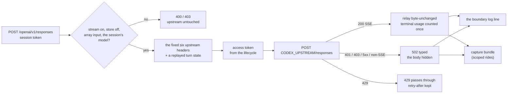
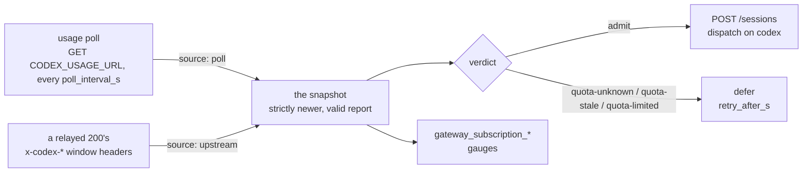
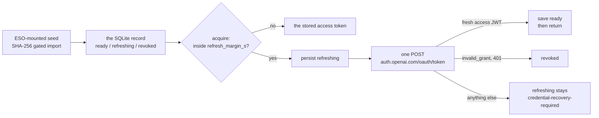

# POST /openai/v1/responses — the `responses` dialect, on the codex rail (lit 2026-10-22; every role since 2026-10-23)

The data-plane path a `codex` harness rides: OpenAI **Responses** over SSE (today's `openai`
dialect stays Chat Completions — [glossary: dialect](../glossary.md#dialect)). Only the `codex`
[rail](../glossary.md#rail) serves it — the operator's ChatGPT subscription. The rail was **lit on
2026-10-22** (FU-270) as the explicit canary cell (the deployed policy,
`argocd/resources/agent-gateway/policy.json`, listed `rails.codex` for the `prober` role only);
**since 2026-10-23 every role lists it** — the operator's ruling that subscriptions go to all
roles — and the walk reaches it without an explicit `harness: codex`
([GW-SESSIONS-ADMIT §The harness follows the cell](sessions.md#the-harness-follows-the-cell)).
A policy that declares the rail gets a credential backend only when `create_app` is handed a
credential store: production wires gateway-local SQLite seeded from the gateway's own login
(`devbox run codex-seed`) and the native refresh. The design and the prototype it was ported from:
[the Codex subscription-rail spike](../../../docs/spikes/codex-subscription-rail.md#gateway-prototype--isolated-build-2026-10-16-fu-270)
(FU-270) and `experiments/codex-rail/` (its native-CLI compat harness remains there).

Three things make a codex ride, and each is a section below with its own flowchart: **the ride**
(the request boundary, the header replacement, the stream and its capture), **the account** (the
[headroom](../glossary.md#headroom) snapshot that admits the rail, fed by the gateway's own usage
poll and by every relayed answer's headers) and **the credential** (the OAuth lifecycle behind the
[persistence interface](../glossary.md#persistence-interface) and its native refresh). Per
request: the session token is resolved ([GW-CRED-BOUNDARY](anthropic-messages.md#gw-cred-boundary));
the body's model is checked exactly ([GW-MODEL-RESOLVE](anthropic-messages.md#gw-model-resolve));
the body's mode is checked ([GW-RAIL-CODEX](#gw-rail-codex)); the access credential comes from the
OAuth lifecycle ([GW-CODEX-OAUTH](#gw-codex-oauth)); the stream relays byte-unchanged while a
bounded parser counts the terminal usage once.

## Interface — the machine half

**[`openai-responses.schema.json`](openai-responses.schema.json)** holds the inbound envelope the
gateway inspects, the upstream contract (the complete header set), the headroom report schema, the
admission reasons and the error envelope.

| Requirement | Governs (schema) | Error codes | Status |
|---|---|---|---|
| [GW-RAIL-CODEX](#gw-rail-codex) | `input.body` (`model`, `stream`, `store`, `input`), `upstream.codex`, `output` | `malformed-body`, `responses-mode-unsupported`, `responses-input-invalid`, `model-not-session`, `dialect-unsupported-on-rail`, `turn-state-invalid`, `upstream-auth`, `upstream-http-error`, `upstream-content-type`, `upstream-unreachable`, `upstream-timeout` | v0, lit 2026-10-22 — the upstream profile, vendor header compatibility and the live canary are `⚑ gap` (rows below); the `upstream-timeout` row `🚧 WIP` (clock-faked only); `⚑ gap (2026-10-16, PR #2646 → work #2650)`: native-CLI turn evidence is local-only (the "⚖ local evidence" row) |
| [GW-CODEX-CAPTURE](#gw-codex-capture) | `capture` (the bundle `GET /sessions/{id}/capture` answers; its records, sanitization rules and bounds) | `capture-not-found` | v0 — the scoped observer (FU-270, the spike §Recorded live protocol experiment): off unless `CODEX_CAPTURE_TASK_PREFIX` names a task prefix; the live bundle and the rows derived from it are the spike's |
| [GW-CODEX-HEADROOM](#gw-codex-headroom) | `headroom.report`, `headroom.verdicts` | — | v0 — the snapshot and its verdict; two report producers exist, both the gateway's own ([GW-CODEX-USAGE-POLL](#gw-codex-usage-poll), [GW-CODEX-UPSTREAM-HEADERS](#gw-codex-upstream-headers)); the jail's own report ingress stays `⚑ gap` |
| [GW-CODEX-ADMISSION](#gw-codex-admission) | `admission.reasons` | — | v0 — the verdict composed into the [GW-SESSIONS-ADMIT](sessions.md#gw-sessions-admit) walk; reservation is `⚑ gap` |
| [GW-CODEX-USAGE-POLL](#gw-codex-usage-poll) | `headroom.poll` | — | v0 — the gateway polls its own account (operator ruling 2026-10-19); two alerts read its counter |
| [GW-CODEX-UPSTREAM-HEADERS](#gw-codex-upstream-headers) | `headroom.upstream` | — | v0 — the second producer, read on the wire 2026-10-22 (the spike §The second ride) |
| [GW-CODEX-OAUTH](#gw-codex-oauth) | `upstream.codex.auth`, `credential_errors` | `credential-store-unavailable`, `credential-recovery-required`, `credential-revoked`, `credential-refresh-uncertain`, `credential-invalid`, `credential-unresolved`, `credential-transient` | gateway-local SQLite with hash-gated seed recovery; live durability remains unverified |
| [GW-CODEX-REFRESH](#gw-codex-refresh) | `refresh` | `credential-revoked`, `credential-refresh-uncertain`, `credential-recovery-required` | native transport wired; the deployed policy declares the rail (2026-10-22) |
| [GW-MODEL-RESOLVE](anthropic-messages.md#gw-model-resolve) (owned there) | `input.body.model` | `model-not-session` | linked — exact on this rail |
| [GW-CRED-BOUNDARY](anthropic-messages.md#gw-cred-boundary) (owned there) | `input.headers.authorization` | `session-unknown`, `session-expired`, `session-released` | linked |
| [GW-SESSIONS-ADMIT](sessions.md#gw-sessions-admit) (owned there) | `admission.reasons` | — | linked — the headroom defers are three more `defer.reason` values |
| [GW-SESSIONS-ENV](sessions.md#gw-sessions-env) (owned there) | — | — | linked — the codex harness's env rows |

## Flow overview

```mermaid
flowchart LR
  P["usage poll\nGET CODEX_USAGE_URL"] -->|a report| HR["headroom snapshot\nstrictly newer, valid"]
  XH["a relayed 200's\nx-codex-* headers"] -->|a report| HR
  HR --> AD{"POST /sessions\nverdict?"}
  AD -->|quota-unknown / stale / limited| DF["defer\nretry_after_s"]
  AD -->|admit| CS["credential state read\nready?"]
  CS --> RQ["POST /openai/v1/responses\nthe request boundary"]
  RQ --> HD["header replacement\n+ the turn state"]
  HD --> OA["access token\nthe OAuth lifecycle"]
  OA -->|inside the margin| RF["native refresh\nauth.openai.com"]
  OA --> UP["CODEX_UPSTREAM/responses"]
  UP -->|200 SSE| ST["relay byte-unchanged\nusage counted once"]
  UP -->|refused| FL["502 typed\nthe body hidden"]
  UP --> XH
  ST --> CP["capture bundle\n(scoped rides)"]
  click P href "#gw-codex-usage-poll" "The usage poll" _self
  click XH href "#gw-codex-upstream-headers" "The upstream headroom headers" _self
  click HR href "#gw-codex-headroom" "The headroom snapshot" _self
  click AD href "#gw-codex-admission" "Admission on headroom" _self
  click DF href "#gw-codex-admission" "Admission on headroom" _self
  click CS href "#admission-reads-the-durable-state" "The credential state at admission" _self
  click RQ href "#the-request-boundary" "The request boundary" _self
  click HD href "#header-replacement" "Header replacement" _self
  click OA href "#gw-codex-oauth" "The OAuth lifecycle" _self
  click RF href "#gw-codex-refresh" "The native refresh" _self
  click UP href "#upstream-failures" "Upstream failures" _self
  click ST href "#streams-and-usage" "Streams and usage" _self
  click FL href "#upstream-failures" "Upstream failures" _self
  click CP href "#gw-codex-capture" "The capture" _self
```

A session is admitted onto the rail on the account's [headroom](#gw-codex-headroom) — the
snapshot the [usage poll](#gw-codex-usage-poll) and every relayed answer's
[headers](#gw-codex-upstream-headers) feed — through [the admission](#gw-codex-admission); its
requests cross [the request boundary](#gw-rail-codex), carry the fixed upstream header set and the
access token [the lifecycle](#gw-codex-oauth) holds (rotated by [the native
refresh](#gw-codex-refresh) when it is near expiry), and the stream relays byte-unchanged; a scoped
ride leaves its [capture bundle](#gw-codex-capture).

## Requirement index

Every requirement of this page, in reading order; the section flowcharts below link into it.

| Requirement | Section | Status |
|---|---|---|
| [GW-RAIL-CODEX](#gw-rail-codex) | the ride | v0, lit 2026-10-22 — the upstream profile, vendor header compatibility and the live canary are `⚑ gap`; the `upstream-timeout` row `🚧 WIP` (clock-faked only); `⚑ gap (2026-10-16, PR #2646 → work #2650)`: native-CLI turn evidence is local-only |
| [GW-CODEX-CAPTURE](#gw-codex-capture) | the ride | v0 — the scoped observer; off unless `CODEX_CAPTURE_TASK_PREFIX` names a task prefix |
| [GW-CODEX-HEADROOM](#gw-codex-headroom) | the account | v0 — the snapshot and its verdict; the jail's own report ingress stays `⚑ gap` |
| [GW-CODEX-ADMISSION](#gw-codex-admission) | the account | v0 — reservation is `⚑ gap` |
| [GW-CODEX-USAGE-POLL](#gw-codex-usage-poll) | the account | v0 |
| [GW-CODEX-UPSTREAM-HEADERS](#gw-codex-upstream-headers) | the account | v0 |
| [GW-CODEX-OAUTH](#gw-codex-oauth) | the credential | gateway-local SQLite with hash-gated seed recovery; live durability remains unverified; cross-process fencing `⚑ gap` (FU-271) |
| [GW-CODEX-REFRESH](#gw-codex-refresh) | the credential | native transport wired; the deployed policy declares the rail (2026-10-22) |

## The ride — the request, the stream, its capture

### GW-RAIL-CODEX

The `codex` rail serves one shape: **streaming** Responses with **`store: false`** and an
**array** `input` — what the pinned Codex CLI sends (`experiments/codex-rail/evidence.json`). Any
other mode is a 400 before the credential is touched. The body's `model` must equal the session's
wire id exactly (absent = filled, as on every rail). Upstream: `<CODEX_UPSTREAM>/responses` — the
upstream base has **no default**; the deployment selects the native Codex backend
`https://chatgpt.com/backend-api/codex` (operator ruling 2026-10-19). SIWC is unselected. The
upstream base header set is **complete and fixed**, with the bounded [turn
state](../glossary.md#turn-state) exception below: `authorization: Bearer <access token>`,
`chatgpt-account-id: <the credential's account>`, `content-type: application/json`,
`accept: text/event-stream`, `accept-encoding: identity`, `user-agent: agent-gateway` — only a
previously issued turn state may return, so a caller can never select an account or smuggle a
cookie. A 200 SSE answer relays **byte-unchanged**; a parser bounded per event (1 MiB) watches for
the terminal event and counts its `usage` **once** into the four token classes (`in` =
`input_tokens` − `input_tokens_details.cached_tokens`, `cache_read` = the cached count, no
cache-write class, `out` = `output_tokens`; missing or malformed usage is unknown — nothing
counted, never a zero claimed). `response.failed` / `response.incomplete` / `error` keep their own
outcome; EOF or `[DONE]` without a terminal is **truncated**; an invalid or oversized event **ends
the stream** before its bytes reach the client ⚖ (the client's own completion check sees the
missing terminal; the gateway never invents an event). Upstream is closed exactly once on every
path — completion, failure, client cancellation — and a generation is never retried once a byte
reached the client.

**World: [policy-codex](../worlds/README.md#the-codex-rails-fakes-tests_codex_worldpy)** — the
codex fake backend answers `upstream-ok` unless a row's `upstream` cell names another behaviour;
the credential is the FAKE store's, one second from expiry, so a ride's first request rotates it
once. "A codex session" = `POST /sessions {role: prober, harness: codex}` after a fresh headroom
observation (20 % / 64 %).

#### The request boundary

Legend: `body` = the accepted body `{stream: true, store: false, input: [...], model:
fixture-model}` (`accepted`) or the one field that deviates from it; `upstream_calls?` = requests
the backend received; `upstream_model?` = the `model` the backend received (`—` = no call).

| description | body | status? | code? | upstream_calls? | upstream_model? |
|---|---|---|---|---|---|
| a streaming, store-off, array-input request lands | `accepted` | 200 | — | 1 | `fixture-model` |
| an absent model is filled with the wire id | `model absent` | 200 | — | 1 | `fixture-model` |
| another model is refused | `model: gpt-other` | 403 | `model-not-session` | 0 | — |
| a non-streaming request is refused | `stream: false` | 400 | `responses-mode-unsupported` | 0 | — |
| server-side storage is refused | `store: true` | 400 | `responses-mode-unsupported` | 0 | — |
| a string input is refused | `input: "hi"` | 400 | `responses-input-invalid` | 0 | — |
| a body that is not a JSON object | `[]` | 400 | `malformed-body` | 0 | — |

Legend: `session` = whose [session token](../glossary.md#session-token) the request carries
(`none` = no `Authorization` header; `codex` = a codex session; `opencode worker` = a worker
session on the opencode rail); `path` = the data-plane path called.

| description | session | path | status? | code? | upstream_calls? |
|---|---|---|---|---|---|
| no session token | `none` | `/openai/v1/responses` | 401 | `session-unknown` | 0 |
| a codex session on the chat path | `codex` | `/openai/v1/chat/completions` | 501 | `dialect-unsupported-on-rail` | 0 |
| a non-codex session on the responses path | `opencode worker` | `/openai/v1/responses` | 501 | `dialect-unsupported-on-rail` | 0 |

#### Header replacement

Legend: `inbound` = the header(s) the caller sends beside the session token; `upstream?` = what
the backend received for them. Every row's upstream header set is exactly the six above plus the
transport's `host`, `content-length`, `connection`.

| description | inbound | upstream? |
|---|---|---|
| the session token becomes the rail's access token | `Authorization: Bearer gws_…` | `authorization: Bearer <the rotated access token>` |
| the account comes from the credential, never the caller | `ChatGPT-Account-ID: attacker` | `chatgpt-account-id: dummy-account` |
| no inbound header crosses ⚖ | `Cookie, x-api-key, x-foo, User-Agent: codex_exec/…, OpenAI-Beta` | `none of them; user-agent: agent-gateway` |
| the stream is asked for unencoded ⚖ | `Accept-Encoding: gzip` | `accept-encoding: identity; accept: text/event-stream` |

#### Opaque turn state

`x-codex-turn-state` is the sole optional routing-header round trip. The gateway records only
an upstream-issued value from a successful SSE response, bound to the authenticated session, the
gateway-owned account and the pinned client's `client_metadata.turn_id`. A new turn clears it.
The first value wins within a turn (the native client's OnceLock behaviour). A request may return
only that exact value; otherwise 400 `turn-state-invalid`, without an inference call. No account
header, cookie or other caller header crosses. A missing or invalid turn id disables state
issuance. Restart or eviction requires a fresh turn; state is not durable. ⚖ Bounds: printable
ASCII, 4096 bytes for state, 128 for the turn id, 1024 session entries (LRU). An oversized or
invalid upstream state is dropped. A delayed old-turn response cannot install state into the newer
turn. These are gateway judgments, not vendor limits.

Legend: `sequence` = what the backend issues and what the client replays, in order (`issue` = the
backend answers the first turn with a state value); `client_state?` = the state header the client
received on the first turn; `replay?` = the replayed request's fate (`accepted` = 200 and the
backend saw the header; `refused` = 400 `turn-state-invalid`, no backend call);
`backend_calls?` = the backend's calls after the replay.

| description | sequence | client_state? | replay? | backend_calls? |
|---|---|---|---|---|
| same session and turn | `issue, replay` | `the issued state` | `accepted` | 2 |
| another session | `issue, cross-session replay` | `the issued state` | `refused` | 1 |
| new turn clears state | `issue, next-turn replay` | `the issued state` | `refused` | 1 |
| forged state | `no issue, replay` | `none` | `refused` | 1 |
| oversized state ⚖ | `issued 4097 bytes, replay` | `none` | `refused` | 1 |
| delayed old turn response ⚖ | `old turn held, new turn done, old answers with state, replay` | `none` | `refused` | 2 |

#### Streams and usage

Legend: `upstream` = the fake backend's behaviour ([worlds](../worlds/README.md#the-codex-rails-fakes-tests_codex_worldpy));
`client_bytes?` = the client's bytes against the upstream's; `outcome?` = the relay outcome the
log line carries; `tokens?` = `in / cache_read / cache_write / out` recorded on the session's one
request; `status?` = the recorded status.

| description | upstream | client_bytes? | outcome? | status? | tokens? |
|---|---|---|---|---|---|
| a completed stream relays byte-unchanged and counts once | `upstream-ok` | `identical` | `completed` | 200 | `7 / 0 / 0 / 3` |
| cached input is its own class ⚖ | `upstream-ok-cached` | `identical` | `completed` | 200 | `12 / 300 / 0 / 7` |
| a second terminal event never replaces usage | `upstream-stream-duplicate` | `identical` | `completed` | 200 | `7 / 0 / 0 / 3` |
| a failed terminal is not a completion ⚖ | `upstream-stream-failed` | `identical` | `failed` | 200 | `7 / 0 / 0 / 3` |
| an incomplete terminal is not a completion ⚖ | `upstream-stream-incomplete` | `identical` | `incomplete` | 200 | `7 / 0 / 0 / 3` |
| EOF without a terminal is truncation ⚖ | `upstream-stream-truncated` | `identical` | `truncated` | 502 | `0 / 0 / 0 / 0` |
| an invalid event ends the stream before its bytes ⚖ | `upstream-stream-invalid` | `a prefix of the events before it, never it` | `protocol-error` | 502 | `0 / 0 / 0 / 0` |

#### Upstream failures

Legend: `upstream` as above (`upstream-down` = the connection fails before any byte;
`upstream-slow` = the read passes the read timeout, clock-faked); `code?` = the error envelope's
code (`—` = not an error envelope: the upstream body passes through); `retry_after?` = the
`retry-after` header the client received.

| description | upstream | status? | code? | retry_after? | upstream_calls? |
|---|---|---|---|---|---|
| an upstream 401 is typed and hidden | `upstream-401` | 502 | `upstream-auth` | — | 1 |
| an upstream 403 is the same class | `upstream-403` | 502 | `upstream-auth` | — | 1 |
| a rate limit passes through ⚖ | `upstream-429` | 429 | — | 30 | 1 |
| an upstream 5xx is typed ⚖ | `upstream-500` | 502 | `upstream-http-error` | — | 1 |
| a redirect is never followed | `upstream-302` | 502 | `upstream-http-error` | — | 1 |
| a non-SSE 200 is refused ⚖ | `upstream-wrong-type` | 502 | `upstream-content-type` | — | 1 |
| an unreachable upstream is typed | `upstream-down` | 502 | `upstream-unreachable` | — | 0 |
| 🚧 WIP: a read past the read timeout | `upstream-slow` | 504 | `upstream-timeout` | — | 0 |

#### The boundary log line

At the "upstream response received" boundary the gateway writes ONE line: INFO when a 200 arrives
without a `content-type` header (the live backend's shape — relayed as a stream; the bounded
parser's `protocol-error` is the guard against a non-SSE body) ⚖; ERROR when the answer is refused,
carrying `content-type=`, `length=`, the response header NAMES and `body=` — ≤ 512 printable bytes
of ≤ 4 KiB read, non-printables escaped, `…(+N bytes)` when cut; the GW-REDACT formatter scrubs
the rendered line ⚖ (the live-canary capture of the spike §Recorded live protocol experiment; the
first ride, 2026-10-22 21:54Z, answered 200 non-SSE and the log said only "upstream 200"). An auth
refusal's body is never read — not into the log either.

Legend: `log_line_contains?` = fragments of that one line, `·`-separated, each contained in it.

| description | upstream | status? | log_line_contains? |
|---|---|---|---|
| a 200 with no content-type is relayed as a stream ⚖ | `upstream-ok-no-ctype` | 200 | `codex upstream 200 without a content-type — relayed as a stream` |
| a refused answer is captured: content-type, header names, a bounded preview ⚖ | `upstream-wrong-type` | 502 | `upstream-content-type codex 200 · content-type='application/json' · headers=[ · body='{"output":[]}'` |
| a 5xx body is previewed too | `upstream-500` | 502 | `upstream-http-error codex 500 · body='{"error":"boom"}'` |
| an auth refusal's body is never read, not even into the log | `upstream-401` | 502 | `upstream-auth codex 401 · <not read: auth>` |

#### The relay seam: event grammar

The relay (`responses.relay`) parses SSE by its grammar, whatever the chunking: a CRLF stream, a
multi-line `data:` field, a terminal after megabytes of deltas. Legend: `chunks` = the synthetic
upstream chunks fed to the relay; `tokens?` = `in / out` counted from the terminal (`unknown` =
nothing counted); `bytes_out?` = the consumer's bytes against the chunks; `closes?` = upstream
closes.

| description | chunks | outcome? | tokens? | bytes_out? | closes? |
|---|---|---|---|---|---|
| every byte split of a CRLF stream parses | `a heartbeat + one completed event in CRLF, split at every offset` | `completed` | `7 / 3` | `identical` | 1 |
| a multi-line data field is one event | `one completed event over two data: lines, one byte per chunk` | `completed` | `unknown` | `identical` | 1 |
| terminal usage after 4 MiB of deltas is counted | `100000 delta events, a terminal, a second terminal` | `completed` | `7 / 3` | `identical` | 1 |
| malformed usage is unknown, not zero | `a terminal with input_tokens: true, output_tokens: -1` | `completed` | `unknown` | `identical` | 1 |
| [DONE] alone is truncation | `data: [DONE]` | `truncated` | `unknown` | `identical` | 1 |

#### The relay seam: the stream ends

Legend: `chunks` as above; `bytes_out?` = what reached the consumer (`none` = not a byte of it);
`pulled?` = the chunks pulled from upstream (`all`; `the first chunk only`); `closes?` = upstream
closes.

| description | chunks | outcome? | bytes_out? | pulled? | closes? |
|---|---|---|---|---|---|
| an oversized event is refused ⚖ | `one 1025-byte event, bound 512` | `protocol-error` | `none` | `all` | 1 |
| a completed event with another status is invalid | `response.completed with status: failed` | `protocol-error` | `none` | `all` | 1 |
| a non-object event is invalid | `data: []` | `protocol-error` | `none` | `all` | 1 |
| a transport fault mid-stream is sanitised | `one chunk, then the transport raises with secret text` | `transport-error` | `the first chunk` | `all` | 1 |
| a cancelled download closes upstream without draining | `the consumer stops after the first chunk` | `cancelled` | `the first chunk` | `the first chunk only` | 1 |
| a consumer that stops after the terminal event keeps the terminal outcome ⚖ | `the consumer stops after the completed event, a trailer still queued` | `completed` | `the completed event` | `the first chunk only` | 1 |

The last row is the live native CLI's shape (2026-10-22 22:57Z: both requests of the first
completed canary turn were recorded `cancelled` / 499 with their usage counted).

#### Live grammar — captured 2026-10-23

The rows the first [capture bundle](../glossary.md#capture-bundle) derived (the spike
[§The capture ride](../../../docs/spikes/codex-subscription-rail.md#the-capture-ride--2026-10-23-1012z-fu-270):
a tool-call turn and its continuation through the live backend, task `capture-codex-20261023T100750Z`).
The fixture [`tests/fixtures/codex-live/turn-2026-10-23.json`](../../tests/fixtures/codex-live/turn-2026-10-23.json)
is the reviewed bundle's STRUCTURE — header names, event types / sizes / relative times, item types
and tool names, the terminal's usage numbers; no prompt text, no identifier, no credential (the bundle
withholds them by construction). Provenance of each row: live observation, replayed offline against the
fake backend — presence and compatibility for that run, never necessity (the plan's rule).

Legend: `fixture` = the slice of the bundle the row replays; `result?` = what the replay showed.

| description | fixture | result? |
|---|---|---|
| the pinned CLI's own request headers never cross — the live set ⚖ | `the CLI's own request header names: originator, session-id, thread-id, x-client-request-id, x-codex-beta-features, x-codex-turn-metadata, x-codex-window-id, x-openai-internal-codex-responses-lite` | `200; none of them crossed; the upstream set is exactly the six (+ transport)` |
| the lite protocol's input items pass the body check | `the lite protocol's items: additional_tools, developer and user message, custom_tool_call, custom_tool_call_output; no top-level tools; include, reasoning, text, prompt_cache_key, client_metadata, parallel_tool_calls: false, tool_choice: auto` | `200; the body crossed unchanged, the model the session's` |
| the live turn's event grammar relays and completes with the ledger's usage | `the 78-event tool-call turn: response.created → in_progress → a message item (output_text.delta ×9) → a custom_tool_call exec (custom_tool_call_input.delta ×57) → response.metadata → response.completed; usage 10683 in / 9088 cached / 83 out + a vendor attribution extension` | `completed, byte-identical, one close; counted 1595 / 9088 / 83 = the live client-response usage` |

#### Named gaps and local evidence

| description | input | v0 answer | the gap |
|---|---|---|---|
| "⚑ gap: SIWC profile (unselected)" | SIWC credentials | unsupported | separate grant and tool-shape contract required |
| "⚑ gap: live vendor header compatibility" | real native backend | offline round trip only | live canary must establish whether other headers are required |
| "⚑ gap: the live canary" | a real account | never run | spike step 4 — a separately authorized maintenance window |
| "⚖ local evidence: the pinned Codex CLI completes a turn through this gateway" | `experiments/codex-rail/compat.py` (codex-cli 0.161.0, the agent-runtime lock) | a completed `codex exec --json` turn, one rotation, one upstream close | not CI: the CLI is not in the CI toolchain — dated local evidence in `experiments/codex-rail/evidence.json` |

The pinned CLI's direct backend calls beside the relay (the 2026-10-23 capture ride: 14.2 POLICY_DENIED SYNs each to `chatgpt.com` / `ab.chatgpt.com`) are gone since the gateway-render opt-outs (agent-runtime#181, agent-base `2026.10.23-g79d146c8caac`): 0 by the same query on the 20:09Z ride, both turns completed — live evidence from one dated ride, not a row ([the spike §The opt-out ride](../../../docs/spikes/codex-subscription-rail.md#the-opt-out-ride--2026-10-23-2009z-fu-270)); a CLI bump that adds a call is caught by `AgentWorkerEgressDropped`.

Evidence — latest run

--8<-- "GW-RAIL-CODEX.md"

### GW-CODEX-CAPTURE

The four-boundary capture of a codex ride ([the spike §Recorded live protocol experiment](../../../docs/spikes/codex-subscription-rail.md#recorded-live-protocol-experiment--2026-10-22-fu-270),
FU-270): the observer the experiment plan asked for, so a live ride yields evidence at **client
request received**, **upstream request sent**, **upstream response received** (its status and
headers, then every SSE event as it is relayed) and **client response sent** — egress-only capture
cannot show what the gateway discarded, ingress-only cannot show what the backend saw. The recorder
is **scoped**: only a session whose task carries the configured prefix (`CODEX_CAPTURE_TASK_PREFIX`;
unset = off, the default) is recorded; the jail's `canary-codex.sh --capture` names its task so.
It is **passive**: the relay yields every chunk unchanged before the tap splits it into events; it
never buffers a response, never delays or replays a request, and a recorder fault is a log line, not
a ride outcome. It **sanitizes before persistence, structurally** (⚖ never the log formatter's
pattern matching, GW-REDACT is the second belt): header values are kept only for an allowlist of
non-sensitive names (content negotiation, transport, the `x-codex-*` headroom percentages the gateway
already reads as a report, the plan vocabulary) — every other header keeps its name with its value
withheld and its length; in bodies and events every string becomes its length except the vocabulary
keys (`type`, `status`, `role`, `name`, `model`, `object`, `code`, …) whose values are enumerations or
public names, and identifier keys (`id`, `*_id`) whose values become run-local aliases (`call#1`)
equal across all four boundaries of a session; numbers, booleans and structure stay; unknown keys
keep their presence and type. It is **bounded**: `CODEX_CAPTURE_MAX_BYTES` per request (default
256 KiB); overflow writes one `truncated` marker and the bundle says `complete: false` — a missing
record is never an observed absence; a ride the gateway itself refuses persists its `client-response`
too, and concurrent requests of one session (a side call beside the main stream) persist back to
back under their own `request` ordinal. Records persist in the gateway's own store (table `captures`,
`CODEX_CAPTURE_RETENTION_DAYS`, default 7) and are read back as one
[capture bundle](../glossary.md#capture-bundle) by `GET /sessions/{id}/capture` under the session's
lookup rule ([GW-SESSIONS-AUTH](sessions.md#gw-sessions-auth) route `lookup`: the admitting caller
or a judge). The bundle is pulled into restricted storage and REVIEWED before any excerpt becomes a
spike paragraph or a fixture; ⚖ the gateway-owned usage poll is not in it (its own log lines and
counters are its instrumentation, [GW-CODEX-USAGE-POLL](#gw-codex-usage-poll)).

**World: [policy-codex](../worlds/README.md#the-codex-rails-fakes-tests_codex_worldpy)** with the
recorder scoped to tasks `capture-*` (`prefix` = `capture-`) unless a row says otherwise; every
value a row shows is the fake backend's.

#### Which rides are recorded

Legend: `task` = the session's task; `prefix` = `CODEX_CAPTURE_TASK_PREFIX` (`(unset)` = the
recorder off); `bundle?` = what `GET /sessions/{id}/capture` answers; `boundaries?` = the record
boundaries in order (`—` = no bundle).

| description | task | prefix | bundle? | boundaries? |
|---|---|---|---|---|
| a scoped ride is recorded at the four boundaries, in order | `capture-t1` | `capture-` | `200, complete, format codex-capture/1, t_ms ascending` | `client-request, upstream-request, upstream-response, upstream-event…, client-response` |
| an unscoped session has no capture | `oracle-562-probe` | `capture-` | `404 capture-not-found` | — |
| the recorder off by default captures nothing ⚖ | `capture-t1` | `(unset)` | `404 capture-not-found` | — |

#### What a record holds

Legend: `ride` = the request and the backend's answer (`upstream-ok` unless named);
`max_bytes` = `CODEX_CAPTURE_MAX_BYTES`; `record?` = what the bundle's records show.

| description | ride | max_bytes | record? |
|---|---|---|---|
| credentials never land in the capture ⚖ | `the backend echoes a DUMMY-SECRET cookie and request id` | 262144 | `authorization, chatgpt-account-id, set-cookie, x-request-id: names kept, values withheld; content-type and accept kept; no canary, no session token anywhere` |
| strings are lengths, vocabulary is kept, identifiers are aliases ⚖ | `input text hi, a function_call_output with call_id, a tool rg` | 262144 | `text → {"len": 2}; type, role, name verbatim; call_id → call#1 at both request boundaries, the raw id nowhere` |
| the stream's events are recorded in order with their usage | `upstream-ok` | 262144 | `event n 1…N in relay order, response.created … response.completed, the terminal's usage as numbers; client-response relayed_bytes = the client's bytes, events = N` |
| the capture is bounded; overflow marks the bundle incomplete and the ride is unaffected ⚖ | `upstream-ok` | 600 | `complete: false, one truncated marker; the ride 200 with the whole stream` |

#### Refusals and concurrency

Legend: `ride` as above; `boundaries?` = the records' boundaries (`all four` = the scoped ride's
full set); `client_response?` = the `client-response` record's status and outcome.

| description | ride | boundaries? | client_response? |
|---|---|---|---|
| a refused answer is captured as a refusal | `upstream-wrong-type` | `all four; upstream-response.refusal = upstream-content-type` | `502 upstream-content-type` |
| a 429 is captured as the rate limit it is | `upstream-429` | `all four` | `429 rate-limited` |
| a gateway-side refusal is captured as a refusal ⚖ | `a body naming another model` | `client-request, client-response; nothing upstream` | `403 model-not-session` |
| two requests in flight in one session persist back to back | `two requests, the first held until the second completes` | `both requests' four, under request 1 and 2; requests: 2, complete` | `200, 200` |

A gateway-side refusal leaves a record because the plan's rule is that a missing record is never an
observed absence; the `seq` range is allocated at persist time under a lock, so a collision is a
loud INSERT failure, never a replaced record.

#### Who reads the bundle

Legend: `reads` = the reads made; `answer?` = their statuses (the world's control plane observes; an
enforcing one refuses both alike — [GW-SESSIONS-AUTH](sessions.md#gw-sessions-auth)).

| description | reads | answer? |
|---|---|---|
| the bundle is read under the session's lookup rule | `GET /sessions/nope/capture; GET /sessions/{id} and its /capture with a token that is no caller's` | `404 session-not-found; the capture's status = the lookup's status` |

Evidence — latest run

--8<-- "GW-CODEX-CAPTURE.md"

## The account — headroom as the rail's admission

### GW-CODEX-HEADROOM

The rail is admitted on **account [headroom](../glossary.md#headroom)**, held by the gateway
itself (no Prometheus read, ADR-108): one immutable snapshot of normalised windows, replaced only
by a **strictly newer**, valid [headroom report](../glossary.md#headroom-report). The report
schema is the gateway's own (`headroom.report` in the schema), not a vendor payload; a producer must
be authenticated and account-bound. Two producers exist today, both the gateway's own and
account-bound by construction — the usage poll ([GW-CODEX-USAGE-POLL](#gw-codex-usage-poll)) and
the headroom headers of every relayed answer ([GW-CODEX-UPSTREAM-HEADERS](#gw-codex-upstream-headers));
a third, the jail's own `rate_limits` report, is a `⚑ gap`. A fresh gateway answers
`quota-unknown` until a report is accepted (fail closed); the headroom is forgotten with the
process. Freshness (`max_age_s`), the ceiling and the window profile are policy
(`rails.codex.headroom`) ⚖ — never code literals. Verdicts: `admit`, `quota-unknown`,
`quota-stale` (past freshness, a clock rollback, or a window's reset passed — a reset passing is
not evidence capacity returned), `quota-limited` (a window at or above the ceiling, or the
explicit `limited` flag).

**World: [policy-codex](../worlds/README.md#the-codex-rails-fakes-tests_codex_worldpy)** — the
experiment's fixture profile: `max_age_s` 120, ceiling 0.95, the 300- and 10080-minute windows;
rows drive the `Headroom` seam with a clock at `T`.

#### A report replaces the snapshot

Legend: `last_accepted` = the report the snapshot holds when the row starts (`none` = a fresh
instance); `report` = the report(s) offered, `source, observed_at, 5h % / 7d %`; `accepted?` =
`accepted`, the refusal code, or `—` (nothing offered); `snapshot?` = the windows the snapshot
holds after (`none`; `limited` = the explicit flag set).

| description | last_accepted | report | accepted? | snapshot? | verdict? |
|---|---|---|---|---|---|
| a fresh two-window report admits and normalises | `none` | `poll, T−10, 20 % / 64 %` | `accepted` | `0.2 / 0.64` | `admit` |
| no report yet is unknown | `none` | `none` | — | `none` | `quota-unknown` |
| a gateway restart forgets | `poll, T−10, 20 % / 64 % (on the old instance)` | `none` | — | `none` | `quota-unknown` |
| an equal or older timestamp cannot overwrite | `poll, T−10, 20 % / 64 %` | `T−10, T−11, T−110 — each limited` | `quota-out-of-order` | `0.2 / 0.64` | `admit` |
| a newer report from another source replaces | `poll, T−10, 20 % / 64 %` | `jail, T−1, limited` | `accepted` | `0.2 / 0.64, limited` | `quota-limited` |

#### A malformed report is refused

Legend: `last_accepted` as above; `report` = the field(s) the offered report carries;
`refused?` = the refusal code every variant answers; `verdict?` = the verdict after.

| description | last_accepted | report | refused? | verdict? |
|---|---|---|---|---|
| a report at the freshness bound is refused | `poll, T−10, 20 % / 64 %` | `observed_at T−120` | `quota-time-invalid` | `admit` |
| a future report is refused | `poll, T−10, 20 % / 64 %` | `observed_at T+1` | `quota-time-invalid` | `admit` |
| a non-finite or bool timestamp is refused | `poll, T−10, 20 % / 64 %` | `observed_at true / NaN / ∞` | `quota-time-invalid` | `admit` |
| a missing or duplicated window is refused | `none` | `windows: [] / the 5h window twice` | `quota-invalid` | `quota-unknown` |
| a window outside the profile is refused | `none` | `window_minutes: 301 / true` | `quota-invalid` | `quota-unknown` |
| an out-of-range or non-finite percentage is refused | `none` | `used_percent −1 / 101 / true / NaN / ∞` | `quota-invalid` | `quota-unknown` |
| an already-passed reset is refused | `none` | `resets_at ≤ T / true / NaN` | `quota-invalid` | `quota-unknown` |
| an unknown source or a non-bool flag is refused | `none` | `source: untrusted / limited: 0 / not an object` | `quota-invalid` | `quota-unknown` |

#### The verdict

Legend: `snapshot` = the accepted report's windows, observed at `T−10` (`limited` = the explicit
flag); `now` = the clock when the verdict is asked.

| description | snapshot | now | verdict? |
|---|---|---|---|
| a window at the ceiling limits | `95 % / 64 %` | `T` | `quota-limited` |
| either window limits | `20 % / 95 %` | `T` | `quota-limited` |
| the explicit flag limits | `20 % / 64 %, limited` | `T` | `quota-limited` |
| the freshness bound is stale ⚖ | `20 % / 64 %` | `T+110 (age 120)` | `quota-stale` |
| a clock rollback is stale | `20 % / 64 %` | `T−20` | `quota-stale` |
| a reset passing is stale, not replenished ⚖ | `20 % / 64 %, the 5h window resets at T+10` | `T+10` | `quota-stale` |

#### Gauges

An ACCEPTED report from either producer — and only one — sets the two subscription gauges of
[GW-METRICS](metrics.md#gw-metrics) for `rail="codex"`, one series per profile window:
`gateway_subscription_utilization` = `used_percent / 100`, `gateway_subscription_reset_seconds` =
`resets_at`. The `window` label is the profile's minutes spelled in the metrics vocabulary (300 →
`5h`, 10080 → `7d`) — the policy profile decides which series exist, and a profile minute the
vocabulary lacks renders `other` like any out-of-set label value ⚖. A refused report reaches no
gauge; a fresh gateway renders no codex series until a report is accepted. The Grafana panels on
UID `claude-subscription` (the "Codex subscription (gateway headroom)" row) read these series.

Legend: the clock is `now` = 1800000000; `reports` = the reports offered, in order;
`utilization?` / `reset_seconds?` = the `5h` / `7d` series of each gauge (`absent` = no series).

| description | reports | utilization? | reset_seconds? |
|---|---|---|---|
| an accepted report renders both gauges per window | `poll, now−10, 20 % / 64 %, resets now+1000 / now+8000` | `0.2 / 0.64` | `1800001000 / 1800008000` |
| a refused report leaves the gauges unchanged ⚖ | `the same, then an older report 99 % / 99 % limited (refused quota-out-of-order)` | `0.2 / 0.64` | `1800001000 / 1800008000` |
| a fresh gateway renders no codex series | `none` | `absent` | `absent` |

#### The window label

Legend: `profile_minutes` = the windows of one accepted report; `labels?` = the `window` label
values rendered on `rail="codex"`.

| description | profile_minutes | labels? |
|---|---|---|
| the window label is the profile's minutes in the window vocabulary ⚖ | `300, 10080, 1440, 90` | `5h, 7d, other` |

| description | input | v0 answer | the gap |
|---|---|---|---|
| "⚑ gap: authenticated report ingress ⚖" | a jail `rate_limits` event | does not reach the gateway — the poll and the upstream headers are the producers | the token-gated jail ingest (spike §Candidate shape) |

Evidence — latest run

--8<-- "GW-CODEX-HEADROOM.md"

### GW-CODEX-ADMISSION

A non-`admit` [headroom](../glossary.md#headroom) verdict skips the rail in the
[GW-SESSIONS-ADMIT](sessions.md#gw-sessions-admit) walk; when it was the last candidate the answer
is [defer](../glossary.md#defer) with that verdict as `reason`. `retry_after_s`: for
`quota-limited` by windows, the **latest** reset among the exhausted windows minus now (every
exhausted window must reset); otherwise the policy's `defer_retry_s` (a new observation is the
cure). Headroom is checked before the credential store is read, and it reserves nothing ⚖; the
rail's `max_sessions` cap still applies, and an admitted session is never re-gated on the data
plane — an upstream 429 is the in-session signal.

**World: [policy-codex](../worlds/README.md#the-codex-rails-fakes-tests_codex_worldpy)** —
`defer_retry_s` 60 (the loader's default), `max_sessions` 2; the clock at `T`, the report observed
at `T−10` with its 5h / 7d windows resetting at `T+1000` / `T+8000`.

#### The verdict in the walk

Legend: `headroom` = the observation the snapshot holds (`none`; `5h % / 7d %`, `limited`) and the
clock when `POST /sessions {role: prober, harness: codex}` is asked (`asked at T+115` = the report
is 125 s old); `decision?` / `reason?` / `retry_after_s?` = the answer's fields (`—` = absent).

| description | headroom | decision? | reason? | retry_after_s? |
|---|---|---|---|---|
| fresh headroom admits the codex harness | `20 % / 64 %` | `dispatch` | — | — |
| no observation defers unknown | `none` | `defer` | `quota-unknown` | 60 |
| a stale observation defers stale | `20 % / 64 %, asked at T+115` | `defer` | `quota-stale` | 60 |
| an exhausted window defers until its reset ⚖ | `96 % / 64 %` | `defer` | `quota-limited` | 1000 |
| two exhausted windows wait for the later reset ⚖ | `96 % / 97 %` | `defer` | `quota-limited` | 8000 |
| the explicit flag alone defers by the policy interval ⚖ | `20 % / 64 %, limited` | `defer` | `quota-limited` | 60 |

#### The gate's place in the walk

Legend: `headroom` as above; `arranged` = what else the row sets up; `answer?` = what the gateway
answered.

| description | headroom | arranged | answer? |
|---|---|---|---|
| headroom is read before the credential store ⚖ | `none` | `the store's lock raises` | `defer quota-unknown; store reads 0` |
| the rail's session cap still applies | `20 % / 64 %` | `2 codex sessions active (max_sessions 2)` | `defer rail-capacity, retry_after_s 60` |
| an admitted session is not re-gated on the data plane ⚖ | `20 % / 64 %, then 99 % / 99 % limited` | `a session dispatched before the limited report` | `the ride 200, one upstream call` |

| description | input | v0 answer | the gap |
|---|---|---|---|
| "⚑ gap: reservation" | two admissions at 94 % | both dispatched | reports do not meter concurrent use; the session cap is the only bound |

Evidence — latest run

--8<-- "GW-CODEX-ADMISSION.md"

### GW-CODEX-USAGE-POLL

The gateway polls the account usage endpoint **itself** — the one credential owner observes its
own account (the operator ruling of 2026-10-19: the account is enrolled in the gateway, so no second
reader holds its token). Every `poll_interval_s` (policy, required, strictly below `max_age_s` so a
healthy schedule never goes stale ⚖) one `GET CODEX_USAGE_URL` (no default; unset = no poll, the
rail stays `quota-unknown`) goes out with `authorization: Bearer <access_token>` and
`chatgpt-account-id`, through `Lifecycle.acquire()` — so a poll inside the refresh margin rotates
the credential exactly like a request would, under the same lock. The answer is translated into a
[headroom report](../glossary.md#headroom-report) (`source: poll`, `observed_at` = now):
`rate_limit.limit_reached || !allowed` → `limited`; each of `primary_window` / `secondary_window` →
`{used_percent, resets_at: reset_at, window_minutes: limit_window_seconds / 60}` (the native
client's basis is the absolute `reset_at`, so is this one's ⚖). A null window is **omitted**, which
the profile check refuses whole — a missing window is unknown, never zero. The payload shape is the
2026-10-22 observation (the spike §Live usage payload shape; `tests/fixtures/codex-usage-observed.json`
mirrors it with synthetic values); the identity fields it carries (`account_id`, `email`, `user_id`)
are never read, logged, attached or rendered. Every outcome is counted on
`gateway_codex_usage_poll_total{outcome}` ([GW-METRICS](metrics.md#gw-metrics)): the family exists
only while the policy DECLARES the codex rail (an undeclared rail renders no series, so the
silent-poll alert cannot fire on it) and then every outcome renders from 0; a refused or failed poll
leaves the last ACCEPTED report standing.

**World: [policy-codex](../worlds/README.md#the-codex-rails-fakes-tests_codex_worldpy)** —
`poll_interval_s` 30 under `max_age_s` 120; the fake usage endpoint answers the observed shape with
synthetic values; the clock at `T`, the stored credential expiring at `T+1`.

#### The answer becomes a report

Legend: `answer` = the endpoint's status and the field(s) that matter (`/`-separated variants are
each offered to the poll); `outcome?` = the poll's counted outcome; `verdict?` = the headroom
verdict after.

| description | answer | outcome? | verdict? |
|---|---|---|---|
| the observed shape is accepted, admits and renders the gauges | `200, 20 % / 64 % (5h / 7d), allowed` | `accepted` | `admit` |
| the vendor's limit_reached flag limits | `200, limit_reached: true` | `accepted` | `quota-limited` |
| a not-allowed answer limits | `200, allowed: false` | `accepted` | `quota-limited` |
| a missing window is refused whole — unknown, never zero ⚖ | `200, secondary_window: null` | `quota-invalid` | `quota-unknown` |
| a window outside the profile is refused | `200, limit_window_seconds: 86400` | `quota-invalid` | `quota-unknown` |
| a non-bool flag or a non-integer window field is refused | `200, allowed: 1 / used_percent: 20.5 / reset_at: "soon" / rate_limit: []` | `quota-invalid` | `quota-unknown` |
| identity never leaves the poll | `200 with DUMMY account / email / user ids` | `accepted` | `admit` |

The identity row's report carries exactly `observed_at`, `source`, `limited`, `windows`, and no log
line at DEBUG carries an identity value.

#### A failed poll leaves the last report standing

Legend: `last_report` = the snapshot before the poll (`accepted` = one accepted poll, 5 s earlier;
`none`); `answer` as above (`(the store)` = the endpoint is never contacted); `outcome?` = the
counted outcome per variant; `verdict?` after.

| description | last_report | answer | outcome? | verdict? |
|---|---|---|---|---|
| an upstream 401 is counted and changes nothing ⚖ | `accepted` | `401` | `upstream-auth` | `admit` |
| a 429 or 500 is an http error, nothing accepted | `none` | `429 / 500` | `upstream-http-error` | `quota-unknown` |
| an unreachable endpoint and a timeout are told apart | `none` | `connect error / read timeout` | `upstream-unreachable / upstream-timeout` | `quota-unknown` |
| a non-JSON, wrong-type or oversize body is refused ⚖ | `none` | `text/html / application/json that is not JSON / 70 KiB (bound 64 KiB)` | `upstream-content-type` | `quota-unknown` |
| a store that does not answer is transient; a recovery marker is unresolved | `none` | `(the store)` | `credential-transient / credential-unresolved` | `quota-unknown` |

A usage 401 alone is no revocation evidence (the spike §Refresh and headroom implications): it is
counted, never a credential verdict.

#### The poll's owner and schedule

Legend: `arranged` = the row's setup; `result?` = what the poll did.

| description | arranged | result? |
|---|---|---|
| the poll rides the lifecycle: one owner rotates once, the rotated bearer and the account header go out ⚖ | `the stored credential 1 s from expiry` | `accepted; one exchange; the rotated bearer, chatgpt-account-id and accept: application/json sent; the store ready` |
| a dark rail has no poll | `no CODEX_USAGE_URL, or no credential backend` | `not enabled; a forced poll contacts nothing; quota-unknown` |
| the schedule polls at start, before the first interval ⚖ | `run() started` | `one poll before any sleep; admit` |
| poll_interval_s is required and sits below max_age_s | `poll_interval_s 120 / 0 / absent / true, max_age_s 120` | `PolicyError naming poll_interval_s` |

#### The poll counter

Legend: `policies` = the world(s) `GET /metrics` is read under; `series?` = the
`gateway_codex_usage_poll_total` series rendered.

| description | policies | series? |
|---|---|---|
| an undeclared rail renders no poll family; a declared one renders every outcome from 0 ⚖ | `policy-default / policy-codex` | `none / the 11 outcomes, each 0` |
| the counter's label set is the poll's outcome set | — | `outcome values = the poll's outcomes` |

Evidence — latest run

--8<-- "GW-CODEX-USAGE-POLL.md"

### GW-CODEX-UPSTREAM-HEADERS

Every relayed 200 stream carries the account's windows as response headers — observed on the wire
2026-10-22 (the spike §The second ride): `x-codex-primary-used-percent`, `-window-minutes`,
`-reset-at`, the `secondary` set, and `x-codex-rate-limit-reached-type` when a limit is hit. The
gateway reads them at the "upstream response received" boundary, on the **relayed 200 only** (a
refused answer and a 429 are not read — the 429's verdict is its body's, and the next poll is at
most `poll_interval_s` away), and translates them into a
[headroom report](../glossary.md#headroom-report) (`source: upstream`, `observed_at` = now;
`limited` = the reached-type header present). The value grammar is the pinned CLI's own reader
(codex-rs `codex-api/src/rate_limits.rs` @ rust-v0.163.0): used-percent a float, window-minutes
and reset-at integers (epoch seconds), a window present iff its used-percent header is ⚖ — a window
with no used-percent header is OMITTED, which the profile check refuses whole (unknown, never zero);
a value the grammar cannot read is `quota-invalid`. The read never touches the ride: the stream is
relayed whole whatever the headers say, and a refused report leaves the last accepted one standing.
Both producers feed the ONE snapshot by the strictly-newer rule, so they compete only by time — a
poll in the same instant is `quota-out-of-order`. Every read is counted on
`gateway_codex_upstream_headroom_total{outcome}` ([GW-METRICS](metrics.md#gw-metrics)),
declared-gated like the poll family. Nothing else in the header set is read (plan type, credits,
the over-secondary percent, the safety flags).

**World: [policy-codex](../worlds/README.md#the-codex-rails-fakes-tests_codex_worldpy)** — every
ride starts from a session admitted on a poll report 20 % / 64 % observed at `T−10`; the backend
answers the ride's `upstream-ok` stream with the headers the row names, and the ride is 200 with
the whole stream in every row.

#### The headers become a report

Legend: `headers` = the `x-codex-*` headers on the relayed answer (`none`); `outcome?` = the
counted outcome(s); `snapshot?` = the snapshot's `source` and its `5h / 7d` windows after.

| description | headers | outcome? | snapshot? |
|---|---|---|---|
| the relayed answer's windows are the second observation | `30 % / 70 %, minutes 300 / 10080, resets T+900 / T+7000` | `accepted` | `source upstream; 0.3 / 0.7` |
| the pinned CLI's value grammar ⚖ | `12.5 / 0, integer minutes, epoch resets` | `accepted` | `source upstream; 0.125 / 0` |
| an answer without window headers is absent, the last report stands | `none` | `absent` | `source poll; 0.2 / 0.64` |
| one window's headers alone are refused whole — unknown, never zero ⚖ | `the primary set only` | `quota-invalid` | `source poll; 0.2 / 0.64` |
| an unreadable value is refused and the ride is unaffected ⚖ | `lots / 5h / soon` | `quota-invalid` | `source poll; 0.2 / 0.64` |
| the two producers replace each other strictly by time ⚖ | `30 % / 70 % at T; then a poll report at T, then one at T+1` | `accepted; quota-out-of-order; accepted` | `source poll; 0.2 / 0.64` |

#### The report gates the next admission

Legend: `headers` as above; `verdict?` = the headroom verdict after the ride; `next_admission?` =
the answer to the next `POST /sessions {role: prober, harness: codex}` once the ride's session is
released.

| description | headers | verdict? | next_admission? |
|---|---|---|---|
| the reached-type header limits the next admission | `30 % / 70 % + x-codex-rate-limit-reached-type: primary` | `quota-limited` | `defer quota-limited, retry_after_s 60` |
| a window at the ceiling in the headers limits until its reset | `96 % / 64 %, 5h resets T+1000` | `quota-limited` | `defer quota-limited, retry_after_s 1000` |

#### What is read, and the counter

Legend: `arranged` = the answer or the policy the row reads under; `counter?` = what
`gateway_codex_upstream_headroom_total` shows.

| description | arranged | counter? |
|---|---|---|
| a 429's headers are not read ⚖ | `upstream-429 carrying exhausted windows` | `nothing counted; the poll's report stands` |
| a wrong-type 200's headers are not read ⚖ | `upstream-wrong-type carrying exhausted windows` | `nothing counted; the poll's report stands` |
| an undeclared rail renders no header family; a declared one renders every outcome from 0 ⚖ | `GET /metrics under policy-default / policy-codex` | `no series / the 5 outcomes, each 0` |
| the counter's label set is the reader's outcome set | — | `outcome values = the reader's outcomes` |

Evidence — latest run

--8<-- "GW-CODEX-UPSTREAM-HEADERS.md"

## The credential — the OAuth lifecycle and its refresh

### GW-CODEX-OAUTH

The codex credential is a refreshable OAuth record (`access_token`, `refresh_token`, `account_id`,
`expires_at`) held behind a **[persistence interface](../glossary.md#persistence-interface)**: one
account per store; `lock()` exclusive across all owners and held across load → exchange → save;
`save` atomic and acknowledged only when durable; a `save` exception may have committed, so the
next call reloads. The lifecycle returns the stored access token while it is more than
`refresh_margin_s` (policy, 30 s in `policy-codex`) from expiry; otherwise it persists
`refreshing` **before** contacting upstream, exchanges once, and returns the replacement only after
saving it `ready`. A persisted `refreshing` — a crash, an uncertain exchange, an invalid
replacement — fails closed as `credential-recovery-required` and is never retried automatically
(replaying a rotated refresh token is the one unrecoverable move). An authoritative revocation
persists `revoked`. No failure carries a credential in its message, its exception chain or any
repr. The deployed policy declares the rail since 2026-10-22 (every role lists it since 2026-10-23).

On the data plane a lifecycle failure answers before upstream is contacted:
`credential-store-unavailable` → 503 with `retry-after` (the store may answer next time); every
other code → 401 with that code (a durable state only an operator act changes). At admission the
durable state is read without refreshing: `ready` admits, `revoked` / `refreshing` skip the rail
(`credential-unresolved`), a store that does not answer is 503 `credential-transient`.

**World: [policy-codex](../worlds/README.md#the-codex-rails-fakes-tests_codex_worldpy)** —
`refresh_margin_s` 30; the stored credential 1 s from expiry, its rotation 2000 s away; the FAKE
store (`MemoryStore`, process memory with injectable save failures) at the `oauth.Lifecycle` seam
and behind the gateway; the durable-ownership rows run a real SQLite store on a temporary path;
the deployed-policy row reads a committed file, not the world.

#### Gateway-local durable ownership (operator ruling 2026-10-19)

`CODEX_UPSTREAM` plus `CODEX_SEED_FILE` wires SQLite and the native refresh transport.
The ESO-mounted seed is a JSON record with the four credential fields above. Infisical
holds only the seed; SQLite in `GATEWAY_DB` owns rotations. No write-back.
Each lock checks the mounted file's SHA-256; unchanged bytes are not decoded/imported again.
A changed valid seed atomically replaces record and hash, including a recovery marker.
A missing seed after import preserves the record. Invalid/oversized seeds fail closed.
⚖ Seed bound: 64 KiB. ⚖ A changed seed is also the recovery operation: it replaces a persisted
`refreshing` marker (the former "lost-rotation recovery", "production write-back" and "refresh
production wiring" gap rows close here — recovery is an operator re-seed with a fresh login,
never a gateway write-back). A POSIX file lock spans load/exchange/save; each SQLite FULL-synchronous
transaction commits independently so the marker survives process exit. Single replica,
Recreate on the PVC; distributed fencing remains FU-271. No credential memory fallback.

Legend: `sequence` = what happens to the store, in order; `result?` = the durable state read back
(or the failure code); `refresh_token?` = WHICH refresh token the record holds, by name (`seed`,
`rotation`, `reseed`); `imports?` = the seed imports the last owner made (`—` = not read).

| description | sequence | result? | refresh_token? | imports? |
|---|---|---|---|---|
| seed once | `an empty database, a mounted seed` | `ready` | `seed` | 1 |
| seed unchanged is not imported again | `rotate, restart on the same seed bytes` | `ready` | `rotation` | 0 |
| changed seed replaces ⚖ | `rotate and leave a refreshing marker, reseed, restart` | `ready` | `reseed` | 1 |
| restart recovers state | `revoke, restart` | `revoked` | `rotation` | 0 |
| crash between exchange and save ⚖ | `the child exits in the exchange; the parent acquires; reseed; acquire` | `refreshing, then credential-recovery-required, then ready after the reseed` | `reseed` | 1 |
| memory fallback is refused | `a :memory: store path` | `credential-store-unavailable` | — | — |

#### A rotation

Legend: `store` = the record when the row starts (`ready, 1 s from expiry` = inside the margin);
`exchange` = what the exchange returns (`—` = never called); `result?` = what `acquire()`
returned; `exchanges?` = exchange calls; `state?` = the durable state after, and which credential
a `ready` record holds (`rotated` = the exchange's; `unchanged` = the one it started with).

| description | store | exchange | result? | exchanges? | state? |
|---|---|---|---|---|---|
| concurrent owners share one rotation | `ready, 1 s from expiry; 16 owners at once` | `the rotation` | `every owner gets the rotation` | 1 | `ready, rotated` |
| a fresh credential is returned without refresh | `ready, 100 s from expiry` | — | `the stored credential` | 0 | `ready, unchanged` |
| the marker is durable before the exchange | `ready, 1 s from expiry` | `the rotation` | `the rotation` | `1 — it saw refreshing` | `ready, rotated` |
| the next refresh uses the persisted rotation | `rotated once, 10 s from the rotation's expiry` | `a third credential` | `the third credential, exchanged from the rotated one` | 2 | `ready` |
| no record or failure shows a credential | `any of the above` | — | `no DUMMY-SECRET in reprs, messages or tracebacks` | — | — |

#### A store fault

Legend: `store` = the fault injected (`save #1` = the marker write, `save #2` = the rotation write);
`exchange` as above; `result?` = the failure code(s) across two acquires; `exchanges?`; `state?`.

| description | store | exchange | result? | exchanges? | state? |
|---|---|---|---|---|---|
| a failed marker write prevents the exchange | `save #1 raises` | — | `credential-store-unavailable, then the rotation` | `0, then 1` | `ready, rotated` |
| a failed rotation write blocks restart | `save #2 raises` | `the rotation` | `credential-store-unavailable, then credential-recovery-required` | 1 | `refreshing` |
| an ambiguous save reloads the committed rotation | `save #2 commits, then raises` | `the rotation` | `credential-store-unavailable, then the rotation` | 1 | `ready, rotated` |
| a lock failure is the store class | `the lock raises` | — | `credential-store-unavailable` | 0 | `ready, unchanged` |
| a failed revocation save still blocks restart ⚖ | `save #2 raises` | `revoked` | `credential-store-unavailable, then credential-recovery-required` | 1 | `refreshing` |
| a committed-then-failed marker never exchanges | `save #1 commits, then raises` | — | `credential-store-unavailable, then credential-recovery-required` | 0 | `refreshing` |

#### The exchange's answer

Legend: `exchange` = how the exchange ends; `result?` = the failure code(s) across two acquires;
`exchanges?`; `state?`.

| description | exchange | result? | exchanges? | state? |
|---|---|---|---|---|
| a crash after the exchange requires recovery ⚖ | `the process dies right after the exchange` | `credential-recovery-required on restart` | 1 | `refreshing` |
| an uncertain exchange is never retried ⚖ | `times out` | `credential-refresh-uncertain, then credential-recovery-required` | 1 | `refreshing` |
| revocation survives restart | `says revoked` | `credential-revoked, then credential-revoked` | 1 | `revoked` |
| explicit revocation blocks a cached access token | `revoke() on a fresh credential` | `credential-revoked` | 0 | `revoked` |
| an invalid rotation fails closed | `another account / CR-LF in a token / NaN expiry / already expired / none` | `credential-invalid, then credential-recovery-required` | `1 each` | `refreshing` |

#### Admission reads the durable state

Legend: `record` = the durable record's state (or the backend) at `POST /sessions {role: prober,
harness: codex}`; `admission?` = the answer.

| description | record | admission? |
|---|---|---|
| a revoked credential is not admissible ⚖ | `revoked` | `defer credential-unresolved` |
| a recovery-required credential is not admissible ⚖ | `refreshing` | `defer credential-unresolved` |
| a store that does not answer at admission is transient ⚖ | `the lock raises` | `503 credential-transient` |
| no backend: the rail is a definitive miss | `create_app without a credential store` | `defer credential-unresolved` |

#### The data plane

Legend: `record` = the durable record or the fault when the admitted session rides; `status?` /
`code?` = the ride's answer (`then` = the second request's); `retry_after?` = its `retry-after`
header; `upstream_calls?`; `exchanges?`.

| description | record | status? | code? | retry_after? | upstream_calls? | exchanges? |
|---|---|---|---|---|---|---|
| a near-expiry credential rotates on first use | `ready, 1 s from expiry` | 200 | — | — | 1 | 1 |
| a revocation mid-session refuses before upstream | `revoked after admission` | 401 | `credential-revoked` | — | 0 | 0 |
| an uncertain refresh refuses, then stays refused | `the exchange times out` | `401, then 401` | `credential-refresh-uncertain, then credential-recovery-required` | — | 0 | 1 |
| a store fault on the data plane is retriable ⚖ | `the marker save raises` | 503 | `credential-store-unavailable` | 60 | 0 | 0 |

The rotating ride's upstream bearer is the rotated access token.

#### The deployed policy

| description | policy_file | declared? |
|---|---|---|
| the deployed policy lists the subscription rails for every role ⚖ | `argocd/resources/agent-gateway/policy.json` | `rails.codex with its headroom and oauth blocks; every role lists anthropic, opencode and codex; openrouter walks last where listed, the prober excepted` |

The rail was lit 2026-10-22 (FU-270: the seed minted in #2826, the poll in #2828); the per-role
order is the weekly knob (operator ruling 2026-10-23 —
[GW-SESSIONS-ADMIT §The harness follows the cell](sessions.md#the-harness-follows-the-cell)); the
metered `openrouter` rail walks LAST except for the `prober`, whose probes are that rail's.

| description | input | v0 answer | the gap |
|---|---|---|---|
| "⚑ gap: cross-process fencing" | two gateway replicas | one replica only (ADR-139) | distributed fencing — FU-271 |

Evidence — latest run

--8<-- "GW-CODEX-OAUTH.md"

### GW-CODEX-REFRESH

The native Codex refresh transport is an injectable callable for [GW-CODEX-OAUTH](#gw-codex-oauth),
not a login/import operation and not the SIWC token-sharing profile. Production wires it beside the
SQLite store when `CODEX_UPSTREAM` and `CODEX_SEED_FILE` are set (`__main__.py`; [§Gateway-local durable ownership](#gateway-local-durable-ownership-operator-ruling-2026-10-19)).
The [profile investigation](../../../docs/spikes/codex-subscription-rail.md#upstream-profile-investigation--2026-10-17-fu-270)
explains why these profiles must stay separate (FU-270).

> **External:** native implementation — [OpenAI Codex rust-v0.161.0 · auth manager § request_chatgpt_token_refresh](https://github.com/openai/codex/blob/979011409de0a60b52f179721948e65531d26144/codex-rs/login/src/auth/manager.rs#L1627)
> **External:** native implementation — [OpenAI Codex rust-v0.161.0 · auth manager § should_refresh_proactively, access JWT exp](https://github.com/openai/codex/blob/979011409de0a60b52f179721948e65531d26144/codex-rs/login/src/auth/manager.rs#L2999)

One POST goes to `https://auth.openai.com/oauth/token`, JSON containing only `grant_type`,
`client_id` (the native public client id) and the stored `refresh_token`. No resource, scope,
access bearer or inbound headers are sent. TLS verification is on; ambient proxies, redirects
and retries are off. Connect/read/write/pool timeouts are each 10 seconds (per operation, not
an overall deadline). Response bytes are bounded to 64 KiB; encoded responses are refused. ⚖ These
bounds and refusing unknown token shapes are gateway policy, not vendor limits.

A successful exchange requires a fresh access JWT with a finite future `exp`. This claim is
used only for refresh scheduling, not verified identity; no guessed TTL is substituted for an
opaque or malformed token. The enrolled account id is preserved; if the access JWT supplies
`https://api.openai.com/auth.chatgpt_account_id`, it must match. An omitted refresh token retains
the old one (as the native client does); a present empty/null/malformed token fails closed.
ID tokens are not used for login or enrolment by this adapter.

A JSON 401, or JSON 400 with `invalid_grant`, `refresh_token_expired`, `refresh_token_reused` or
`refresh_token_invalidated` (case-insensitive, string `error` or nested `error.code`) is definitive:
the lifecycle persists `revoked`. Every other failure is uncertain, including malformed/oversized
responses, redirects, 429, 5xx, timeouts, invalid replacement and account mismatch. ⚖ Unlike the
native CLI's transient retry, the gateway keeps `refreshing` and requires recovery, because it
cannot rule out a lost rotation. Exceptions expose fixed text and no upstream exception chain.

**World: [policy-codex · native-refresh](../worlds/README.md#the-codex-rails-fakes-tests_codex_worldpy)** —
the HTTP fake reached through the real transport adapter and lifecycle; fabricated JWTs, no live
credential; the stored credential 1 s from expiry.

#### A rejected or uncertain exchange

Legend: `response` = the token endpoint's status and body; `first_acquire?` = the first
`acquire()`'s failure code; `state?` = the durable state after; `attempts?` = HTTP attempts across
two acquires.

| description | response | first_acquire? | state? | attempts? |
|---|---|---|---|---|
| invalid grant stops refresh permanently | `400 invalid_grant` | `credential-revoked` | `revoked` | 1 |
| reused rotation stops refresh permanently | `400 nested refresh_token_reused` | `credential-revoked` | `revoked` | 1 |
| unauthorized refresh stops permanently | `401 JSON` | `credential-revoked` | `revoked` | 1 |
| rate limit is uncertain and never retried ⚖ | `429` | `credential-refresh-uncertain` | `refreshing` | 1 |
| redirect never sends the refresh token elsewhere | `302 with Location` | `credential-refresh-uncertain` | `refreshing` | 1 |
| unknown expiry never gets a guessed lifetime ⚖ | `200 opaque access token` | `credential-refresh-uncertain` | `refreshing` | 1 |
| different account cannot replace the enrolled account | `200 other account claim` | `credential-refresh-uncertain` | `refreshing` | 1 |

#### A successful exchange

Legend: `response` = the 200 body; `saved?` = what the store holds before `acquire()` returns;
`expiry?` = the returned credential's `expires_at` (the fabricated JWT's `exp`).

| description | response | saved? | expiry? |
|---|---|---|---|
| rotation is saved before use | `fresh access JWT and a replacement refresh token` | `both replacements, ready` | 4600 |
| omitted refresh token retains the stored token | `fresh access JWT only` | `the replacement access token and the stored refresh token, ready` | 4600 |

Every row's request is one POST to `https://auth.openai.com/oauth/token` with `grant_type`,
`client_id` and the stored `refresh_token`, JSON content type, no bearer or cookie, every timeout
10 s; the marker is `refreshing` while the request is out.

Evidence — latest run

--8<-- "GW-CODEX-REFRESH.md"

