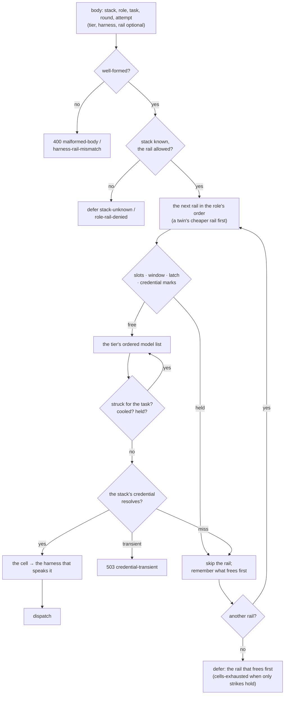
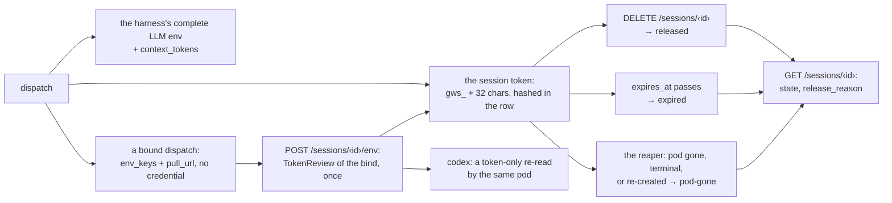
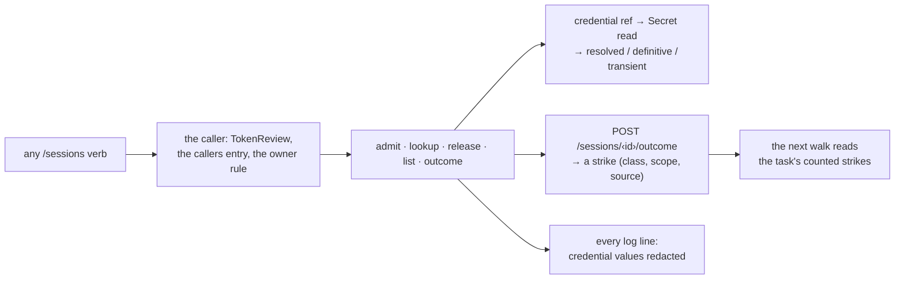

# POST /sessions · GET /sessions/{id} · DELETE /sessions/{id} · POST /sessions/{id}/env · POST /sessions/{id}/outcome · GET /sessions?task= — the launcher's one question

*May this unit run now, with which harness, and what goes in the pod's env.* The control-plane
seam of the island ([UC-1](../use-cases/uc-1-worker-ride.md) steps ① and ④). The caller sends
`(stack, role, task, round)` and optional `tier` / `harness` / `rail` — or, for the catalog's
entry canary, `canary: {model, provider}` ([GW-CATALOG-OR](catalog.md#gw-catalog-or)); the gateway answers
`dispatch` (a session, a rail, a harness, a model, the pod's complete LLM env) or `defer` (a
typed reason and when to ask again). The caller authenticates with its projected ServiceAccount
token and may ask only for what the policy's `callers` grant it ([GW-SESSIONS-AUTH](#gw-sessions-auth)).
A body carrying `bind` gets a dispatch without the
credential, and the bound pod pulls its env itself ([GW-SESSIONS-PULL](#gw-sessions-pull)). No caller names a model: the policy does, and every
data-plane request is resolved from the session identity
([GW-MODEL-RESOLVE](anthropic-messages.md#gw-model-resolve)). The canonical end-to-end pair is
[`uc-1/request.json`](../use-cases/uc-1/request.json) → [`uc-1/expected-response.json`](../use-cases/uc-1/expected-response.json).

## Interface — the machine half

**[`sessions.schema.json`](sessions.schema.json)** is the single source for the request,
response and error shapes; the service **imports it**. Coupling is enforced by
`scripts/spec_gate.py` in `devbox run ci` (rule 7).

| Requirement | operation | Governs (schema) | Error codes | Status |
|---|---|---|---|---|
| [GW-SESSIONS-ADMIT](#gw-sessions-admit) | `POST /sessions` | `post.input` (incl. `canary` — [GW-CATALOG-OR](catalog.md#gw-catalog-or)'s entry canary, whose rows live there: the defers `canary-not-due`, `canary-budget`, `not-in-catalog`), `post.output` (`dispatch` / `defer`; `dispatch.rail_choice` — [GW-MODEL-TIERS](catalog.md#gw-model-tiers)'s rail choice, whose rows live there) | `malformed-body`, `harness-rail-mismatch`, `credential-transient` | v0: the walk — rails in the role's order, the twin's cheaper rail first, the harness taken from the cell; `⚑ gap`: `/route` is not served (consumers move to this endpoint) and the ADR-096 ladder's labels / urgency / budget inputs are not read ([§Named gaps — admission](#named-gaps-admission)) |
| [GW-SESSIONS-RETRY](#gw-sessions-retry) | `POST /sessions` | `post.input.attempt`, `get.output.attempt`, `post.output.defer.reason` (`cells-exhausted`, the one defer with no `retry_after_s`) | `malformed-body` (`attempt` < 1) | v0 — the walk reads [GW-SESSIONS-OUTCOME](#gw-sessions-outcome)'s counted strikes, tier lists are ordered, `attempt` makes a re-run detectable; `⚑ gap`: one model across rails is two ids ([§Named gaps — retry](#named-gaps-retry)) |
| [GW-SESSIONS-CAPACITY](#gw-sessions-capacity) | `POST /sessions` | `post.output.defer.reason` (`rail-window`, `rail-latched`, `cell-cooled`, `credential-rejected`, `not-in-catalog`, `no-eligible-provider`), `post.output.defer.retry_after_s` | — | v0 + the ladder's capacity half (window utilization, the 429 latch, the Go window draw, the per-cell 429 cooldown, the rejected credential and its recovery, the marks kept across a restart) + the openrouter provider axis (the cell is (rail, model, provider), `no-eligible-provider`; homelab#2741); `⚑ gap (2026-11-01, PR #3105 → work #3108)`: the Go account headroom is unread — the rail's one shared allowance is learnt from a ride's first 429; the other capacity gaps (FU-109 tier thresholds, the OpenRouter account latch, the free-tier key budget, a Go 402, the Go draw as a lower bound, the capacity doorbell) are rows under [§Named gaps — capacity](#named-gaps-capacity) |
| [GW-SESSIONS-ENV](#gw-sessions-env) | `POST /sessions` | `post.output.dispatch.env`, `post.output.dispatch.context_tokens` | — | v0 for `claude` / `opencode` / `goose` / `codex` (the codex rail lit 2026-10-22 — [openai-responses.md](openai-responses.md)); `⚑ gap (2026-10-16, PR #2646 → work #2650)`: the codex env's native-CLI turn evidence is local-only; `⚑ gap (2026-10-17, PR #2656 → work #2650)`: the goose/opencode wire evidence is a one-off in-cluster probe, not CI, and opencode's provider-package fetch under enforced egress is unobserved ([§Evidence outside CI](#evidence-outside-ci)) |
| [GW-SESSIONS-TOKEN](#gw-sessions-token) | `POST /sessions`, `GET /sessions/{id}` | `post.output.dispatch.session`, `get.output` | `session-not-found` | v0 |
| [GW-SESSIONS-RELEASE](#gw-sessions-release) | `DELETE /sessions/{id}`, `GET /sessions/{id}` | `delete.output`, `get.output.released_at` | `session-not-found` | v0 |
| [GW-SESSIONS-PULL](#gw-sessions-pull) | `POST /sessions` (`bind`), `POST /sessions/{id}/env` | `post.input.bind`, `post.output.dispatch_bound`, `pull.output`, `pull.token_reread` | `pull-identity-refused`, `tokenreview-transient`, `env-already-delivered`, `session-released`, `session-expired`, `session-not-found`, `token-rotation-conflict` | v0; the Codex same-pod token re-read after the first delivery; `⚑ gap`: the racing-rotation arm has no row ([§Named gaps — pull](#named-gaps-pull)) |
| [GW-SESSIONS-LIVENESS](#gw-sessions-liveness) | `GET /sessions/{id}` | `get.output.state`, `get.output.release_reason` | — | v0 |
| [GW-SESSIONS-AUTH](#gw-sessions-auth) | `all` | `caller`, `get.output.caller`, `list.input`, `list.output` (the judge's `GET /sessions?task=` — [§A judge finds a task's sessions](#a-judge-finds-a-tasks-sessions)) | `caller-unauthenticated`, `caller-unknown`, `caller-stack-denied`, `caller-role-denied`, `caller-bind-denied`, `caller-not-owner`, `tokenreview-transient`, `session-not-found`, `malformed-body` (a list without `task`) | v0, deployed in `enforce` (the knob; `observe` 2026-10-17 until every caller sent its token); `⚑ gap (2026-10-17, PR #2683 → work #2684)`: a bind's ServiceAccount is not constrained per caller ([§Named gaps — auth](#named-gaps-auth)) |
| [GW-SESSIONS-OUTCOME](#gw-sessions-outcome) | `POST /sessions/{id}/outcome`, `GET /sessions/{id}` | `outcome.input`, `outcome.output`, `outcome.strike`, `get.output.outcome` | `outcome-class-unknown`, `outcome-evidence-refused`, `outcome-judge-only`, `outcome-window-closed`, `outcome-conflict`, `caller-not-owner`, `session-not-found` | v0 — the admission's walk reads it ([GW-SESSIONS-RETRY](#gw-sessions-retry)); `⚑ gap`: the fleet view across tasks ([§Named gaps — outcome](#named-gaps-outcome)) |
| [GW-CRED-RESOLVE](#gw-cred-resolve) | `POST /sessions` | `post.output.defer.reason` (`credential-unresolved`) | `credential-transient` | v0 |
| [GW-REDACT](#gw-redact) | `all` | `$defs.error_envelope.error.message` (the one wire surface a log-shaped string reaches) + log lines (a formatter invariant) | — | v0 |
| [GW-MODEL-RESOLVE](anthropic-messages.md#gw-model-resolve) (owned there) | `POST /sessions` | `post.output.dispatch.model` | — | linked — the model a dispatch names is the one every data-plane request must carry |
| [GW-ACCESS](../access.md#gw-access) (owned there) | `POST /sessions` | `post.input.role` | — | linked — the role's rail set is the inventory's enforced column |
| [GW-CODEX-CAPTURE](openai-responses.md#gw-codex-capture) (owned there) | `GET /sessions/{id}/capture` | `capture` (the bundle — owned there, not in this schema) | `capture-not-found` | linked — the bundle is read under this page's lookup rule ([GW-SESSIONS-AUTH](#gw-sessions-auth)); its records and sanitization are [GW-CODEX-CAPTURE](openai-responses.md#gw-codex-capture)'s |

## Flow overview

```mermaid
flowchart LR
  L["launcher: POST /sessions\n(stack, role, task, round, attempt)"] --> C{"the caller:\nTokenReview × callers"}
  C -->|refused| E["401 / 403"]
  C --> W["the walk:\nrails in the role's order"]
  W --> S["the task's strikes,\nthe tier's model list"]
  S --> K["capacity: slots, windows, latch,\ncooldowns, credential marks"]
  K -->|every rail held| D["defer\n(reason, retry_after_s)"]
  K --> R["the stack's credential ref"]
  R --> H["the cell → its harness → its env"]
  H --> T["dispatch: the session token"]
  H --> B["a bound dispatch: pull_url,\nno credential"]
  B --> P["the pod pulls its env once\n(TokenReview of the bind)"]
  T --> DP["the data plane\n(anthropic-messages.md, openai-chat.md, openai-responses.md)"]
  P --> DP
  DP --> O["POST /sessions/‹id›/outcome:\nthe consumer's class → a strike"]
  O --> X["DELETE, or expiry"]
  DP --> RP["the reaper: the pod is gone"]
  X --> G["GET /sessions/‹id›:\nstate, release_reason"]
  RP --> G
  click L href "#gw-sessions-admit" "GW-SESSIONS-ADMIT" _self
  click C href "#gw-sessions-auth" "GW-SESSIONS-AUTH" _self
  click E href "#who-may-call-under-enforce" "Who may call, under enforce" _self
  click W href "#the-policy-walk" "The policy walk" _self
  click S href "#gw-sessions-retry" "GW-SESSIONS-RETRY" _self
  click K href "#gw-sessions-capacity" "GW-SESSIONS-CAPACITY" _self
  click D href "#a-defer-is-200-a-transient-fault-is-503" "A defer is 200" _self
  click R href "#gw-cred-resolve" "GW-CRED-RESOLVE" _self
  click H href "#the-harness-follows-the-cell" "The harness follows the cell" _self
  click T href "#gw-sessions-token" "GW-SESSIONS-TOKEN" _self
  click B href "#the-bound-answer" "The bound answer" _self
  click P href "#gw-sessions-pull" "GW-SESSIONS-PULL" _self
  click O href "#gw-sessions-outcome" "GW-SESSIONS-OUTCOME" _self
  click X href "#gw-sessions-release" "GW-SESSIONS-RELEASE" _self
  click RP href "#gw-sessions-liveness" "GW-SESSIONS-LIVENESS" _self
  click G href "#what-get-says" "What GET says" _self
```

A launcher's `POST /sessions` is answered by the [admission](#admission):
the caller is read first ([GW-SESSIONS-AUTH](#gw-sessions-auth)), then the [walk](../glossary.md#walk)
crosses the role's rails in order ([GW-SESSIONS-ADMIT](#gw-sessions-admit)), reading the task's
[strikes](../glossary.md#strike) and the tier's ordered model list ([GW-SESSIONS-RETRY](#gw-sessions-retry)),
the rail's and the cell's capacity ([GW-SESSIONS-CAPACITY](#gw-sessions-capacity)) and the stack's
credential ([GW-CRED-RESOLVE](#gw-cred-resolve)); the first admissible [cell](../glossary.md#cell)
names the harness and the env ([GW-SESSIONS-ENV](#gw-sessions-env)). [The session](#the-session)
then lives on a token ([GW-SESSIONS-TOKEN](#gw-sessions-token)) — minted into the answer, or pulled once by
the bound pod ([GW-SESSIONS-PULL](#gw-sessions-pull)) — rides the data plane, which is the other pages'
([anthropic-messages.md](anthropic-messages.md), [openai-chat.md](openai-chat.md),
[openai-responses.md](openai-responses.md)), reports how it ended ([GW-SESSIONS-OUTCOME](#gw-sessions-outcome)),
and ends by `DELETE`, by expiry ([GW-SESSIONS-RELEASE](#gw-sessions-release)) or by the reaper when its
pod is gone ([GW-SESSIONS-LIVENESS](#gw-sessions-liveness)). No log line of any of this carries a
credential value ([GW-REDACT](#gw-redact)).

## Requirement index

Every requirement of this page, in reading order; the section flowcharts below link into it. The
`⚑ gap` marks are rule 10's — the same marks the Interface table carries.

| Requirement | Section | Status |
|---|---|---|
| [GW-SESSIONS-ADMIT](#gw-sessions-admit) | admission | `⚑ gap`: `/route` is not served; the ADR-096 ladder's labels / urgency / budget inputs are not read |
| [GW-SESSIONS-RETRY](#gw-sessions-retry) | admission | `⚑ gap`: one model across rails is two ids |
| [GW-SESSIONS-CAPACITY](#gw-sessions-capacity) | admission | `⚑ gap (2026-11-01, PR #3105 → work #3108)`: the Go account headroom is unread; FU-109 tier thresholds, the OpenRouter account latch, the free-tier key budget, a Go 402, the Go draw as a lower bound and the capacity doorbell are gaps too |
| [GW-SESSIONS-ENV](#gw-sessions-env) | the session | `⚑ gap (2026-10-16, PR #2646 → work #2650)`: the codex env's native-CLI turn evidence is local-only; `⚑ gap (2026-10-17, PR #2656 → work #2650)`: the goose/opencode wire evidence is a one-off probe, opencode's provider-package fetch under enforced egress unobserved |
| [GW-SESSIONS-TOKEN](#gw-sessions-token) | the session | |
| [GW-SESSIONS-PULL](#gw-sessions-pull) | the session | `⚑ gap`: the racing-rotation arm has no row |
| [GW-SESSIONS-RELEASE](#gw-sessions-release) | the session | |
| [GW-SESSIONS-LIVENESS](#gw-sessions-liveness) | the session | |
| [GW-SESSIONS-AUTH](#gw-sessions-auth) | cross-cutting | `⚑ gap (2026-10-17, PR #2683 → work #2684)`: a bind's ServiceAccount is not constrained per caller |
| [GW-SESSIONS-OUTCOME](#gw-sessions-outcome) | cross-cutting | `⚑ gap`: the fleet view across tasks |
| [GW-CRED-RESOLVE](#gw-cred-resolve) | cross-cutting | |
| [GW-REDACT](#gw-redact) | cross-cutting | |

**Reading the tables.** The header is the parameter list (CONVENTIONS § The intent column): every
column after `description` is an input or, ending in `?`, an expected observable. Four literals read
the same way on every table of this page: `—` = not in the answer (the key is null or absent);
`null` = a JSON null the answer carries; `(absent)` = the key is not in the answer at all; `(policy)` =
the body does not name it, so the role's policy default applies. A `world` column names the
[world](../glossary.md#world) a row rides — the policy document plus, after `·`, the fake upstream's
behaviour ([worlds/README.md](../worlds/README.md)); a rule whose rows share one world names it once
instead.

## Admission — may this unit run now, and on which cell (`GW-SESSIONS-ADMIT`, `-RETRY`, `-CAPACITY`)

The [walk](../glossary.md#walk) is one question asked rail by rail, cell by cell, and the three
requirements here own its three kinds of answer: ADMIT the order and the overrides (which rail, which
harness, what is an HTTP error), RETRY what the task's [strikes](../glossary.md#strike) and the
`attempt` counter exclude, CAPACITY what the rail's and the cell's capacity hold back.

### GW-SESSIONS-ADMIT

A `POST /sessions` body is admitted by [walking](../glossary.md#walk) `roles.<role>.rails` in order — ⚖ the role's
order yields once: when the tier's lists name ONE model on two allowed rails (a
[twin](../glossary.md#twin)), the rail whose twin cell costs less per clean ride walks first,
with that twin at its list's head, and the answer's `rail_choice` says why
([GW-MODEL-TIERS §The rail choice](catalog.md#the-rail-choice) owns those rows; `null` when no
twin) — and, inside each rail, the [tier](../glossary.md#tier)'s ORDERED model list
([GW-SESSIONS-RETRY](#gw-sessions-retry)) —
and picking the **first rail** whose `active_sessions < rails.<rail>.max_sessions`, that is not
capacity-blocked — the rail, or the [cell](../glossary.md#cell) its tier's model makes on it
([GW-SESSIONS-CAPACITY](#gw-sessions-capacity)) — AND whose credential for the stack resolves
([GW-CRED-RESOLVE](#gw-cred-resolve)) and has not been rejected upstream. None → [`defer`](../glossary.md#defer), whose `reason` and
`retry_after_s` are those of the blocked rail that frees **first** (a full rail frees after the
policy's `defer_retry_s`, 60 s; ties go to walk order — ⚖ a gateway choice, the old proxy has no multi-rail answer); a walk blocked only on credentials
defers `credential-unresolved`, or `credential-rejected` when any of its credentials was rejected
upstream (⚖ the rejection outranks: it names the operator act, a rotation). An **explicit**
`harness` filters the walk to the **cells** that serve its dialect: `claude` speaks the anthropic
dialect; `opencode` / `goose` speak openai; `codex` speaks responses (rail `codex` only — gated by
account headroom, [GW-CODEX-HEADROOM](openai-responses.md#gw-codex-headroom), whose admission rows
live there). A cell's dialect is its rail's — except a Go cell, which is its model's
([GW-CATALOG-GO §The model's dialect](catalog.md#gw-catalog-go)): a cell the harness cannot speak
is skipped, a rail none of whose tier cells speak it is passed over, and an explicit `harness` ×
`rail` pair none of whose tier cells speak it is a 400 `harness-rail-mismatch`, never a silent
skip. Without one, **the harness follows the cell**
([§The harness follows the cell](#the-harness-follows-the-cell)): every allowed rail is walked in
the role's order, the first cell its tier list admits is picked, and the dispatch names the harness
that speaks that cell's dialect. An explicit `rail` the role is allowed is taken even when it is
later in the list, as an override (logged as one: unverified — no row reads the line). `defer` is HTTP 200 — a normal answer the caller
polls after `retry_after_s`; only a malformed body or a transient credential fault is an HTTP
error. ⚖ The gateway admits on count, capacity, strikes and credential: no labels, no urgency, no
budget class — the rest of the ADR-096 ladder is a gap, rendered as rows, not omitted. The
transport facts the gateway sees FIRST-HAND (a 429, a 401/403, a stream's end) are its own and are
[GW-SESSIONS-CAPACITY](#gw-sessions-capacity)'s rows; a ride's outcome is the consumer's and is not read here. The
caller never polls `/anthropic-limit` / `/opencode-limit`: the defer IS the limit answer.

#### The policy walk

**World: [policy-default](../worlds/README.md#policy-worlds)**, the task `homelab-2588-r1`, round 0. Legend: `active` = the active
sessions per rail as `anthropic/opencode/openrouter`; `credential` = how the stack's refs resolve
(`all resolve`; `anthropic_ref definitive miss` = the Secret the ref names is gone).

| description | world | stack | role | active | credential | decision? | rail? | model? | reason? |
|---|---|---|---|---|---|---|---|---|---|
| a worker takes the first rail in its list | policy-default | platform | worker | 0/0/0 | all resolve | dispatch | opencode | opencode-go/deepseek-v4.1-flash | — |
| the first rail is full, the second is taken | policy-default | platform | worker | 0/3/0 | all resolve | dispatch | openrouter | deepseek/deepseek-v4-flash | — |
| every allowed rail is full | policy-default | platform | worker | 0/3/20 | all resolve | defer | — | — | rail-capacity |
| a reviewer rides the subscription first | policy-default | platform | reviewer | 0/0/0 | all resolve | dispatch | anthropic | claude/sonnet | — |
| the subscription is full, the reviewer takes Go | policy-default | platform | reviewer | 5/0/0 | all resolve | dispatch | opencode | opencode-go/claude-haiku-5-5 | — |
| the stack's anthropic ref does not resolve, the walk continues ⚖ | policy-default | platform | reviewer | 0/0/0 | anthropic_ref definitive miss | dispatch | opencode | opencode-go/claude-haiku-5-5 | — |
| the only allowed rail's credential does not resolve | policy-default | platform | prober | 0/0/0 | anthropic_ref definitive miss | defer | — | — | credential-unresolved |
| an unknown stack | policy-default | nope | worker | 0/0/0 | all resolve | defer | — | — | stack-unknown |

#### Explicit tier, harness and rail

**World: [policy-default](../worlds/README.md#policy-worlds)**, a platform body, no rail holds a session.
Legend: `tier` / `harness` / `rail` = what the body names, `(policy)` when it does not.

| description | world | role | tier | harness | rail | decision? | rail? | model? | reason? |
|---|---|---|---|---|---|---|---|---|---|
| an explicit tier picks the model inside the rail | policy-default | worker | heavy | (policy) | (policy) | dispatch | opencode | opencode-go/claude-haiku-5-5 | — |
| an explicit harness narrows the walk to its dialect | policy-default | worker | (policy) | goose | (policy) | dispatch | opencode | opencode-go/deepseek-v4.1-flash | — |
| an explicit harness passes the rail whose cells all speak another dialect | policy-default | worker | light | claude | (policy) | dispatch | openrouter | deepseek/deepseek-v4-flash | — |
| a harness that cannot speak the role's only rail ⚖ | policy-default | prober | (policy) | opencode | (policy) | defer | — | — | role-rail-denied |
| an explicit rail the role is not allowed | policy-default | worker | (policy) | claude | anthropic | defer | — | — | role-rail-denied |
| an explicit rail the policy does not declare ⚖ | policy-default | worker | (policy) | claude | codex | defer | — | — | role-rail-denied |
| an explicit rail the role is allowed is taken even when later in the list ⚖ | policy-default | worker | (policy) | (policy) | openrouter | dispatch | openrouter | deepseek/deepseek-v4-flash | — |

#### The harness follows the cell

⚖ Operator ruling 2026-10-23 (FU-270, [the spike §Role routing](../../../docs/spikes/codex-subscription-rail.md#role-routing--ruled-2026-10-23-fu-270)):
**every subscription rail is every role's.** The role's rail ORDER is the operator's weekly knob —
one week the reviewer rides claude, the next codex; a week's tokens drained on purpose for a
special use are made up by the next rail with no policy edit; and a reviewer that is always the
same model is blind to the same classes of problem. The walk therefore crosses the dialect
boundary on its own: with no `harness` in the body every allowed rail is a candidate.

⚖ Operator ruling 2026-10-24 (homelab#2870): **the harness is taken LAST, from the cell.** The
walk's order is role + tier → rails in the role's order, with capacity and credentials → the first
unstruck model on that rail's tier list → **the harness that speaks that cell's dialect**. A
cell's dialect is its rail's — except a Go cell, which is its model's (the models.dev per-model
`provider` override, [GW-CATALOG-GO §The model's dialect](catalog.md#gw-catalog-go)); the
`openrouter` rail's cells serve both dialects, as its upstream does. A cell that speaks
`roles.<role>.harness` keeps the role's harness; a cell that does not names its own dialect's
harness (⚖ one harness per dialect, the launcher's baked defaults — `config.DIALECT_HARNESS`).
`roles.<role>.harness` is thus the role's harness wherever the picked cell speaks it, no longer a
filter; the env follows the harness ([GW-SESSIONS-ENV](#gw-sessions-env)), and the launcher runs
the harness the answer names (`agents/agent-session.sh`, the `gateway-sessions` block). An
explicit `harness` keeps its meaning above: it filters CELLS — a cell it cannot speak is skipped
(never ridden onto), a rail none of whose tier cells speak it is passed over, and an explicit
`harness` × `rail` pair none of whose tier cells speak it is a 400 `harness-rail-mismatch`; an
explicit `rail` without a harness takes the picked cell's.

**World: [policy-codex](../worlds/README.md#policy-worlds)** — roles shaped as the 2026-10-23 ruling (every role lists
`anthropic`, `opencode` and `codex`; codex `max_sessions` 2; the opencode standard list carries both
dialect shapes, `deepseek-v4.1-flash` openai first, `claude-haiku-5-5` anthropic second) with codex
[headroom](../glossary.md#headroom) fresh at 20 % / 64 %; the task `homelab-2588-r1`. Legend: `active` = the active
sessions per rail as `anthropic/opencode/codex`.

| description | world | role | tier | harness | rail | active | decision? | rail? | harness? | model? | reason? |
|---|---|---|---|---|---|---|---|---|---|---|---|
| without a harness the walk crosses the dialect boundary: the reviewer reaches codex ⚖ | policy-codex | reviewer | (policy) | (policy) | (policy) | 5/3/0 | dispatch | codex | codex | codex/fixture-model | — |
| a dual-dialect rail keeps the role's harness | policy-codex | reviewer | (policy) | (policy) | (policy) | 5/0/0 | dispatch | opencode | claude | opencode-go/claude-haiku-5-5 | — |
| the Go cell's dialect is the model's: an openai cell rides the opencode harness | policy-codex | reviewer | standard | (policy) | (policy) | 5/0/0 | dispatch | opencode | opencode | opencode-go/deepseek-v4.1-flash | — |
| an explicit harness on the Go rail skips the openai cells and takes the Claude model | policy-codex | reviewer | standard | claude | (policy) | 5/0/0 | dispatch | opencode | claude | opencode-go/claude-haiku-5-5 | — |
| an opencode-harness worker reaching the anthropic rail rides claude ⚖ | policy-codex | worker | (policy) | (policy) | (policy) | 0/3/2 | dispatch | anthropic | claude | claude/sonnet | — |
| an explicit harness still narrows the walk to its dialect | policy-codex | reviewer | (policy) | claude | (policy) | 5/3/0 | defer | — | — | — | rail-capacity |
| an explicit rail without a harness takes the rail's harness ⚖ | policy-codex | reviewer | (policy) | (policy) | codex | 0/0/0 | dispatch | codex | codex | codex/fixture-model | — |

The env is the picked harness's, never the role's: a worker whose walk lands on the anthropic rail is
handed claude's three vars ([GW-SESSIONS-ENV](#gw-sessions-env)), nothing of its policy harness's.
Legend: `env_keys?` = the dispatch's `env` keys, in order.

| description | world | role | active | harness? | env_keys? |
|---|---|---|---|---|---|
| the env is the picked harness's | policy-codex | worker | 0/3/2 | claude | ANTHROPIC_BASE_URL, ANTHROPIC_AUTH_TOKEN, ANTHROPIC_MODEL |

#### A malformed body

A body the schema refuses is the one 400 `malformed-body`: a missing required field, a value outside an
enum, a negative `round`, a body that is not JSON. **World: [policy-default](../worlds/README.md#policy-worlds)**.
Legend: `body` = the one change to a well-formed platform worker body (`k: v` sets the key; `no task`
drops it; `not JSON` = the raw bytes `not json` under `content-type: application/json`).

| description | world | body | status? | code? |
|---|---|---|---|---|
| a missing required field | policy-default | no task | 400 | malformed-body |
| a role outside the enum | policy-default | role: janitor | 400 | malformed-body |
| a tier outside the enum | policy-default | tier: enormous | 400 | malformed-body |
| a rail outside the enum | policy-default | rail: zen | 400 | malformed-body |
| a negative round | policy-default | round: -1 | 400 | malformed-body |
| a body that is not JSON | policy-default | not JSON | 400 | malformed-body |

#### An explicit harness and rail pair

An explicit `harness` × `rail` pair none of whose tier cells speak the harness is a 400
`harness-rail-mismatch`, never a silent skip; a pair some cell does speak dispatches. `codex` with no
allowed rail serving responses is a `defer` `role-rail-denied` (a walk with nothing to walk), while
`codex` against a named rail that does not serve responses is the 400. **World: [policy-default](../worlds/README.md#policy-worlds)**
(no codex rail). Legend: `code?` = the error envelope's code; `decision?` / `reason?` = the 200
answer's.

| description | world | role | harness | rail | status? | code? | decision? | reason? |
|---|---|---|---|---|---|---|---|---|
| an explicit harness and rail that cannot speak | policy-default | reviewer | goose | anthropic | 400 | harness-rail-mismatch | — | — |
| an explicit harness and rail no cell of which speaks it | policy-default | worker | claude | opencode | 400 | harness-rail-mismatch | — | — |
| an explicit harness and rail that can speak | policy-default | reviewer | claude | opencode | 200 | — | dispatch | — |
| codex where no allowed rail serves responses | policy-default | worker | codex | (policy) | 200 | — | defer | role-rail-denied |
| codex against a rail that does not serve responses | policy-default | worker | codex | openrouter | 400 | harness-rail-mismatch | — | — |

#### A defer is 200, a transient fault is 503

A well-formed request that must wait is a 200 `defer`; the kube API away while a credential is being
resolved is a 503 `credential-transient` with a `retry-after` header, the only transient HTTP error
of admission ([GW-CRED-RESOLVE](#gw-cred-resolve)). **World: [policy-default](../worlds/README.md#policy-worlds)**.
Legend: `active`, `credential` as in [§The policy walk](#the-policy-walk) (`anthropic_ref transient fault`
= the Secret source answers 5xx / unreachable); `retry_after_header?` = the response's `retry-after`.

| description | world | role | active | credential | status? | code? | decision? | retry_after_header? |
|---|---|---|---|---|---|---|---|---|
| a well-formed request that must wait | policy-default | worker | 0/3/20 | all resolve | 200 | — | defer | — |
| the kube API is away while resolving the credential | policy-default | reviewer | 0/0/0 | anthropic_ref transient fault | 503 | credential-transient | — | 20 |

#### Counting

A dispatch counts one active session on its rail; a `DELETE` or an expiry frees it; a defer counts
nothing. **World: [policy-default](../worlds/README.md#policy-worlds)**, the opencode rail (cap 3). Legend:
`before` = the rail's active sessions before the action; `gauge?` = `gateway_sessions_active{rail="opencode"}`
after it.

| description | world | before | action | gauge? |
|---|---|---|---|---|
| a dispatch counts on its rail | policy-default | 0 | a worker dispatch | 1 |
| a release frees the slot | policy-default | 1 | DELETE | 0 |
| an expiry frees the slot without a DELETE | policy-default | 1 | expires_at passes | 0 |
| a defer counts nothing | policy-default | 3 | a worker defer | 3 |

#### Named gaps — admission

| description | input | v0 answer | the gap |
|---|---|---|---|
| ⚑ gap: labels, urgency, budget class | body carries none, none read | — | the ADR-096 ladder's inputs; `tier` is the only size knob |
| ⚑ gap: `POST /route` | any | 404 | not served by this gateway — consumers move to `/sessions`; the old proxy keeps serving it |

Evidence — latest run

--8<-- "GW-SESSIONS-ADMIT.md"

### GW-SESSIONS-RETRY

*A failed attempt costs a re-dispatch, never a round* ([model-routing.md §The design's three
rules](../../../docs/agents/model-routing.md#the-designs-three-rules), rule 3). A rail tier names
an **ordered list** of models, `rails.<rail>.models.<tier>: [id, …]`; a bare string is the
one-item list (every policy written before this keeps loading). The [walk](../glossary.md#walk) reads the task's
**counted [strikes](../glossary.md#strike)** ([GW-SESSIONS-OUTCOME](#gw-sessions-outcome)) and takes, rail by rail, the
first model of the tier's list that the task has not struck: a cell-scoped strike excludes that
(rail, model), a model-scoped one excludes the model id on every rail, a harness-scoped one excludes
every cell the struck harness would ride ([§Harness-scoped strikes](#harness-scoped-strikes)), and a cooled cell
([GW-SESSIONS-CAPACITY](#gw-sessions-capacity)) is skipped as well. A rail with no admissible
model is passed over, and the walk moves on to the role's next rail. ⚖ When every candidate cell is
**struck**, and no rail is held only by time (capacity, latch, window, cooldown — those defer as
before, because waiting helps there), the answer is `defer` **`cells-exhausted` with no
`retry_after_s`**. Waiting does not help: the caller escalates (the old ladder's "chain exhausted
with the strike list"). ⚖ Model identity is the policy id: the same model on another rail is
another id, so a model strike on `claude/sonnet` does not exclude `opencode-go/claude-haiku-5-5`
([§Named gaps — retry](#named-gaps-retry)). A strike is the task's: it comes from an earlier
session of the same task, and a `clean` outcome on the same cell, model or harness refutes it.

`POST /sessions` carries **`attempt`** (default 1): the consumer's automatic re-admission counter at
this round. Strikes are keyed by TASK, not by attempt, so the exclusion holds however the attempt is
counted. `attempt` is what makes a re-run **detectable**. ⚖ The same caller re-admitting the same
(stack, task, round, attempt) for the same bound pod (both unbound counts as the same pod) while the
earlier session is still **active** is a re-run of that admission: a killed pod's re-run, or a slot
leaked by a SIGKILL (the 2026-10-17 experiment's probe left one active until its TTL). The earlier
session is **superseded**: it is released, and its token is refused from then on. Then this
admission proceeds. Never two live sessions for one attempt. Refusing would wedge the re-run until
the TTL; answering the old session again cannot work, because an unbound session's token exists only
as a hash. **What the gateway cannot detect:** a re-run that restarts at attempt 1 after the earlier
session was released or expired. The experiment saw Argo re-run a review as a fresh round-0
admission. It is admitted as new, but it meets the task's strikes all the same.
The consumers' side: report the outcome before the DELETE, and on a strike re-admit at the SAME
round with `attempt + 1`, at most 2 automatic attempts (`agents/agent-session.sh` and
`agents/specs-reviewer-session.sh`, under `AGENT_GATEWAY=sessions` / the specs review).

#### Strikes walk the list

**World: [policy-default](../worlds/README.md#policy-worlds)**: `rails.anthropic.models.heavy` = `[claude/sonnet, claude/opus]` (the
reviewer's tier), `rails.openrouter.models.light` = `[deepseek/deepseek-v4-flash, deepseek/deepseek-v4.1-flash]`,
every other tier a bare string; the reviewer's body, round 0. Legend: `T` = the task
`specs-review homelab#2700`, `another task` = `specs-review homelab#2701`; `strikes` = what the task's earlier
sessions reported through the outcome endpoint, as `class on (rail, model)` (`for T` = reported for T,
whatever task now asks; `provider-5xx (gateway) on claude/sonnet, then clean` = the gateway's own
transport strike on that session, refuted by its `clean` outcome; `—` = none); `attempt` = the body's.

| description | world | role | task | strikes | attempt | decision? | rail? | model? |
|---|---|---|---|---|---|---|---|---|
| a tier names an ordered list: the first model is taken | policy-default | reviewer | T | — | 1 | dispatch | anthropic | claude/sonnet |
| a cell strike moves the walk to the next model in the list | policy-default | reviewer | T | harness-gave-up on (anthropic, claude/sonnet) | 2 | dispatch | anthropic | claude/opus |
| a model strike excludes the model, the list continues | policy-default | reviewer | T | no-verdict on claude/sonnet | 2 | dispatch | anthropic | claude/opus |
| a struck list moves the walk to the next rail | policy-default | reviewer | T | no-verdict on claude/sonnet, no-verdict on claude/opus | 3 | dispatch | opencode | opencode-go/claude-haiku-5-5 |
| a strike is per task | policy-default | reviewer | another task | no-verdict on claude/sonnet for T | 1 | dispatch | anthropic | claude/sonnet |
| a refuted strike excludes nothing | policy-default | reviewer | T | provider-5xx (gateway) on claude/sonnet, then clean | 2 | dispatch | anthropic | claude/sonnet |

#### Cooled, exhausted, or held

Legend: `strikes` as above, plus `a 429 cooled (openrouter, deepseek/deepseek-v4-flash)` = a worker
standard ride on openrouter answered 429, so the light list's first cell is cooled, and `…; opencode at
its 3` = the opencode rail at its cap; `(absent)` = the defer carries no `retry_after_s` at all; `T`
is the task of every row.

| description | world | role | tier | rail | strikes | attempt | decision? | rail? | model? | reason? | retry_after_s? |
|---|---|---|---|---|---|---|---|---|---|---|---|
| a cooled cell in the list is skipped, the next model taken | policy-default · upstream-429 | worker | light | openrouter | a 429 cooled (openrouter, deepseek/deepseek-v4-flash) | 1 | dispatch | openrouter | deepseek/deepseek-v4.1-flash | — | — |
| every cell struck: cells-exhausted, no retry_after_s ⚖ | policy-default | prober | (policy) | (policy) | no-verdict on claude/haiku | 2 | defer | — | — | cells-exhausted | (absent) |
| a capacity-blocked rail outranks struck cells: the defer waits ⚖ | policy-default | reviewer | (policy) | (policy) | no-verdict on claude/sonnet, no-verdict on claude/opus; opencode at its 3 | 3 | defer | — | — | rail-capacity | 60 |

#### Harness-scoped strikes

⚖ Operator ruling 2026-10-24 (FU-270, homelab#2867's round 1): a fault in the **harness** is not a
verdict on the model. Two of #2867's three strikes were the launcher's dead opencode permission grant
(opencode 1.19.0 read `mode.autoApprove` as an agent and auto-rejected the recipe read). They would
have killed any model, yet as `unknown` (model-scoped) the walk moved to the next model, twice, and
burned a ride each time. A **harness-scoped** strike excludes the struck harness for the task on
every cell. The walk then takes the first admissible cell that **another** harness speaks (the harness
follows the cell, homelab#2870). With an **explicit** `harness` that is struck for the task, nothing
is admissible: the answer is `defer` `cells-exhausted`, because the platform has to fix the
harness and waiting does not help. A clean outcome on the same harness refutes the strike.

⚖ The harness a cell rides is the one the walk derives for it ([§The harness follows the
cell](#the-harness-follows-the-cell)), and a harness-scoped strike skips that **cell**, never the
rail whole: a cell another harness speaks stays a candidate, so a mixed-dialect Go rail keeps
walking its other-dialect cells while `opencode` is struck — its Claude-dialect cell is taken under
`claude`. With an explicit `harness` that is not struck, the struck harness's own cells stay
admissible to it: the strike names no model and no cell.

**World: [policy-codex](../worlds/README.md#policy-worlds)**, codex headroom fresh at 20 % / 64 %; the
worker task `homelab-2867-r1`, round 1, whose attempt 1 rode (opencode, `opencode-go/deepseek-v4.1-flash`)
on the `opencode` harness. Legend: `strikes` = what that attempt reported (`harness-fault on harness
opencode`; `…, then clean on attempt 2's opencode session` = attempt 2, admitted before the strike on
the same harness, standard tier, then reported `clean`); `harness` = the body's, `(policy)` when absent.

| description | world | strikes | harness | attempt | decision? | rail? | harness? | model? | reason? |
|---|---|---|---|---|---|---|---|---|---|
| a harness strike moves the walk to a cell another harness speaks ⚖ | policy-codex | harness-fault on harness opencode | (policy) | 2 | dispatch | opencode | claude | opencode-go/claude-haiku-5-5 | — |
| a harness strike excludes no model | policy-codex | harness-fault on harness opencode | goose | 2 | dispatch | opencode | goose | opencode-go/deepseek-v4.1-flash | — |
| an explicit harness that is struck defers ⚖ | policy-codex | harness-fault on harness opencode | opencode | 2 | defer | — | — | — | cells-exhausted |
| a refuted harness strike excludes nothing | policy-codex | harness-fault on harness opencode, then clean on attempt 2's opencode session | (policy) | 3 | dispatch | opencode | opencode | opencode-go/deepseek-v4.1-flash | — |

#### The attempt counter

**World: [policy-default](../worlds/README.md#policy-worlds)**; `T` = the reviewer task `specs-review homelab#2700`,
round 0, unbound and with no caller token (`observe`) unless the sequence binds it. Legend: `sequence`
= the admissions in order; `result?` = what the rows and the data plane show afterwards.

| description | world | sequence | result? |
|---|---|---|---|
| attempt defaults to 1 and is on the row | policy-default | admit with no attempt, GET | attempt = 1 |
| attempt below 1 is malformed | policy-default | attempt: 0 | 400 malformed-body |
| a re-admission of the same attempt supersedes the active one ⚖ | policy-default | admit T attempt 1 twice (the same caller, unbound) | the first released, its token 401 session-released; the second active |
| the next attempt does not supersede | policy-default | admit T attempt 1, then attempt 2 | both active |
| another pod's same attempt is not superseded | policy-default | admit T attempt 1 bound to fixer-1, then bound to fixer-2 | both active |
| a re-run that restarts at attempt 1 still meets the task's strikes ⚖ | policy-default | attempt 1 struck no-verdict on claude/sonnet and released; admit T attempt 1 again | dispatch claude/opus |

#### Named gaps — retry

| description | input | v0 answer | the gap |
|---|---|---|---|
| ⚑ gap: one model across rails | a model strike on `claude/sonnet` | `opencode-go/claude-haiku-5-5` still admits | the policy names rail-prefixed ids; `model-classes.json` groups them per model, and that grouping is not in the gateway policy |

Evidence — latest run

--8<-- "GW-SESSIONS-RETRY.md"

### GW-SESSIONS-CAPACITY

Three per-rail checks and three per-cell checks after the slot count ([model-routing.md §The ladder](../../../docs/agents/model-routing.md#the-ladder--rail--class--tier--cell)'s
capacity facts, moved from the old proxy's two limit endpoints into the admission answer). Every
threshold, hold and anchor is policy data under `rails.<rail>.admission` — none is a code literal —
and each is ⚖ **copied** from the old proxy, which keeps serving its own copy until it retires
([§Who owns which fact](../../../docs/agents/model-routing.md#who-owns-which-fact): this is a
duplicate by design for that window, not a second owner). The Go rail's vendor facts — prices,
peak rows and hours, per-model monthly limits, window shares — are not policy: they are the
[Go catalog](../glossary.md#go-catalog)'s snapshot ([GW-CATALOG-GO](catalog.md#gw-catalog-go),
operator ruling 5, 2026-10-17). The per-cell checks walk the tier's ordered list: a model a check
holds is skipped for the next one, and only when every model is held does the rail defer, with the
hold that lifts first. A rail with no `admission` key has no
capacity check. A blocked rail is skipped like a full one; it frees when the **last** of its
blocks lifts. Every reading and every usage below arrives through the data plane — a session and
one request the upstream answers — never from a seed.

- **Window utilization** (`anthropic`): the last-seen `anthropic-ratelimit-unified-<w>-utilization`
  of each window at/over `utilization_thresholds.<w>` blocks the rail until that window's
  `-reset`. ⚖ 5h **0.80** = `ANTHROPIC_UTIL_THRESHOLD`'s code default (`openrouter-proxy.py`; unset in
  its `deployment.yaml`), 7d **0.95** = `ANTHROPIC_UTIL_THRESHOLD_7D` (`deployment.yaml`). A reading
  whose reset has passed is no reading (the old proxy's "dead data" rule); a reading older than
  `reading_stale_s` (**900 s**) is no reading either — an unavailable reading admits, never blocks.
  ⚖ The 900 s bound has **no** old-proxy precedent (it sees every subscription ride; this gateway
  sees only its own, so its reading ages out) — a guess the operator may tune.
- **Cell [cooldown](../glossary.md#cooldown)** (every rail): an upstream 429 cools the **cell** — (rail, the session's policy
  model, provider) — until its reset, read from the wire: `retry-after` (delta seconds) first, then
  `x-ratelimit-reset` (OpenRouter sends the reset as epoch **milliseconds** and no `retry-after`),
  else the rail's `latch_429_hold_s`, else the policy's `defer_retry_s`. Admission skips a cooled
  cell (`cell-cooled`, `retry_after_s` = its reset); any 2xx on that cell clears it early — the old
  router's transport belt, which a 2xx also clears
  ([model-routing.md §The strike ladder](../../../docs/agents/model-routing.md#the-strike-ladder)).
  ⚖ The cell is (rail, model, provider): on the openrouter rail a 429 answered to a PINNED attempt
  cools that provider's cell only ([§The provider axis](#the-provider-axis-openrouter); the model
  admits while another eligible provider remains), an unpinned 429 cools the model's own cell
  (provider `''`) — the only cell on the rails that pin none. The evidence that a 429
  is a MODEL's fact, not the rail's: the 2026-10-17 free-model experiment
  (`docs/spikes/gateway-free-models-2026-10-17/cells.tsv`, 549 upstream responses) saw 115
  OpenRouter 429s across three models, each the model's own limit (`limit_source`
  `upstream_provider_shared_pool` 105, `openrouter_shared_capacity` 3,
  `openrouter_free_tier_per_minute` 7), while two other models on the same key served 200s
  throughout; an experiment rail latch on one model's 429 deferred a different model.
- **429 [latch](../glossary.md#latch)** (`anthropic`, `opencode`): the ACCOUNT-scope signal. ⚖ Scope is a property the policy
  declares, never inferred from a count: a rail whose policy sets `latch_429_hold_s` with
  `latch_scope: account` (the default) is one subscription account whose limits are account
  windows (the subscription's 5h/7d), so a 429 there latches the whole rail as well as cooling its
  cell, for the same reset (a reset-less 429 → the hold); any 2xx on the rail clears it early.
  ⚖ hold **900 s** = `ANTHROPIC_429_HOLD_S` (`openrouter-proxy.py`). `opencode` declares
  `latch_scope: account` too (since 2026-11-01): the vendor meters every paid Go model against **one**
  shared account allowance — the published per-model limits only WEIGHT a request's cost against
  that pool (OpenCode support's statement in anomalyco/opencode#54875; the docs still say per model,
  anomalyco/opencode#60311) — so a Go 429 latches the rail for its `retry-after` (the vendor names
  the block's reset: ~2 h on 2026-11-01), else the rail's `latch_429_hold_s` (**900 s** =
  `GO_CAPACITY_HOLD_S`). The spike's ruling 3 (per model, [§F2](../../../docs/spikes/opencode-go-catalog.md))
  is superseded by the wire: on 2026-11-01 three Go cells 429'd within eight minutes against one
  reset, two of them admitted fresh after the first — the per-model scope re-admitted the rail
  twice into the same exhausted block. `openrouter` declares none: its 429s
  are per model (the experiment above). A count rule ("≥ 2 models 429'd") would have latched it
  wrongly: two models' independent provider-pool 429s overlapped there while two others served.
- **Credential rejected** (every rail): an upstream 401, or a 403 whose error names a credential
  reason ([GW-CRED-BOUNDARY](anthropic-messages.md#gw-cred-boundary)), marks THAT credential —
  the rail plus a sha256 fingerprint of the value, never the value — rejected. Admission resolves
  the stack's credential as before and skips the rail when that credential is rejected; any 2xx on
  it clears it, and a changed value is a different fingerprint, so a rotation clears it by
  construction. A rejected credential **recovers without traffic**. A mark that only data-plane
  traffic could clear is a self-latch, because admission stops sending traffic once it is set. That
  happened live on 2026-10-17: an edge's 403 latched the Go rail until a pod restart.
  ⚖ A rail whose policy declares **`credential_probe`** (`{method, path, body?, backoff_s:
  [first, cap]}`, relative to the rail's upstream base) is re-verified by the gateway itself. A
  background loop re-resolves the credential through the stack that saw it (a changed value clears
  the mark) and sends the probe with it, on a doubling backoff. Only a 2xx clears the mark. A
  credential verdict doubles the backoff. Anything else (5xx, unreachable, an edge refusal) is no
  verdict and is retried at the same backoff.
  - opencode probes with `POST /v1/chat/completions`, one token on the rail's model. Its
    `/v1/models` answers 200 to no key at all, and a bogus model fails before the key is checked
    (both probed live), so neither proves the key.
  - openrouter probes with `GET /v1/key`, which costs nothing.
  - ⚖ A rail with **no probe** (anthropic: no free authenticated call on the subscription) is
    re-admitted **half-open** after `credential_hold_s` (**900 s**): the next ride is the probe, and
    a fresh rejection doubles the hold.
  A walk blocked only by rejected credentials defers `credential-rejected` with `retry_after_s` =
  the earliest re-verification. The [capacity marks](../glossary.md#capacity-mark) — the cooldowns, the latch, the rejections and the
  backoff a repeat doubles from — are store-backed and survive a pod roll
  ([§Kept across a restart](#kept-across-a-restart)). A policy refusal or an edge
  refusal ([GW-CRED-BOUNDARY](anthropic-messages.md#gw-cred-boundary)) rejects nothing.
- **Go window draw** (`opencode`, per cell): each `window_draw.windows.<w>` (`5h` / `7d` / `30d`)
  sums the **model's** metered (2xx) requests inside the window open at `now`, priced from the
  four token classes at the Go catalog's **list** rates — uncached input and output at `in`/`out`,
  each cache class at its own rate (a `null` rate draws nothing); the model's peak row inside a
  peak hour by the REQUEST's timestamp; else the cost tier the request's prompt (uncached + cache
  read + cache write tokens) exceeds — gometer's `window_draw()` semantics. A window at/over
  `threshold × monthly limit × share` holds that model until the window resets, where the monthly
  limit is the model's own under `rails.opencode.plan` and the share is the page's (5h 20 % ·
  weekly 50 % · monthly 100 % today). ⚖ The rules stay copied from `gometer.py`: the anchors
  (`_GO_WINDOW_DEFAULTS`: 5h `chain` · 7d `weekly` Mon 00:00 · 30d `monthly` 13th 11:30 —
  self-measured, no vendor source) and `OPENCODE_UTIL_THRESHOLD`'s 0.80. The `chain` window opens
  at the model's first request after its previous one expired (`router.go_usage_chain_open`).
  Prices apply at READ time from the ledger (`requests` × `sessions.model`), so a catalog refresh
  re-prices the open windows. A model whose monthly limit is `unlimited` draws against no window.
  ⚠ Since the allowance is ONE pool (the latch bullet above), a per-model draw under-reads it: the
  account reading is the "⚑ gap: the Go account headroom" row under [§Named gaps — capacity](#named-gaps-capacity).
- **Not in the catalog** (`opencode`, per cell): a Go model the catalog's config snapshot does not
  list, or that has no monthly-limit row under the policy's plan (or no snapshot exists yet), is
  refused — `not-in-catalog`, `retry_after_s` = the next scheduled catalog refresh — never priced at
  a fallback (operator ruling 4). This is the 2026-10-14 retirement (the spike's §F3) turned from
  silent into a typed defer.

**Worlds** (the `world` column): `policy-default` with the fake upstream's behaviour after the `·`
([worlds/README.md §Upstream behaviours](../worlds/README.md#upstream-behaviours-fake-upstreams)); `T0` = Fri 2027-01-15 08:00:00Z, the clock every
row starts at (a Go peak hour); every `then` / `roll` cell is seconds that pass before the ask.

#### The subscription's windows

The reviewer's body with `rail: anthropic`. Legend: `reading` = the last anthropic answer's
`5h / 7d` utilization, its resets at T0 + 3600 / T0 + 259200.

| description | world | reading | decision? | rail? | reason? | retry_after_s? |
|---|---|---|---|---|---|---|
| the 5h window at its threshold defers the subscription until its reset | policy-default · upstream-ok | 0.80 / 0.10 | defer | — | rail-window | 3600 |
| the 5h window under its threshold admits | policy-default · upstream-ok | 0.79 / 0.10 | dispatch | anthropic | — | — |
| the 7d window under its own threshold admits | policy-default · upstream-ok | 0.10 / 0.94 | dispatch | anthropic | — | — |
| the 7d window at its threshold defers until the 7d reset | policy-default · upstream-ok | 0.10 / 0.95 | defer | — | rail-window | 259200 |
| both windows over: the later reset names the wait | policy-default · upstream-ok | 0.90 / 0.97 | defer | — | rail-window | 259200 |

#### A reading that is no reading

The reviewer's body. Legend: `reading` as above, `(reset T0 − 1)` = that window's reset already passed
when it was read; `then` = seconds that pass with no further anthropic answer (`—` = none); `rail` =
the body's rail, `(policy)` = the policy walk (the reviewer's rails: anthropic, then opencode).

| description | world | reading | then | rail | decision? | rail? | reason? | retry_after_s? |
|---|---|---|---|---|---|---|---|---|
| a window whose reset has passed is no reading | policy-default · upstream-ok | 0.90 (reset T0 − 1) / 0.10 | — | anthropic | dispatch | anthropic | — | — |
| a reading older than reading_stale_s is no reading ⚖ | policy-default · upstream-ok | 0.90 / 0.10 | +901 s | anthropic | dispatch | anthropic | — | — |
| a reading just inside reading_stale_s still defers | policy-default · upstream-ok | 0.90 / 0.10 | +900 s | anthropic | defer | — | rail-window | 2700 |
| the walk continues past a blocked subscription | policy-default · upstream-ok | 0.90 / 0.10 | — | (policy) | dispatch | opencode | — | — |

#### The subscription's 429 latch

The reviewer's body with `rail: anthropic`. Legend: `arrange` = the rides before the ask and what the
fake answered them (`upstream-429` sends `retry-after: 30`; `no retry-after` = `upstream-429-no-header`;
`the same session → 200` = that session's next request answered 200); `then` = seconds that pass.

| description | world | arrange | then | decision? | rail? | reason? | retry_after_s? |
|---|---|---|---|---|---|---|---|
| an anthropic 429 latches the subscription for its retry-after | policy-default · upstream-429 | reviewer ride on anthropic → 429 | — | defer | — | rail-latched | 30 |
| a 429 without retry-after latches for the policy hold | policy-default · upstream-429-no-header | reviewer ride on anthropic → 429, no retry-after | — | defer | — | rail-latched | 900 |
| the latch lifts at its expiry | policy-default · upstream-429 | reviewer ride on anthropic → 429 | +30 s | dispatch | anthropic | — | — |
| any 2xx on the rail clears the latch | policy-default · upstream-429 | reviewer ride on anthropic → 429, the same session → 200 | — | dispatch | anthropic | — | — |

#### The Go rail's 429 latch, and a rail that declares none

The worker's body. Legend: `arrange` as above (`openrouter at its 20` = the rail at its cap);
`rail` / `tier` = the body's, `(policy)` = the policy walk (the worker's rails: opencode, then openrouter).

| description | world | arrange | rail | tier | decision? | rail? | reason? | retry_after_s? |
|---|---|---|---|---|---|---|---|---|
| a Go 429 latches the rail for its retry-after | policy-default · upstream-429 | worker ride on opencode → 429 | opencode | (policy) | defer | — | rail-latched | 30 |
| a Go 429 without retry-after latches for the rail's hold | policy-default · upstream-429-no-header | worker ride on opencode → 429, no retry-after | opencode | (policy) | defer | — | rail-latched | 900 |
| one Go model's 429 blocks every Go model: one shared allowance ⚖ | policy-default · upstream-429 | worker ride on opencode → 429 | opencode | heavy | defer | — | rail-latched | 30 |
| a latched Go rail is skipped, the walk continues | policy-default · upstream-429 | worker ride on opencode → 429 | (policy) | (policy) | dispatch | openrouter | — | — |
| a rail whose policy declares no latch is not latched: its other model admits ⚖ | policy-default · upstream-429 | worker ride on openrouter → 429 | openrouter | heavy | dispatch | openrouter | — | — |
| every rail blocked: the rail that frees first names the defer ⚖ | policy-default · upstream-429 | worker ride on opencode → 429; openrouter at its 20 | (policy) | (policy) | defer | — | rail-latched | 30 |

#### The cell cooldown

Legend: `arrange` = the rides before the ask and what the fake answered them (`→ 429, reset T0 + 42 s` =
`upstream-429-reset`, OpenRouter's shape: `x-ratelimit-reset` in epoch milliseconds, no `retry-after`;
`the same, plus retry-after: 30` = both headers; `no header` = `upstream-429-no-header`; `the same
session → 200` = that session's next request answered 200; `(the heavy cell)` = the researcher's
heavy tier on openrouter); `then` = seconds that pass; `role` / `rail` / `tier` = the body's.
A worker on openrouter rides the standard tier's `deepseek/deepseek-v4-flash`; its heavy tier is
`deepseek/deepseek-v4.1-flash`.

| description | world | arrange | then | role | rail | tier | decision? | rail? | reason? | retry_after_s? |
|---|---|---|---|---|---|---|---|---|---|---|
| a 429 cools its cell until x-ratelimit-reset (epoch ms) | policy-default · upstream-429-reset | worker ride on openrouter → 429, reset T0 + 42 s | — | worker | openrouter | (policy) | defer | — | cell-cooled | 42 |
| retry-after outranks x-ratelimit-reset | policy-default · upstream-429-reset | the same, plus retry-after: 30 | — | worker | openrouter | (policy) | defer | — | cell-cooled | 30 |
| a 429 that names no reset cools for defer_retry_s ⚖ | policy-default · upstream-429-no-header | worker ride on openrouter → 429, no header | — | worker | openrouter | (policy) | defer | — | cell-cooled | 60 |
| another model on the rail is not cooled | policy-default · upstream-429-reset | worker ride on openrouter → 429, reset T0 + 42 s | — | worker | openrouter | heavy | dispatch | openrouter | — | — |
| the cell admits again at its reset | policy-default · upstream-429-reset | worker ride on openrouter → 429, reset T0 + 42 s | +42 s | worker | openrouter | (policy) | dispatch | openrouter | — | — |
| a 2xx on the cell clears it | policy-default · upstream-429-reset | worker ride on openrouter → 429, reset T0 + 42 s, the same session → 200 | — | worker | openrouter | (policy) | dispatch | openrouter | — | — |
| a cooled cell is skipped, the walk continues | policy-default · upstream-429-reset | researcher ride on openrouter → 429 (the heavy cell) | — | researcher | (policy) | (policy) | dispatch | anthropic | — | — |
| a subscription 429 latches the rail and cools the cell: the latch names the defer ⚖ | policy-default · upstream-429 | reviewer ride on anthropic → 429 (retry-after: 30) | — | reviewer | anthropic | (policy) | defer | — | rail-latched | 30 |

#### A rejected credential

Legend: `arrange` = one ride answered an upstream 401 (`upstream-401`, or the Go vendor's
`upstream-401-key-expired`) or OpenRouter's harness-gate 403 (`upstream-403-refused`), with what the
Secret source then holds (`oracle's key differs` = the oracle stack's OpenRouter Secret holds its own
value; `the Secret then holds a new key` = the platform key is rotated); `then` = seconds that pass
(`+301 s (the ref cache)` = past [GW-CRED-RESOLVE](#gw-cred-resolve)'s 300 s positive TTL);
`stack` / `role` / `rail` = the body's.

| description | world | arrange | then | stack | role | rail | decision? | rail? | reason? | retry_after_s? |
|---|---|---|---|---|---|---|---|---|---|---|
| a rejected credential is skipped, the walk continues | policy-default · upstream-401-key-expired | worker ride on opencode → upstream-401-key-expired | — | platform | worker | (policy) | dispatch | openrouter | — | — |
| every allowed rail's credential rejected defers credential-rejected ⚖ | policy-default · upstream-401 | prober ride on anthropic → upstream-401 | — | platform | prober | (policy) | defer | — | credential-rejected | 900 |
| a rejection is per credential: another stack's key still admits | policy-default · upstream-401 | platform worker ride on openrouter → upstream-401 (oracle's key differs) | — | oracle | worker | openrouter | dispatch | openrouter | — | — |
| a new credential value clears it | policy-default · upstream-401 | platform worker ride on openrouter → upstream-401; the Secret then holds a new key | +301 s (the ref cache) | platform | worker | openrouter | dispatch | openrouter | — | — |
| a 2xx on the credential clears it | policy-default · upstream-401 | platform worker ride on openrouter → upstream-401, the same session → 200 | — | platform | worker | openrouter | dispatch | openrouter | — | — |
| a policy refusal does not reject the credential | policy-default · upstream-403-refused | worker ride on openrouter → upstream-403-refused | — | platform | worker | openrouter | dispatch | openrouter | — | — |

#### Recovery without traffic

The probe pass is the app's background loop. `policy-default`'s opencode probe is `POST
/v1/chat/completions` (1 token, backoff `[60, 3600]`); anthropic declares none (hold 900 s). Legend:
`arrange` as above; `then` = seconds that pass before the probe pass; `probe_answers` = what the
upstream answers the probe (`—` = no pass runs); `probes_sent?` = the probes the pass sent.

| description | world | arrange | then | role | rail | probe_answers | probes_sent? | decision? | rail? | reason? | retry_after_s? |
|---|---|---|---|---|---|---|---|---|---|---|---|
| a probe's 2xx clears a rejected credential without traffic | policy-default · upstream-401-key-expired | worker ride on opencode → upstream-401-key-expired | +60 s | worker | opencode | upstream-ok | 1 | dispatch | opencode | — | — |
| a probe rejected again doubles the backoff | policy-default · upstream-401-key-expired | worker ride on opencode → upstream-401-key-expired | +60 s | worker | opencode | upstream-401-key-expired | 1 | defer | — | credential-rejected | 120 |
| a probe with no verdict keeps the backoff ⚖ | policy-default · upstream-401-key-expired | worker ride on opencode → upstream-401-key-expired | +60 s | worker | opencode | upstream-500 | 1 | defer | — | credential-rejected | 60 |
| a probe is not sent before it is due | policy-default · upstream-401-key-expired | worker ride on opencode → upstream-401-key-expired | +30 s | worker | opencode | upstream-ok | 0 | defer | — | credential-rejected | 30 |
| a rail with no probe is re-admitted half-open after its hold ⚖ | policy-default · upstream-401 | prober ride on anthropic → upstream-401 | +900 s | prober | (policy) | upstream-ok | 0 | dispatch | anthropic | — | — |
| a repeat rejection after half-open doubles the hold | policy-default · upstream-401 | prober ride on anthropic → upstream-401; +900 s; prober ride on anthropic → upstream-401 again | — | prober | (policy) | — | — | defer | — | credential-rejected | 1800 |
| an edge refusal marks nothing: the rail keeps admitting | policy-default · upstream-403-edge | worker ride on opencode → upstream-403-edge | — | worker | opencode | upstream-ok | 0 | dispatch | opencode | — | — |

#### The Go window draw

The Go rows ride the world's Go catalog (`catalog-ok` + `docs-ok`, plan `go` —
[worlds/README.md §The Go catalog's fakes](../worlds/README.md#the-go-catalogs-fakes)). A worker
ride on opencode rides `opencode-go/deepseek-v4.1-flash`: base in 0.15 / out 0.60 / cache_read
0.003 / cache_write `null`, peak 0.30 / 1.20 / 0.006 / `null`, $80 a month → windows $16 / $40 /
$80, thresholds $12.80 / $32 / $64. A reviewer ride (or a worker's `tier: heavy`) rides
`opencode-go/claude-haiku-5-5`: base 0.10 / 0.50 / 0.01 / 0.125, above 100000 prompt tokens
0.50 / 2.50 / 0.05 / 0.625, no peak row, $15 a month → 5h threshold $2.40. Legend: `ride` = the
arranged ride's role and the usage its answer carried (`in` / `out` / `cache_read` / `cache_write`,
`M` = 10⁶, `K` = 10³); `at` = when it rode (`T0` = a peak hour, `T0 + 2 h` = off-peak); `then` =
seconds that pass before the ask; `rail` / `tier` = the body's. The draws: 30M in + 3.2M out at
peak = $12.84 (≥ $12.80), 3.1M out = $12.72, off-peak = $6.42; 1000M cache_read = $6.00 (not the
input rate's $300); 1000M cache_write = $0; haiku 4M in + 0.2M out = $2.50 at the tier row (≥ $2.40;
the base row would be $0.50); 90K in + 1M out = $0.509 at the base row (the tier row would be $2.545).

| description | world | ride | at | then | rail | tier | decision? | rail? | reason? | retry_after_s? |
|---|---|---|---|---|---|---|---|---|---|---|
| a 5h draw over threshold defers the Go model until its window resets | policy-default · upstream-ok | worker in 30M, out 3.2M | T0 | — | opencode | (policy) | defer | — | rail-window | 18000 |
| a 5h draw under threshold admits | policy-default · upstream-ok | worker in 30M, out 3.1M | T0 | — | opencode | (policy) | dispatch | opencode | — | — |
| an off-peak request draws at the base rate | policy-default · upstream-ok | worker in 30M, out 3.2M | T0 + 2 h | — | opencode | (policy) | dispatch | opencode | — | — |
| cache reads draw at their own rate, not the input rate | policy-default · upstream-ok | worker cache_read 1000M | T0 | — | opencode | (policy) | dispatch | opencode | — | — |
| a cache class with no rate draws nothing ⚖ | policy-default · upstream-ok | worker cache_write 1000M | T0 | — | opencode | (policy) | dispatch | opencode | — | — |
| a prompt past the context tier draws at the tier's rate ⚖ | policy-default · upstream-ok | reviewer in 4M, out 0.2M | T0 | — | opencode | heavy | defer | — | rail-window | 18000 |
| a prompt within the context tier draws at the base row ⚖ | policy-default · upstream-ok | reviewer in 90K, out 1M | T0 | — | opencode | heavy | dispatch | opencode | — | — |

#### The Go windows

Legend as above. The draws: 10M in + 1M out = $4.20 (under v4.1-flash's $12.80; haiku's $2.40 would
hold it); 110M in = $33 (≥ the 7d $32, under the 30d $64), the 7d window resetting Mon 2027-01-18
00:00Z = T0 + 230400; 220M in = $66 (≥ the 30d $64), the 30d window resetting 2027-02-13 11:30Z =
T0 + 2518200.

| description | world | ride | at | then | rail | tier | decision? | rail? | reason? | retry_after_s? |
|---|---|---|---|---|---|---|---|---|---|---|
| each model's windows are its own monthly limit's shares | policy-default · upstream-ok | worker in 10M, out 1M | T0 | — | opencode | (policy) | dispatch | opencode | — | — |
| a full window on one Go model never blocks another | policy-default · upstream-ok | worker in 30M, out 3.2M | T0 | — | opencode | heavy | dispatch | opencode | — | — |
| the walk continues past a full Go window | policy-default · upstream-ok | worker in 30M, out 3.2M | T0 | — | (policy) | (policy) | dispatch | openrouter | — | — |
| an expired 5h window draws nothing | policy-default · upstream-ok | worker in 30M, out 3.2M | T0 | +18000 s | opencode | (policy) | dispatch | opencode | — | — |
| the 7d window binds once the 5h one has expired | policy-default · upstream-ok | worker in 110M | T0 | +18000 s | opencode | (policy) | defer | — | rail-window | 212400 |
| the 30d window binds once the week has reset | policy-default · upstream-ok | worker in 220M | T0 | +230401 s | opencode | (policy) | defer | — | rail-window | 2287799 |

#### Not in the catalog

Legend: `refresh` = the world's Go catalog refreshed against the fake vendor before the ask
(`catalog-retired` = the catalog, models.dev, without `deepseek-v4.1-flash` — §F3 replayed;
`docs-retired` = the Go page without `claude-haiku-5-5`'s plan rows; `none (a fresh store)` = no
snapshot exists and no refresh has run); `retry_after_s?` = the next scheduled refresh, 21600 s
after the one just run, or `defer_retry_s` (60) when none is scheduled yet.

| description | world | refresh | rail | tier | decision? | rail? | reason? | retry_after_s? |
|---|---|---|---|---|---|---|---|---|
| a Go model the catalog no longer lists defers not-in-catalog ⚖ | policy-default · catalog-retired | catalog-retired | opencode | (policy) | defer | — | not-in-catalog | 21600 |
| a not-in-catalog model is skipped, the walk continues ⚖ | policy-default · catalog-retired | catalog-retired | (policy) | (policy) | dispatch | openrouter | — | — |
| a listed model with no monthly limit under the plan defers not-in-catalog ⚖ | policy-default · docs-retired | docs-retired | opencode | heavy | defer | — | not-in-catalog | 21600 |
| the other Go models still admit ⚖ | policy-default · catalog-retired | catalog-retired | opencode | heavy | dispatch | opencode | — | — |

| description | world | refresh | rail | tier | decision? | rail? | reason? | retry_after_s? |
|---|---|---|---|---|---|---|---|---|
| no catalog snapshot at all: every Go model is not-in-catalog ⚖ | policy-default | none (a fresh store) | opencode | (policy) | defer | — | not-in-catalog | 60 |

#### Kept across a restart

The capacity state is written through to the store's `capacity_marks` table as it changes — one row
per [capacity mark](../glossary.md#capacity-mark): `cooled` (the cell `rail|model|provider`, until its reset), `latched` (the rail, until its
reset), `rejected` (`rail|<credential fingerprint>` with the mark's stack, `at`, `backoff` and
`until` = its next re-verification) and `hold` (the backoff a credential's next rejection doubles
from; it has no expiry in memory, so none in the store) — never a credential value. A new gateway on
the same DB reloads them at start and logs `capacity: reloaded N marks …`; the fail-open `:memory:`
store ([GW-HEALTH](health.md#gw-health)) keeps none. Operator ruling 2026-10-21: the old proxy
persisted its latches (`router.latch_save`), so a roll must not forget what a 429 or a 401 taught.
⚖ What a reload drops is exactly what the in-memory logic would already have let go by then: a
cooldown or latch past its `until`, a no-probe rail's rejection past its half-open (its `hold`
stays, so a repeat still doubles), a mark on a rail the policy no longer names. ⚖ A probe rail's
rejection past its due time reloads as due — the first re-probe pass after the roll sends it —
because the in-memory mark waits for the probe's verdict, never a clock.

Legend: `arrange` = the ride(s) on the first gateway, as in the tables above; `roll` = the first
gateway's store closes, that many seconds pass, a second gateway starts on the same DB path; `after`
= a ride on the second gateway before the ask (`—` = none); `role` / `rail` = the body's.

| description | world | arrange | roll | after | role | rail | decision? | rail? | reason? | retry_after_s? |
|---|---|---|---|---|---|---|---|---|---|---|
| a cooled cell survives a restart | policy-default · upstream-429-reset | worker ride on openrouter → 429, reset T0 + 42 s | +10 s | — | worker | openrouter | defer | — | cell-cooled | 32 |
| a 429 latch on the subscription survives a restart | policy-default · upstream-429 | reviewer ride on anthropic → 429 (retry-after: 30) | +10 s | — | reviewer | anthropic | defer | — | rail-latched | 20 |
| a rejected credential's mark survives with its backoff | policy-default · upstream-401-key-expired | worker ride on opencode → upstream-401-key-expired | +10 s | — | worker | opencode | defer | — | credential-rejected | 50 |
| a mark cleared by a 2xx before the roll is gone after it | policy-default · upstream-429-reset | worker ride on openrouter → 429, reset T0 + 42 s, the same session → 200 | +10 s | — | worker | openrouter | dispatch | openrouter | — | — |
| a half-open hold survives: a repeat rejection after the roll doubles the hold ⚖ | policy-default · upstream-401 | prober ride on anthropic → upstream-401 | +900 s | prober ride on anthropic → upstream-401 | prober | (policy) | defer | — | credential-rejected | 1800 |

#### The re-probe schedule across a restart

The worker's body with `rail: opencode`. Legend: `arrange`, `roll` as above; `probe_answers` = what
the upstream answers the second gateway's first re-probe pass; `probes_sent?` = the probes that
pass sent.

| description | world | arrange | roll | probe_answers | probes_sent? | decision? | rail? | reason? | retry_after_s? |
|---|---|---|---|---|---|---|---|---|---|
| the re-probe schedule continues after the roll: a probe rejected again doubles | policy-default · upstream-401-key-expired | worker ride on opencode → upstream-401-key-expired | +60 s | upstream-401-key-expired | 1 | defer | — | credential-rejected | 120 |
| a probe due while the gateway was down is sent on the first pass after the roll ⚖ | policy-default · upstream-401-key-expired | worker ride on opencode → upstream-401-key-expired | +90 s | upstream-ok | 1 | dispatch | opencode | — | — |
| a probe is not sent before it is due, across the roll | policy-default · upstream-401-key-expired | worker ride on opencode → upstream-401-key-expired | +30 s | upstream-ok | 0 | defer | — | credential-rejected | 30 |

#### What the second gateway shows first

Legend: `arrange`, `roll` as above (`on a :memory: gateway` = the first gateway failed open to the
memory store; `a new :memory: store` = so does the second); `observed?` = what the second gateway
shows before any admission — its `capacity_marks` rows after the load and the answer to a worker on
openrouter, its gauges on the first scrape, or its reload line.

| description | world | arrange | roll | observed? |
|---|---|---|---|---|
| an expired mark is not reloaded | policy-default · upstream-429-reset | worker ride on openrouter → 429, reset T0 + 42 s | +42 s | capacity_marks holds no row; worker, rail openrouter → dispatch openrouter |
| the gauges show the reloaded counts on the first scrape ⚖ | policy-default · upstream-429-reset | worker ride on openrouter → 429, reset T0 + 42 s; worker ride on opencode → upstream-401-key-expired | +10 s | gateway_cells_cooled{rail="openrouter"} 1 · gateway_credentials_rejected{rail="opencode"} 1 |
| the reload is logged | policy-default · upstream-429-reset | worker ride on openrouter → 429, reset T0 + 42 s; worker ride on opencode → upstream-401-key-expired | +10 s | capacity: reloaded 3 marks from the store (1 cooled, 0 latched, 1 rejected, 1 holds; 0 dropped as expired) |
| the memory store keeps no mark ⚖ | policy-default · upstream-429-reset | worker ride on openrouter → 429, reset T0 + 42 s, on a :memory: gateway | +10 s, a new :memory: store | dispatch openrouter |

#### The provider axis (openrouter)

Once the [endpoint snapshot](../glossary.md#endpoint-snapshot) covers a model ([GW-RAIL-OPENROUTER §Selection](openai-chat.md#selection--the-gateways-own-evidence-never-exacto),
homelab#2741), the openrouter [cell](../glossary.md#cell) is `(rail, model, provider)`: a cell-scoped
strike or a 429 cooldown on one provider leaves the model admissible while another eligible
provider remains; the model is **exhausted** for the task when every eligible provider is struck,
**cell-cooled** (until the earliest reset) when every remaining one is cooled, and ⚖
**`no-eligible-provider`** (a typed defer, `retry_after_s` = `defer_retry_s`) when the snapshot
covers the model but no endpoint clears the policy floors — the model is not ridden, the walk
continues. ⚖ A provider-scoped strike on a model the snapshot does NOT cover excludes the model's
cell: nothing can route around it. The rails that pin no provider keep provider `''`.

Worlds: `policy-default · openrouter-endpoints` (the snapshot of `deepseek/deepseek-v4.1-flash` = M, the
openrouter heavy tier; `deepseek/deepseek-v4-flash` = the standard tier has no entry);
`openrouter-endpoints-ineligible` = the snapshot trimmed to open-inference/fp4, alibaba and
parasail/fp8, none of which clears the floors ([worlds/README.md](../worlds/README.md#the-openrouter-endpoints-world)).
Legend: `arrange` = the task's earlier rides and their outcomes (`T` = the row's task; `struck` =
reported `harness-gave-up`; `—` = none); `role` / `rail` / `tier` / `attempt` = the body's.

| description | world | arrange | role | rail | tier | attempt | decision? | rail? | model? | reason? | retry_after_s? |
|---|---|---|---|---|---|---|---|---|---|---|---|
| a provider cell strike leaves the model admissible while another eligible provider remains ⚖ | policy-default · openrouter-endpoints | T's earlier ride struck harness-gave-up on deepinfra | worker | openrouter | heavy | 2 | dispatch | openrouter | deepseek/deepseek-v4.1-flash | — | — |
| every eligible provider struck for the task: the model is exhausted ⚖ | policy-default · openrouter-endpoints | T's five earlier rides struck deepinfra, atlas-cloud, morph, inference-net, baidu | worker | openrouter | heavy | 6 | defer | — | — | cells-exhausted | (absent) |
| every eligible provider cooled: cell-cooled until the earliest reset ⚖ | policy-default · openrouter-endpoints · upstream-429 | two requests whose pinned attempts all answered 429 (retry-after: 30) | worker | openrouter | heavy | 1 | defer | — | — | cell-cooled | 30 |
| no endpoint clears the floors: the model defers no-eligible-provider ⚖ | policy-default · openrouter-endpoints-ineligible | — | worker | openrouter | heavy | 1 | defer | — | — | no-eligible-provider | 60 |
| an ineligible model is skipped, the walk continues | policy-default · openrouter-endpoints-ineligible | — | researcher | (policy) | (policy) | 1 | dispatch | anthropic | claude/sonnet | — | — |
| a provider strike with no snapshot to steer by excludes the model's cell ⚖ | policy-default · openrouter-endpoints | T's unpinned v4-flash ride (served by Sail Research) struck harness-gave-up | worker | openrouter | standard | 2 | defer | — | — | cells-exhausted | (absent) |

#### Named gaps — capacity

| description | input | v0 answer | the gap |
|---|---|---|---|
| ⚑ gap: FU-109 tier thresholds | a dispatch-unit tier asking past the 5h threshold | deferred at the per-window threshold | the old proxy RAISES a window's threshold per consumer tier (`model-classes.json` `tier_thresholds`); the gateway's `light`/`standard`/`heavy` is not that vocabulary |
| ⚑ gap: the OpenRouter account latch | 402s / credit below the floor on a stack key | no latch | the old proxy's `rpd` / `credit` / hard-402 legs (homelab#158) and the key headroom poll ([GW-RAIL-OPENROUTER](openai-chat.md#gw-rail-openrouter)); cross-model 429s are per-cell facts here, not an account signal |
| ⚑ gap: the free-tier key budget spans every `:free` cell | a 429 whose body says `limit_source: openrouter_free_tier_per_minute` | only the cell that saw it cools; the next `:free` cell 429s once and cools itself | the limit is the key's across `:free` models (20 req/min in the experiment's headers); reading the body's `limit_source` would cool them as one group — not built |
| ⚑ gap: a Go 402 | an upstream 402 on opencode | no latch | the old proxy latches a Go 402 for `GO_CAPACITY_402_HOLD_S` (1800 s) |
| ⚑ gap: the Go draw is the gateway's own traffic only | Go spend through the old proxy or the jail shim | not in this ledger — this draw is a lower bound of the account's | the account-wide reading (the old proxy's ledger, the jail shim's reports) |
| ⚑ gap: the Go account headroom | (work #3108) the vendor's account windows — `GET /zen/go/v1/usage` answers the Go key `{usage: {rolling, weekly, monthly: {status, percent, resetsAt}}}` (account-level, no per-model split; probed 200 on 2026-11-01) | not read — an exhausted block is learnt from the first 429 of a ride, which the harness does not survive (opencode retries three times and exits: 2026-11-01, three rides died mid-work) | a Go twin of [GW-CODEX-HEADROOM](openai-responses.md#gw-codex-headroom), admitting on the account reading and deferring `quota-limited` until `resetsAt`; the per-model window draw above is then a lower bound of one shared pool, not the pool |
| ⚑ gap: a capacity doorbell | a rail frees a slot | nothing is pushed | the caller polls `retry_after_s` |

Evidence — latest run

--8<-- "GW-SESSIONS-CAPACITY.md"

## The session — env, token, pull, release, liveness (`GW-SESSIONS-ENV`, `-TOKEN`, `-PULL`, `-RELEASE`, `-LIVENESS`)

What a dispatch hands over and how the [session](../glossary.md#session) ends: the env for the picked
harness, the token that is the pod's only credential (minted into the answer, or pulled once by the
bound pod), release by `DELETE`, expiry, or the reaper.

### GW-SESSIONS-ENV

`POST /sessions` answers a `dispatch` that carries `env`: the pod's **complete** LLM environment for that harness,
pointing at THIS gateway with the session token as the credential — the launcher copies it
verbatim and adds nothing LLM-shaped. Var names mirror what each harness consumes today
(`agents/agent-session.sh`): `claude` reads `ANTHROPIC_BASE_URL` + `ANTHROPIC_AUTH_TOKEN`
(rendered there today) and `ANTHROPIC_MODEL` (the name the CLI needs; the gateway rewrites
anyway). The openai-dialect vars are what the **pinned** CLI was observed to read — not the
brief's names. They were probed in-cluster on 2026-10-17 in an `agent-base:2026.10.15-gd10904baa8fa`
pod (goose 1.49.0, opencode 1.18.35), with a loopback listener standing in for this gateway and
recording each request's path, `Authorization` and body `model`. A harness that ignores a var the
gateway hands it is a failed requirement, not a passed one:

- **goose** reads `OPENAI_BASE_URL` / `OPENAI_API_KEY` / `GOOSE_MODEL` only when
  `GOOSE_PROVIDER=openai`. Without it the run exits `No provider configured` before any request.
  With it: `GET <base>/models`, then `POST <base>/chat/completions` with `Bearer <key>` and
  `model` = `GOOSE_MODEL` (title side-calls included).
- **opencode** does not read `OPENCODE_MODEL`. Given only `OPENAI_BASE_URL` / `OPENAI_API_KEY`,
  its built-in openai provider sent `POST <base>/responses` with its OWN default models
  (`gpt-5.6-terra`, `gpt-5.4-nano`), so that env is unusable here. One `OPENCODE_CONFIG_CONTENT`
  value holding an `@ai-sdk/openai-compatible` provider (`baseURL`, `apiKey`, the model as both
  `model` and `small_model`) gave `POST <base>/chat/completions` with `Bearer <key>` and
  `model: deepseek-v4.1-flash` on every request. So opencode's env is that ONE var.

The model var carries the policy id with its rail prefix removed (`claude/sonnet` →
`sonnet`, `opencode-go/deepseek-v4.1-flash` → `deepseek-v4.1-flash`; openrouter ids are bare) — the
same strip `agents/agent-session.sh` performs today. `context_tokens` is the harness window the
launcher hands the CLI: on the Go rail it is the Go catalog's `context` for the wire model (models.dev's
`limit.context` under the console's overlay — [GW-CATALOG-GO](catalog.md#gw-catalog-go) ruling 5: the
vendor's fact lives in the snapshot, and a policy `context_tokens` entry for an `opencode-go/*` model
refuses the load, so a stale hand copy can never shadow the catalog); on every other rail it is the
policy's declared per-model window (the openrouter rail has no catalog context yet). `null` is "no
catalog row" / "not declared", never a guess.

**`codex`** ([world](../glossary.md#world) `policy-codex`; the deployed rail lit 2026-10-22, every role lists it since 2026-10-23): the pinned CLI reads its provider from
config, not from env — observed with codex-cli 0.161.0 (`experiments/codex-rail/compat.py`):
a bare `OPENAI_BASE_URL` + `OPENAI_API_KEY` with no provider block is ignored (the CLI dialled
`api.openai.com`, refused by the fixture's closed proxy), while a `[model_providers.<id>]` block
with `base_url`, `wire_api = "responses"`, `env_key` and the model completes a turn. So the env
carries the three VALUES that block needs and the harness wrapper renders the block from them
(`base_url = $OPENAI_BASE_URL`, `env_key = "OPENAI_API_KEY"`, `model = $CODEX_MODEL`) ⚖ — the
only var the CLI itself reads is the `env_key` one, the token. The compat harness renders exactly
that block from a real dispatch answer; its run is recorded under [§Evidence outside CI](#evidence-outside-ci).

Legend, every env table: `value?` = the var's value in the dispatch's `env` (`the session token` = equal
to `session.token`); `http://agent-gateway.agent-egress.svc.cluster.local:8080` is this gateway.

#### The claude env

A reviewer with `harness: claude`. Legend: `rail` = the body's rail, `(policy)` = the walk's first (anthropic).

| description | world | rail | var | value? |
|---|---|---|---|---|
| claude: the base url is this gateway's anthropic path | policy-default | (policy) | ANTHROPIC_BASE_URL | http://agent-gateway.agent-egress.svc.cluster.local:8080/anthropic |
| claude: the auth token is the session token | policy-default | (policy) | ANTHROPIC_AUTH_TOKEN | the session token |
| claude: the model name is the alias the CLI resolves | policy-default | (policy) | ANTHROPIC_MODEL | sonnet |
| claude on the Go rail: same three vars, Go's model name | policy-default | opencode | ANTHROPIC_MODEL | claude-haiku-5-5 |

#### The opencode env

A worker with `harness: opencode`: ONE var, `OPENCODE_CONFIG_CONTENT`, holding a JSON config. Legend:
`path` = the JSON path read inside it.

| description | world | path | value? |
|---|---|---|---|
| opencode: an openai-compatible provider block | policy-default | .provider.gateway.npm | @ai-sdk/openai-compatible |
| opencode: the provider's base url is this gateway's openai path | policy-default | .provider.gateway.options.baseURL | http://agent-gateway.agent-egress.svc.cluster.local:8080/openai/v1 |
| opencode: the provider's api key is the session token | policy-default | .provider.gateway.options.apiKey | the session token |
| opencode: the session model is the bare id under that provider | policy-default | .model | gateway/deepseek-v4.1-flash |
| opencode: the title model is the same id | policy-default | .small_model | gateway/deepseek-v4.1-flash |

#### The goose env

A worker with `harness: goose` and `rail: openrouter`.

| description | world | var | value? |
|---|---|---|---|
| goose: the provider is goose's openai provider | policy-default | GOOSE_PROVIDER | openai |
| goose: the base url is this gateway's openai path | policy-default | OPENAI_BASE_URL | http://agent-gateway.agent-egress.svc.cluster.local:8080/openai/v1 |
| goose: the api key is the session token | policy-default | OPENAI_API_KEY | the session token |
| goose: the model var carries the bare id | policy-default | GOOSE_MODEL | deepseek/deepseek-v4-flash |

#### The codex env

A prober with `harness: codex`, on fresh headroom.

| description | world | var | value? |
|---|---|---|---|
| codex: the base url is this gateway's openai path (wrapper-rendered) ⚖ | policy-codex | OPENAI_BASE_URL | http://agent-gateway.agent-egress.svc.cluster.local:8080/openai/v1 |
| codex: the api key is the session token, read through env_key ⚖ | policy-codex | OPENAI_API_KEY | the session token |
| codex: the model var carries the bare id (wrapper-rendered) ⚖ | policy-codex | CODEX_MODEL | fixture-model |

#### Exactly these vars

Legend: `present?` = the env's keys, in order; `absent?` = names and prefixes (`X_*`) no key matches.

| description | world | harness | present? | absent? |
|---|---|---|---|---|
| claude's env is exactly three vars | policy-default | claude | ANTHROPIC_BASE_URL, ANTHROPIC_AUTH_TOKEN, ANTHROPIC_MODEL | ANTHROPIC_API_KEY, OPENAI_*, OPENROUTER_* |
| opencode's env is exactly the provider config | policy-default | opencode | OPENCODE_CONFIG_CONTENT | ANTHROPIC_*, OPENAI_*, OPENROUTER_* |
| goose's env is exactly four vars | policy-default | goose | OPENAI_BASE_URL, OPENAI_API_KEY, GOOSE_PROVIDER, GOOSE_MODEL | ANTHROPIC_*, OPENROUTER_* |

| description | world | harness | present? | absent? |
|---|---|---|---|---|
| codex's env is exactly three vars ⚖ | policy-codex | codex | OPENAI_BASE_URL, OPENAI_API_KEY, CODEX_MODEL | ANTHROPIC_*, OPENROUTER_* |

No env value is a real key: every value (each leaf of opencode's config included) is the session
token, a URL, a model name or a provider / package name — never a value the [GW-REDACT](#gw-redact)
patterns would catch. Legend: `credential_shaped_values?` = how many values are not one of those.

| description | world | harnesses | credential_shaped_values? |
|---|---|---|---|
| no env value is a real key | policy-default | claude, claude on Go, opencode, goose | 0 |

#### context_tokens

Legend: `world` `policy-default · catalog-retired` = the Go catalog refreshed against the fake vendor
without `deepseek-v4.1-flash`; `context_tokens?` = the dispatch's, or the catalog read for the wire
model when the admission defers; `reason?` = the defer's.

| description | world | role | harness | rail | tier | context_tokens? | decision? | reason? |
|---|---|---|---|---|---|---|---|---|
| a Go model's context_tokens is the catalog's context ⚖ | policy-default | worker | opencode | (policy) | (policy) | 1000000 | dispatch | — |
| a Go model with no catalog row answers null, never a default | policy-default · catalog-retired | worker | opencode | opencode | (policy) | null | defer | not-in-catalog |
| a declared context_tokens is echoed | policy-default | worker | goose | openrouter | heavy | 163840 | dispatch | — |
| an undeclared context_tokens is null, never a default | policy-default | reviewer | claude | (policy) | (policy) | null | dispatch | — |

#### The policy refuses a Go context_tokens

Legend: `context_tokens` = the key added to an otherwise `policy-default` document.

| description | world | context_tokens | load? |
|---|---|---|---|
| a declared context_tokens for a Go model refuses the load ⚖ | policy-default | {"opencode-go/deepseek-v4.1-flash": 1000000} | refused, naming context_tokens |

#### Evidence outside CI

| description | harness | the evidence | not in CI |
|---|---|---|---|
| ⚖ cluster evidence: the pinned goose and opencode send this gateway's dialect from this env | goose 1.49.0, opencode 1.18.35 (agent-base 2026.10.15-gd10904baa8fa) | goose: `GET /openai/v1/models` + `POST /openai/v1/chat/completions`, `Bearer` = the token, `model` = `GOOSE_MODEL`; opencode: `POST /openai/v1/chat/completions` only, `Bearer` = the token, `model` = the bare id | the in-cluster probe of 2026-10-17 (the PR that resolved these rows), not CI; the shadow cells (specs-reviewer.md §Shadow runs) are the end-to-end check |
| ⚑ gap (2026-10-17, PR #2656 → work #2650): opencode's provider package under enforced egress | opencode | the probe namespace (`agent-coordinator`) reached `registry.npmjs.org` and `models.dev` (HTTP 200), so whether opencode FETCHES `@ai-sdk/openai-compatible` at run time was not observed | a ride whose egress blocks npm (homelab#990's class) is unproven: it may wedge before the first request |
| ⚖ local evidence: the pinned Codex CLI completes a turn from this env through the gateway | codex (codex-cli 0.161.0) | the provider block rendered from the dispatch `env`; `OPENAI_API_KEY` in the child env | no `auth.json`, no operator config (a fresh `CODEX_HOME`) — `experiments/codex-rail/evidence.json`, not CI |

Evidence — latest run

--8<-- "GW-SESSIONS-ENV.md"

### GW-SESSIONS-TOKEN

`POST /sessions` mints the [session token](../glossary.md#session-token) as `gws_` + 32 url-safe random characters from a CSPRNG, once
per dispatch, and returns it **once** — in the `dispatch` body. The DB stores `sha256(token)` and never
the token; `GET /sessions/{id}` returns the row without it: `id, stack, role, task, round, attempt, rail,
harness, model, created_at, expires_at, released_at, requests, tokens_in, tokens_out, tokens_cache_read,
tokens_cache_write, caller, requests_incomplete, outcome, state, release_reason` (`state` / `release_reason`:
[GW-SESSIONS-LIVENESS](#gw-sessions-liveness); `outcome`: the latest reported outcome,
[GW-SESSIONS-OUTCOME](#gw-sessions-outcome); `requests_incomplete`: the 2xx answers whose body stopped
before its end, [GW-RAIL-OPENROUTER](openai-chat.md#gw-rail-openrouter); `caller`: the admitting caller,
[GW-SESSIONS-AUTH](#gw-sessions-auth)) — no `token`, no `token_hash`. The data plane accepts the token as
`Authorization: Bearer gws_…` or `x-api-key: gws_…` ([GW-CRED-BOUNDARY](anthropic-messages.md#gw-cred-boundary)).
`expires_at = created_at + session_ttl_s` (14400 s in `policy-default`). A request through the data
plane is counted on the row: `requests`, and the upstream `usage` as `tokens_in` (uncached input) /
`tokens_out`, the cache classes in `tokens_cache_read` / `tokens_cache_write` ([GW-METRICS](metrics.md#gw-metrics)).

#### The token and the row

A platform worker's dispatch. Legend: `action` = what happens after it; `result?` = what the answer,
the row or the DB dump shows.

| description | world | action | result? |
|---|---|---|---|
| the token has the fixed shape | policy-default | dispatch | token matches ^gws_[A-Za-z0-9_-]{32}$ |
| two dispatches never share a token | policy-default | dispatch twice | tokens differ, ids differ |
| the row holds a hash, not the token | policy-default | dispatch, read the DB | token_hash = sha256(token); the token nowhere in the dump |
| GET returns the row without the token | policy-default | dispatch, GET | 200; the 22 row fields; no token, no token_hash |
| GET on an unknown id | policy-default | GET /sessions/nope | 404 session-not-found |
| expiry is the policy TTL | policy-default | dispatch, GET | expires_at = created_at + 14400 s |
| a request through the data plane is counted on the row | policy-default · upstream-ok | dispatch, one upstream-ok call, GET | requests 1, tokens_in 7, tokens_out 3 |
| the x-api-key form is accepted on the data plane | policy-default · upstream-ok | dispatch, x-api-key: the token on the data plane | 200 |

Evidence — latest run

--8<-- "GW-SESSIONS-TOKEN.md"

### GW-SESSIONS-PULL

*The pod pulls its own env through `POST /sessions/{id}/env`; the launcher never holds the session token* (operator ruling
2026-10-17, FU-270). A `POST /sessions` body may carry **[`bind`](../glossary.md#bind)`: {namespace, serviceaccount, pod?}`**
— the identity of the pod the launcher is about to create. A bound `dispatch` carries **no
credential**: `session.id`, `session.expires_at`, `rail`, `harness`, `model`, `context_tokens`,
plus `env_keys` (the NAMES of the env [GW-SESSIONS-ENV](#gw-sessions-env) would have handed over,
in its order) and `pull_url` (`<this gateway>/sessions/{id}/env`) — no `session.token`, no `env`.
⚖ `context_tokens` and `session.expires_at` stay in the bound answer: neither is a credential, and
the launcher reads both (the harness's context window, the TTL it reports); the env's model
*values* do not — the launcher has `model`, the pod gets the wire names in its pulled env.
The token does not exist yet: the row holds an unminted placeholder no token hashes to. **Without
`bind` the answer is byte-for-byte GW-SESSIONS-ENV's** — the specs reviewer's launcher depends on it.
Which namespaces a caller may bind is the policy's `callers` entry for it ([GW-SESSIONS-AUTH](#gw-sessions-auth)):
the bind is no longer the caller's word alone.

The pod then calls **`POST /sessions/{id}/env`** (the [env pull](../glossary.md#env-pull)) with `Authorization: Bearer <its projected
ServiceAccount token>`, audience **`agent-gateway`**. The gateway TokenReviews it
(`spec.audiences: [agent-gateway]`) and serves only when the review is `authenticated`, lists
that audience, names the user `system:serviceaccount:<bind.namespace>:<bind.serviceaccount>`,
and — when the bind names a pod — carries the extra `authentication.kubernetes.io/pod-name`
equal to exactly that pod. Then it **mints the token** (GW-SESSIONS-TOKEN's shape; only the
sha256 is stored) and answers `{id, expires_at, env}`, the `env` exactly GW-SESSIONS-ENV's.
The checks run in a fixed order — the id (404 `session-not-found`), the identity (403
`pull-identity-refused`; a review the API cannot answer is 503 `tokenreview-transient`,
retriable — also when the API refuses the GATEWAY's review with 401/403 ⚖: that is the gateway's own
RBAC, not a verdict on the caller), the session's state (401 `session-released` / `session-expired`, exactly as the
data plane refuses it), delivery (409 `env-already-delivered`) — so a caller with the wrong
identity learns nothing about a session but that its id exists. **At most once** ⚖: the
launcher's pods are `restartPolicy: Never` (`agents/agent-session.sh`), so a legitimate pod
pulls exactly once, and a leaked projected token cannot fetch the credential a second time
inside its own lifetime. The identity check is the git broker's pattern
(`GIT_CRED_BROKER_URL`, FU-089 — the old proxy's `_token_review`: the caller's projected token,
TokenReview'd, a failed review never a pass-through); the gateway's RBAC adds
`tokenreviews.create` and nothing else.

Why a pull and not a launcher-written Secret (#2667's first cut): the loop SA cannot create
Secrets in fixer namespaces, deliberately. **Credential writes stay gateway-only** — the codex
rail's OAuth refresh needs ONE owner per account writing each rotation durably
([codex spike §Gateway prototype](../../../docs/spikes/codex-subscription-rail.md#gateway-prototype--isolated-build-2026-10-16-fu-270)'s
OAuth row and refresh-persistence paragraph); a launcher that wrote the session's Secret would
be a second writer of credential material. And Codex's own seam is a pull: a custom provider's
`auth.command` prints the bearer from a command
([§Public ChatGPT/Codex OAuth contract](../../../docs/spikes/codex-subscription-rail.md#public-chatgptcodex-oauth-contract)),
so a codex harness can point that command at this endpoint after its initial full env pull.

Legend, this rule: `platform-agents/agentstack-worker/fixer-1` = `bind: {namespace: platform-agents,
serviceaccount: agentstack-worker, pod: fixer-1}`; `«id»` = the session's id.

#### The bound answer

**World: [policy-default](../worlds/README.md#policy-worlds)**, a platform worker. Legend: `bind` = the body's bind (`—` = none);
`answer?` = what the dispatch answer, or the row, holds.

| description | world | bind | answer? |
|---|---|---|---|
| a bound dispatch carries the session's identity, not its credential ⚖ | policy-default | platform-agents/agentstack-worker/fixer-1 | keys decision, session (id, expires_at), rail, harness, model, env_keys, pull_url, context_tokens, rail_choice; no gws_ in the body |
| pull_url is this gateway's pull path for the session | policy-default | platform-agents/agentstack-worker/fixer-1 | http://agent-gateway.agent-egress.svc.cluster.local:8080/sessions/«id»/env |
| without bind the dispatch answer is unchanged | policy-default | — | session.token a gws_ token; env present; no env_keys, no pull_url |
| a bound session holds no token until its pull | policy-default | platform-agents/agentstack-worker/fixer-1 | token_hash = unminted:«id»; the bind recorded |

#### env_keys names the harness's env

Legend: `role` / `harness` / `rail` = the body's, bound to fixer-1; `env_keys?` = the answer's `env_keys`, in order.

| description | world | role | harness | rail | env_keys? |
|---|---|---|---|---|---|
| env_keys names the opencode env | policy-default | worker | opencode | (policy) | OPENCODE_CONFIG_CONTENT |
| env_keys names the claude env | policy-default | reviewer | claude | (policy) | ANTHROPIC_BASE_URL, ANTHROPIC_AUTH_TOKEN, ANTHROPIC_MODEL |
| env_keys names the goose env | policy-default | worker | goose | openrouter | OPENAI_BASE_URL, OPENAI_API_KEY, GOOSE_PROVIDER, GOOSE_MODEL |

#### A malformed bind

A bind without a `serviceaccount`, or whose `namespace` is not a DNS label, is the body's 400.

| description | world | bind | status? | code? |
|---|---|---|---|---|
| a bind without a serviceaccount is malformed | policy-default | {namespace: platform-agents} | 400 | malformed-body |
| a bind namespace that is not a DNS label is malformed | policy-default | {namespace: Platform_Agents, serviceaccount: agentstack-worker} | 400 | malformed-body |

#### The bound identity, one thing changed

The bound identity = authenticated · audiences `[agent-gateway]` · `system:serviceaccount:platform-agents:agentstack-worker`
· pod-name `fixer-1`. Legend: `session` = how the session was admitted (`bound to fixer-1` = the bind
above); `presented` = what the TokenReview answers for the presented token, ONE thing changed from the
bound identity (`unauthenticated` = `authenticated: false`; `the kube API audience` = audiences
`[https://kubernetes.default.svc]`; a username = that user; `pod-name fixer-2`; `no pod-name extra`;
`no bearer` = no `Authorization` header at all).

| description | world | session | presented | status? | code? |
|---|---|---|---|---|---|
| the bound pod's projected token is served | policy-default | bound to fixer-1 | the bound identity | 200 | — |
| no bearer token | policy-default | bound to fixer-1 | no bearer | 403 | pull-identity-refused |
| a token the API does not authenticate | policy-default | bound to fixer-1 | unauthenticated | 403 | pull-identity-refused |
| the bound identity without the gateway audience | policy-default | bound to fixer-1 | the kube API audience | 403 | pull-identity-refused |
| another ServiceAccount of the bound namespace | policy-default | bound to fixer-1 | system:serviceaccount:platform-agents:default | 403 | pull-identity-refused |
| the bound ServiceAccount name in another namespace | policy-default | bound to fixer-1 | system:serviceaccount:oracle-agents:agentstack-worker | 403 | pull-identity-refused |
| another pod of the bound ServiceAccount | policy-default | bound to fixer-1 | pod-name fixer-2 | 403 | pull-identity-refused |
| a token with no pod binding when the bind names a pod | policy-default | bound to fixer-1 | no pod-name extra | 403 | pull-identity-refused |

#### The bind's shape, the id, the API

Legend: `session` `bound, no pod` = the bind without `pod`; `unbound` = dispatched without `bind`; `—` =
no session (`POST /sessions/nope/env`); `presented` `(the review raises)` = the TokenReview API is
away (5xx / unreachable); `(the API answers the gateway's review 403)` = the API refuses the GATEWAY's
own TokenReview (its RBAC).

| description | world | session | presented | status? | code? |
|---|---|---|---|---|---|
| a bind without a pod admits any pod of its ServiceAccount ⚖ | policy-default | bound, no pod | pod-name fixer-2 | 200 | — |
| an unbound session refuses every pull ⚖ | policy-default | unbound | the bound identity | 403 | pull-identity-refused |
| an unknown id | policy-default | — | the bound identity | 404 | session-not-found |
| the TokenReview API fails | policy-default | bound to fixer-1 | (the review raises) | 503 | tokenreview-transient |
| the TokenReview API refuses the gateway itself ⚖ | policy-default | bound to fixer-1 | (the API answers the gateway's review 403) | 503 | tokenreview-transient |

#### What a pull returns

Legend: `role` / `harness` / `rail` = the body's, bound to fixer-1 and pulled by it; `pulled?` = what
the pulled `env`, the data plane, or the row then shows (`…` = this gateway's base URL).

| description | world | role | harness | rail | pulled? |
|---|---|---|---|---|---|
| the pull answers the opencode env GW-SESSIONS-ENV would have | policy-default | worker | opencode | (policy) | env keys = env_keys; apiKey a fresh gws_ token; baseURL …/openai/v1; model gateway/deepseek-v4.1-flash |
| the pull answers the claude env | policy-default | reviewer | claude | (policy) | ANTHROPIC_AUTH_TOKEN a fresh gws_ token; ANTHROPIC_BASE_URL …/anthropic; ANTHROPIC_MODEL sonnet |
| the pull answers the goose env | policy-default | worker | goose | openrouter | OPENAI_API_KEY a fresh gws_ token; OPENAI_BASE_URL …/openai/v1; GOOSE_PROVIDER openai; GOOSE_MODEL deepseek/deepseek-v4-flash |
| the pulled token rides the data plane | policy-default · upstream-ok | worker | opencode | (policy) | 200; the row's requests = 1 |
| the row stores the pulled token's sha256 only | policy-default | worker | opencode | (policy) | token_hash = sha256(token); the token nowhere in the sqlite dump |

#### Codex token re-read

After the first full env delivery, a Codex pull returns **only a fresh session token** as
`text/plain` with `Cache-Control: no-store`. It never returns configuration again.
TokenReview runs every time. ⚖ Re-read requires the first pull's exact pod name AND UID;
missing UID fails closed, even if namespace/ServiceAccount/name match. Every successful re-read
atomically replaces the stored token hash; the old token stops authenticating immediately.
Release and expiry are checked before rotation and again in the conditional write. A racing
rotation returns 409 `token-rotation-conflict` and may be retried ([§Named gaps — pull](#named-gaps-pull)). Other harnesses stay once-only.
The wrapper performs its initial full env pull before starting Codex; its `auth.command` can
then print this endpoint's plain token. No upstream OAuth credential reaches the pod.

**World: [policy-codex](../worlds/README.md#policy-worlds)**: a codex session bound to a pod whose first
pull named its UID. Legend: `second_pull` = what the second pull presents or finds (`same UID` /
`different UID` / `missing UID` = the TokenReview's pod UID extra; `released` / `expired` = the
session's state); `answer?` = the 200 body and its effects (`—` = an error envelope).

| description | world | second_pull | status? | answer? |
|---|---|---|---|---|
| same pod rotates token only | policy-codex | same UID | 200 | a plain gws_ token, Cache-Control no-store; the old token refused; the data plane serves the new one |
| recreated pod is refused ⚖ | policy-codex | different UID | 403 | — |
| absent UID cannot reread ⚖ | policy-codex | missing UID | 403 | — |
| released session cannot reread | policy-codex | released | 401 | — |
| expired session cannot reread | policy-codex | expired | 401 | — |

#### Only once, and in order

**World: [policy-default](../worlds/README.md#policy-worlds)**, a platform worker bound to fixer-1, the TokenReview
answering the bound identity for the pod's token and `pod-name fixer-2` for a second token. Legend:
`sequence` = what happens before the pull under test, and which token that pull presents.

| description | world | sequence | status? | code? |
|---|---|---|---|---|
| a second pull by the same pod is refused ⚖ | policy-default · upstream-ok | pull, pull again (the same identity) | 409 | env-already-delivered |
| a second pull by another pod is refused by identity first ⚖ | policy-default | pull, then a pull whose token reviews as pod-name fixer-2 | 403 | pull-identity-refused |
| a released session is refused as the data plane refuses it | policy-default | DELETE, then pull | 401 | session-released |
| an expired session is refused as the data plane refuses it | policy-default | the clock past expires_at, then pull | 401 | session-expired |
| a wrong identity on a released session is refused by identity first ⚖ | policy-default | DELETE, then a pull whose token reviews as pod-name fixer-2 | 403 | pull-identity-refused |

The log rows (a pull line names the session and the identity, never either token; a refused
pull never logs the presented token; a JWT is masked by shape) are
[GW-REDACT](#gw-redact)'s.

#### Named gaps — pull

| description | input | v0 answer | the gap |
|---|---|---|---|
| ⚑ gap: a racing rotation | two concurrent same-pod re-reads | one plain token, one 409 `token-rotation-conflict` (the conditional write) | unexercised: the ASGI test client serializes the two pulls, so the conflict arm has no row — it rides with the first concurrent fixture |

Evidence — latest run

--8<-- "GW-SESSIONS-PULL.md"

### GW-SESSIONS-RELEASE

`DELETE /sessions/{id}` is the launcher's finalize hook: it stamps `released_at`, frees the
rail slot, and from that moment the token is refused on the data plane with 401
`session-released`. An expired session is refused with 401 `session-expired` without any
DELETE, and its slot counts as free. Release is idempotent — a second DELETE answers 200 with the
same `released_at`. ⚖ A DELETE of an already expired session stamps `released_at` too, but the data
plane keeps saying `session-expired`: expiry is the older fact.

#### Release and expiry

**World: [policy-default](../worlds/README.md#policy-worlds)**, a platform worker on opencode (a reviewer on anthropic
for the anthropic data-plane row). Legend: `session_state` = the session before the action (`—` =
none; `expired, no DELETE, the rail at its cap` = the expired session was one of the rail's 3, and a
further admission had deferred); `action` = the request under test; `result?` = the body, the gauge
`gateway_sessions_active{rail="opencode"}`, or the data plane's answer afterwards.

| description | world | session_state | action | status? | result? |
|---|---|---|---|---|---|
| release an active session | policy-default | active | DELETE | 200 | released_at set; gateway_sessions_active{rail="opencode"} 0 |
| release twice | policy-default | released | DELETE | 200 | the same released_at; gateway_sessions_active{rail="opencode"} 0 |
| release an unknown id | policy-default | — | DELETE /sessions/nope | 404 | session-not-found |
| a released token on the data plane | policy-default | released | POST /openai/v1/chat/completions | 401 | session-released |
| an expired token on the data plane | policy-default | expired | POST /anthropic/v1/messages | 401 | session-expired |
| an expired session releases its slot | policy-default | expired, no DELETE, the rail at its cap | POST /sessions rail opencode | 200 | dispatch opencode |
| release of an expired session: expiry is the older fact ⚖ | policy-default | expired | DELETE | 200 | released_at set; the data plane stays session-expired |

Evidence — latest run

--8<-- "GW-SESSIONS-RELEASE.md"

### GW-SESSIONS-LIVENESS

*A session whose pod is gone is reaped; `GET /sessions/{id}` reports the reap as `state` and `release_reason`* (operator ruling 2026-10-17, FU-270). A ride whose pod is
SIGKILLed never sends its DELETE, and without liveness its session would hold the rail slot until the
TTL. The 2026-10-17 experiment's probe left one active for its whole TTL
(`docs/spikes/gateway-free-models-2026-10-17/cells.tsv`, probe-c: `released_at: null` at
expiry). The gateway already knows the pod first-hand, from the TokenReviews it does anyway:
- a **bound** session's pod is the one whose projected token pulled its env
  ([GW-SESSIONS-PULL](#gw-sessions-pull)); the review names the pod and its uid;
- an **unbound** session's pod is its **caller's**, when the caller's projected token is pod-bound
  ([GW-SESSIONS-AUTH](#gw-sessions-auth); the same extras).

⚖ **A pod check, not a TTL-with-renewal.** The pod check is one namespaced `pods get` per live
session per pass. The cost is a reaper interval (`liveness_check_s`, **60 s**) times the active
sessions (≤ 29 today, the deployed rails' caps summed) GETs, so at most about 29 requests a minute to the
kube API. A renewal protocol would put a heartbeat into every consumer and every harness wrapper,
and still lose the session when the heartbeat process itself is what died. The RBAC is a namespaced
`agent-gateway-session-pods` Role (`pods: get`) in each bind namespace and each caller namespace
(`argocd/resources/agent-gateway/rbac.yaml`). It adds no cluster-scoped name.

A pass releases a session whose pod is **gone** (404), **terminal** (`Succeeded` / `Failed`), or
**another pod under the same name** (a different uid: the launcher re-creates a retried ride's pod
with the same name). The release has `release_reason: pod-gone`, the slot frees, the token is refused
from then on, and `gateway_sessions_reaped_total{rail}` goes up by 1. ⚖ A pod the API cannot answer
for (5xx, unreachable, no Role in that namespace) is left to its TTL: an unknown is never a reap.
Sessions with no known pod are left to the TTL as well: a bound session not yet pulled, or an
unbound session whose caller token is not pod-bound (a jail canary's minted token).

`GET /sessions/{id}` says which state the session is in. **`state`**: `active` | `released` |
`expired` — the data plane's verdict ([GW-SESSIONS-RELEASE](#gw-sessions-release): the older fact
wins). **`release_reason`**: `released` (a DELETE) | `superseded` (a re-admission of the same attempt,
[GW-SESSIONS-RETRY](#gw-sessions-retry)) | `pod-gone`. It is null
while the session is not released. An expired session therefore reads `state: expired`, where before
it showed only `released_at: null`.

**World: [policy-default](../worlds/README.md#policy-worlds)**; the pods API is the fake `StaticPods` (every pod running unless a
row says otherwise); the pass is the reaper's, the app's background loop in production.

#### The reaper pass

Legend: `session` = how it was admitted (`bound, pulled by fixer-1` = bound to `platform-agents/agentstack-worker/fixer-1`
and pulled by a token the TokenReview names pod `fixer-1`, uid `uid-1`; `unbound, the caller's token
pod-bound to specs-review-tick` = admitted by the specs reviewer with a token naming that pod, uid
`uid-c`; `minted` = a caller token with no pod extra); `pods_api` = the pods API's answer for that pod
(`—` = no pod to ask for); `calls?` = the pods API calls the pass made.

| description | world | session | pods_api | calls? | state? | release_reason? |
|---|---|---|---|---|---|---|
| a bound session whose pod is gone is reaped | policy-default | bound, pulled by fixer-1 | fixer-1: 404 | 1 | released | pod-gone |
| a terminal pod is reaped | policy-default | bound, pulled by fixer-1 | fixer-1: phase Succeeded | 1 | released | pod-gone |
| a re-created pod under the same name is reaped ⚖ | policy-default | bound, pulled by fixer-1 (uid-1) | fixer-1: running, uid-2 | 1 | released | pod-gone |
| a running pod keeps its session | policy-default | bound, pulled by fixer-1 | fixer-1: running, uid-1 | 1 | active | null |
| a pod the API cannot answer for is left to the TTL ⚖ | policy-default | bound, pulled by fixer-1 | fixer-1: unknown (5xx / no Role) | 1 | active | null |
| a bound session not yet pulled is not checked ⚖ | policy-default | bound, never pulled | — | 0 | active | null |
| an unbound session lives in its caller's pod ⚖ | policy-default | unbound, the caller's token pod-bound to specs-review-tick | specs-review-tick: 404 | 1 | released | pod-gone |
| a caller token with no pod binding is left to the TTL ⚖ | policy-default | unbound, the caller's token not pod-bound (minted) | — | 0 | active | null |

#### What GET says

Legend: `sequence` = the admissions and what follows them; `released_at?` = `set` or `null`.

| description | world | sequence | state? | release_reason? | released_at? |
|---|---|---|---|---|---|
| an active session says active | policy-default | admit, GET | active | null | null |
| a released session says why | policy-default | admit, DELETE, GET | released | released | set |
| an expired session says expired, not a null release | policy-default | admit, the clock past expires_at, GET | expired | null | null |
| a superseded session says so | policy-default | admit attempt 1 twice (the same caller, unbound), GET the first | released | superseded | set |

#### Counted

| description | world | sequence | result? |
|---|---|---|---|
| a reap is counted on its rail | policy-default | a bound opencode session reaped (its pod gone) | gateway_sessions_reaped_total{rail="opencode"} 1 |
| one pods API call per live session per pass | policy-default | three pulled bound sessions, one pass | 3 calls |

Evidence — latest run

--8<-- "GW-SESSIONS-LIVENESS.md"

## Cross-cutting — the caller, the outcome, the credential, the log (`GW-SESSIONS-AUTH`, `-OUTCOME`, `GW-CRED-RESOLVE`, `GW-REDACT`)

Four requirements every verb of `/sessions` leans on: who is asking ([GW-SESSIONS-AUTH](#gw-sessions-auth)),
how a ride ended and what that excludes next time ([GW-SESSIONS-OUTCOME](#gw-sessions-outcome)), how a
credential ref becomes a verdict ([GW-CRED-RESOLVE](#gw-cred-resolve)), and that no log line carries a
credential ([GW-REDACT](#gw-redact)).

### GW-SESSIONS-AUTH

*The control plane knows who is asking, for every verb of `/sessions`* (operator order 2026-10-17, FU-270). Every `POST /sessions`,
`GET /sessions/{id}`, `DELETE /sessions/{id}` and `GET /sessions?task=` carries **`Authorization:
Bearer <the caller's projected ServiceAccount token>`**, audience **`agent-gateway`**. The gateway reviews it through the
**same** TokenReview path as [the env pull](#gw-sessions-pull) (`TokenReviewer`, `spec.audiences:
[agent-gateway]`, one implementation) and reads the reviewed username,
`system:serviceaccount:<ns>:<sa>`, as the caller. The policy's **`callers`** map, keyed by that
username, says what the caller may ask for: its admissions' `stacks` and `roles`, and the
`bind_namespaces` a [`bind`](../glossary.md#bind) may name. Exact values only, every key required, a
key that is not a ServiceAccount username refuses the policy load. So a wildcard can never be
written. The caller is stored on the session row (`caller`, returned by `GET`), and `GET` / `DELETE`
belong to that caller. The env pull is NOT caller-checked here: its caller is the bound pod, which
GW-SESSIONS-PULL checks against the bind.

**`GET /sessions?task=<exact task key>`** (route `list`, FU-270 (b)) is the [judge](../glossary.md#judge)'s
lookup: `{"sessions": [<the GET /sessions/{id} row, `outcome` included>…]}`, ordered by
`created_at`, released and expired sessions INCLUDED — a judge reads a verdict's fate after
release ([GW-SESSIONS-OUTCOME](#gw-sessions-outcome)). A missing or empty `task` is 400
`malformed-body`. ⚖ Visibility is GET's owner rule, never a refusal: a caller whose entry says
`outcome: any` sees every session of ITS stacks carrying the task; any other caller sees only the
sessions it admitted; a row admitted with no caller (`observe`) is visible to any listed caller, as
the owner rule already says for `GET`. A row outside that is simply not listed — an empty list,
never a 403, since a list reveals nothing. The caller check is every control-plane route's (401 /
403 / 503 under `enforce`; counted under `observe`, `{route="list"}`).

⚖ The checks run in a fixed order (an alternative would read the body first, or answer 404 before the caller check): the caller's token (401 / 503), its `callers` entry (403
`caller-unknown`), the body (400, as [GW-SESSIONS-ADMIT](#gw-sessions-admit)), then the body against
the entry: stack, role, bind namespace (403, one code each). For `GET` / `DELETE` the order is the
token, the entry, the id (404), the owner (403 `caller-not-owner`). A caller without a valid token
therefore learns nothing about a body or an id.

**`control_plane_auth`** is the rollout knob. ⚖ It and `callers` are REQUIRED in the policy: a policy silent about its callers must not default to "anyone" (or to `observe`). **`enforce`**: a call with no
bearer, or one the review does not authenticate for audience `agent-gateway`, is 401
`caller-unauthenticated`; a review the API cannot answer is 503 `tokenreview-transient` with
`retry-after: 5`, as on the pull. **`observe`**: that same call is **admitted**. The gateway writes one log line naming the
route and the reason, and counts it on
**`gateway_control_plane_unauthenticated_total{route,reason}`** ([GW-METRICS](metrics.md#gw-metrics)).
It counts in both modes. The deployed policy ran in `observe` until every caller sent its token
and the series stayed flat, then flipped to `enforce` (2026-10-17); `observe` stays the rollback knob. ⚖ **A VALID token is checked against `callers`
in both modes.** Under `observe`, a caller the gateway can identify but that is unlisted, or that
asks outside its entry, is refused exactly as under `enforce`. The knob forgives a missing identity
during the rollout. It never waves through a known identity the policy does not grant.

**Worlds** (the `world` column): [`policy-default`](../worlds/README.md#policy-worlds) is `observe`, so every other rule of this page
runs unchanged without a caller token; `policy-enforce` is the same document with `enforce`. Both hold three fixture callers.
**The platform loop** = `system:serviceaccount:platform-agents:agentstack-loop` · stacks
`[platform]` · roles `[worker, prober]` (the dispatcher's workers, and the entry canary's prober
rides — [GW-CATALOG-OR §The entry canary](catalog.md#the-entry-canary) — which `canary-entrants.sh`
admits as this SA) · bind namespaces `[platform-agents]`. **The specs reviewer** =
`system:serviceaccount:agent-coordinator:agent-coordinator` · stacks `[platform]` · roles
`[reviewer, worker]` · bind namespaces `[]`. **The judge** =
`system:serviceaccount:agent-coordinator:outcome-judge` · stacks `[platform]` · roles `[]` ·
`outcome: any`, admits nothing: it is [GW-SESSIONS-OUTCOME](#gw-sessions-outcome)'s reporter and
the list's reader. Legend, every table of this rule: `presented` = what the TokenReview answers for the presented
token — a caller's name = authenticated · audiences `[agent-gateway]` · that username; `an unlisted
ServiceAccount` = the same, as `system:serviceaccount:platform-agents:default`; `unauthenticated` =
`authenticated: false`; `the kube API audience` = the platform loop with audiences
`[https://kubernetes.default.svc]`; `no bearer` = no `Authorization` header; `(the review raises)` =
the API is away. The body is a platform worker bound to `{platform-agents, agentstack-worker, fixer-1}`
unless a cell says otherwise. `counted?` = the `gateway_control_plane_unauthenticated_total{route,reason}`
series that moved, as `route/reason +1` (`none` = no series moved).

#### Who may call, under enforce

Legend: `caller?` = the row's stored `caller` (`—` = no row was written).

| description | world | presented | status? | code? | caller? | counted? |
|---|---|---|---|---|---|---|
| the platform loop admits a bound platform worker | policy-enforce | the platform loop | 200 | — | system:serviceaccount:platform-agents:agentstack-loop | none |
| no bearer, under enforce | policy-enforce | no bearer | 401 | caller-unauthenticated | — | admit/absent +1 |
| a token the API does not authenticate, under enforce | policy-enforce | unauthenticated | 401 | caller-unauthenticated | — | admit/invalid +1 |
| a token for another audience, under enforce | policy-enforce | the kube API audience | 401 | caller-unauthenticated | — | admit/invalid +1 |
| the TokenReview API fails, under enforce | policy-enforce | (the review raises) | 503 | tokenreview-transient | — | admit/review-transient +1 |
| the caller check precedes the body ⚖ | policy-enforce | no bearer, the body not JSON | 401 | caller-unauthenticated | — | admit/absent +1 |
| an unlisted ServiceAccount, under enforce | policy-enforce | an unlisted ServiceAccount | 403 | caller-unknown | — | none |

#### Who may call, under observe

| description | world | presented | status? | code? | caller? | counted? |
|---|---|---|---|---|---|---|
| no bearer, under observe, is admitted and counted ⚖ | policy-default | no bearer | 200 | — | null | admit/absent +1 |
| an invalid token, under observe, is admitted and counted | policy-default | unauthenticated | 200 | — | null | admit/invalid +1 |
| a review the API cannot answer, under observe, is admitted and counted ⚖ | policy-default | (the review raises) | 200 | — | null | admit/review-transient +1 |
| an unlisted ServiceAccount is refused under observe too ⚖ | policy-default | an unlisted ServiceAccount | 403 | caller-unknown | — | none |

#### What a caller may ask for

Under `policy-default` (the same answers under `policy-enforce`: a known caller is checked identically).
Legend: `body` = the admission body as `<stack> <role>, bind <namespace>/<serviceaccount>[/<pod>]`
(`no bind`; `no task` = the required field dropped).

| description | world | presented | body | status? | code? |
|---|---|---|---|---|---|
| a stack outside the caller's entry | policy-default | the platform loop | stack oracle, worker, bind platform-agents/agentstack-worker | 403 | caller-stack-denied |
| a role outside the caller's entry | policy-default | the platform loop | platform reviewer, bind platform-agents/agentstack-worker/fixer-1 | 403 | caller-role-denied |
| the entry canary's role is inside the dispatcher's entry ⚖ | policy-default | the platform loop | platform prober, no bind | 200 | — |
| a bind namespace outside the caller's entry | policy-default | the platform loop | platform worker, bind oracle-agents/agentstack-worker | 403 | caller-bind-denied |
| a caller with no bind namespaces may not bind | policy-default | the specs reviewer | platform reviewer, bind platform-agents/agentstack-worker | 403 | caller-bind-denied |
| an unbound admission needs no bind namespace | policy-default | the specs reviewer | platform reviewer, no bind | 200 | — |
| a known caller's malformed body is still 400 | policy-default | the platform loop | platform worker, bind platform-agents/agentstack-worker/fixer-1, no task | 400 | malformed-body |

#### Lookup and release belong to the admitting caller

Legend: `admitter` = who admitted the session (`no bearer` = admitted with no caller, under `observe`);
`verb` / `presented` = the request under test.

| description | world | admitter | verb | presented | status? | code? | counted? |
|---|---|---|---|---|---|---|---|
| the admitting caller reads its session | policy-enforce | the platform loop | GET | the platform loop | 200 | — | none |
| the admitting caller releases its session | policy-enforce | the platform loop | DELETE | the platform loop | 200 | — | none |
| another listed caller may not read it | policy-enforce | the platform loop | GET | the specs reviewer | 403 | caller-not-owner | none |
| another listed caller may not release it | policy-enforce | the platform loop | DELETE | the specs reviewer | 403 | caller-not-owner | none |
| a release without a bearer, under enforce | policy-enforce | the platform loop | DELETE | no bearer | 401 | caller-unauthenticated | release/absent +1 |
| a lookup without a bearer, under observe, is served and counted | policy-default | the platform loop | GET | no bearer | 200 | — | lookup/absent +1 |
| a session admitted with no caller is released by any listed caller ⚖ | policy-default | no bearer | DELETE | the specs reviewer | 200 | — | none |

#### An unknown id

| description | world | presented | status? | code? |
|---|---|---|---|---|
| an unknown id is 404 only after the caller check ⚖ | policy-enforce | the platform loop | 404 | session-not-found |
| an unknown id without a bearer, under enforce ⚖ | policy-enforce | no bearer | 401 | caller-unauthenticated |

#### A judge finds a task's sessions

`GET /sessions?task=` (route `list`). The task is the worker body's (`T` = `homelab-2588-r1`); the specs
reviewer admits it unbound as `reviewer`. Legend: `admitted_by` = the task's sessions, one per
admitter, oldest first (`(released)` = that admitter DELETEd its own; `an oracle dispatcher` = a
session of stack `oracle` recorded as admitted by `system:serviceaccount:oracle-agents:agentstack-loop`
— stored directly, since no fixture caller may admit that stack; `—` = none); `task` = the query
(`(none)` = no `task` parameter); `rows?` = the listed `(caller, state)` pairs, oldest first, or the
error code of a refused list.

| description | world | admitted_by | presented | task | status? | rows? | counted? |
|---|---|---|---|---|---|---|---|
| the judge lists a task two callers admitted | policy-enforce | the platform loop (released) + the specs reviewer | the judge | T | 200 | (the platform loop, released), (the specs reviewer, active) | none |
| the admitting caller lists only its own | policy-enforce | the platform loop + the specs reviewer | the platform loop | T | 200 | (the platform loop, active) | none |
| another listed caller sees an empty list, never a 403 | policy-enforce | the platform loop | the specs reviewer | T | 200 | [] | none |
| the judge lists a task of a stack outside its entry ⚖ | policy-enforce | an oracle dispatcher | the judge | T | 200 | [] | none |
| an unknown task is an empty list | policy-enforce | the platform loop | the judge | nope | 200 | [] | none |
| a list without a bearer, under observe, is served and counted ⚖ | policy-default | the platform loop | no bearer | T | 200 | (the platform loop, active) | list/absent +1 |
| no task is 400 malformed-body | policy-enforce | — | the judge | (none) | 400 | malformed-body | none |
| a list without a bearer, under enforce | policy-enforce | — | no bearer | T | 401 | caller-unauthenticated | list/absent +1 |

#### One TokenReview path, and the pull stays the pod's

| description | world | sequence | result? |
|---|---|---|---|
| the caller's token is reviewed by the pull's reviewer, for audience agent-gateway | policy-enforce | the gateway's reviewer is the kube one on a fake API that answers the platform loop's username; POST /sessions with the loop's bearer | 200 dispatch; one TokenReview, spec.audiences [agent-gateway], sent with the gateway's own ServiceAccount token |
| the env pull is not caller-checked | policy-enforce | the platform loop admits a bound worker; the bound pod (not in callers) pulls | 200 {id, expires_at, env} |

#### The policy shape

Legend: `policy` = the one change to `policy-default`'s control-plane keys, or the deployed document
`argocd/resources/agent-gateway/policy.json`; `load?` = `PolicyError`, or what loads.

| description | world | policy | load? |
|---|---|---|---|
| a caller key that is not a ServiceAccount username refuses the load | policy-default | callers key system:serviceaccount:platform-agents:* | PolicyError |
| a caller naming a stack the policy does not hold refuses the load | policy-default | the platform loop's stacks: [nope] | PolicyError |
| a caller entry missing a key refuses the load | policy-default | the platform loop without bind_namespaces | PolicyError |
| a policy without control_plane_auth refuses the load ⚖ | policy-default | control_plane_auth absent | PolicyError |
| a policy without callers refuses the load ⚖ | policy-default | callers absent | PolicyError |
| the deployed callers are today's four dispatchers and the judge, under enforce ⚖ | policy-default | argocd/resources/agent-gateway/policy.json | loads: control_plane_auth enforce; callers = the platform loop, the oracle prober, the specs-review tick, the coordinator namespace's shared SA, the outcome judge |

The deployed entries are today's in-cluster callers, named by the SA they run as, and the deployed
row holds exactly: `system:serviceaccount:platform-agents:agentstack-loop` (stacks `[platform]`, roles
`[coordinator, prober, researcher, reviewer, worker]`, bind namespaces `[agent-runtime, homelab,
openrouter-operator, platform-agents]`, outcome `own`), `system:serviceaccount:oracle-agents:agentstack-loop`
(`[oracle]`, `[prober]`, `[]`, `own`), `system:serviceaccount:agent-coordinator:specs-review`
(`[platform]`, `[reviewer, worker]`, `[]`, `own`), `system:serviceaccount:agent-coordinator:agent-coordinator`
(`[platform]`, `[coordinator, responder, retro]`, `[openrouter-operator]`, `own`) and
`system:serviceaccount:agent-coordinator:outcome-judge` (`[platform]`, `[]`, `[]`, outcome **`any`**).
The platform
stack's graduated coordinator pod (`agents/coordinator-session.sh --loop-ns`, SA `agentstack-loop`)
is the one in-cluster caller of `agents/agent-session.sh`; the jail's `canary-entrants.sh` mints
the same SA's token to ride the entry canary, which is why its entry grants `prober` beside
`worker` (2026-10-20 — until then every canary admission was 403 `caller-role-denied`). The same
`prober` grant admits the `probe-platform` tick's outer session — ONE unbound session from the
AgentStack Composition's prober pod (`prober.gateway: sessions`, the shared helper
`agents/gateway-admit.sh`), no bind. It binds
into the platform repo namespaces that hold an `agentstack-worker` SA. ⚖ `agent-coordinator` is a platform repo but holds
no `agentstack-worker`, so a bind there could never be pulled and is not granted. ⚖ The same SA
also holds `coordinator` and `reviewer`, bound into its OWN namespace `platform-agents` (operator
ruling 2026-11-01, the platform lanes' move onto the gateway, FU-270): the loop's coordinator and
reviewer pods run there as `agentstack-loop` (`agents/coordinator-session.sh` /
`agents/reviewer-session.sh --loop-ns`), launched by that same SA — granted ahead of the launchers
that will use it; until they do, the grant admits nothing new. ⚖ It also holds `researcher`: the
jail's `agents/research-fanout.sh` mints this SA's token (the entry canary's impersonation) and each
platform arm is a worker-launcher ride bound into a platform repo namespace, as `researcher`. ⚖ **The coordinator namespace's
shared SA** `agent-coordinator:agent-coordinator` holds `coordinator` + `responder`, no bind: the
responder, the deep dig, island intake and the fix-debounce set-pass run as it
(`agents/coordinator/{responder,deep-dig,island-intake,fix-debounce}-argo.yaml`) and will admit
ONE unbound session each, the specs reviewer's shape. ⚖ It also holds `retro`, bound into
`openrouter-operator`: the retro cron's cells (`agents/coordinator/retro-argo.yaml`) run as this SA
and hand each cell to the worker launcher, whose ride pod lives in the platform retro's ride
namespace (`agents/retro-project.sh`) — so the shared grant now reaches a bind there too. Being shared, the grant reaches every
workflow on that SA; a per-workflow SA (the specs reviewer's #2685 split) is the narrower
alternative, deferred until a lane needs to be told apart from the others at the gateway. ⚖ The **oracle
loop** `oracle-agents:agentstack-loop` (operator ruling 2026-10-24, FU-270) is the `probe-oracle`
CronWorkflow's pod (the AgentStack Composition's prober template, `prober.childRail: codex`): role
`prober` only, stack `oracle` only, **no bind** — the pod admits ONE unbound session for its own
nested mission child (`rail: codex`) and holds the answer's token itself, the specs reviewer's
shape; its projected token is pod-bound, so the reaper knows the pod
([GW-SESSIONS-LIVENESS](#gw-sessions-liveness)). Every other oracle role stays on the old proxy's
`/route`. The specs-review
tick and its shadow cells run as their own SA `specs-review` (`agents/coordinator/specs-review-argo.yaml`;
homelab#2685 — `callers` is per SA, and `agent-coordinator` is the SA every other workflow in that
namespace shares): role `reviewer`, plus ⚖ `worker` for the goose@openrouter shadow cell, which rode `--role worker`
because the reviewer role has no openrouter rail
([specs-reviewer.md §Shadow runs](../../../docs/agents/specs-reviewer.md#shadow-runs--harness--rail-cells-gatewayplanmd-step-3)). A jail
canary mints the loop SA's token (`kubectl create token`) and acts as that dispatcher. **The
judge** `agent-coordinator:outcome-judge` admits nothing (roles `[]`, no bind): it is the
deploy-revert chain's judge step (`agents/coordinator/deploy-revert-argo.yaml`, FU-270 (b)) —
`outcome: any` lets it list a reverted merge's review sessions and report `wrong-verdict` on them
([GW-SESSIONS-OUTCOME §Who may report](#who-may-report)).

#### What the log says

Legend: `holds?` = a fragment some log line of the call holds; `never_holds?` = a value no line holds.

| description | world | sequence | holds? | never_holds? |
|---|---|---|---|---|
| a dispatch line names the caller, never its token | policy-enforce | the platform loop admits | caller=system:serviceaccount:platform-agents:agentstack-loop | the presented token |
| an unauthenticated call is one line naming the route and the reason | policy-default | POST /sessions with no bearer | exactly one line: control-plane: admit unauthenticated (absent) — ADMITTED under control_plane_auth=observe | — |

#### Named gaps — auth

| description | input | v0 answer | the gap |
|---|---|---|---|
| ⚑ gap: a bind's ServiceAccount is not constrained per caller | the platform loop binds `{homelab, default}` | admitted, because the namespace is listed | an entry lists bind NAMESPACES only, so any pod SA in a listed namespace can be named; a per-caller ServiceAccount list is the next key if a listed namespace ever holds an SA that must not ride |

Evidence — latest run

--8<-- "GW-SESSIONS-AUTH.md"

### GW-SESSIONS-OUTCOME

*The consumer classifies its own output through `POST /sessions/{id}/outcome`; the gateway owns what it sees first-hand; one store, one
vocabulary* (operator ruling 2026-10-17, FU-270). `POST /sessions/{id}/outcome {class, subclass?,
evidence?}` is how a consumer says how its ride ended. The gateway can see a 429, a 401 or a cut
stream ([GW-SESSIONS-CAPACITY](#gw-sessions-capacity)), but not a review that returned no
verdict, or one that invented its findings — the 2026-10-17 free-model experiment
(`docs/spikes/gateway-free-models-2026-10-17/cells.tsv`) had both behind clean 200s. The caller
check is [GW-SESSIONS-AUTH](#gw-sessions-auth)'s with the DELETE rule: the admitting caller may
report. ⚖ A **[judge](../glossary.md#judge)** may report too: a `callers` entry with `outcome: any` may report on any
session of its `stacks`, which a later check (did the APPROVE hold?) needs, since the reviewer
cannot grade its own verdict. The key is optional and `own` by default, so an absent key grants
nothing extra. The deployed judge is `system:serviceaccount:agent-coordinator:outcome-judge`
(`argocd/resources/agent-gateway/policy.json`): the deploy-revert chain's judge step
(`agents/coordinator/deploy-revert-argo.yaml`, FU-270 (b)), which finds the review sessions of a
merge the chain reverted through `GET /sessions?task=` ([GW-SESSIONS-AUTH §A judge finds a task's
sessions](#a-judge-finds-a-tasks-sessions)) and reports `wrong-verdict` on each.

⚖ **When:** before release, and after release or expiry for the policy's `outcome_window_s`
(**86400 s**). The launcher reports before its DELETE; a judge reads a verdict's fate later, so a
pre-release-only rule would have no place for `wrong-verdict`. ⚖ **Once per reporter:** the same
class again is a replay (200, `replay: true`, nothing new stored); a different class from the same
reporter is 409 `outcome-conflict`; a judge's outcome is another reporter's and supersedes on
`GET` (`outcome` = the latest). The checks run in a fixed order: the caller (401 / 403 / 503), the
id (404), owner or judge (403 `caller-not-owner`), the body (400), a judge-only class (403), the
window (409), the reporter's earlier class (409).

**Rounds ≠ strikes** ([model-routing.md §The design's three rules](../../../docs/agents/model-routing.md#the-designs-three-rules)):
a logic failure, a reviewer's `CHANGES_REQUESTED` or CI red on the change, is a ROUND, owned by
the consumer's round counter. It is **no class here**, and saying one is 400
`outcome-class-unknown`. An infra or serving failure is a [STRIKE](../glossary.md#strike).

#### The vocabulary — one home

`sessions.schema.json` `outcome.input.properties.class` (`enum` + `x-scope`) is the set; the code's
copy (`outcomes.py` `OUTCOME_CLASSES`) is pinned to it ([§One vocabulary, one view](#one-vocabulary-one-view)). **Scope** is the old router's rule
([model-routing.md §The strike ladder](../../../docs/agents/model-routing.md#the-strike-ladder)): a
**cell**-scoped (serving-shaped) strike excludes that (rail, model, provider) [cell](../glossary.md#cell) for
the task; a **model**-scoped one excludes the model on every rail for the task; a **harness**-scoped
one excludes the session's harness on every cell for the task ([GW-SESSIONS-RETRY §Harness-scoped strikes](#harness-scoped-strikes)). ⚖ Each new
class's scope is a judgment, marked.

| class | scope | who writes it | what it means |
|---|---|---|---|
| `clean` | — | consumer | the ride did its job; refutes the task's counted strikes on this cell / model |
| `harness-death` | model | consumer | the harness died (goose `-32602` and kin) |
| `auth-storm` | cell | consumer · **gateway** (an upstream 424 `upstream-auth`) | 401/403 from the serving upstream |
| `timeout` | cell | consumer · **gateway** (504, or a stream cut by a read timeout) | the completion timed out at the provider |
| `provider-5xx` | cell | consumer · **gateway** (an upstream 5xx relayed, or 502 `upstream-unreachable`) | the provider failed |
| `no-pr` | model | consumer | the ride produced no artifact |
| `unknown` | model | consumer | an unclassified death |
| `turn-cap` | model | consumer | the ride died at a turn / output cap |
| `tool-loop` | cell | consumer | a cap death with zero tool-result progress |
| `no-verdict` | model ⚖ | consumer | a review ride ended without a verdict; the experiment's no-verdict behind an all-200 ride was the model's (nemotron on #2640: 16 × 200, then the 600 s cap) — the serving ones carry their own transport strike |
| `wrong-verdict` | model | **judge only** | the verdict did not hold under a later check — the experiment's judged-WRONG verdicts: inkling's APPROVE on #2640, cohere's on #2628 and #2635 |
| `invented-findings` | model ⚖ | consumer | a review cited defects the diff does not contain |
| `repetition` | model ⚖ | consumer | the model looped on its own output |
| `harness-gave-up` | cell ⚖ | consumer | the harness abandoned after the upstream kept failing (retries exhausted) — a serving shape |
| `stream-incomplete` | cell ⚖ | **gateway** (a 2xx with `incomplete` = `no-terminal` / `transport-error`) | the stream ended before its terminal event |
| `refused` | cell ⚖ | **gateway** (403 `upstream-refused`) | the upstream refused this model for this caller (OpenRouter's harness gate) |
| `harness-fault` | harness ⚖ | consumer | the harness failed on its own machinery and would fail the same way on any model: a config it did not honour, a permission it auto-rejected, a crash before its first model call (homelab#2867's dead opencode grant) |

#### The store

A strike is a row keyed **(stack, task, rail, model, provider, harness)** with its class, scope and
**source** (`outcome` = the consumer, `gateway` = a transport fact); `provider` is the serving
provider's slug on the openrouter rail ([GW-RAIL-OPENROUTER §Attribution](openai-chat.md#attribution--the-answer-names-the-cell)),
`''` where none was named — a cell-scoped class lands on the provider(s) the ride rode, a
model-scoped one carries none. `harness` is the session's harness, written on every strike. Only a
harness-scoped strike is matched on it. ⚖ At most one per
(session, class, source, provider): nine 502s on one ride are one `provider-5xx`, not nine — and a
failed-over ride strikes each provider it tried, one per cell. ⚖ A 429 writes
**no** strike: the cell cooldown is that fact's whole answer, and a rate limit says nothing about
this task. ⚖ A pod that hung up (`client-closed`) writes none either: why it hung up is the
consumer's to say (unverified — no row). **A clean outcome refutes** the task's counted strikes on the same cell
(cell-scoped), the same model (model-scoped) and the same harness (harness-scoped): they stay as
history, with `refuted_at` set.
**A bare 2xx refutes nothing**: a provider serving badly behind HTTP 200 is exactly what a strike
routes around (the old router's refutation rule). ⚖ A clean outcome refutes cell strikes only on
the cells the ride rode CLEAN (the providers that served it a 2xx, and the model's own cell): a
provider the ride failed over from keeps its strike. `gateway_strikes_total{class,source}` counts
them ([GW-METRICS](metrics.md#gw-metrics)).

**Worlds** (the `world` column): `policy-enforce` for the caller rows, `policy-default` with the fake
upstream's behaviour after the `·` for the rest. Legend, every table of this rule: `the worker session` =
the platform loop admitted `{platform, worker, task homelab-2700, round 1}` on the policy walk
(opencode, `opencode-go/deepseek-v4.1-flash`, harness opencode); a strike cell reads
`{rail, model, harness, class, scope, source}`, `none` = no counted strike on the task; `series?` =
the `gateway_strikes_total` series and its value.

#### Who may report

Legend: `reporter` = who presents its token (`no bearer` = none); `session` = whose outcome (`nope` =
an unknown id); `result?` = the 200 answer's `strike` as `{class, scope}`, or the error code.

| description | world | reporter | session | class_ | status? | result? |
|---|---|---|---|---|---|---|
| the admitting caller reports an outcome | policy-enforce | the platform loop | the worker session | no-verdict | 200 | strike {no-verdict, model} |
| another listed caller may not | policy-enforce | the specs reviewer | the worker session | no-verdict | 403 | caller-not-owner |
| a judge may report on a session it did not admit ⚖ | policy-enforce | the judge | the worker session | wrong-verdict | 200 | strike {wrong-verdict, model} |
| wrong-verdict is a judge's call ⚖ | policy-enforce | the platform loop | the worker session | wrong-verdict | 403 | outcome-judge-only |
| no bearer, under enforce | policy-enforce | no bearer | the worker session | no-verdict | 401 | caller-unauthenticated |
| an unknown id after the caller check | policy-enforce | the platform loop | nope | no-verdict | 404 | session-not-found |

#### What an outcome may say

Legend: `body` = the outcome body (`5000 × x` = a 5000-byte value).

| description | world | body | status? | code? |
|---|---|---|---|---|
| a logic failure is not an outcome class | policy-default | class: changes-requested | 400 | outcome-class-unknown |
| a class outside the vocabulary | policy-default | class: flaky | 400 | outcome-class-unknown |
| a missing class | policy-default | {} | 400 | malformed-body |
| an unknown key | policy-default | class: no-verdict, verdict: APPROVE | 400 | malformed-body |
| a credential-shaped evidence value is refused ⚖ | policy-default | class: no-verdict, evidence: {log: auth sk-or-v1-FAKE0000} | 400 | outcome-evidence-refused |
| evidence over 4096 bytes ⚖ | policy-default | class: no-verdict, evidence: {log: 5000 × x} | 400 | malformed-body |

#### When

Legend: `sequence` = what happens before the report under test (`+3600 s` = seconds that pass after the
DELETE); `result?` = whether the outcome is stored, the replay, or the error code.

| description | world | sequence | status? | result? |
|---|---|---|---|---|
| an outcome before release is accepted | policy-default | report, the session active | 200 | stored |
| an outcome after release, inside the window ⚖ | policy-default | DELETE, +3600 s, report | 200 | stored |
| an outcome after the window | policy-default | DELETE, +86401 s, report | 409 | outcome-window-closed |
| the same outcome twice is a replay ⚖ | policy-default | report no-verdict twice | 200 | replay: true; one strike |
| a different outcome from the same reporter | policy-default | report no-verdict, then repetition | 409 | outcome-conflict |

#### The consumer's strike

Legend: `report` = the class the consumer reports.

| description | world | report | strike? | series? |
|---|---|---|---|---|
| a model-scoped class strikes the model | policy-default | no-verdict | {opencode, opencode-go/deepseek-v4.1-flash, opencode, no-verdict, model, outcome} | {class="no-verdict",source="outcome"} 1 |
| a serving-scoped class strikes the cell | policy-default | harness-gave-up | {opencode, opencode-go/deepseek-v4.1-flash, opencode, harness-gave-up, cell, outcome} | {class="harness-gave-up",source="outcome"} 1 |
| a harness-scoped class strikes the harness | policy-default | harness-fault | {opencode, opencode-go/deepseek-v4.1-flash, opencode, harness-fault, harness, outcome} | {class="harness-fault",source="outcome"} 1 |

#### The gateway's transport strike

Legend: `answered` = what the fake upstream answers the session's request (`× 3` = three requests;
`a stream` = a streaming request).

| description | world | answered | strike? | series? |
|---|---|---|---|---|
| the gateway writes its own transport class | policy-default · upstream-401 | upstream-401 | {opencode, opencode-go/deepseek-v4.1-flash, opencode, auth-storm, cell, gateway} | {class="auth-storm",source="gateway"} 1 |
| one transport strike per session and class ⚖ | policy-default · upstream-500 | upstream-500 × 3 | {opencode, opencode-go/deepseek-v4.1-flash, opencode, provider-5xx, cell, gateway} | {class="provider-5xx",source="gateway"} 1 |
| a 429 is a cooldown, not a strike ⚖ | policy-default · upstream-429 | upstream-429 | none | — |
| a read timeout is a transport strike | policy-default · upstream-slow | upstream-slow (504 upstream-timeout) | {opencode, opencode-go/deepseek-v4.1-flash, opencode, timeout, cell, gateway} | {class="timeout",source="gateway"} 1 |
| an unreachable upstream is a transport strike | policy-default · upstream-down | upstream-down (502 upstream-unreachable) | {opencode, opencode-go/deepseek-v4.1-flash, opencode, provider-5xx, cell, gateway} | {class="provider-5xx",source="gateway"} 1 |
| a policy refusal is a transport strike, not a rejected credential | policy-default · upstream-403-refused | upstream-403-refused (403 upstream-refused) | {opencode, opencode-go/deepseek-v4.1-flash, opencode, refused, cell, gateway} | {class="refused",source="gateway"} 1 |
| a cut stream is a transport strike | policy-default · upstream-stream-truncated | upstream-stream-truncated (a stream) | {opencode, opencode-go/deepseek-v4.1-flash, opencode, stream-incomplete, cell, gateway} | {class="stream-incomplete",source="gateway"} 1 |

#### Refutation

Legend: `sequence` = the session's requests and reports in order; `strikes?` = the counted strikes
afterwards; `refuted?` = the outcome answer's `refuted` count (`—` = no outcome was reported).

| description | world | sequence | strikes? | refuted? |
|---|---|---|---|---|
| a bare 2xx refutes nothing | policy-default · upstream-500 | upstream-500, then upstream-ok on the same session | {opencode, opencode-go/deepseek-v4.1-flash, opencode, provider-5xx, cell, gateway} | — |
| a clean outcome refutes the task's counted strikes | policy-default · upstream-500 | upstream-500, then the consumer reports clean | none | 1 |
| a clean outcome on another model refutes nothing there | policy-default | the heavy model struck no-verdict; a standard-tier session of the task reports clean | {opencode, opencode-go/claude-haiku-5-5, claude, no-verdict, model, outcome} | 0 |

#### One vocabulary, one view

| description | world | sequence | result? |
|---|---|---|---|
| GET shows the latest outcome | policy-default | report no-verdict (subclass rc=1), GET | outcome {class no-verdict, subclass rc=1, reporter null} |
| the code's vocabulary is the schema's | policy-default | OUTCOME_CLASSES vs outcome.input.properties.class (enum, x-scope) | equal, class and scope |

#### Strikes on the provider axis

World `policy-default · openrouter-endpoints` ([GW-RAIL-OPENROUTER](openai-chat.md#gw-rail-openrouter)):
a worker session on rail openrouter, `tier: heavy`, rides `deepseek/deepseek-v4.1-flash` pinned.
Legend: `ride` = how the providers answered the one ride (`served by deepinfra` = a 200 from the first
pinned provider; `deepinfra 500 → atlas-cloud 500 → morph 200` = two fail-overs); `report` = the
consumer's outcome (`—` = none); `strikes?` = the task's strikes as `(class, provider, refuted)`.

| description | world | ride | report | strikes? |
|---|---|---|---|---|
| a cell-scoped class lands on the provider the ride rode ⚖ | policy-default · openrouter-endpoints | served by deepinfra | harness-gave-up | (harness-gave-up, deepinfra, no) |
| a failed-over ride strikes each provider it tried, one per cell ⚖ | policy-default · openrouter-endpoints | deepinfra 500 → atlas-cloud 500 → morph 200 | — | (provider-5xx, deepinfra, no), (provider-5xx, atlas-cloud, no) |
| a clean ride refutes only the cells it rode clean ⚖ | policy-default · openrouter-endpoints | deepinfra 500 → atlas-cloud 500 → morph 200 | clean | (provider-5xx, deepinfra, no), (provider-5xx, atlas-cloud, no) |

#### Named gaps — outcome

| description | input | v0 answer | the gap |
|---|---|---|---|
| ⚑ gap: the fleet view | the same class on ≥ 2 distinct tasks | per-task strikes only | the old router's pair cooldown / model nomination across tasks (`router.py:pair_cooldowns`) |

Evidence — latest run

--8<-- "GW-SESSIONS-OUTCOME.md"

### GW-CRED-RESOLVE

Under `POST /sessions`, a [credential ref](../glossary.md#credential-ref) (`namespace/name`) is resolved by reading the Secret through the gateway's
ServiceAccount (`/var/run/secrets/kubernetes.io/serviceaccount`). The read is a verdict in
three classes: **resolved** (the Secret exists, carries the label
`openrouter.teststuff.net/session-key=true`, and the rail's key is present), **definitive miss**
(404, 403, the label absent, the key absent — the ref is wrong), **transient** (5xx or the API
unreachable — nothing is known about the ref). Resolved values are cached 300 s; misses 20 s.
Per rail: `anthropic` → `stacks.<stack>.anthropic_ref`, key `AUTH_TOKEN`; `openrouter` →
`stacks.<stack>.openrouter_ref`, key `OPENROUTER_API_KEY`; `opencode` → the gateway's **own**
mounted Secret (`agent-egress/opencode-go-key`, key `api-key`, env `OPENCODE_GO_API_KEY`) — no
kube read, no per-stack ref. The precedent is the old proxy's `_resolve_ref` (homelab#1004
negative TTL, homelab#1620 transient class); RBAC is a Role per loop namespace granting `get`
on secrets to the gateway SA. A definitive miss skips the rail on admission (`defer
credential-unresolved` when it was the last) and refuses the data plane 401 `credential-unresolved`;
a transient is 503 `credential-transient` on both; `gateway_credential_resolve_total{rail,outcome}`
counts each verdict.

#### The read's verdict

A session admitted on the rail while the ref was good, then the Secret read changes. Legend:
`secret_read` = what the Secret source answers the ref afterwards; `admission?` = the next admission
on that rail only; `data_plane?` = the session's next data-plane request; `resolve_total?` = the
rail's `gateway_credential_resolve_total{outcome=…}` series.

| description | world | rail | secret_read | verdict? | admission? | data_plane? | resolve_total? |
|---|---|---|---|---|---|---|---|
| a labeled Secret with the rail's key (anthropic) | policy-default · upstream-ok | anthropic | 200, label true, AUTH_TOKEN present | resolved | dispatch | 200 | outcome=resolved ≥ 1 |
| a labeled Secret with the rail's key (openrouter) | policy-default · upstream-ok | openrouter | 200, label true, OPENROUTER_API_KEY present | resolved | dispatch | 200 | outcome=resolved ≥ 1 |
| the Secret is missing | policy-default · upstream-ok | openrouter | 404 | definitive | defer credential-unresolved, retry_after_s 60 | 401 credential-unresolved | outcome=definitive ≥ 1 |
| RBAC refuses the read | policy-default · upstream-ok | anthropic | 403 | definitive | defer credential-unresolved, retry_after_s 60 | 401 credential-unresolved | outcome=definitive ≥ 1 |
| the Secret exists but is unlabeled | policy-default · upstream-ok | anthropic | 200, no label | definitive | defer credential-unresolved, retry_after_s 60 | 401 credential-unresolved | outcome=definitive ≥ 1 |
| the Secret is labeled but the rail's key is absent | policy-default · upstream-ok | openrouter | 200, label true, only AUTH_TOKEN | definitive | defer credential-unresolved, retry_after_s 60 | 401 credential-unresolved | outcome=definitive ≥ 1 |
| the API server fails | policy-default · upstream-ok | anthropic | 503 | transient | 503 credential-transient | 503 credential-transient | outcome=transient ≥ 1 |
| the API server is unreachable | policy-default · upstream-ok | openrouter | connection refused / timeout | transient | 503 credential-transient | 503 credential-transient | outcome=transient ≥ 1 |

#### The Go key

Legend: `(no read)` = the Go key is the gateway's own mount, never a kube read; `env unset` = the
mount is empty.

| description | world | rail | secret_read | verdict? | admission? | data_plane? | resolve_total? |
|---|---|---|---|---|---|---|---|
| the Go key is the gateway's own mount | policy-default · upstream-ok | opencode | (no read) | resolved | dispatch | 200 | outcome=resolved ≥ 1 |
| the Go mount is empty | policy-default · upstream-ok | opencode | (no read), env unset | definitive | defer credential-unresolved, retry_after_s 60 | 401 credential-unresolved | outcome=definitive ≥ 1 |

#### The caches

Legend: `sequence` = the resolver's calls and the seconds that pass between them (`the ref missing` =
the openrouter Secret gone before the first resolve; `restored` = put back before the second);
`kube_reads?` = the Secrets read, in order, by name.

| description | world | sequence | kube_reads? |
|---|---|---|---|
| a resolved ref is cached | policy-default | resolve openrouter, +299 s, resolve again | platform-openrouter |
| a positive entry expires | policy-default | resolve openrouter, +301 s, resolve again | platform-openrouter, platform-openrouter |
| a miss is cached briefly | policy-default | the ref missing: resolve openrouter, +19 s, resolve again | platform-openrouter |
| a miss expires fast | policy-default | the ref missing: resolve openrouter, +21 s (the ref restored), resolve again | platform-openrouter, platform-openrouter |
| a transient never poisons a stack's other rail ⚖ | policy-default | the anthropic ref transient: resolve anthropic, then resolve openrouter | claude-session, platform-openrouter |

Evidence — latest run

--8<-- "GW-CRED-RESOLVE.md"

### GW-REDACT

On every operation (`all`), no log line the gateway emits contains a credential value: a bearer value, a `gws_` token, an
`sk-ant-oat…` OAuth token, an `sk-or-v1-…` OpenRouter key (unverified — expected to be masked
like the bearer value), a JWT (the projected ServiceAccount token a pod presents to
[the env pull](#gw-sessions-pull)), or the Go key's value (unverified — expected to be masked
like the bearer value). The log formatter replaces any such substring with `<redacted>` before
the line is written, whatever the call site passed — the precedent is the old proxy's
`_looks_like_credential`. A ref or a model id is not a credential and is logged verbatim
(unverified — expected to be logged verbatim).

#### What the log holds, and never holds

Legend: `path` = the request path that writes the lines; `log_line_contains?` = a fragment some log
line of that path holds (a containment check — `…` stands for the session id the row's own admission
returned); `never_logged?` = fragments separated by `, `, none of which appears on any log line.

| description | world | path | log_line_contains? | never_logged? |
|---|---|---|---|---|
| an upstream 401 body is summarised, not copied | policy-default · upstream-401 | upstream-401 on openrouter | upstream-auth openrouter 401 | LEAK, sk-ant-oat, invalid x-api-key |
| a bad inbound header is logged by shape | policy-default | Authorization: Bearer notatoken | session-unknown | notatoken |
| a dispatch line names the session id, never the token | policy-default | POST /sessions | id=… | gws_ |
| a pull line names the session and the identity, never either token | policy-default | a bound dispatch, then its pull | env pulled id=… by system:serviceaccount:platform-agents:agentstack-worker | eyJ, gws_ |
| a refused pull never logs the presented token | policy-default | a pull whose token reviews as another ServiceAccount | pull-identity-refused | eyJ |

Evidence — latest run

--8<-- "GW-REDACT.md"

