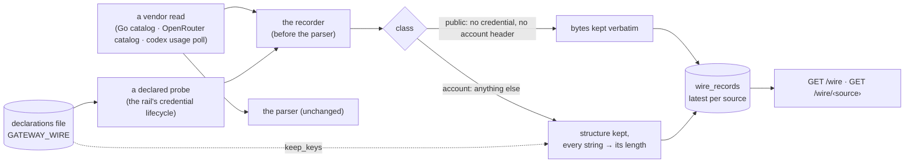

# GET /wire — what the gateway's vendors actually answered

The gateway parses every vendor answer into a normalised snapshot and used to drop the bytes. The
[wire record](../glossary.md#wire-record) keeps each vendor read's **latest** answer, per
[wire source](../glossary.md#wire-source), in the gateway's own store, so a wire shape is mined from a
recorded answer — never hand-copied, never invented. `GET /wire` and `GET /wire/<source>` are the
read-only door, like `/catalog/*`: they take no credential and return none.

## Interface — the machine half

**[`wire.schema.json`](wire.schema.json)** holds the index's shape, a record's provenance, the declarations file's shape (`$defs.wire_declarations`) and the one
error code; the service **imports it**. A member's body is the stored bytes, not JSON of that schema.

| Requirement | Governs (schema) | Error codes | Status |
|---|---|---|---|
| [GW-WIRE-RECORD](#gw-wire-record) | `$defs.provenance` | — | v0 — the account class's allowlist is in [GW-WIRE-PROBE](#gw-wire-probe) |
| [GW-WIRE-VIEW](#gw-wire-view) | `index_output`, `member_headers` | `wire-not-recorded` (404) | v0 |
| [GW-WIRE-PROBE](#gw-wire-probe) | `$defs.wire_declarations` | — | v0 |

## Flow overview

## Requirement index

| Requirement | Section | Status |
|---|---|---|
| [GW-WIRE-RECORD](#gw-wire-record) | the recorder | v0 |
| [GW-WIRE-VIEW](#gw-wire-view) | the door | v0 |
| [GW-WIRE-PROBE](#gw-wire-probe) | the declared probe | — |

## GW-WIRE-RECORD

Every vendor read the gateway makes registers a [wire source](../glossary.md#wire-source) and a class,
and hands its answer to the recorder before its parser reads it; the parser, the snapshots and the
views read exactly what they read before. The registered sources are `go-models-dev`, `go-console-config`
and `go-docs` (the Go catalog's three reads), `openrouter-endpoints`, `openrouter-mcp-rankings` and
`openrouter-mcp-benchmarks` (the OpenRouter catalog's reads — `openrouter-endpoints` is one read per
candidate model, so it keeps the last model's answer) and `codex-usage` (the usage poll).

A source is `public` when the read sent no credential and no account header: the answer's bytes are
kept verbatim. Every other read is `account`: the answer is sanitised structurally before it is
persisted — keys, numbers, booleans and nulls stay, every string becomes `{"len": n}` ⚖ (an unseen
payload can carry identity nobody listed, so a scrub of known values is rejected). The class is
decided by what the read sent, not by the caller's declaration: a read that carried a credential is
never `public`. Only the latest answer is kept, one row per source; a failed read (a non-200, an
unreachable vendor) leaves the last good answer in place and records the failure beside it ⚖. An
answer is bounded (`GATEWAY_WIRE_MAX_BYTES`, default 1048576): a `public` answer over the bound is
cut and marked `complete: false`; an `account` answer over it keeps no structure (a cut document has
none) and records `over-bound`. An answer that echoes a credential the gateway holds is withheld whole.
The record is in the SQLite store and survives a restart. A recorder fault never takes a read down.
The `sha256` is the answer's digest as the vendor sent it.

Unverified — expected to hold, no row yet: an `account` answer over the bound records `over-bound`;
a recorder fault never takes a read down; the parsers, snapshots and views are unchanged; the sources
`go-docs`, `openrouter-endpoints`, `openrouter-mcp-rankings` and `openrouter-mcp-benchmarks` record as
described.

**World: [policy-codex](../worlds/README.md#policy-worlds)** — every world's gateway starts from the Go
catalog's fakes; the codex usage fake answers the observed shape (synthetic values, dummy identity).

#### A read's answer is kept

Legend: `read` = the answer the fake gives at the stated time; `credential_sent` = the credential the
read carries; `source_class?` = the class the source is recorded under; `stored?` = the record's bytes; `sha256?` = the record's digest; `fetched_at?` =
the record's time.

| description | source | read | credential_sent | source_class? | stored? | sha256? | fetched_at? |
|---|---|---|---|---|---|---|---|
| a public read's bytes are kept verbatim | `go-models-dev` | `catalog-ok at T0` | none (no credential, no account header) | `public` | the fake's bytes, byte-identical | the bytes' sha256 | `T0` |
| a later answer replaces it | `go-models-dev` | `catalog-ok at T0, then catalog-trimmed at T0 + 21600 s` | none (no credential, no account header) | `public` | the later bytes | the later bytes' sha256 | `T0 + 21600 s` |
| a shape the parser refuses is still recorded ⚖ | `go-models-dev` | `catalog-malformed at T0` | none (no credential, no account header) | `public` | the malformed bytes | their sha256 | `T0` |
| an account read keeps its structure and no string value ⚖ | `codex-usage` | `the observed usage shape at T0` | the codex bearer and account header | `account` | every key, number and boolean; every string `{"len": n}` | the raw bytes' sha256 | `T0` |

#### A failed read, a bound, a restart

Legend: `max_bytes` = the recorder's bound; `last_ok?` = the kept answer's bytes; `last_error?` = the
failure recorded beside it; `complete?` = whether the kept answer is whole (a source with no kept
answer is whole).

| description | source | read | max_bytes | last_ok? | last_error? | complete? |
|---|---|---|---|---|---|---|
| a failed read keeps the last good answer and records the failure beside it ⚖ | `go-models-dev` | `catalog-ok at T0, then catalog-503 at T0 + 60 s` | `1048576` | T0's bytes | status 503 at the later time | `true` |
| an unreachable vendor records no bytes | `go-models-dev` | `catalog-down at T0` | `1048576` | none | unreachable | `true` |
| an answer over the bound is cut and says so ⚖ | `go-models-dev` | `catalog-ok at T0` | `600` | the first 600 bytes | none | `false` |
| a record survives a restart | `go-models-dev` | `catalog-ok at T0, restart at T0 + 3600 s` | `1048576` | T0's bytes | none | `true` |

#### The credential never lands in a record

Legend: `credential_sent` = the credential the read carries; `source_class?` = the class the source is
recorded under; `last_error?` = the failure the recorder notes beside the source (`status <n>` = a non-200
answer, of which no byte is kept; `withheld` = a 200 answer that echoed a credential the gateway holds, no part of it kept); `record_fields_with_key?` =
the number of the stored record's fields (body included) that contain the Go key;
`log_lines_with_key?` = the log lines that do.

| description | source | read | credential_sent | source_class? | last_error? | record_fields_with_key? | log_lines_with_key? |
|---|---|---|---|---|---|---|---|
| a vendor answer that echoes the key is withheld ⚖ | `go-console-config` | `config-401-echo` | `the Go key as a bearer` | `account` | `status 401` | `0` | `0` |
| a good answer that echoes the key is withheld whole ⚖ | `go-console-config` | `config-200-echo` | `the Go key as a bearer` | `account` | `withheld` | `0` | `0` |
| a read that carried a credential is never class public ⚖ | `go-console-config` | `config-ok` | `the Go key as a bearer` | `account` | `none` | `0` | `0` |

#### The account class's allowlist

Legend: `keep_keys` = the source's allowlist in the declarations file; `answer` = what the fake upstream
answers; `stored?` = the record's bytes; `load?` = whether the declarations load (`—` = no file is read).

| description | keep_keys | answer | stored? | load? |
|---|---|---|---|---|
| an allowlisted key keeps its string, every other string its length ⚖ | `[slug]` | `{"slug": "fixture-model", "note": "hello"}` | `"slug": "fixture-model"`, `"note": {"len": 5}` | loads |
| no allowlist keeps no string | `[]` | `{"slug": "fixture-model", "note": "hello"}` | both strings as lengths | loads |
| an allowlisted key is kept at any depth and in a list | `[slug]` | `{"a": {"slug": "x"}, "slug": ["p", 3], "other": ["q"]}` | `{"a": {"slug": "x"}, "slug": ["p", 3], "other": [{"len": 1}]}` | loads |
| no declarations file keeps no string ⚖ | `GATEWAY_WIRE` unset, source `codex-usage` | the observed usage shape | every string as its length | — |
| an allowlisted value that matches a credential pattern is still withheld ⚖ | `[slug]` | `{"slug": "sk-ant-oat-FAKE…"}` | the value as its length | loads |

#### What an allowlist may not name

Legend: `keep_keys` = the allowlist in the declarations file; `load?` = whether the declarations load. The
floor is the observed identity fields and anything token-, cookie-, secret-, password-, credential-,
authorization- or email-named ⚖.

| description | keep_keys | load? |
|---|---|---|
| an identity key can never be allowlisted ⚖ | `[email]` | refused, naming email |
| an account id is an identity key | `[account_id]` | refused, naming account_id |
| a user id is an identity key | `[user_id]` | refused, naming user_id |
| a token-named key is never allowlisted | `[access_token]` | refused, naming access_token |
| a cookie-named key is never allowlisted | `[Set-Cookie]` | refused, naming Set-Cookie |
| a secret-named key is never allowlisted | `[client_secret]` | refused, naming client_secret |

Evidence — latest run

--8<-- "GW-WIRE-RECORD.md"

## GW-WIRE-VIEW

`GET /wire` answers the index: for every source with a record, its provenance (class, url, status,
bytes, sha256, fetched_at, age_s, complete, and the last failure) and no body. `GET /wire/<source>` answers one
member: the stored bytes as the body, the provenance in `x-wire-source`, `x-wire-class`,
`x-wire-sha256`, `x-wire-fetched-at` and `x-wire-complete`. A source with no good answer is not an
empty answer: `404 wire-not-recorded`. The door asks for no credential ⚖ (like `/catalog/*`, it
is reachable by whoever reaches the gateway's port, so it may carry nothing a credential would
protect — which is what the `account` class's sanitising is for), and returns none: every
`account` body is structure and lengths.

Unverified — expected to hold, no row yet: an `account` body served through the door is its sanitised
structure; a source whose every read failed answers 404.

**World: [policy-codex](../worlds/README.md#policy-worlds)** — as GW-WIRE-RECORD.

#### The door

Legend: `recorded` = the answers on file at T0; `call` = the request made; `answer?` = the response's body (a JSON shape, or the stored bytes) and the headers it names.

| description | recorded | call | status? | answer? |
|---|---|---|---|---|
| the index lists every source with its provenance and no body | `go-models-dev and go-console-config at T0` | `GET /wire` | `200` | `sources` = one entry per source on file, each exactly source, class, url, status, bytes, sha256, fetched_at, age_s, complete, last_error, last_error_at; no body |
| one member is its stored bytes, the provenance in headers ⚖ | `go-models-dev at T0` | `GET /wire/go-models-dev` | `200` | body = the stored bytes; headers x-wire-source, x-wire-class, x-wire-sha256, x-wire-fetched-at, x-wire-complete |
| a source never read is not an empty answer | `nothing for go-docs` | `GET /wire/go-docs` | `404` | `wire-not-recorded` |
| the door asks for no credential ⚖ | `go-models-dev at T0` | `GET /wire/go-models-dev`, no token | `200` | body = the stored bytes, `x-wire-class` = `public` |
| the view's shape is the schema's | `go-models-dev at T0` | `GET /wire` | `200` | exactly the schema's required keys |

Evidence — latest run

--8<-- "GW-WIRE-VIEW.md"

## GW-WIRE-PROBE

A [wire source](../glossary.md#wire-source) the gateway has no call for yet is **declared**, in the
declarations file the path `GATEWAY_WIRE` names — one file of its own, never the machine-merged
`policy.json` and never code (the operator's read ⚖: a probe widens what the deployed gateway reads
upstream, and an allowlisted key widens what a record keeps). A declaration names a source, a declared
rail, a GET path on that rail's upstream, an optional query and an interval. The read goes through the
rail's own credential lifecycle — the bearer and the account header the rail's data plane would send,
never a refresh of its own — and is recorded as an `account` source, so its answer is structure and
lengths. The bytes are opaque to the probe: it assumes no shape. GET only, never an inference path, never
a host the rail does not already reach: the loader refuses a rail the policy does not declare, an absolute
URL, an inference path (`/responses`, `/chat/completions`, `/messages`, …) and any key that is not
`rail`, `path`, `query` or `interval_s` — a method is not a key ⚖. No file, or an empty one, means no
probe goes out and no account string is kept ⚖. A probe reads at start unless its record is younger than
its interval (then at the record's time + the interval), so a restart inside the interval reads nothing; a
read with no usable credential fetches nothing and counts `no-credential` ⚖. `gateway_wire_probe_total{source, outcome}`
counts each probe (`ok`, `no-credential`, `fetch-failed`); `source` only takes names the file declares. A
`wire` key in the policy refuses the load ⚖. A malformed declarations file refuses to start, like a
malformed policy ⚖. The same file holds the account class's allowlist (`keep_keys`): the string values
under those keys are kept verbatim ⚖, every other string stays its length, and a value that matches a
credential pattern ([GW-REDACT](sessions.md#gw-redact)'s) stays a length even under an allowlisted key. An allowlist
can never name an identity key (`email`, `account_id`, `user_id`, anything token-, cookie-, secret-,
password-, credential- or authorization-named — the floor ⚖).

Unverified — expected to hold, no row yet: the identity-key set beyond the floor — the usage payload's
identity fields are the one observed case; whether `chatgpt-account-id` is needed on `/models` (the
2026-10-29 hand probe went through the data plane's headers, so the probe sends it); a malformed
declarations file at start refuses it; the real `/models` shape is not asserted here — it is what the
deployed probe will record. Only the `codex` rail has a credential lifecycle a probe can ride; the loader
refuses another rail naming it.

**World: [policy-codex](../worlds/README.md#policy-worlds)** with the declarations world
[wire-codex](../worlds/README.md#policy-worlds) — probe `codex-models` = rail `codex`, path `/models`,
query `client_version=0.155.0`, interval 21600 s; the fake `/models` answer is an obviously synthetic body.

#### A declared probe is read

Legend: `declarations` = the file `GATEWAY_WIRE` names; `lifecycle` = the rail's credential at the
read; `at` = the clock when the schedule runs; `request?` = what the fake upstream received;
`outcome?` = the probe counter's outcome; `recorded_class?` = the class the source is recorded under.

| description | declarations | lifecycle | at | request? | outcome? | recorded_class? |
|---|---|---|---|---|---|---|
| a declared probe goes out through the rail's lifecycle | wire-codex | a valid credential | T0 | `GET {CODEX_UPSTREAM}/models?client_version=0.155.0`, `Bearer <the lifecycle's access token>`, `chatgpt-account-id` | ok | account |
| no file, nothing read ⚖ | `GATEWAY_WIRE` unset | a valid credential | T0 | none | — | — |
| an empty file, nothing read | `{}` | a valid credential | T0 | none | — | — |
| no usable credential, no fetch ⚖ | wire-codex | the lifecycle refuses | T0 | none | no-credential | — |
| an upstream error is counted and recorded as the failure | wire-codex, the fake answers 503 | a valid credential | T0 | as the first row | fetch-failed | account |
| a restart inside the interval probes nothing at start | wire-codex, a record at T0 | a valid credential | restart at T0 + 3600 s | none | — | account |

#### What a probe may be

Legend: `probe` = the declaration under test; `load?` = whether the declarations load.

| description | probe | load? |
|---|---|---|
| a probe is a GET on a declared rail's upstream ⚖ | rail `codex`, path `/models` | loads |
| a rail the policy does not declare refuses the load | rail `zen`, path `/models` | refused, naming the rail |
| an absolute URL refuses the load ⚖ | path `https://elsewhere.test/models` | refused, naming path |
| an inference path refuses the load ⚖ | path `/responses` | refused, naming path |
| a chat path is an inference path too | path `/chat/completions` | refused, naming path |
| a method is not a key | `method: POST` | refused, naming method |
| a query rides `query`, not the path | path `/models?x=1` | refused, naming path |
| a scheme-relative path is a host | path `//elsewhere.test/models` | refused, naming path |
| a dot-dot segment is refused | path `/../responses` | refused, naming path |
| an interval under a minute is refused | `interval_s: 5` | refused, naming interval_s |
| a query value is a string | `query: {a: 1}` | refused, naming query |
| a name the gateway already reads is refused | probe named `go-docs` | refused, naming go-docs |
| an unknown key of the file is refused | top-level `surprise` | refused, naming surprise |
| a file that is not an object is refused | `[]` | refused, naming object |

#### The declarations have one home

Legend: `declared_in` = where the probe is declared; `load?` = whether the gateway starts.

| description | declared_in | load? |
|---|---|---|
| a probe in the declarations file loads | the file `GATEWAY_WIRE` names | loads |
| a `wire` key in the policy refuses the load ⚖ | `policy.json`, key `wire` | refused, naming wire |
| a declarations file that is not JSON refuses to start ⚖ | the file `GATEWAY_WIRE` names, not JSON | refused, naming JSON |

Evidence — latest run

--8<-- "GW-WIRE-PROBE.md"

