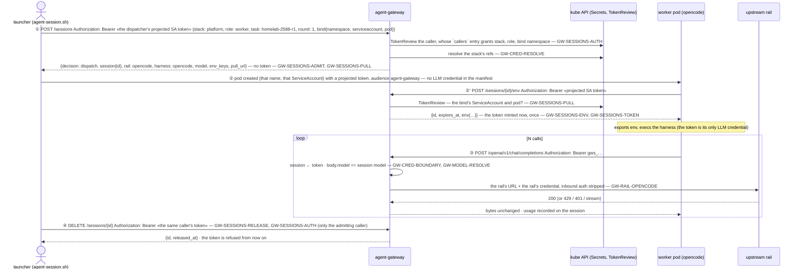

# UC-1 — a worker ride: admit → env → N LLM calls → release

**Persona:** the launcher (`agents/agent-session.sh`) dispatching one fixer round on the
`platform` stack. **Its one question:**

> *May `homelab-2588-r1` run now — with which harness, and what goes in the pod's env?*

Today the launcher answers half of that itself (84 self-routing sites across six scripts,
[context-and-autonomy.md §Interfaces](../../../docs/spikes/context-and-autonomy.md)); after this
use case it asks once — authenticated as its dispatcher's ServiceAccount, naming the pod it will
create (`bind`) — the pod pulls its own `env`, and the launcher calls `DELETE` from its finalize hook.
Everything in the island exists to make this ride work end-to-end with **no model name chosen
by the caller and no credential in the pod**.

## Flow

Every numbered step is a requirement on an endpoint page; the request/response shapes are the
schemas beside them.

## Walk-through data (the golden thread)

The data lives in [`uc-1/`](uc-1/) and is carried through every stage. Each stage's expected
output is committed next to its input; placeholders in guillemets (`«id»`, `«token»`, `«T»`)
are values the run produces — tests assert the field is present and has the declared shape
(the token matches `^gws_[A-Za-z0-9_-]{32}$`; `expires_at` = `created_at` + 14400 s under
`policy-default`). World: [`policy-default`](../worlds/policy-default.json) with every ref
resolvable; upstream behaviour `upstream-ok` unless the pair says otherwise.

| Stage | Input | Expected output | Requirements |
|---|---|---|---|
| ① admit (unbound — the specs reviewer's shape) | [`uc-1/request.json`](uc-1/request.json) | [`uc-1/expected-response.json`](uc-1/expected-response.json) | GW-SESSIONS-ADMIT, GW-SESSIONS-ENV, GW-SESSIONS-TOKEN, GW-CRED-RESOLVE |
| ① admit, bound (the worker launcher's shape) | [`uc-1/bind-request.json`](uc-1/bind-request.json), `Authorization: Bearer «the dispatcher's projected SA token»` | [`uc-1/bind-response.json`](uc-1/bind-response.json) | GW-SESSIONS-AUTH, GW-SESSIONS-ADMIT, GW-SESSIONS-PULL |
| ②′ env pull | `POST /sessions/«id»/env`, `Authorization: Bearer «projected SA token»` | [`uc-1/pull-response.json`](uc-1/pull-response.json) | GW-SESSIONS-PULL, GW-SESSIONS-ENV, GW-SESSIONS-TOKEN |
| ③ data plane, [Go rail](../../../docs/agents/chainless-redesign.md) (the ride's own) | [`uc-1/opencode-request.json`](uc-1/opencode-request.json) | [`uc-1/opencode-response.json`](uc-1/opencode-response.json) | GW-RAIL-OPENCODE, GW-MODEL-RESOLVE, GW-CRED-BOUNDARY |
| ③ data plane, OpenRouter rail (the same worker when Go is full) | [`uc-1/openrouter-request.json`](uc-1/openrouter-request.json) | [`uc-1/openrouter-response.json`](uc-1/openrouter-response.json) | GW-RAIL-OPENROUTER, GW-MODEL-RESOLVE, GW-CRED-BOUNDARY |
| ③ data plane, subscription rail (a prober's claude harness, for the anthropic dialect) | [`uc-1/anthropic-request.json`](uc-1/anthropic-request.json) | [`uc-1/anthropic-response.json`](uc-1/anthropic-response.json) | GW-RAIL-ANTHROPIC, GW-MODEL-RESOLVE, GW-CRED-BOUNDARY |
| ④ release | `DELETE /sessions/«id»` | [`uc-1/release-response.json`](uc-1/release-response.json) | GW-SESSIONS-RELEASE |

### Canonical calls

| # | Call | Expected |
|---|---|---|
| Q1 | `POST /sessions` with `request.json` (all rails empty) | `dispatch` on `opencode`, harness `opencode`, model `opencode-go/deepseek-v4.1-flash`, the three openai-dialect env vars, `context_tokens: 1000000` |
| Q2 | the pod's `POST /openai/v1/chat/completions` with the Q1 token, body model `deepseek-v4.1-flash` | the fake Go upstream receives `…/zen/go/v1/chat/completions` with `Authorization: Bearer «OPENCODE_GO_API_KEY»` and no `gws_` anywhere; the pod gets the upstream body byte-identical; the session row shows `requests: 1, tokens_in: 12, tokens_out: 7` |
| Q3 | Q1 again with `opencode` at 3/3 | `dispatch` on `openrouter`, model `deepseek/deepseek-v4-flash`; its call reaches `https://openrouter.ai/api/v1/chat/completions` with the stack key |
| Q4 | `POST /sessions {stack: platform, role: prober, task: probe-platform, round: 0}` then the pod's `POST /anthropic/v1/messages` with body model `claude-haiku-4-5` | `dispatch` on `anthropic`, model `claude/haiku`; the fake Anthropic upstream receives `Authorization: Bearer «AUTH_TOKEN»` and `anthropic-beta: oauth-2025-04-20`; the body model is untouched |
| Q5 | `DELETE /sessions/«Q1 id»`, then Q2 again | `{id, released_at}`; the repeat is 401 `session-released`; `gateway_sessions_active{rail="opencode"}` is back to 0 |
| Q6 | Q1 with every allowed rail full | 200 `{decision: defer, reason: rail-capacity, retry_after_s}` — not an HTTP error |
| Q7 | `bind-request.json`, then the bound pod's `POST /sessions/«id»/env`, then the same pull again | a dispatch with `env_keys: [OPENCODE_CONFIG_CONTENT]` and no `gws_`; the pull answers Q1's `env` with a token minted then; the repeat is 409 `env-already-delivered` |
| Q8 | Q7's admission under `control_plane_auth: enforce` ([`policy-enforce`](../worlds/policy-enforce.json)), once with the platform loop's token and once with none | the first dispatches and the row's `caller` is `system:serviceaccount:platform-agents:agentstack-loop`; the second is 401 `caller-unauthenticated` ([GW-SESSIONS-AUTH](../endpoints/sessions.md#gw-sessions-auth)) |

## What this use case does not cover (so nobody infers it)

The ADR-096 ladder, strikes and cooldowns (the model is the policy's, every time); the
capacity defers (window utilization, 429 latch, Go window draw — rows on
[GW-SESSIONS-ADMIT](../endpoints/sessions.md#capacity--the-ladders-capacity-half), not this spine); the git token (the pod gets it from the broker, not from here — FU-269); the `codex`
harness and its rail ([openai-responses.md](../endpoints/openai-responses.md)); a second
replica. Each is a `⚑ gap` row on the requirement it belongs to.
